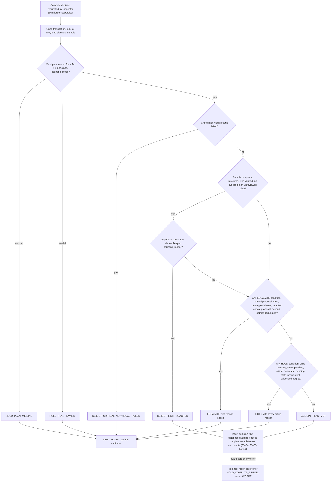
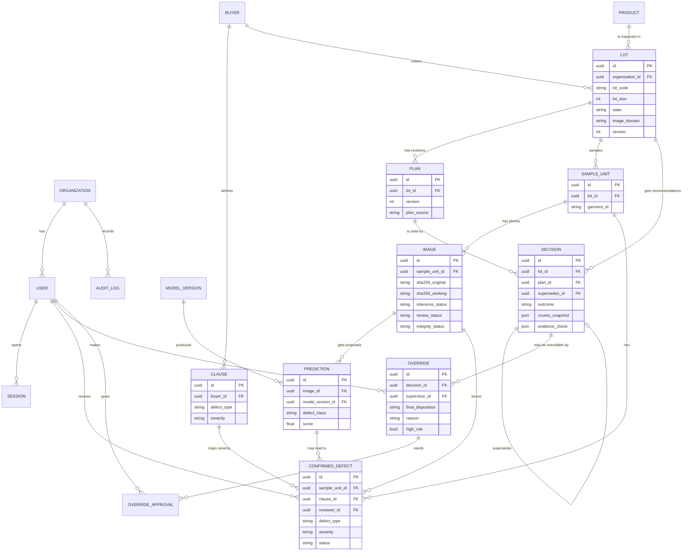

# Lotline — Product Requirements Document (PRD)

## 1. Document Information

| Field | Value |
|---|---|
| Product name | Lotline |
| Document title | Lotline Product Requirements Document, Version 1 scope |
| Document version | 0.3 (reconciliation revision) |
| Status | **Draft for review.** Nothing described here has been built or reviewed by a third party. The only test evidence is the LL-01/LL-09 design spike on a reduced schema (39 checks, PostgreSQL 16.x and 18.7, 17 Nov 2026), listed in Appendix C of `security-v0_4.md` and Appendix E of `SYSTEM_DESIGN_v1_2.md`. Every other requirement is untested. |
| Created date | 15 November 2026 (version 0.1); revised 15 November 2026 (0.2); revised 17 November 2026 (0.3) |
| Document owner | TBD (project owner to be named at review) |
| Authoring note | Drafted by Claude (AI assistant) at the project owner's request, from the two source documents below. Owner review pending. |
| Intended audience | Project supervisor (reviewer), development team, QC domain reviewer |
| Source documents | **SRC-ARCH** = `lotline_research_prompt_v3_1.md` (decisions D1–D8, rules R1–R14; version 0.2 of this PRD named `lotline_architecture_prompt.md`; [A: same lineage, owner to confirm]). **SRC-SEC** = `security-v0_4.md` (Draft 0.4). **SRC-SD** = `SYSTEM_DESIGN_v1_2.md` (schema, state transitions, API). Decision log: `LOTLINE_DECISION_LOG.md`. This PRD owns product requirements and business rules (section 9); where another document restates a rule, this one wins and the difference is a defect. |

### 1.1 Revision history

| Version | Date | Change | Author |
|---|---|---|---|
| 0.1 | 15 Nov 2026 | First complete draft against security Draft 0.1 | Claude (for project owner) |
| 0.2 | 15 Nov 2026 | Re-based on security Draft 0.2: new requirement and test IDs, database-level decision guard, HOLD before ESCALATE precedence, second-Supervisor approval for high-risk overrides, HOLD not overridable, image-level review, canonical working copy and file-first upload, four-network deployment, progressive login delay, new session and backup assumptions. PRD business-rule IDs renamed `BR-` to `BRL-` to avoid clashing with SRC-SEC `BR-01` to `BR-10`. See Appendix D. | Claude (for project owner) |
| 0.3 | 17 Nov 2026 | Reconciled with Security 0.4, System Design 1.2 and Research Prompt v3.1: **one `n` per plan**, `counting_mode`, zone/size-band severity mapping, **critical non-visual gate**, **canonical decision precedence** (v3 §H) and canonical reason codes, **override policy** (ACCEPT and REJECT only; HOLD and ESCALATE never), execution architecture Option A (InferenceWorker plus DB-less Vision, manual mode never blocked), model self-test and append-only activation. Section 11 mirrors Security 0.4 rows. Not re-based line by line: see Appendix R. | Claude (for project owner) |

### 1.2 How to read this PRD

**Evidence labels.** Every statement that is not a plain requirement carries one of these labels.

| Label | Meaning |
|---|---|
| **Source-reported fact** | A fact stated in a source document (for security, SEC-F1 to SEC-F19). This PRD did **not** re-verify it. SRC-SEC section 14 states, per source, whether the page was read in full or only as a search excerpt; excerpt-based facts (F9, F12 to F14, F16 to F19) must be re-checked on the live page before quoting. |
| **Unverified (SEC-U#)** | A claim SRC-SEC itself could not verify (U1 to U14). It must not be relied on until checked. |
| **(S)** | After an assumption or decision: needs Supervisor or owner approval (SRC-SEC Appendix E, decisions S1 to S13). |
| **Assumption (ASM-xx, from SRC-SEC A1 to A20)** | A condition or number the team must confirm or change. Not a requirement until confirmed. |
| **Recommendation** | A proposed design choice. |
| **Proposed (PRO)** | A rule this PRD adds because the sources are silent. It is flagged in the Conflict and Gap Register (section 22.3, IDs `CG-xx`) and needs owner confirmation. |
| **TBD / OQ-xx** | Missing information. See Open Questions (section 22.2). |

**Priority.** Must = required for Version 1 completion. Should = expected in Version 1 unless cut by the owner. Could = optional in Version 1.

**Terminology.** "Supervisor" (capitalized) is the Lotline role. "Project supervisor" is the person reviewing this project. "Sample unit" is one garment. "Defective unit" is a sample unit with at least one confirmed defect. "Confirmed" always means confirmed by a human reviewer. "Plan" means the entered sampling parameters `(n; Ac, Re)` per class. "Detector" is the computer-vision model. "Recommendation" is the system's computed outcome. "Final disposition" is the recommendation unless a Supervisor override exists.

**What this PRD does not do.** It does not contain application code, benchmark results, dataset statistics, or ISO 2859-1 / ANSI/ASQ Z1.4 table values. It does not claim certification or completed penetration testing.

**Nature of the architecture source.** SRC-ARCH is written as a prompt that asks for dataset research and an architecture. It states product rules and module invariants (treated here as requirements), but it supplies **no completed research results**. Every dataset fact (BDFD9, AITEX AFID, MVTec AD, DAGM 2007, TILDA, RAW-FABRID) is therefore an unverified claim to check, and dataset selection is TBD.

---

## 2. Executive Summary

**What Lotline is.** Lotline is an AI-assisted garment quality-inspection and lot-acceptance decision-support web application for knitwear (Version 1: one knit family, tee or polo). It is not a fabric-scanning machine, not smart glasses, and not a factory ERP.

**Problem it solves.** A QC lead must decide whether to accept a buyer sample of a garment lot. The decision depends on counting *defective garments* by severity class and comparing the counts with the sampling plan's acceptance and rejection numbers (`Ac`, `Re`). Lotline makes that count traceable, consistent, and auditable, and it refuses to turn a missing or failed check into a clean result.

**Who needs it.** Knitwear QC leads and inspectors who photograph sampled garments; Supervisors who own sampling plans, buyer clause mapping, and overrides; Admins who manage accounts.

**How AI-assisted inspection works.**
1. An Inspector opens or creates a lot; a Supervisor has entered the sampling plan.
2. The Inspector photographs each sampled garment in a phone browser and uploads the photos.
3. A detector proposes visible defects (class, score, box). It proposes only. It has no severity output.
4. The Inspector reviews every image: confirm, edit, reject, or manually add a defect.
5. The server maps each confirmed defect type to a severity (critical, major, minor) through the buyer's clause list. An unknown clause means ESCALATE.
6. A deterministic engine counts defective garments per class (one garment counts once, at its highest confirmed severity) and compares each class with its `Ac` and `Re`.
7. The system recommends **ACCEPT**, **REJECT**, **HOLD**, or **ESCALATE**. A Supervisor may override only an ACCEPT or REJECT decision, with a mandatory reason; HOLD and ESCALATE are never overridden (they end when their cause is resolved). A high-risk override (to ACCEPT) needs a different Supervisor's approval; the original recommendation is kept and the report never prints an overridden ACCEPT as an ISO acceptance.
8. A one-page PDF report renders the stored decision row.

**Governing principle.** *AI proposes defects. Humans confirm defects. The deterministic sampling engine makes the recommendation. The AI never independently approves a lot.*

**Expected value (hypotheses, not measured results).** Consistent counting rules; an evidence trail (who confirmed what, with which model version); fewer silent failures; and a decision record a buyer or supervisor can audit. Values are validated through the metrics in section 18.

---

## 3. Problem Statement

### 3.1 Problems asserted by the source documents (not independently verified by this PRD)

| ID | Problem | Source |
|---|---|---|
| PB-01 | AQL is commonly misread as a percentage allowance (for example "2.5% may be defective"). The operative numbers are sample size `n`, acceptance number `Ac`, and rejection number `Re`. | SRC-ARCH rule 1 |
| PB-02 | Defects are counted as boxes or as defect instances instead of defective garments. Several defects on one garment must count once. | SRC-ARCH rule 2 |
| PB-03 | Severity (critical, major, minor) is a buyer decision, not an image property. Predicting it from pixels would be wrong. | SRC-ARCH rule 4 |
| PB-04 | A failed model, a blurry photo, or an empty detection list can be mistaken for "zero defects". | SRC-ARCH rule 5, SRC-SEC G2, G3 |
| PB-05 | Sampling tables are copyrighted and secondary sources disagree on cell values, so tables must not be reproduced or reconstructed. | SRC-ARCH rule 7 |
| PB-06 | Public defect datasets are mostly fabric or industrial-surface images (woven rolls, wide strips, industrial anomaly), far from a phone photo of a finished knit garment. | SRC-ARCH dataset section (claim; unverified) |
| PB-07 | A reviewer may click "confirm" on everything (review fatigue), and software cannot detect cherry-picked sampling. | SRC-SEC section 11 |

### 3.2 Assumptions about the current QC process that need validation with the QC lead

| ID | Assumption | Validation method |
|---|---|---|
| PA-01 | Today the QC lead counts defective garments by hand and records them on paper or spreadsheets. | Interview the QC lead (TBD) |
| PA-02 | Evidence for a past decision (which photo, which reviewer, which rule) is hard to reconstruct. | Interview; review sample records (TBD) |
| PA-03 | Buyers supply, or the factory holds, a clause list that classifies defect types as critical, major, or minor. | Obtain a real buyer clause list (OQ-04) |
| PA-04 | A licensed copy of the sampling standard, or the buyer's order, is available to the Supervisor who enters `(n; Ac, Re)`. | Confirm access (OQ-05) |
| PA-05 | Phone photos taken on a table or hanging garment under ambient light are enough for a human to judge the defect types listed for Version 1. | Staged-garment trial (section 17.14) |
| PA-06 | No baseline measurements (inspection time, error rates, rework) exist in the supplied documents. | Collect before claiming any improvement |

---

## 4. Product Vision and Goals

### 4.1 Vision

Lotline gives a knitwear QC lead a trustworthy, auditable decision aid for buyer samples: the machine finds candidates, people decide what is a defect, and a deterministic rule produces the recommendation. Lotline prefers a visible HOLD or ESCALATE to a confident but wrong ACCEPT.

### 4.2 Primary objectives

| ID | Objective | Linked rules |
|---|---|---|
| OBJ-01 | Produce a correct, repeatable recommendation from human-confirmed defective-unit counts and an entered plan. | BRL-01 to BRL-12 |
| OBJ-02 | Never convert a missing, failed, or uncertain check into a pass. | BRL-14, BRL-15, SEC G2, G3 |
| OBJ-03 | Keep every change that can affect a decision traceable (who, when, before, after, why). | SEC G4 |
| OBJ-04 | Keep uploaded files harmless and private, keep object-level access correct inside the organization, and keep internal services (database, inference) unreachable from places that do not need them. | SEC G6, G8, AZ-02 to AZ-04 |
| OBJ-05 | Be usable by an Inspector on a phone browser. | SRC-ARCH stack |
| OBJ-06 | Show honestly what the model was evaluated on, per image domain. | SRC-ARCH evaluation |
| OBJ-07 | Always show the system recommendation and any human override separately; an overridden ACCEPT is never shown as an ISO acceptance. | SEC G5, OV-06 |

### 4.3 Business goals (Version 1)

| ID | Goal | Note |
|---|---|---|
| BG-01 | Demonstrate end-to-end inspection of a lot on staged knit garments with a decision that matches a hand calculation. | Version 1 completion condition (section 17.14) |
| BG-02 | Demonstrate that a detector miss or failure leads to HOLD or ESCALATE, not ACCEPT. | Version 1 completion condition |
| BG-03 | Provide a design basis that can later be extended to factory photos and a second product without rewriting isolation or audit. | SRC-ARCH versions, SRC-SEC ORG-04 |

### 4.4 User goals

| Role | Goal |
|---|---|
| Inspector | Finish a sample quickly on a phone, with the system flagging what needs attention, and know exactly why a lot is HOLD. |
| Supervisor | Trust the counts, control the plan, make and justify overrides, and show an auditor the evidence. |
| Admin | Manage accounts safely and see system health without access to garment images. |

### 4.5 Success criteria for Version 1

| ID | Criterion | Source |
|---|---|---|
| SC-01 | At least eight staged garments are run end to end, and every outcome matches a hand calculation made with the entered plan. | SRC-ARCH versions |
| SC-02 | At least one forced detector miss produces HOLD or ESCALATE, never ACCEPT. | SRC-ARCH versions |
| SC-03 | All Must requirements in sections 7 and 11 pass their acceptance tests, or a documented exception is approved by the project owner. | This PRD |
| SC-04 | The essential security tests T-01 to T-54 (SRC-SEC section 10.1) are written, run, and pass on a test deployment. Optional tests O-01 to O-10 are scheduled, not required. | SRC-SEC section 10 |
| SC-05 | A restore drill from backup only succeeds: roles, counts, and sessions are correct, the reconciler marks missing files HOLD, and the encrypted copy is unreadable without the passphrase. | SRC-SEC T-49, T-50 |

### 4.6 Measurable KPIs

No numeric business target is supplied by the sources. All targets are **TBD** and need a baseline first. Metric definitions are in section 18.

| KPI | Definition | Target |
|---|---|---|
| KPI-01 Decision agreement on frozen mini-lots | Share of frozen mini-lot decisions equal to the hand-calculated outcome | TBD (recommendation: 100% on the Version 1 staged set; any miss is investigated) |
| KPI-02 False accept count (critical) | Frozen mini-lots where the system said ACCEPT but a human-confirmed critical defective unit exists | Recommendation: 0 tolerated; the failure that matters |
| KPI-03 HOLD rate and ESCALATE rate | Share of evaluated lots ending HOLD or ESCALATE | TBD; reported, not minimized by itself |
| KPI-04 Override rate and high-risk override rate | Overrides per decided lot; share flagged high-risk | TBD |
| KPI-05 Review completeness | Share of sample images with a human review result before any ACCEPT or REJECT | Must be 100% by construction (BRL-09, BRL-10) |
| KPI-06 Inspection time per image | Median time from upload to image review result | TBD; needs a manual baseline (PA-06) |
| KPI-07 Detector recall on holes and dropped stitches, per image domain | False-negative rate per domain on a frozen split | TBD; reported per domain, never pooled |

---

## 5. Target Users and Personas

Roles are **single** per user and enforced by the server (SRC-SEC section 6, AZ-02). Version 1 has one organization and fewer than about 25 users (A1).

### 5.1 Admin (system role, not a QC role — A4)

| Aspect | Description |
|---|---|
| Responsibilities | Create and disable users, change roles, issue temporary passwords, clear login counters, read the audit log, export audit data, watch system alerts, manage products and buyers, activate or roll back a model version (host command). |
| Goals | Keep accounts correct and the system healthy without touching inspection results. |
| Permissions | Everything marked "Admin = Yes" in section 5.4. |
| Restrictions | Cannot create lots, upload or view garment images, run inference, confirm defects, set image review results, compute decisions, override, or approve overrides. Cannot disable or demote the last active Admin. Cannot change own role. Cannot edit or delete audit, decision, or override rows. |
| Main workflows | W-01 create inspector account; W-02 login and logout; user lifecycle; audit read and export; W-15 view report (the Version 1 report holds no garment images, CG-04). |

### 5.2 Inspector

| Aspect | Description |
|---|---|
| Responsibilities | Create lots, register sample units (garments), photograph and upload, run inference, review every image, confirm or reject defects, set image review results, compute a recommendation, generate reports. |
| Goals | Complete the required sample with clear guidance on what is missing or blocked. |
| Permissions | Create lots; **write only to lots they created** (A5, S4); read all lots, reports, and images in the organization; upload, retake, withdraw (before decision), run inference, review, compute a decision on own lots. |
| Restrictions | Cannot enter or change the plan or clause list; cannot change a lot after a decision; cannot override or approve overrides; cannot view the audit log. Cannot set severity, reviewer, or counts. |
| Main workflows | W-03, W-05 to W-13, W-15, W-16. |

### 5.3 Supervisor

| Aspect | Description |
|---|---|
| Responsibilities | Enter and change the sampling plan (and the clause list, see CG-03), maintain products and buyers, write to any lot, withdraw images, review duplicate flags, override recommendations with a reason, approve or reject another Supervisor's high-risk override, read the audit log, archive lots. |
| Goals | Control the rule inputs and take documented responsibility for exceptions. |
| Permissions | Everything in section 5.4 marked Supervisor = Yes. |
| Restrictions | Cannot manage users or export the audit log. Cannot override a HOLD. Cannot approve own override. Cannot edit audit, decision, override, or approval rows. Cannot delete a lot that has a decision (archive only). An override on a lot where this Supervisor confirmed defects is flagged (AZ-07). |
| Main workflows | W-04, W-14, W-15, plus any Inspector workflow on any lot. |

### 5.4 Role-permission matrix (from SRC-SEC Draft 0.2, section 6)

"Own" = lots the user created (A5). "S#" marks a decision still needing owner approval (SRC-SEC Appendix E). A forbidden request returns 403 when the object exists and the user has no right, and 404 when the object does not exist or an ID chain does not match (AZ-02, AZ-03).

| Action | Admin | Inspector | Supervisor | Needs confirmation |
|---|---|---|---|---|
| Log in, log out, change own password | Yes | Yes | Yes | |
| Create or disable users, change roles, issue temporary passwords | Yes | No | No | |
| Clear login counters for a user | Yes | No | No | |
| Create or edit products and buyers | Yes | No | Yes | S10 |
| Create a lot | No | Yes | Yes | A4 |
| Edit lot metadata before a decision | No | Own | Yes | A5 (S4) |
| Change lot data or plan after a decision exists | No | No | Yes (creates a new decision) | |
| Enter or change plan (`n`, `counting_mode`, `Ac`, `Re` per class) | No | No | Yes | S11 |
| Edit buyer clause list | No | No | Yes | S11; Version 1 loading is CG-03 |
| View lots, details, reports | Yes | Yes | Yes | A5 (S4) |
| View garment images | No | Yes | Yes | A5 (S4) |
| Upload, retake, or withdraw an image (before decision) | No | Own | Yes | A5 (S4) |
| Request or repeat inference (enqueues a job) | No | Own | Yes | |
| Cancel a queued inference job (manual review) | No | Own | Yes | |
| Set the critical non-visual status (FR-DEC-016) | No | No | Yes | RP R13 |
| Confirm, edit, reject, or add a defect; set image review result | No | Own | Yes | A5 (S4) |
| Compute a decision | No | Own | Yes | |
| Override a decision (OV-01 to OV-04) | No | No | Yes | S5, S6 |
| Approve or reject a high-risk override | No | No | Yes (a different Supervisor) | S5 |
| View audit log | Yes | No | Yes | |
| Export audit log | Yes | No | No | |
| Activate or roll back a model version (host command) | Yes | No | No | |
| Break-glass password reset or Admin creation (host command) | Host operator | No | No | |
| Edit or delete audit, decision, or override rows | No | No | No | |
| Delete a lot that has a decision | No | No | No | |
| *Generate a report (PDF)* | No (view only) | Own | Yes | **PRO, CG-05.** Not in the source matrix |
| *Flag an image "needs retake"* | No | Own | Yes | **PRO.** Follows the confirm permission |

### 5.5 Non-user stakeholders

| Stakeholder | Interest |
|---|---|
| Buyer | Defines the clause list and the sampling plan in the order; receives or audits the report. Not a Lotline user in Version 1. |
| Host operator | Runs backup, restore, break-glass, model replacement, and TLS setup on the host. Not a Lotline role. |
| Project supervisor | Reviews this PRD and the demo. Not the Lotline "Supervisor" role. |

---

## 6. Product Scope

### 6.1 Version 1 — In scope

| # | Capability | Detail level |
|---|---|---|
| S1 | One organization; `organization_id` on users and lots; object-level access inside the organization | AZ-02, AZ-03, AZ-08 |
| S2 | One knit garment family (tee **or** polo; which one is OQ-06) | Single product family configured |
| S3 | Lot management: lot code, product, color, lot size, buyer, state | FR-LOT |
| S4 | Buyer and product records; buyer clause list | FR-LOT-005, FR-CLS |
| S5 | Sampling plan configuration (entered `(n; Ac, Re)` per class; default-plan assumption displayed) | FR-PLAN |
| S6 | Phone-browser capture and upload (JPEG, PNG); canonical working copy | FR-CAP |
| S7 | Detector proposes defects: one detector, no severity output | FR-VIS |
| S8 | Image-level uncertainty flags: blur, dark, low score, unknown class | FR-UNC |
| S9 | Human review: confirm, edit, reject, add manually; explicit review result per image | FR-REV |
| S10 | Severity through buyer clauses; unknown clause means ESCALATE | FR-CLS |
| S11 | Deterministic `Ac`/`Re` decision engine, three classes, with a database decision guard | FR-DEC |
| S12 | Outcomes ACCEPT, REJECT, HOLD, ESCALATE | FR-DEC |
| S13 | Supervisor override with audit trail, high-risk second approval, HOLD not overridable | FR-OVR |
| S14 | Inspection history (lot list, lot detail timeline, audit log) | FR-LOT-008, FR-AUD |
| S15 | One-page PDF report with mandatory override wording | FR-REP |
| S16 | Manual inspection when inference fails ("not inferred" state) | FR-VIS-006, FR-REV |
| S17 | Essential (Tier E) security controls of SRC-SEC section 5 | Section 11 |
| S18 | Docker Compose deployment on one machine with four networks; backup and restore | FR-OPS, NFR |

### 6.2 Out of scope (all versions unless a later version says otherwise)

| Excluded item | Reason or source |
|---|---|
| Multi-factory SaaS; multiple organizations in production | SRC-ARCH out of scope; composite organization keys and row-level security are deferred (AZ-09, DB-11) |
| Native mobile applications | SRC-ARCH |
| Worker surveillance | SRC-ARCH |
| Smart glasses; fabric-roll or line-scan scanning | SRC-ARCH |
| Factory ERP integration | SRC-ARCH |
| Microservices, message bus, Redis, Kubernetes | SRC-ARCH, SRC-SEC P6 (a separate inference process is allowed only so the site stays up when the model is down) |
| All garment types beyond one knit family | SRC-ARCH |
| Automatic lot approval by AI | Governing principle |
| Automatic retraining from user-confirmed data | Governing principle; SRC-SEC Appendix C |
| Training critical/major/minor from pixels | SRC-ARCH rule 4 |
| Tightened or reduced inspection switching | SRC-ARCH rule 8 |
| Double or multiple sampling | Not in the sources; single sampling only |
| OAuth, SSO, SIEM, high availability, certifications | SRC-SEC scope and section 11 |
| MFA, HEIC, antivirus or sandboxed decoder, point-in-time recovery | Deferred (SRC-SEC Appendix C) |
| Outbound email (password reset by Admin instead) | A13 |
| Reproducing or reconstructing any ISO 2859-1 / Z1.4 table | SRC-ARCH rule 7 |

### 6.3 Not automated (a person must do or decide)

1. Sample selection. Software cannot verify that garments were chosen at random (SRC-SEC section 11).
2. Confirming that a visible mark is a defect, and which type it is.
3. Setting each image's review result (reviewed with defects, or reviewed clean).
4. Entering the plan `(n; Ac, Re)` from a licensed standard or the buyer's order.
5. Maintaining the buyer clause list.
6. Deciding an ESCALATE case, and any override or override approval.
7. Retaking a bad photo.
8. Placing, hashing, and activating model files on the host.

### 6.4 Version 2 and later (ideas only; SRC-ARCH versions, SRC-SEC Appendix C)

Supervisor-edited clause list (UI); tuned image-quality gate; detection threshold chosen on a validation split; staged-versus-public results table; override list; TOTP for Admin and Supervisor (AUTH-10); hash chain, audit-blocking trigger, and signed audit exports (AUD-08, AUD-09); row-level security, composite organization keys, multi-organization tests (AZ-09, DB-11, O-10); non-pickle model serving and signed manifests (AI-12); HEIC support; antivirus scanning and a sandboxed decoder (UP-14); point-in-time recovery (BAK-08); perceptual-hash duplicate detection and a "selection method" record; container image scanning and SBOM review (DEP-12); calibration protocol (BRL-16); optional anomaly flag if dataset research shows added signal (never increments the AQL count). No detailed requirements are written for these.

### 6.5 Version 3 (ideas only)

Factory photos as their own test set; a second product; retraining on a curated, frozen data set (never automatic from user-confirmed data). Not designed here.

---

## 7. Functional Requirements

Each requirement has the fields requested in the brief. "Dependencies" lists related requirements, business rules (`BRL-xx`, section 9), SRC-SEC IDs (section 11; for example `AUTH-04`, `BR-07`, `OV-03`), and entities (section 13). Test IDs: `T-nn` and `O-nn` are SRC-SEC Draft 0.2 tests (section 10); `TC-xxx` are PRD tests defined in section 17. Numeric limits marked *(A#)* are SRC-SEC assumptions pending owner confirmation (section 22.1).

### 7.1 Identity and access (module: Identity)

| Requirement ID | Feature | Description | Actor | Priority | Acceptance Criteria | Dependencies |
|---|---|---|---|---|---|---|
| FR-AUTH-001 | Email and password login | The system authenticates a user by email and password. Unknown email, wrong password, disabled account, and an account in a delay window return the **same generic response and status**. For an unknown email the server still runs a dummy hash so timing is similar. | Any user | Must | Four failure cases are indistinguishable by body and status; timing difference is within a tolerance set in the test plan (T-01, T-02). | AUTH-04 |
| FR-AUTH-002 | Password policy and size limit | On set or change the server: rejects more than 128 characters **before** hashing; requires at least 15 characters; applies no composition rules; accepts ASCII, spaces, and Unicode with NFC normalization before hashing; sets no periodic expiry; allows paste and password managers; checks a blocklist (common and breached passwords plus "lotline", the email, and the display name) and shows the reason; has no hints or security questions. | Any user, Admin | Must | 14 and 129 characters rejected; 15 and 128 accepted; spaces and Unicode accepted; common and context-word passwords rejected with a reason (T-03). | AUTH-02, AUTH-03, F2 |
| FR-AUTH-003 | Password hashing | Passwords are stored only as Argon2id hash strings at or above an OWASP minimum row (for example 19 MiB, t=2, p=1), with a random salt and full parameters in the string. The team benchmarks on the real host so one verification stays well under one second. At most 2 verifications run at the same time *(A19)*; extra requests wait or fail generically. Hashes are re-computed at login when parameters are raised. | System | Must | Database holds an Argon2id string; no plaintext in database, dump, or logs (T-04); parallel login burst stays within the limit (O-05). | AUTH-01, AUTH-02, F1 |
| FR-AUTH-004 | Progressive login delay | The failure counter belongs to the **account key** (normalized email text, whether or not the account exists). No delay for failures 1 to 4. From failure 5, attempts are rejected for 30 seconds, doubling per failure up to 15 minutes, **without checking the password** during the wait. A successful login resets the counter. | System | Must | Wait applies even with the correct password; works after the wait; an unknown email behaves the same (T-05). | AUTH-05, A9 (S2), F3, F4 |
| FR-AUTH-005 | Lockout denial-of-service controls | There is no hard lock before 100 consecutive failures; at 100 password login is disabled for that account until an Admin resets it. The Admin is alerted at 10 failures, and on repeated failures against any Admin or Supervisor account. The proxy limit per IP is coarse (60 login requests per minute *(A19)*) because phones may share one address. An Admin can clear counters. | System, Admin | Must | A second-IP attacker cannot hold a Supervisor out beyond the 15-minute delay cap; at 100 failures an Admin reset restores access (T-06). | AUTH-06, A18 |
| FR-AUTH-006 | Server-side sessions | Login creates a server-side session whose cookie carries a random identifier and a random secret verifier (verifier at least 128 bits). The database stores the identifier and the SHA-256 of the verifier; lookup is by identifier with constant-time comparison; the identifier alone is never accepted. Cookie: `__Host-` prefix, `Secure`, `HttpOnly`, `SameSite=Strict`, `Path=/`, no `Domain`, no `Max-Age`. | System | Must | Cookie attributes verified; sessions table holds no usable token (T-01, T-11, T-13). | SES-01, SES-02, F5, CG-01 |
| FR-AUTH-007 | Session timeouts | Idle timeout 30 minutes and absolute timeout 8 hours *(A10, S1)*, enforced on the server. Last-seen is updated at most once per minute. An expired session returns 401. | System | Must | Short-timeout test configuration returns 401 after idle and after absolute expiry (T-09). | SES-03 |
| FR-AUTH-008 | Session ID lifecycle | A new session ID is issued at login, password change, and role change. Session IDs are accepted only from the cookie; an unknown ID is treated as anonymous and logged. | System | Must | Planted cookie and URL-carried ID ignored; new ID after login (T-11). | SES-04 |
| FR-AUTH-009 | Logout and revocation | Logout deletes the server session (all IDs of that session). Password change, password reset, user disable, and role change revoke the user's other sessions at once. | Any user, Admin | Must | Replayed cookie returns 401; second session dies on password change, disable, role change (T-10). | SES-05 |
| FR-AUTH-010 | No browser token storage | No token is placed in `localStorage` or `sessionStorage`. Authenticated and sensitive responses carry `Cache-Control: no-store`. | System | Must | Header and storage inspection (T-13). | SES-06 |
| FR-AUTH-011 | Session logging | Session creation, renewal, destruction, expiry, and invalid-ID attempts are logged using the internal session row ID, never the raw cookie. | System | Must | No raw token in logs or audit rows (T-47). | SES-07, AUD-05 |
| FR-AUTH-012 | CSRF protection | The server creates a per-session synchronizer token. The React app reads it from a JSON response (not a cookie) and sends it in a custom header on every non-GET request, including photo uploads; comparison is constant-time. `Origin` is checked against a **configured** public origin (not `Host` or `X-Forwarded-Host`); a missing or `null` `Origin` is accepted only with a valid token; unsafe requests with `Sec-Fetch-Site: cross-site` are rejected. Login requires JSON content type, the custom header, and the origin check. GET, HEAD, and OPTIONS never change state. | System | Must | Missing token, wrong origin, no origin and no token, cross-site fetch metadata, login CSRF, and multipart upload from another site all return 403 (T-12). | CSRF-01 to CSRF-04, F6 |
| FR-AUTH-013 | XSS prevention | User text (lot codes, notes, filenames) is never rendered as raw HTML. The proxy sets a restrictive Content Security Policy. React code never builds request URLs or methods from URL parts or hash fragments. | System | Must | Script text in a lot code and a note stays inert (T-12, O-03). | CSRF-04, CSRF-05, U5, U7 |
| FR-AUTH-014 | First Admin and break-glass | There are no default accounts. The first Admin is created by a host command run by the operator (it asks for a password and applies the password policy). The same command can reset any password or create an Admin when all Admins are locked out; it writes an audit row with actor `host-operator` and needs host shell access. | Host operator | Must | Reset works and writes an audit row (T-08). | AUTH-07, A6 |
| FR-AUTH-015 | Temporary passwords | The server generates a random password (at least 16 characters from a CSPRNG), shows it once to the Admin, stores only its hash, sets "must change", and expires it after 24 hours *(A19)*. Until changed, the session can call only change-password and logout. A reset revokes all sessions of that user. | Admin, system | Must | Only the two routes work; expiry at 24 hours with a test clock; old sessions revoked (T-07). | AUTH-08 |
| FR-AUTH-016 | Account safeguards | The last active Admin cannot be disabled or demoted. Nobody can change their own role. Each user has exactly one role. | Admin | Must | Demotion refused (T-08); self-role-change returns 403 (TC-USR-03). | AUTH-09, AZ-07 |
| FR-AUTH-017 | Change own password | Any user can change their own password subject to FR-AUTH-002; the current password is required; other sessions are revoked. | Any user | Must | TC-USR-04; T-10. | AUTH-03, F4 |
| FR-AUTH-018 | MFA (TOTP) | TOTP for Admin and Supervisor is optional hardening and **not** part of Version 1. | Admin, Supervisor | Could (Version 2) | n/a | AUTH-10 (Tier O), A2 |
| FR-USR-001 | User administration | An Admin can create a user (email, display name, role), disable or re-enable a user, change a role, issue a temporary password, clear login counters, and unlock an account. Disabling or changing a role revokes that user's sessions at once. Users are never deleted (disable only). | Admin | Must | TC-USR-01, TC-USR-02; T-10; each Admin action produces one audit row. | AUTH-07 to AUTH-09, DB-03, AUD-01 |

### 7.2 Authorization and access scope (module: Identity)

| Requirement ID | Feature | Description | Actor | Priority | Acceptance Criteria | Dependencies |
|---|---|---|---|---|---|---|
| FR-AZ-001 | Deny by default | Every API route is registered with a required permission. An automated test lists all routes and fails if one has none. | System | Must | Route inventory test passes; every route returns 401 without login (T-14). | AZ-01 |
| FR-AZ-002 | One policy function | A single function `can(user, action, resource)` decides role permission, ownership, and lot state on **every** request, including reading images and reports. It returns 403 when the object exists but is forbidden and 404 when it does not exist. The UI may hide buttons, but the server is the authority. | System | Must | Table-driven test: every role by every action in section 5.4 equals the matrix (T-15). | AZ-02 |
| FR-AZ-003 | Nested ID chain | Resources are loaded through the policy layer. Nested IDs are checked along the chain image to sample unit to lot; a mismatched chain returns 404. This protects against IDOR between users **inside** the organization. | System | Must | Inspector B cannot read or edit Inspector A's lot or images; mismatched IDs return 404 (T-16). | AZ-03 |
| FR-AZ-004 | Identity fields from the session | `reviewer_id`, `created_by`, and `organization_id` come from the session. Request models list allowed fields and reject unknown ones. Clients cannot send role, status, severity, counts, hashes, or model version. | System | Must | Extra fields rejected or ignored; stored values come from session or server (T-17). | AZ-04, U13 |
| FR-AZ-005 | Lot lock | After a decision exists (CG-08), lot data, plan, and sample units are locked. Only a Supervisor can change them, and that creates a **new** decision; the old one stays. | System | Must | T-42; TC-LOT-06. | AZ-05, BR-09 |
| FR-AZ-006 | Optimistic concurrency | Lots, confirmed defects, and image review status carry version numbers. A stale write returns 409. | System | Must | T-42; TC-REV-07. | AZ-06 |
| FR-AZ-007 | Separation of duties | Admin has no QC action. Nobody changes their own role. A Supervisor override on a lot where that Supervisor confirmed defects is flagged. | System | Must | T-15, T-44; TC-OVR-05. | AZ-07, A4 |
| FR-AZ-008 | Single-organization scope | `organization_id` is stored on users and lots only; child tables reach it through the lot. Repository functions return only the caller's organization. | System | Must | T-16. | AZ-08, A1 |
| FR-AZ-009 | Multi-tenant machinery | Composite organization foreign keys, row-level security, and a two-organization test database are optional hardening, deferred. | Dev team | Could (Version 2) | O-10. | AZ-09, DB-11 |
| FR-AZ-010 | Denied requests audited | Every denied request (401 on a protected action, 403, blocked 404) writes an audit row (best effort, after the rollback) and an application log line with actor, route, and target ID. | System | Must | TC-AUD-04. | AUD-01, AUD-03 |

### 7.3 Lots and sample units (module: Lots)

| Requirement ID | Feature | Description | Actor | Priority | Acceptance Criteria | Dependencies |
|---|---|---|---|---|---|---|
| FR-LOT-001 | Create lot | An Inspector or Supervisor creates a lot with lot code, product, color, lot size (integer at least 1), and buyer. The creator is recorded and the lot state is OPEN. Admin cannot create lots. | Inspector, Supervisor | Must | Valid lot saved with creator and OPEN state; invalid lot size returns 422 (TC-LOT-01, TC-LOT-03). | Lot entity, AZ-05 |
| FR-LOT-002 | Lot code uniqueness | Lot code is unique (`UNIQUE (lot_code)`; one organization). | System | Must | Duplicate code returns a validation error; the database rule holds under parallel create (TC-LOT-02). | DB-04 |
| FR-LOT-003 | Edit lot metadata | Before a decision, an Inspector can edit own lots and a Supervisor any lot; edits use version numbers and write audit rows with before and after. After a decision, only a Supervisor can edit, and a new decision is created (FR-DEC-014). | Inspector (own), Supervisor | Must | T-16, T-42; TC-LOT-04. | FR-AZ-005, AUD-01 |
| FR-LOT-004 | Lot list and detail | All roles can list and open lots, with filters (state, buyer, outcome, date), pagination, and sort on an allowlist of columns. Lot detail shows header, plan, sample-unit and image-review progress, current recommendation, final disposition, and history. | All roles | Must | Hostile `sort` or `filter` value returns 422 and changes nothing (T-18); TC-LOT-05. | DB-01 |
| FR-LOT-005 | Products and buyers | An Admin or Supervisor creates and edits product records (Version 1: one knit family, OQ-06) and buyer records. Each buyer carries a clause list (FR-CLS-001). | Admin, Supervisor | Must | TC-LOT-08; audit row per change. | S10, Product, Buyer |
| FR-LOT-006 | Register sample unit | An Inspector or Supervisor registers a sample unit (one garment) in a lot with a garment ID unique within the lot. The number of units cannot exceed the required sample size (**PRO, CG-13**). Units are never deleted. | Inspector (own), Supervisor | Must | Duplicate garment ID rejected; registering above the required size rejected (TC-LOT-07). | FR-PLAN-004, FR-CAP-002 |
| FR-LOT-007 | Lot states and locking | Lot state moves OPEN to DECIDED when a final decision or an effective override exists (CG-08) and to ARCHIVED by a Supervisor. A lot with a decision cannot be deleted; archive only. | Supervisor | Must | TC-LOT-06; delete route absent or 403. | AZ-05, DB-03 |
| FR-LOT-008 | Inspection history | Lot detail shows a chronological history (uploads, inference results, image reviews, decisions, overrides, approvals, reports) built from stored rows and the audit log. | All roles | Should | Each event type in AUD-01 appears with actor and time (TC-LOT-09). | FR-AUD-001 |

### 7.4 Sampling plan (module: Plan)

Default plan assumption (**assumption, not a fact**): single sampling, normal inspection, General Inspection Level II; critical AQL 0 interpreted as `Ac = 0`, `Re = 1`; major AQL 2.5; minor AQL 4.0. Tightened and reduced switching are out of Version 1. This sentence must be repeated wherever the plan appears (FR-PLAN-002).

| Requirement ID | Feature | Description | Actor | Priority | Acceptance Criteria | Dependencies |
|---|---|---|---|---|---|---|
| FR-PLAN-001 | Plan record | A lot has one active plan with **one sample size `n`**, a **`counting_mode`** (BRL-23), and per class (critical, major, minor) an AQL label (informational), `Ac`, and `Re`; plus inspection level, sampling mode, source reference, version, `entered_by` and time. A plan is versioned and never edited in place. | Supervisor | Must | TC-PLAN-01, TC-PLAN-05. | BR-05, BR-15, A27 |
| FR-PLAN-002 | Assumption label | Wherever the plan is shown (plan screen, decision summary, report) the label "Default plan is an assumption: single sampling, normal inspection, General Inspection Level II; critical AQL 0 read as Ac 0 / Re 1; major 2.5; minor 4.0" appears, and the `(n; Ac, Re)` values are marked "entered by <user>". The report line also reads "(assumed default plan)" per OV-06. | System | Must | Text present on all three surfaces (TC-PLAN-06). | SRC-ARCH rule 8, OV-06 |
| FR-PLAN-003 | Plan entry by Supervisor only | Only a Supervisor enters or changes the plan (`n`, `counting_mode`, `Ac`, `Re`). Values are typed from a licensed standard or the buyer's order; the UI may pre-fill the labelled default plan assumption (BRL-21) but never a sampling table. | Supervisor | Must | TC-PLAN-04. | BR-05, AZ-07 |
| FR-PLAN-004 | Plan validation | The server requires integers; `n` at least 1; `Re = Ac + 1` for every class (Version 1, single sampling; BR-05); `counting_mode` present. Anything else is refused with 422 at entry and by database `CHECK` constraints; a plan that is invalid anyway gives HOLD `HOLD_PLAN_INVALID`. | System | Must | TC-PLAN-02, TC-PLAN-03, TC-PLAN-05. | BR-05, DB-04 |
| FR-PLAN-005 | Read-back before save | The plan screen shows a read-back summary (`n`, `counting_mode`, per class `Ac`, `Re`, source text) that the Supervisor must confirm before saving. | Supervisor | Must | TC-PLAN-01. | BR-05 |
| FR-PLAN-006 | Pure plan and counting module | The plan and counting module is a pure function `(plan, confirmed rows) -> per-class counts and result`. It imports no vision, ML, database, or web package (static import test) and is unit tested for boundary values. The same counting rule is mirrored in the SQL view `v_unit_class` and a property test compares both on random data (BR-03). | Dev team | Must | T-37, T-41; TC-PLAN-07. | BR-03, BR-05, DB-06 |
| FR-PLAN-007 | No sampling tables | The product, its configuration, seed data, tests, and documentation contain no reconstructed or copied ISO 2859-1 or ANSI/ASQ Z1.4 table, and there is no table lookup feature. | Dev team | Must | Repository scan finds no multi-row `(code letter, AQL, n, Ac, Re)` table (TC-PLAN-08, T-41). | BRL-13, BR-05 |
| FR-PLAN-008 | Plan lock and change | The plan is locked after a decision. A Supervisor change inserts a new plan revision and a new decision row (with `supersedes_id`); previous rows remain. Every change is audited with before and after. | Supervisor | Must | T-42; TC-PLAN-05. | AZ-05, BR-09, AUD-01 |
| FR-PLAN-009 | Test configuration labeling | Plans used for test and demo are labeled "test configuration" in the plan source field and are never presented as a standard's values. | Supervisor | Should | TC-PLAN-09. | FR-PLAN-001 |

### 7.5 Image capture and upload (module: Capture)

| Requirement ID | Feature | Description | Actor | Priority | Acceptance Criteria | Dependencies |
|---|---|---|---|---|---|---|
| FR-CAP-001 | Phone-browser capture | An Inspector can take or choose a photo from a phone browser (camera through a file input; the live camera API only in a secure context, F17) and upload it. iPhone users are told to use Settings, Camera, Formats, **Most Compatible** so photos are JPEG (F19). | Inspector, Supervisor | Must | End-to-end login, camera or picker, upload on the factory phone model and browser works (TC-CAP-04). | A3, F17, F19, DEP-03 |
| FR-CAP-002 | Upload metadata | Each upload names a lot, a sample unit (garment ID), and a side (front, back, detail). Missing or invalid values are rejected before the file body is read. | Inspector, Supervisor | Must | TC-CAP-01. | FR-LOT-006 |
| FR-CAP-003 | Pre-body checks | Before the body is read the server checks authentication, CSRF, role, ownership, lot unlocked, and the per-user rate limit (30 per minute *(A19)*). A rejected request leaves no temp file. | System | Must | T-12, T-16; TC-CAP-01. | UP-01 |
| FR-CAP-004 | Formats and validation chain | Only JPEG and PNG are accepted; HEIC, WebP, GIF, TIFF, BMP, SVG, and PDF are rejected with a clear message and the "Most Compatible" hint. The server streams to a temp file, checks the file signature, opens with Pillow under limits, verifies, then decodes fully. The decoded type, not the extension or `Content-Type`, decides the stored type. | System | Must | T-20, T-24. | UP-02, UP-03, A8 (S13), F7, F19 |
| FR-CAP-005 | Size and pixel limits | 15 MB at the proxy **and** in the app while streaming (`Content-Length` is not trusted); `Image.MAX_IMAGE_PIXELS` set to 50 million and `DecompressionBombWarning` turned into an error; never set to `None`; multi-frame files rejected; filename at most 255 characters, restricted characters, no colon; request timeout. | System | Must | T-21, T-22, T-23. | UP-04, F18, A8 (S13) |
| FR-CAP-006 | Canonical working copy | The server decodes the image, applies EXIF orientation, strips metadata, and re-encodes (JPEG to JPEG, PNG to PNG). Inference, display, review boxes, and reports use **only** the working copy, so box coordinates match what the reviewer sees. `sha256_original` and `sha256_working` are stored. Original bytes are kept in a separate private folder when A17 (S9) says so (default: keep). GPS and device EXIF are never stored in the database or returned by the API. | System | Must | T-19: rotated JPEG with GPS shows upright, metadata absent, boxes match. | UP-05, DB-10, A17 (S9), F7 |
| FR-CAP-007 | Safe names and paths | Stored names are server-generated UUIDs. Paths are built from configured base folders and generated names only; the resolved path must stay inside the base folder; no symlinks; folders mode 0700, files mode 0600. The original name is kept only as sanitized, length-limited metadata, shown escaped. | System | Must | T-23. | UP-06 |
| FR-CAP-008 | File first, row last | The write protocol is: W1 stream to `tmp/<uuid>.part` on the same filesystem and hash; W2 validate; W3 duplicate check; W4 build the working copy; W5 `fsync` and rename into the final private folder; W6 **one transaction** (lock the lot row, confirm the lot is unlocked, insert the `image` row with paths, sizes, hashes, `inference_status = pending`, and the audit row; commit); W7 send bytes to inference. A crash can leave an orphan file but never a row without a file. | System | Must | T-27 kills the API at W1, W5, W6, and after commit: no row without a file; leftovers cleaned. | UP-09, DB-09, U12 |
| FR-CAP-009 | Duplicates | A repeated `sha256_original` in the same lot is not stored again, not counted, and is reported as `duplicate_of`. The database rule is a partial unique index on non-withdrawn images, so re-upload after a withdrawal is allowed. The same hash in another lot is accepted but flagged for Supervisor review. A recompressed copy is **not** detected (documented limit). | System | Must | T-26. | UP-10, DB-04 |
| FR-CAP-010 | Disk-space guard | Below a free-space threshold (value TBD), uploads fail with a clear error and an alert is raised. A full disk never looks like success. | System | Must | T-21. | UP-12, DEP-11 |
| FR-CAP-011 | Authenticated image serving | Images are served only by an authorized API route with a fixed `Content-Type`, `X-Content-Type-Options: nosniff`, and `Cache-Control: no-store`. No directory listing; no public or signed URLs. The images volume is mounted only into `api` (read-write) and the backup job (read-only). Admin has no image access. | System | Must | T-25. | UP-07, UP-08 |
| FR-CAP-012 | Retake | An image flagged "needs retake" (FR-UNC-002) is replaced by a new upload for the same sample unit and side; the flagged image becomes excluded from the sample but its row, hashes, and audit record are kept. | Inspector, Supervisor | Must | TC-CAP-02. | FR-UNC-002 |
| FR-CAP-013 | Withdraw and purge | An Inspector (own lot, before a decision) or a Supervisor can withdraw an image (soft state, hash kept, reason recorded). Files are deleted only by the purge procedure: mark `purge_pending` in the database, delete the file, mark `purged`. Who may purge, and when, is decision S9. | Inspector, Supervisor | Must | TC-CAP-03; T-26 (re-upload after withdrawal). | UP-13, DB-09 INV-3, S9 |
| FR-CAP-014 | Capture guidance | The capture screen tells the user: no faces, no badges. | Inspector | Should | TC-CAP-05. | UP-13 |
| FR-CAP-015 | Upload feedback | The screen shows per-file progress and a clear result (accepted, rejected with reason, duplicate with link). | Inspector | Should | TC-CAP-01. | Section 15 |

### 7.6 Computer-vision defect detection (module: Vision)

| Requirement ID | Feature | Description | Actor | Priority | Acceptance Criteria | Dependencies |
|---|---|---|---|---|---|---|
| FR-VIS-001 | Run inference | After an accepted upload the upload transaction queues an **inference job** (`inference_job`) as the system on behalf of the uploader (CG-21); an Inspector (own lot) or Supervisor can also request or repeat it. A separate `InferenceWorker` claims and runs the job. Each run stores new predictions and never edits old ones. | System, Inspector, Supervisor | Must | TC-VIS-01, TC-VIS-07; audit rows for run and failure. | AI-10, AI-15, AUD-01 |
| FR-VIS-002 | Detector output | The detector returns, for each proposal, defect class, score, and box coordinates. It has **no severity output**, and the `prediction` table has no severity, count, or "defective" column. | System | Must | Prediction schema has no such field (TC-VIS-02; T-32). | BR-01, BRL-05 |
| FR-VIS-003 | Prediction record | Every prediction stores image ID, job ID, `model_version_id`, class, score, box (normalised corners) and time; the job record stores the input hash, settings and latency (SD 4.5). The detector-output columns are written once by the database function `dispatcher_record_predictions` and never changed; only the review-state columns can change (ADR-023). | System | Must | TC-VIS-01; T-36, T-81. | AI-10, DB-19 |
| FR-VIS-004 | Inference status | Each image has a **derived** inference status from its latest job: `pending`, `ok`, `failed`, or `not_inferred`. Nothing writes it directly. Only `ok` plus a human review result, or a completed manual review, can lead to ACCEPT or REJECT. | System | Must | TC-VIS-04; T-81. | AI-07, AI-15 |
| FR-VIS-005 | Empty list means no proposals | An empty detection list is stored and shown as "no proposals", never as "no defects". The image stays pending review until a person sets a review result. | System | Must | T-31, TC-VIS-03. | BR-02, BRL-14 |
| FR-VIS-006 | Inference failure behavior | A timeout (30 s *(A19)*), crash, refused connection, unhealthy `Vision`, invalid output or failed model-hash check never produces a result. While `Vision` is unhealthy the worker stops claiming jobs; a failed call is requeued with backoff up to 3 attempts, then the job is `failed` and the image shows "Not inferred, detector unavailable". Upload and manual review keep working. The lot cannot become ACCEPT or REJECT until each image has a human review result. | System | Must | T-34, T-40, T-89; O-09. | AI-07, BR-08, FH-01 |
| FR-VIS-007 | Network isolation and hardening | `vision` joins only `infer_net`, shared only with `inference-worker`; it shares **no network** with `db` or `api` and has no internet path ("no credentials" is not a boundary). `api` has no route to `vision`. `inference-worker` opens no listening port and is the only container on both `db_net` and `infer_net`. Both are non-root with a read-only root filesystem and no capabilities. | System | Must | T-38, T-86, T-87. | AI-01, AI-02 |
| FR-VIS-008 | Interface | The `InferenceWorker` reads one working image (read-only `images` mount), verifies its hash, and sends the bytes plus a request ID and the requested model hash to `Vision` with a timeout. `Vision` re-validates the image, verifies the model hash, and returns detections and the hash used. Endpoints: `/infer` and `/health` only; none loads, uploads or switches a model by path. | System | Must | T-38, T-39. | AI-03 |
| FR-VIS-009 | Validate inference output | Output is untrusted. The database function that stores predictions checks, before anything is stored: class in the trained list, box inside image bounds with positive size, score between 0 and 1, at most 100 detections, returned model hash equals the job's model, and **no missing keys**. Invalid output is not stored; the job is `failed` (`invalid_output`). | System | Must | T-40. | AI-04, DB-19 |
| FR-VIS-010 | Model loading | A checkpoint is **code you trust**. Only files built by the team's own pipeline; SHA-256 in the database and a version-controlled manifest; hash checked before load; read-only mount into `vision` only; no web upload. The loading behaviour of the **pinned RF-DETR version** is unverified (Security U21, T-88). | System | Must | T-39, T-88. | AI-05, AI-18 |
| FR-VIS-011 | Dependency pinning | The `vision` and `inference-worker` images use hashed lockfiles built in CI and install nothing at run time. The worker image contains no PyTorch; Ultralytics stays out of every image unless the fallback detector is chosen (AGPL-3.0). | System | Must | T-33. | AI-06 |
| FR-VIS-012 | Model version management | `model_version` rows are immutable (hash, size, training run, data version, libraries, thresholds, builder, time). A new version must pass a **self-test** run by the worker (`model_selftest`) before an Admin can activate it in the web app with a password re-entry; activation and rollback are appended `model_activation` rows (the active model is the latest row); old versions stay. | Admin, system | Must | T-59, T-60, T-85. | AI-08, AI-09, AI-17, DB-22 |
| FR-VIS-013 | Predictions never alter counts | Counts come only from confirmed defect rows with `status = confirmed` and a non-null reviewer. No query for counts touches `prediction`; no trigger or code path copies a prediction into a confirmed defect. | System | Must | Changing or deleting all predictions leaves counts and decision unchanged (T-32, TC-VIS-05). | BR-01, BRL-09 |
| FR-VIS-014 | Trained class list | Each model version records its trained class list. The list is TBD until a dataset and labels are chosen (OQ-10). | System | Must | TC-VIS-09. | AI-04, OQ-10 |
| FR-VIS-015 | Uncalibrated label | Wherever a model score or confidence is shown, the UI says **uncalibrated** unless a calibration set from the same distribution exists. No UI or report text says "calibrated", "conformal coverage", or "ISO-compliant AI". | System | Must | TC-VIS-06 (text scan). | BRL-16 |
| FR-VIS-016 | CPU inference responsiveness | CPU inference is acceptable if a lot of phone photos returns "in a few seconds" (SRC-ARCH; unquantified). The team measures latency on the target machine and fixes a numeric target (NFR-PERF-002). | Dev team | Should | Latency report exists. | NFR-PERF-002 |

### 7.7 Uncertainty handling (module: Uncertainty)

| Requirement ID | Feature | Description | Actor | Priority | Acceptance Criteria | Dependencies |
|---|---|---|---|---|---|---|
| FR-UNC-001 | Image-level flags | An image can carry flags: BLUR, DARK, LOW_SCORE, UNKNOWN_CLASS. Flags are stored and shown on the image. An optional anomaly flag is not a Version 1 requirement and never increments a count. | System | Must (automatic BLUR and DARK: Should) | TC-UNC-01. | SRC-ARCH module 7 |
| FR-UNC-002 | Retake required | An image flagged BLUR or DARK (automatically or by a reviewer) is "needs retake". It cannot be given a review result, and the lot is HOLD (`HOLD_VIEWS_PENDING`) until a non-flagged replacement is uploaded. | System | Must | TC-UNC-02; T-40. | FR-CAP-012, FH-07 |
| FR-UNC-003 | Flags never change `Ac` or counts | Flags change review attention and HOLD or ESCALATE state only. They never change `Ac`, `Re`, or any count. | System | Must | TC-UNC-03. | BRL-09 |
| FR-UNC-004 | Quality check | Version 1 provides (a) a Must reviewer action "mark needs retake" and (b) a Should automatic blur and darkness check with provisional thresholds (TBD, unvalidated). A tuned gate is Version 2 (CG-14). | System, reviewer | Must (a); Should (b) | TC-UNC-02, TC-UNC-04. | CG-14 |
| FR-UNC-005 | Low score attention | A proposal below a configurable score threshold is marked LOW_SCORE and shown distinctly. The threshold is provisional in Version 1 and chosen on a validation split in Version 2. | System | Should | TC-UNC-04. | FR-VIS-014 |
| FR-UNC-006 | Structured events | Inference failures and uncertain predictions are logged as events with image ID, model version, and reason (timeout, invalid output, hash mismatch, blur, dark, low score, unknown class). Image bytes are never logged. The Admin sees counters. | System | Must | T-36. | AI-11 |

### 7.8 Human review (module: Review)

| Requirement ID | Feature | Description | Actor | Priority | Acceptance Criteria | Dependencies |
|---|---|---|---|---|---|---|
| FR-REV-001 | Review proposals | For each image the reviewer sees proposals as boxes (on the working copy) with class and an **uncalibrated** score and can confirm, edit (class or box), or reject each one, and can add a defect the detector missed. | Inspector (own), Supervisor | Must | TC-REV-01 to TC-REV-04. | FR-VIS-002, UP-05 |
| FR-REV-002 | Defect type list | Confirmation and manual add use a fixed type list a QC lead can recognize: hole, dropped stitch, skipped stitch, needle line, oil stain, shade band, other. The final list is aligned with the buyer clause list and model classes (OQ-10). | Reviewer | Must | Only listed types selectable; server rejects others. | OQ-10, FR-CLS-001 |
| FR-REV-003 | Confirmed defect record | A confirmed defect row stores sample unit, image, defect type, `clause_id`, severity, status (`confirmed`, `needs_clause`, or `rejected`), source (model proposal or manual), `prediction_id` (nullable), `reviewer_id` (**not null**, from the session), time, and version. Severity is added only by the server (FR-CLS-002). | System | Must | T-17 (reviewer and severity from server). | AZ-04, BR-01, BR-04 |
| FR-REV-004 | Chain validation | The image must belong to the unit, the unit to the lot; otherwise 404 and no row. | System | Must | T-16. | AZ-03 |
| FR-REV-005 | Reject a proposal | Rejecting a proposal stores a row with status `rejected` (reviewer, time, link to the prediction, optional note) that is never counted. The prediction row is unchanged. | Reviewer | Must | TC-REV-03. | BR-01, FR-DEC-006 |
| FR-REV-006 | No deletion of evidence | Confirmed defects change by status (and an edited flag), never by deletion; the app role has no DELETE on `confirmed_defect`. | System | Must | T-18. | DB-03 |
| FR-REV-007 | Image review result | An image becomes reviewed only when a person sets `reviewed_defects` or `reviewed_clean` through the review endpoint (reviewer and time stored); inference cannot set review fields. The action is refused while the image has an unresolved proposal, inference status pending, or a retake flag. `reviewed_clean` needs its own explicit confirmation and is refused if the image has confirmed or `needs_clause` rows; `reviewed_defects` is refused if it has none (**PRO** consistency checks). | Reviewer | Must | T-31, TC-REV-05, TC-REV-06; audit event "image review result". | BR-02, AI-07, SRC-SEC section 11 (review fatigue) |
| FR-REV-008 | Re-review after change | Any later change to an image's confirmed defects, or new predictions for that image, resets its review status to `pending_review` and requires a new human result (**PRO, CG-15**). | System | Must | TC-REV-08, TC-VIS-07. | FR-VIS-001 |
| FR-REV-009 | No bulk confirm | The UI provides no "confirm all" or "mark all reviewed" action across images or lots. Flagged images are highlighted. | System | Must | TC-REV-09 (UI inspection). | SRC-SEC section 11 |
| FR-REV-010 | Possible-critical highlight | A proposal whose type maps to critical under the buyer clause list is shown as "possible critical". | System | Should | TC-REV-04. | FR-CLS-001 |
| FR-REV-011 | Review audit | Defect confirmed, edited, rejected, added manually, and image review result each write one audit row with before and after. | System | Must | T-47. | AUD-01 |
| FR-REV-012 | Manual inspection | When an image is "not inferred" or "failed", the reviewer inspects the working copy, adds defects manually using the same actions, and sets the image review result; the lot screen shows "not inferred". | Reviewer | Must | T-30, TC-DEC-06, W-16. | FR-VIS-006 |
| FR-REV-014 | Manual mode never blocks | When a reviewer finishes an image manually, a **queued** inference job on it is cancelled (`api_cancel_job`); a running job is discarded when it finishes (it writes nothing). A queued or running job never prevents a decision on a view that already has a human review result, so a stopped worker cannot deadlock a lot (LL-10). | Inspector, Supervisor, system | Must | TC-VIS-08; T-84. | BR-13, AI-16 |
| FR-REV-013 | Excluded images | A withdrawn image, or one replaced after a retake, has review status `excluded` and does not count toward completeness. | System | Must | TC-CAP-02, TC-CAP-03. | FR-CAP-012, FR-CAP-013 |

### 7.9 Severity and buyer clauses (module: Review, Decision)

| Requirement ID | Feature | Description | Actor | Priority | Acceptance Criteria | Dependencies |
|---|---|---|---|---|---|---|
| FR-CLS-001 | Buyer clause list | Each buyer has a clause list (`clause`: id, buyer, defect type, severity, version) with the clause reference text. A Supervisor owns the list (S11); in Version 1 it is loaded by a controlled import and read-only in the app, with editing in Version 2 (**CG-03**). | Supervisor | Must | TC-CLS-01. | BR-04, S11 |
| FR-CLS-002 | Server-side severity | After a human confirms the defect type, the server sets `clause_id` and severity from the buyer's clause list. A composite foreign key `(clause_id, severity)` to `clause` makes the database reject a severity that differs from the clause. A severity sent by a client is rejected. | System | Must | T-17, T-38. | BR-04, AZ-04, DB-04 |
| FR-CLS-003 | Unknown clause | If no clause exists for the confirmed type, the server stores `status = needs_clause` with no severity, does not guess, and the lot is ESCALATE (`ESCALATE_UNMAPPED_CLAUSE`) once HOLD conditions clear. | System | Must | T-38, TC-CLS-03. | BR-04, BRL-06, FH-09 |
| FR-CLS-004 | Severity classes | Severity values are exactly critical, major, minor. | System | Must | Database CHECK constraint (TC-CLS-04). | DB-04 |
| FR-CLS-005 | Zone and size-band mapping | Severity is looked up by `(buyer, defect_type, zone_code, size_band)`; the reviewer chooses the zone from the buyer's list; the lookup uses the exact key first, then the same key with an empty `size_band`; no row means no severity, `status = needs_clause`, and ESCALATE (`ESCALATE_UNMAPPED_CLAUSE`). The mapping row is stored with the defect. Size bands are measured from the box and the stored calibration, or entered by the reviewer, never inferred by the model. | System, Supervisor | Must | TC-CLS-05; T-94. | BR-17, A31 |

### 7.10 Decision engine (module: Decision)

The full rule text is in section 9. These requirements make it testable. The evaluation order follows SRC-SEC diagram 6 (section 7.5).

| Requirement ID | Feature | Description | Actor | Priority | Acceptance Criteria | Dependencies |
|---|---|---|---|---|---|---|
| FR-DEC-001 | Counts from confirmed rows only | The server computes counts only from `confirmed_defect` rows with `status = confirmed` and a non-null `reviewer_id`. No endpoint accepts counts and no count query touches `prediction`. | System | Must | Counts in a request are ignored or rejected (T-17, TC-DEC-13); T-32. | BR-01, AZ-04, BRL-09 |
| FR-DEC-002 | Defective unit counting | One garment is one sample unit. Counting follows the plan's **`counting_mode`** (BRL-23): under `highest_class_only` a unit counts once, in the class of its highest confirmed severity; under `every_class` it counts once in each class where it has a confirmed defect. Boxes are never counted. | System | Must | TC-DEC-04; T-93. | BR-15, BRL-04, BRL-23 |
| FR-DEC-003 | Per-class evaluation | For each class `c`, with `D_c` the defective-unit count: PASS if `D_c <= Ac_c`; FAIL if `D_c >= Re_c`. Because `Re = Ac + 1`, no count falls between them. | System | Must | TC-DEC-02, TC-DEC-03. | BR-05, BRL-08 |
| FR-DEC-004 | ACCEPT and REJECT gate | ACCEPT, and REJECT for `REJECT_LIMIT_REACHED`, are computed only inside one transaction that locks the lot row and only when ALL hold: a valid plan exists; at least `min(n, lot size)` sample units exist; each has the required images (A16); every included image has a human review result and none is `pending_review`; no image is `failed`, `pending`, or `not_inferred` unless a person completed it manually; no image is quality-failed; no `needs_clause`; every included image file exists and matches its stored hash (checked now, saved in `evidence_check`). Then REJECT if any class FAILs (`REJECT_LIMIT_REACHED`); ACCEPT only if all three classes PASS **and** the critical non-visual status is `done` or `not_required` (`ACCEPT_PLAN_MET`). The only REJECT that does not wait for the full sample is `REJECT_CRITICAL_NONVISUAL_FAILED` (FR-DEC-016). | System | Must | T-39, T-40; TC-DEC-01 to TC-DEC-03, TC-DEC-17. | BR-07, BRL-10, BRL-11 |
| FR-DEC-005 | HOLD conditions | HOLD, with every active reason recorded, when: no plan (`HOLD_PLAN_MISSING`); plan invalid (`HOLD_PLAN_INVALID`); fewer units than required (`HOLD_UNITS_MISSING`); a required view not reviewed, a live job on a view with no human review, a failed or never-run inference with no manual review, or a retake requested (`HOLD_VIEWS_PENDING`); critical non-visual status `pending` (`HOLD_CRITICAL_NONVISUAL_PENDING`); a review state that contradicts the confirmed defects (`HOLD_VIEW_STATE_INCONSISTENT`); a missing, unreadable or altered file (`HOLD_EVIDENCE_INTEGRITY`); a technical error that the database can still record (`HOLD_COMPUTE_ERROR`). | System | Must | TC-DEC-05 to TC-DEC-09. | BR-06, BR-13, BRL-12 |
| FR-DEC-006 | ESCALATE conditions | ESCALATE, with reason codes, when: an open proposal routes to a critical clause (`ESCALATE_CRITICAL_UNREVIEWED`); a confirmed defect has no mapped clause (`ESCALATE_UNMAPPED_CLAUSE`); the reviewer rejected a critical-routed proposal and the second review is pending (`ESCALATE_CRITICAL_REJECTION_UNCONFIRMED`); the reviewer flagged "possible critical, need a second opinion" or CG-17 (b) or (c) applies (`ESCALATE_SECOND_OPINION_REQUESTED`). An ESCALATE can only be resolved by the workflow named in 9.5, never by an override. | System | Must | TC-DEC-10, TC-DEC-11. | BR-06, BRL-17 |
| FR-DEC-007 | Evaluation order | The engine evaluates in the canonical order of section 9.4 and stops at the first outcome: plan (HOLD), then REJECT (failed critical non-visual check, or a complete verified sample with a class at or above `Re`), then ESCALATE, then every other HOLD, then ACCEPT. This is the order of Research Prompt v3.1 §H. All matching reasons are recorded. Resolves LL-02. | System | Must | TC-DEC-12, TC-DEC-18; T-91. | BR-07, BR-18, BRL-18 |
| FR-DEC-008 | Decision record | Each computation inserts a `decision` row (INSERT-only for the app role) holding: lot, plan revision, outcome (CHECK: ACCEPT, REJECT, HOLD, ESCALATE), reason codes, counts snapshot **including the counted unit IDs**, `evidence_check`, computing user, time, and `supersedes_id`. A later change creates a new row; the old row stays. | System | Must | T-39, T-42; TC-DEC-15. | BR-06, BR-09, OV-07 |
| FR-DEC-009 | Atomic computation | Computing a decision locks the lot row inside one transaction so counts cannot change halfway; the audit row is written in the same transaction; a statement timeout and pool limit apply. | System | Must | TC-DEC-14; T-42, T-47. | BR-07, DB-05, U1, AUD-03 |
| FR-DEC-010 | Lot state on decision | Lot state becomes DECIDED when a decision with outcome ACCEPT or REJECT exists, or when an effective override is recorded. HOLD and ESCALATE decisions keep the lot OPEN (**PRO, CG-08**). | System | Must | TC-LOT-06. | FR-LOT-007 |
| FR-DEC-011 | Fail closed | If the database, the audit write, the file check, or any required check cannot run, no decision is produced and the user sees an error; the system never returns ACCEPT or REJECT by default. A technical failure is never a defect count of zero. | System | Must | T-40, T-47, T-48, TC-DEC-18. | BR-08, BRL-15, P1 |
| FR-DEC-012 | Calibration inactive in Version 1 | In Version 1 no calibration set exists, so the interval rule is inactive and every score is labeled uncalibrated. | System | Must | TC-VIS-06. | BRL-16 |
| FR-DEC-013 | Decision summary content | The decision summary shows per class: `n`, `Ac`, `Re`, count, PASS/FAIL; the outcome; every reason code in words with what the user must do next; the plan assumption label; and model versions used. | System | Must | TC-DEC-19 (screen check against stored row). | FR-PLAN-002 |
| FR-DEC-014 | Change after decision | After a decision exists, a Supervisor change to lot data, plan, or sample units, or a changed confirmation, creates a **new** decision row (`supersedes_id`); the old row, its counts, and its overrides remain. | Supervisor | Must | T-42. | AZ-05, FR-PLAN-008 |
| FR-DEC-015 | Database decision guard | A `BEFORE INSERT` trigger on `decision` for outcomes ACCEPT and REJECT re-checks in SQL: the plan matches the lot; completeness items that live in the database; no `needs_clause`; snapshot counts equal the live counts from `v_unit_class`; `evidence_check.all_present` is true. A failed check aborts the insert. **Limit:** it cannot detect a lying API that forges `evidence_check`. | Dev team | Must | T-39: direct inserts of ACCEPT for an incomplete sample, wrong counts, and with `needs_clause` are each refused. | BR-10, DB-06, U2 |
| FR-DEC-016 | Critical non-visual gate | A lot carries `critical_nonvisual_status` = `pending`, `done`, `not_required` or `failed` (what to check is buyer data, for example needle detection and broken-needle records). Only a **Supervisor** sets it (not Admin); each change is audited and `failed` needs a note; a decided lot must be reopened to change it. `pending` blocks ACCEPT; `failed` gives REJECT (`REJECT_CRITICAL_NONVISUAL_FAILED`) even when the sample is incomplete. Resolves LL-05. | Supervisor, system | Must | TC-DEC-19; T-90. | BR-16, EV-10 |
| FR-DEC-017 | Counting mode is configuration | `counting_mode` (`highest_class_only` or `every_class`) is stored with the plan, has no default, is printed on the report and stored in the evidence snapshot. Resolves LL-07. | Supervisor, system | Must | TC-DEC-04, TC-PLAN-05; T-93. | BR-15 |
| FR-DEC-018 | Guard path for the early rejection | The database guard accepts `REJECT_CRITICAL_NONVISUAL_FAILED` when the plan is valid, the lot is not decided and `critical_nonvisual_status = failed` with a named Supervisor, time and note; completeness and hash checks are not required because a rejection never becomes an acceptance. | System | Must | TC-DEC-19; T-90. | EV-10 |

### 7.11 Supervisor override (module: Decision)

| Requirement ID | Feature | Description | Actor | Priority | Acceptance Criteria | Dependencies |
|---|---|---|---|---|---|---|
| FR-OVR-001 | Override action | Only a Supervisor can override. A reason of at least 20 characters is required. The override is a **separate row** (`override`: decision, final disposition, reason, before and after values, Supervisor, time) linked to the decision. The decision row is never changed and no column is shared between the two. | Supervisor | Must | T-43; TC-OVR-01 to TC-OVR-04. | OV-01, OV-02 |
| FR-OVR-002 | Only ACCEPT and REJECT are overridable | Only the latest decision of a lot can be overridden and only when its outcome is **ACCEPT or REJECT**. **HOLD and ESCALATE are never overridden** (owner-confirmed 17 Nov 2026, decision S6): they end when the missing evidence is added, the clause is mapped or the second review is done, followed by a recompute. A decision with `REJECT_CRITICAL_NONVISUAL_FAILED` is not overridable (OV-10, **PROPOSED, PENDING APPROVAL**). Final dispositions are `OVERRIDE_ACCEPT` and `OVERRIDE_REJECT`. | System | Must | T-45, T-92; TC-OVR-02, TC-OVR-06. | OV-03, OV-10, S6 |
| FR-OVR-003 | High-risk override and second approval | An override is **high-risk** if the final disposition is ACCEPT (`OVERRIDE_ACCEPT`, over a system REJECT). A high-risk override takes effect only after approval by a **different** active Supervisor (`override_approval` row); self-approval is refused. `OVERRIDE_REJECT` (stricter) needs a reason but no approval. If only one active Supervisor exists, the override is flagged HIGH RISK, the Admin is notified, and decision S5 applies (OQ-03). | Supervisor, system | Must | T-44. | OV-04, S5, AZ-07 |
| FR-OVR-004 | Audit of overrides | Every override and approval is audited with before and after values. | System | Must | T-47. | OV-05, AUD-01 |
| FR-OVR-005 | Mandatory report wording | Reports print two lines: "System recommendation: <outcome> under single sampling with plan <n, Ac, Re> (assumed default plan)" and "Final disposition: <ACCEPTED/REJECTED ... BY SUPERVISOR OVERRIDE> by <name> on <date>, reason: <text>. This is not an ISO 2859-1 acceptance." An overridden ACCEPT is never printed as plain ACCEPT. | System | Must | T-46; TC-REP-02. | OV-06, G5 |
| FR-OVR-006 | Override immutability | The app role has no UPDATE or DELETE grant on `decision`, `override`, and `override_approval`. | System | Must | T-43. | OV-07, DB-03 |
| FR-OVR-007 | Final disposition rule | Final disposition is the latest **effective** override's disposition if one exists, else the system recommendation. A pending (unapproved) override does not change it. Both are always shown together. | System | Must | TC-OVR-06, TC-REP-02. | OV-02, OV-04 |
| FR-OVR-008 | Separation of duties flag | If the overriding Supervisor confirmed any defect on the lot, the override is flagged "reviewer is overrider". | System | Must | TC-OVR-05. | AZ-07 |
| FR-OVR-009 | Override list | A list of all overrides with filters is Version 2. Version 1 shows overrides and approvals on the lot detail and report. | Supervisor | Could (Version 2) | n/a | SRC-ARCH versions, CG-20 |

### 7.12 Report (module: Report)

| Requirement ID | Feature | Description | Actor | Priority | Acceptance Criteria | Dependencies |
|---|---|---|---|---|---|---|
| FR-REP-001 | One-page PDF | The system renders a one-page PDF containing: lot code, product, color, lot size, buyer; plan with the assumption label; `n` per class; confirmed counts per class; per-class result; outcome with reason codes; overrides and approvals (who, when, why, high-risk flag); model version IDs; image domain of the lot (staged or factory) and the evaluation domains on record for the model versions; generated-by and time; decision number. | Inspector (own), Supervisor | Must | TC-REP-01, TC-REP-02. | SRC-ARCH module 9, CG-16 |
| FR-REP-002 | Override wording | The report carries the two-line wording of FR-OVR-005 whenever a final disposition differs from the recommendation. | System | Must | T-46. | OV-06 |
| FR-REP-003 | Not a second source of truth | The PDF is rendered from the stored decision and override rows; regenerating it for the same decision gives the same content. | System | Must | TC-REP-04. | SRC-ARCH module 9 |
| FR-REP-004 | Warnings | The report shows warnings for manual inspection ("not inferred" images), image file problems (`HOLD_EVIDENCE_INTEGRITY`), and "uncalibrated". If the optional audit hash chain exists (AUD-09, Version 2), a failed verification also prints "audit integrity failed". | System | Must | TC-REP-03, TC-REP-06. | FH-01, FH-12, AUD-09 |
| FR-REP-005 | No garment images | The Version 1 report embeds no garment photos (CG-04). If images are added later they come from the canonical working copy (UP-05) and are shown only to roles with image access. | System | Must | TC-REP-05. | UP-05, A5 |
| FR-REP-006 | View and download | All roles can view a report in the app and download the PDF; only Inspector (own) and Supervisor can generate it (**CG-05**). Supervisors keep issued PDF reports as the post-restore comparison record (BAK-07). | All roles | Must | TC-REP-05; T-15. | AZ-02, BAK-07 |
| FR-REP-007 | One-page guarantee | The content fits one page. If reasons or overrides do not fit, the report prints the most recent items and "N more in the lot record". | System | Should | TC-REP-07. | FR-REP-001 |
| FR-REP-008 | Report audit | Report generation writes an audit row (user, decision, time) (**PRO**: not in the AUD-01 list). | System | Should | TC-REP-08. | AUD-01 |

### 7.13 Audit (module: Audit)

| Requirement ID | Feature | Description | Actor | Priority | Acceptance Criteria | Dependencies |
|---|---|---|---|---|---|---|
| FR-AUD-001 | Event coverage | The system records the events of AUD-01: login success, failure, lockout, logout, expiry; password change and reset; user create, disable, role change; lot create, edit, archive; plan set and change; upload accepted, rejected, duplicate, withdrawn; inference run and failure; defect confirmed, edited, rejected, added; image review result; decision computed; override and approval; model activated; audit export; authorization denied; backup result; integrity-check result. | System | Must | T-47 (one row per event with before and after). | AUD-01 |
| FR-AUD-002 | Row content | Each row stores: row ID, server time, actor (user, `system`, or `host-operator`), action, entity type and ID, lot ID, before and after (changed fields only), reason, outcome, request ID, client IP (informational). | System | Must | T-47. | AUD-02 |
| FR-AUD-003 | Same-transaction write | The audit row is written in the same database transaction as the change; if it fails, the change does not commit. Denied attempts are written separately after the rollback (best effort) and also to the application log. | System | Must | T-47, T-48. | AUD-03, FH-05 |
| FR-AUD-004 | Append-only for the app role | The app role has INSERT and SELECT only on `audit_log`; no API route edits or deletes audit rows. | System | Must | T-47. | AUD-04, DB-03 |
| FR-AUD-005 | No secrets in logs | Passwords, tokens, verifiers, and CSRF tokens never appear in audit rows or logs. | System | Must | T-47. | AUD-05 |
| FR-AUD-006 | Read, export, retention | Supervisor and Admin read the log with filters; only Admin exports and the export is audited. Records are kept at least 12 months (or longer if a buyer requires it) and are included in backups. | Admin, Supervisor | Must | T-47; TC-AUD-02. | AUD-06, A12 (S8) |
| FR-AUD-007 | Nightly consistency check | A nightly job checks that every confirmed defect, decision, override, and image has an audit row, and alerts on a gap. | System | Must | T-47 (delete an audit row in a test database: gap found). | AUD-07 |
| FR-AUD-008 | Optional tamper evidence | A trigger blocking UPDATE, DELETE, TRUNCATE on `audit_log` (AUD-08) and a hash chain with an off-machine chain head or weekly audit export (AUD-09) are optional hardening, **not** Version 1 requirements. Any later chain is tamper-evident, **not** tamper-proof, and the report must say so. | Dev team | Could (Version 2) | O-04 (only if built). | AUD-08, AUD-09 |
| FR-AUD-009 | Server time | Time comes from the server clock synchronized by NTP; client time is never trusted. | System | Must | TC-AUD-01. | AUD-02, A13 |
| FR-AUD-010 | Safe display | Audit text is escaped in the UI. | System | Must | TC-AUD-03. | CSRF-05 |

### 7.14 Operations and resilience (module: Platform)

| Requirement ID | Feature | Description | Actor | Priority | Acceptance Criteria | Dependencies |
|---|---|---|---|---|---|---|
| FR-OPS-001 | Health checks and alerts | Health checks exist for `proxy`, `api`, `inference` (including model-hash status), and `db`, with a restart policy. A visible Admin alert (admin page; no email in Version 1) is raised for: inference down, disk low, backup failed, reconciler found problems, audit gap, login-failure spikes. | System | Must | T-30, T-49, T-53; TC-OPS-01. | DEP-06, DEP-11 |
| FR-OPS-002 | Backup | Backups cover database (including audit and model-version records), versioned role-creation scripts, images (working copies and originals), model files and manifests, configuration without secrets, and TLS material; secrets get a separate offline copy. Order: dump the database at T0, then sync files at T1 later than T0 (never the reverse). A manifest records T0, T1, counts, and SHA-256 of the dump. Run every 4 hours in working hours; keep 14 daily, 8 weekly, 6 monthly dumps *(A11, S7)*; encrypt before leaving the host; second device or location; passphrase kept offline. | Host operator | Must | T-49, T-50. | BAK-01 to BAK-04, A11 |
| FR-OPS-003 | Restore | Restore uses a fresh stack, roles from versioned init scripts, the dump, then the files; runs the reconciler (missing or mismatched files mark images and lots HOLD); **revokes all sessions**; and has the Admin and Supervisor compare the last decisions with issued reports; an audit entry is written. Tested before first use and monthly. Work after the last backup is lost; a restored lot with missing evidence is HOLD, never a wrong ACCEPT. | Host operator, Supervisor | Must | T-49. | BAK-05 to BAK-07 |
| FR-OPS-004 | Reconciler | At start-up and nightly: delete old temp files; quarantine orphan files older than 24 hours and purge them after 7 days *(A19)*; re-check size and hash of files; mark rows with missing or mismatched files `integrity_status = missing` or `mismatch`, set the lot to HOLD (`HOLD_EVIDENCE_INTEGRITY`), and alert. | System | Must | T-28, T-29; TC-OPS-02. | UP-11, FH-12, FH-13 |
| FR-OPS-005 | Maintenance jobs | Expired sessions and login-attempt rows are cleaned up; container logs rotate so they cannot fill the disk. | System | Must | TC-OPS-03. | SES-03, DEP-06 |
| FR-OPS-006 | Configuration safety | The app refuses to start if any database secret is missing or empty. Production settings turn off debug, restrict API docs to Admin or disable them, use generic error bodies with a request ID, and use same-origin CORS (none). | System | Must | T-13, T-54. | DB-07, DEP-04, DEP-08 |
| FR-OPS-007 | Topology and hardening | Compose uses four networks (`edge`, `app_net`, `db_net`, `infer_net`; all internal except `edge`) with memberships exactly as SRC-SEC section 4.2; only `proxy` publishes ports (80 redirects to 443); containers run non-root where the image allows with capabilities dropped, `no-new-privileges`, read-only root filesystem, and resource limits. | Dev team | Must | T-51, T-52, T-53. | DEP-01, DEP-02, DEP-05, DB-08 |

---

## 8. Detailed User Workflows

Each workflow lists preconditions, main flow, alternative flow, failure scenarios with the expected system response, and postconditions. Requirement IDs show where a step is specified.

### W-01 Admin creates an inspector account

| Field | Content |
|---|---|
| Preconditions | Admin is logged in (not on a temporary password). |
| Main flow | 1. Admin opens User management. 2. Enters email, display name, role Inspector. 3. The server generates a random temporary password (at least 16 characters), shows it **once**, stores only its hash, sets "must change", and sets a 24-hour expiry. 4. Audit row "user create" is written in the same transaction. 5. Admin hands the password to the user out of band. |
| Alternative flow | Admin chooses another role. Admin later disables or re-enables the user, issues a new temporary password (all sessions of that user revoked), or clears login counters. If all Admins are locked out, the host operator uses the break-glass command (FR-AUTH-014). |
| Failure scenarios | Email already exists: validation error, no row. Non-Admin calls the route: 403 and a denied audit row. Database unavailable: 503, "Nothing was saved". |
| Expected system response | The user appears in the list with state "must change password"; the temporary password is not shown again. |
| Postconditions | User exists with one role; audit row exists; no password stored in plaintext (FR-AUTH-003, FR-AUTH-015, FR-USR-001). |

### W-02 User logs in and logs out

| Field | Content |
|---|---|
| Preconditions | Account active; HTTPS reachable. |
| Main flow | Login: 1. The app sends JSON with the custom header and correct origin. 2. The server checks the delay window for the account key; if inside it, it returns the generic failure **without checking the password**. 3. Otherwise it takes a hashing slot and verifies the password (a dummy hash if the email is unknown). 4. On success it resets the counter, issues a new session (identifier plus verifier) in a `__Host-` cookie with `Secure`, `HttpOnly`, `SameSite=Strict`, and returns the CSRF token in the JSON response. 5. The app opens the Dashboard. Logout: 6. The server deletes the session and the app returns to Login. |
| Alternative flow | Temporary password: only change-password and logout work until changed. Session expires (30 minutes idle or 8 hours absolute *(A10, S1)*): next request returns 401. |
| Failure scenarios | Wrong password, unknown email, disabled account, account in delay: identical generic response. 5th consecutive failure starts a 30-second delay that doubles to a 15-minute cap; the Admin is alerted at 10 failures; at 100 password login is disabled until an Admin reset. Plain HTTP: redirect to HTTPS. Missing CSRF token on a later request: 403. |
| Expected system response | Generic errors reveal nothing about which accounts exist; every login result is audited. |
| Postconditions | A valid session exists after login and none after logout; the old cookie returns 401. |

### W-03 Inspector creates a lot

| Field | Content |
|---|---|
| Preconditions | Inspector logged in; product and buyer records exist. |
| Main flow | 1. Inspector opens Create lot. 2. Enters lot code, product, color, lot size, buyer. 3. The server validates (lot size integer at least 1; lot code unique), sets creator and organization from the session, and state OPEN. 4. Lot detail opens showing "Plan: not set". |
| Alternative flow | A Supervisor creates the lot. The Inspector edits own lot before any decision. |
| Failure scenarios | Duplicate lot code: error naming the conflicting code. Product or buyer missing: the form tells the user to ask an Admin or Supervisor. |
| Expected system response | The lot is readable by all roles and writable by its creator and any Supervisor. |
| Postconditions | Lot row and audit row exist; any decision computed before a plan exists is HOLD `HOLD_PLAN_MISSING`. |

### W-04 Supervisor configures a sampling plan

| Field | Content |
|---|---|
| Preconditions | Supervisor logged in; lot is OPEN; the Supervisor has the licensed standard or the buyer's order in hand (outside Lotline). |
| Main flow | 1. Supervisor opens Sampling plan. 2. The screen shows the default-plan assumption label. 3. For critical, major, minor the Supervisor enters `n`, `Ac`, `Re` and the plan source text. 4. The server validates (integers, `n >= 1`, `0 <= Ac < Re`). 5. The screen shows a read-back summary; the Supervisor confirms. 6. A new plan revision (insert only) and an audit row are saved. 7. The required sample size is shown (whole lot if `n >=` lot size). |
| Alternative flow | Change before a decision: new revision, audited. After a decision: change inserts a new plan revision and a new decision (FR-DEC-014). |
| Failure scenarios | `Ac >= Re`, negative `n`, non-integer: 422. `Re != Ac + 1`: warning; a later count between `Ac` and `Re` gives HOLD `HOLD_PLAN_INVALID`. `n` values differ across classes: warning; HOLD `PLAN_N_MISMATCH` until OQ-02 is resolved. Inspector calls the route: 403. Stale version: 409. |
| Expected system response | No major or minor value is prefilled. The assumption label is visible. |
| Postconditions | Plan revision linked to the lot; later decisions reference it. |

### W-05 Inspector captures and uploads garment photos

| Field | Content |
|---|---|
| Preconditions | Lot is OPEN; Inspector owns the lot or is a Supervisor; the user has not exceeded the required number of sample units. |
| Main flow | 1. Inspector registers a sample unit (garment ID). 2. Chooses side: front, back, or detail. 3. Takes or picks a photo (guidance: no faces, no badges; iPhone: Most Compatible). 4. The app uploads with the CSRF header. 5. The server runs W-06. 6. The accepted image appears in the unit with status "inference pending". |
| Alternative flow | Several photos per unit. Retake of a flagged image (FR-CAP-012). Withdraw an image with a reason. |
| Failure scenarios | Network loss mid-upload: nothing is stored; retry offered. Disk low or full: clear error, no partial row, alert. Rate limit (30 per minute) exceeded: 429. Another user's lot (non-Supervisor): 403. HEIC or other format: rejected with the Most Compatible hint. |
| Expected system response | Each file shows accepted, rejected with reason, or duplicate with a link. |
| Postconditions | Accepted images exist as a working copy (and an original if kept) under generated names, with both hashes; no GPS or device EXIF is stored. |

### W-06 System validates uploaded images

| Field | Content |
|---|---|
| Preconditions | An upload request passed session, CSRF, role, ownership, lot-unlocked, and rate-limit checks (before the body is read). |
| Main flow | W1 stream to a temp file on the final filesystem, count bytes, compute `sha256_original`. W2 check size, signature, full decode, pixel limit (warning treated as error), single frame. W3 if the hash already exists in this lot, stop. W4 build the working copy (orientation applied, metadata stripped, re-encoded) and hash it. W5 `fsync` and rename into the final private folder. W6 one transaction: lock the lot row, confirm it is unlocked, insert the image row and audit row, commit. W7 send bytes to inference. |
| Alternative flow | Duplicate in the same lot: temp file deleted, `duplicate_of` returned, not counted. Same hash in another lot: accepted and flagged for Supervisor review. Re-upload after a withdrawal: allowed. |
| Failure scenarios | Over size: 413, temp file deleted. Corrupt, truncated, wrong type, bomb: 422, temp file deleted, audit "upload rejected". Crash at W1 to W5: only temp or orphan files, cleaned by the reconciler. Commit fails or duplicate race at W6: rollback and final files deleted. |
| Expected system response | The user is told to retake an unreadable photo. A duplicate never advances progress toward `n`. |
| Postconditions | Either one image row plus its files exists, or no row exists. A row without a file cannot arise from a crash in this sequence. |

### W-07 System runs defect inference

| Field | Content |
|---|---|
| Preconditions | Image row exists; an active model version exists. |
| Main flow | 1. The API sends the working-copy bytes and a request ID to inference over `infer_net` with a timeout. 2. The service re-validates the image and runs the detector. 3. It returns JSON detections. 4. The API validates the output (known class, box inside bounds, score 0 to 1, bounded count). 5. Valid output is stored as predictions with model version, input hash, settings, raw output, and latency; status `ok`. 6. The API sets BLUR, DARK, LOW_SCORE flags where applicable. 7. The image waits for human review. |
| Alternative flow | Empty list: stored as "no proposals"; image still waits for review. Re-run: new predictions are inserted and any earlier review result on that image is reset (FR-REV-008). |
| Failure scenarios | Timeout, error, or open circuit: image `not_inferred`, alert, W-16. Invalid output: not stored, image `failed`, HOLD. Model-hash mismatch: inference refuses to start; same as not inferred. |
| Expected system response | Banner "Not inferred, detector unavailable" or "Detector result rejected". No screen shows a clean pass. |
| Postconditions | Each image has an inference status; predictions are INSERT-only; no confirmed defect and no review result exists yet. |

### W-08 Inspector reviews predictions

| Field | Content |
|---|---|
| Preconditions | The image has inference status ok, failed, or not inferred (not pending). |
| Main flow | 1. Inspector opens the image (working copy). 2. Sees boxes, class, **uncalibrated** score, and flags. 3. Resolves every proposal (W-09) and adds misses (W-10). 4. Taps "Finish image" and sets the result: "Reviewed, defects" or "Reviewed, clean" (its own confirmation). 5. Moves to the next image. |
| Alternative flow | A Supervisor reviews an image on another Inspector's lot. The reviewer changes an earlier choice before finishing the image. |
| Failure scenarios | Unresolved proposal, pending inference, or retake flag: "Finish image" refused with the reason; the image stays `pending_review` and the lot stays HOLD. Stale version: 409. Chain mismatch: 404. |
| Expected system response | There is no bulk "confirm all". Possible critical proposals are highlighted. |
| Postconditions | The image has a human review result (reviewer and time stored) or remains `pending_review`. |

### W-09 Inspector confirms or rejects a defect

| Field | Content |
|---|---|
| Preconditions | A proposal exists. |
| Main flow | Confirm: 1. Inspector taps Confirm (optionally edits class or box) and picks a type from the fixed list. 2. The server validates the chain image to unit to lot. 3. The server looks up the buyer clause (W-11), inserts a `confirmed_defect` row with reviewer from the session, and writes the audit row in the same transaction. Reject: 4. Inspector taps Reject (optional note). 5. The server inserts a row with status `rejected`; the prediction row is unchanged. |
| Alternative flow | Reviewer edits the class, for example to "other". |
| Failure scenarios | Client sends severity, reviewer, or counts: rejected or ignored. Stale version: 409. Rejecting a critical-mapped proposal sets the `ESCALATE_CRITICAL_REJECTION_UNCONFIRMED` condition. |
| Expected system response | The user sees the stored type and the server-assigned severity or "no clause: a person must decide". |
| Postconditions | Proposal resolved; row and audit row exist; if the image had a review result it is reset. |

### W-10 Inspector manually adds a missed defect

| Field | Content |
|---|---|
| Preconditions | Image is open in review. |
| Main flow | 1. Inspector taps Add defect. 2. Places a box and picks a type. 3. The server inserts a confirmed defect with source "manual", reviewer from the session, no prediction link. 4. Severity is assigned as in W-11. |
| Alternative flow | Used in W-16 when no predictions exist. |
| Failure scenarios | Type outside the list: rejected. A critical-mapped manual add on an inferred image with no critical proposal sets `ESCALATE_CRITICAL_REJECTION_UNCONFIRMED`. Lot locked: 409 or 403. |
| Expected system response | The defect appears in the image's confirmed list and counts only once the image has a human review result. |
| Postconditions | Confirmed defect row and audit row exist; image review result reset if previously set. |

### W-11 System assigns severity using buyer clauses

| Field | Content |
|---|---|
| Preconditions | A human confirmed a defect type. |
| Main flow | 1. The server looks up the type in the buyer's clause list. 2. If found: stores `clause_id` and severity on the row (the composite foreign key `(clause_id, severity)` guards consistency). 3. The result is shown to the reviewer. |
| Alternative flow | A type with no clause, such as "other" in most lists, follows the failure path. |
| Failure scenarios | No clause: row status `needs_clause`, no severity, no guess. The lot becomes ESCALATE (`ESCALATE_UNMAPPED_CLAUSE`) once HOLD conditions clear. No clause list for the buyer: every confirmed defect has no clause. |
| Expected system response | "A person must decide this case." |
| Postconditions | Severity set only by the server, only on a confirmed row. |

### W-12 System calculates defective-unit counts

| Field | Content |
|---|---|
| Preconditions | Decision computation requested (W-13) and the HOLD gates passed. |
| Main flow | 1. The server selects `confirmed_defect` rows with status `confirmed` and a reviewer, for the lot. 2. Through `v_unit_class` it takes each unit's highest confirmed severity. 3. It counts units per class and stores the counted unit IDs. 4. The pure counting module and the SQL view must agree (property test). |
| Alternative flow | Units with only `needs_clause` rows are not counted and raise ESCALATE. |
| Failure scenarios | Rows changed during computation: prevented by the lot row lock. Counts supplied in the request: ignored. |
| Expected system response | Counts are always derived from the database. |
| Postconditions | Counts and unit IDs are part of the decision snapshot. |

### W-13 System generates a lot decision

| Field | Content |
|---|---|
| Preconditions | Inspector (own lot) or Supervisor requests "Compute decision". |
| Main flow | 1. Open a transaction; lock the lot row; load plan and sample. 2. Gate 1: plan present? (else HOLD `HOLD_PLAN_MISSING`). 3. Gate 2: at least `n` units, required images present, files exist and hashes match? (else HOLD `HOLD_UNITS_MISSING` or `HOLD_EVIDENCE_INTEGRITY`). 4. Gate 3: every included image human-reviewed, none pending, failed, or not inferred without manual review, none quality-failed? (else HOLD `HOLD_VIEWS_PENDING`, `HOLD_VIEWS_PENDING`, `HOLD_VIEWS_PENDING`). 5. Gate 4: any `needs_clause`, unconfirmed possible critical, or critical disagreement? (else ESCALATE with reason codes). 6. Count (W-12): any class at or above `Re` gives REJECT; all classes at or below `Ac` gives ACCEPT; otherwise HOLD `HOLD_PLAN_INVALID`. 7. Save `evidence_check`. 8. Insert the decision row (the database guard re-checks ACCEPT and REJECT) and the audit row; commit. |
| Alternative flow | Repeated computation after more review: a new decision row superseding the old one. |
| Failure scenarios | Database, audit write, or guard failure: rollback, no decision, 503 or HOLD, never ACCEPT. Inference down: HOLD until each image has a human review result, then the outcome comes from human counts with a "manual inspection" warning. |
| Expected system response | Outcome, reasons, and next steps in plain words. HOLD and ESCALATE are Lotline states, not ISO outcomes. |
| Postconditions | A decision row exists; the lot is DECIDED only for ACCEPT or REJECT (CG-08). |

### W-14 Supervisor overrides a recommendation

| Field | Content |
|---|---|
| Preconditions | A decision exists with outcome ESCALATE, REJECT, or ACCEPT; the user is a Supervisor. |
| Main flow | 1. Supervisor opens the decision summary: recommendation, reason codes, counts. 2. Taps Override, enters the final disposition and a reason of at least 20 characters. 3. The server checks high-risk (final ACCEPT after REJECT or ESCALATE, or any confirmed critical garment). 4. Not high-risk: the override row (before, after, reason, Supervisor, time) and audit row are inserted and are effective. 5. High-risk with a second active Supervisor: the override is **pending**; a different Supervisor approves or rejects with a reason (`override_approval` row); only approval makes it effective. 6. High-risk with a single Supervisor: flagged HIGH RISK, Admin notified, decision S5 applies. 7. The report shows recommendation and final disposition separately. |
| Alternative flow | A later effective override replaces the final disposition; earlier rows remain. |
| Failure scenarios | HOLD decision: refused ("add the missing evidence"). Inspector or Admin: 403 and denied audit row. Missing or short reason: rejected. Self-approval: refused. Stale decision: 409. |
| Expected system response | High-risk overrides are visibly marked; a pending override does not change the final disposition. |
| Postconditions | The original recommendation is unchanged; override, approval, and audit rows exist; the lot is DECIDED when an override is effective. |

### W-15 User generates and views a PDF report

| Field | Content |
|---|---|
| Preconditions | A decision exists; the user may view the lot. |
| Main flow | 1. Inspector (own lot) or Supervisor taps Generate report. 2. The server renders the one-page PDF from the decision and override rows, with the mandatory wording of OV-06. 3. An audit row is written. 4. The user views it in the app or downloads it; Admin and other roles view or download an existing report. 5. Supervisors keep issued PDFs for post-restore comparison. |
| Alternative flow | Regenerate: same content for the same decision. |
| Failure scenarios | Forbidden lot: 403 or 404 by policy. PDF engine failure: error; no partial file shown as valid. If an audit hash chain exists (Version 2) and fails: "audit integrity failed". |
| Expected system response | The report states outcome, reason codes, overrides and approvals, model versions, domains, and warnings. |
| Postconditions | The PDF is a rendering; the decision rows remain the source of truth. |

### W-16 Inspector continues manual inspection when inference is unavailable

| Field | Content |
|---|---|
| Preconditions | Inference is down, timed out, returned invalid output, or failed its model-hash check. |
| Main flow | 1. Uploads still succeed; images show "not inferred" (or "failed"). 2. The lot shows HOLD (`HOLD_VIEWS_PENDING`). 3. The Inspector inspects each working copy and adds defects manually (W-10). 4. The Inspector sets each image's review result. 5. When every sample image has a human result, the Inspector computes the decision. 6. The outcome comes from human-confirmed counts; the report notes "manual inspection (not inferred)". |
| Alternative flow | When inference returns, a re-run resets review results on affected images so a person re-reviews (FR-REV-008). |
| Failure scenarios | Database or disk failure: no state change. An image without a valid file: HOLD `HOLD_EVIDENCE_INTEGRITY`. Review not completed: HOLD stays. |
| Expected system response | "Not inferred" appears on screen and report; no clean pass is ever shown. |
| Postconditions | Lot is HOLD until every sample image has a human review result; no count is ever assumed to be zero. |

---

## 9. Business Rules and Decision Logic

These rules are normative. They restate SRC-ARCH ("Rules that override anything else") and SRC-SEC Draft 0.2 (section 5.4 `BR-01` to `BR-10`, section 5.5 `OV-01` to `OV-07`). PRD business-rule IDs use the prefix **BRL-** so they do not clash with SRC-SEC `BR-xx`. Where the sources are silent and this PRD adds a rule it is marked **PRO** with a `CG-xx` reference. **This PRD introduces no new sampling rule.** The `PRO` items are workflow safeguards, not changes to the sampling rule.

### 9.1 AQL sampling rules

| ID | Rule |
|---|---|
| BRL-01 | **AQL is not a percentage allowance.** "AQL 2.5" never means "2.5% of the lot may be defective". No screen, report, or message may express an AQL as an allowed percentage. |
| BRL-02 | The operative values are **one sample size `n` per plan**, and per class (critical, major, minor) the acceptance number `Ac` and rejection number `Re`, plus the plan's `counting_mode` (BRL-23). The AQL label is informational. (Resolves LL-06; Research Prompt D6.) |
| BRL-03 | One garment is one sample unit. |
| BRL-04 | A unit with several confirmed defects is counted according to the plan's `counting_mode` (BRL-23). Boxes are not counted. Five boxes are not five AQL defects. (See CG-02 for a wording conflict in the brief.) |
| BRL-07 | Critical, major, and minor are scored **separately**, each against its own `Ac` and `Re`. |
| BRL-08 | Per class: PASS if count `<= Ac`; FAIL if count `>= Re`. Version 1 requires `Re = Ac + 1` for every class, so no count lies between them; a plan that breaks this is invalid (`HOLD_PLAN_INVALID`). |
| BRL-13 | The plan (one `n`, `Ac` and `Re` per class, and `counting_mode`) is configuration entered by a Supervisor from a licensed standard or the buyer's order. ISO 2859-1 and ANSI/ASQ Z1.4 are copyrighted and secondary sources disagree, so Lotline contains **no** sampling table and publishes no reconstructed one. |
| BRL-21 | **Default plan, an assumption:** single sampling, normal inspection, General Inspection Level II; critical AQL 0 read as `Ac = 0`, `Re = 1` (one critical defective unit fails); major AQL 2.5; minor AQL 4.0. Tightened and reduced switching are out of Version 1. The assumption text appears wherever the plan appears. |
| BRL-22 | **Procedure (descriptive, no values):** lot size and inspection level select a code letter; the letter and the AQL select `n`, `Ac`, `Re`; an arrow in the table can change `n`; if `n` is at least the lot size, inspect 100% of the lot. Lotline does not perform this lookup. A person does, and enters the result. |
| BRL-23 | **`counting_mode`** is part of the plan: `highest_class_only` (a unit counts once, in its highest confirmed severity) or `every_class` (a unit counts once in each class where it has a confirmed defect). No default; a plan without it is invalid. Which mode a buyer requires is an open question the Supervisor answers per plan. (LL-07; Research Prompt R2.) |
| BRL-24 | **Critical non-visual gate.** `critical_nonvisual_status` is `pending`, `done`, `not_required` or `failed`, set only by a Supervisor with audit; `pending` blocks ACCEPT; `failed` gives REJECT regardless of sample completeness. (LL-05; Research Prompt R13.) |
| BRL-25 | **Severity mapping key** is `(buyer, defect_type, zone_code, size_band)`, exact match first, then the key with an empty `size_band`; no match means ESCALATE. (LL-08; Research Prompt R4.) |
| BRL-26 | **Manual mode never blocks.** An inference job never prevents a decision on a view that already has a human review result (FR-REV-014). (LL-10.) |
| BRL-27 | **Reason codes are canonical.** The decision stores the System Design strings listed in 9.4. Earlier PRD names are retired (crosswalk: System Design Appendix E.1). |

### 9.2 Severity

| ID | Rule |
|---|---|
| BRL-05 | Severity is **not** a model output. After a person confirms the defect type, the server maps it through the buyer's clause list (`clause_id` plus a composite foreign key `(clause_id, severity)`). The model is never trained to output critical, major, or minor. |
| BRL-06 | If no clause exists for the confirmed type (and zone and size band, BRL-25), the row is stored with status `needs_clause`, no severity is stored or guessed, and the lot becomes ESCALATE (`ESCALATE_UNMAPPED_CLAUSE`). The Supervisor maps the clause and recomputes. |

### 9.3 Outcomes

| ID | Rule |
|---|---|
| BRL-09 | Only human-confirmed defective-unit counts enter the `Ac`/`Re` comparison. A prediction never creates or changes a count (SRC-SEC BR-01). |
| BRL-10 | **ACCEPT** only when the full completeness gate of FR-DEC-004 passes, all three classes PASS, and the critical non-visual status is `done` or `not_required`. |
| BRL-11 | **REJECT** (`REJECT_LIMIT_REACHED`) only when the same completeness gate passes and at least one class FAILs. The **only** REJECT without a complete sample is `REJECT_CRITICAL_NONVISUAL_FAILED` (BRL-24). |
| BRL-12 | **HOLD** when the sampling rule cannot be applied yet (section 9.4). |
| BRL-17 | **ESCALATE** when a person must decide because the case is outside the system's competence (section 9.5). |
| BRL-14 | An empty detection list means "no proposals", never "no defects". The image stays pending review until a person sets a result. |
| BRL-15 | A failed model, unreachable inference, invalid inference output, a blurry or dark photo, a missing or altered file, a database or disk error, or a failed audit write is never a count of zero. Every failure path ends in an error with no state change, or in HOLD, or in ESCALATE, never in ACCEPT or REJECT. |
| BRL-16 | Without a calibration set from the same distribution, the UI says **uncalibrated**. Lotline makes no claim of conformal coverage, calibration, or "ISO-compliant AI". An interval-based HOLD exists only with a real calibration set (Version 2). |
| BRL-18 | **Evaluation order (canonical, Research Prompt v3.1 §H):** plan (HOLD), then REJECT, then ESCALATE, then every other HOLD, then ACCEPT (section 9.4). This replaces both the PRD 0.2 order (HOLD before ESCALATE) and the PRD 0.1 order. It resolves LL-02. |
| BRL-20 | **HOLD and ESCALATE are Lotline workflow states, not ISO 2859-1 sampling outcomes.** Under single sampling the standard ends in accept or reject once the sample is complete and the counts are real. |

### 9.4 Decision precedence and reason codes

The first matching tier wins; every matching reason is recorded. This table is the business rule. System Design 8.6 implements it and Security 5.2 repeats it for the guard. Codes marked PRO are PRD additions.

| Tier | Code | Outcome | Active when | Resolution (ordinary workflow, never an override) |
|---:|---|---|---|---|
| 0 | `HOLD_PLAN_MISSING` | HOLD | The lot has no saved, confirmed plan revision. | Supervisor enters the plan. |
| 1 | `HOLD_PLAN_INVALID` | HOLD | `n` is absent or below 1, a class has `Re != Ac + 1`, `counting_mode` is unset, or a class limit is missing. | Supervisor enters a valid plan version. |
| 2a | `REJECT_CRITICAL_NONVISUAL_FAILED` | REJECT | `critical_nonvisual_status = failed`, regardless of sample completeness. | Not overridable (OV-10, PROPOSED); the Supervisor re-records the check after a real re-check and recomputes. |
| 2b | `REJECT_LIMIT_REACHED` | REJECT | The sample is complete, reviewed and verified (no tier 7, 8, 10, 11 or 12 condition) and any class count is at or above its `Re`. | n/a |
| 3 | `ESCALATE_CRITICAL_UNREVIEWED` | ESCALATE | A proposal on an included image routes to a critical clause (or has no clause, so critical cannot be excluded) and has no human resolution. The UI prevents this state; the engine checks it as a guard. | Reviewer answers the proposal. |
| 4 | `ESCALATE_UNMAPPED_CLAUSE` | ESCALATE | A confirmed defect has no mapped buyer clause (`needs_clause`), including type `other`, and (PRO) a confirmed human type outside the trained class list that has no clause. A model-emitted class outside the list is different: it is invalid output (AI-04) and fails the job (CG-22). | Supervisor maps the clause. |
| 5 | `ESCALATE_CRITICAL_REJECTION_UNCONFIRMED` | ESCALATE | The reviewer rejected a proposal that routes to critical (CG-17 (a)) and the second review is pending. | Supervisor second review. |
| 6 | `ESCALATE_SECOND_OPINION_REQUESTED` | ESCALATE | The reviewer flagged "possible critical, need a second opinion", or CG-17 (b) or (c): the reviewer edits a proposal's type to or from a critical-mapped type; or, on an image with inference status ok, adds a critical-mapped defect and no confirmed critical-mapped proposal exists on that image. No overlap threshold is used. (The CG-17 part is PROPOSED, DL-10.) | Supervisor second review. |
| 7 | `HOLD_UNITS_MISSING` | HOLD | Fewer sample units than `min(n, lot size)`, or a unit lacks the required images (A16, default one valid image). Duplicates and withdrawn images do not count. | Register and photograph the missing units. |
| 8 | `HOLD_VIEWS_PENDING` | HOLD | A required view is not reviewed: no current image, no review of the current image, an unanswered proposal, a **live inference job on a view with no human review**, a failed or never-run inference with no manual review, or a retake requested or a quality-failed image with no replacement. | Upload, review, or finish manually (BRL-26). |
| 9 | `HOLD_CRITICAL_NONVISUAL_PENDING` | HOLD | `critical_nonvisual_status = pending` (blocks ACCEPT, not REJECT). | Supervisor records the check. |
| 10 | `HOLD_VIEW_STATE_INCONSISTENT` | HOLD | A current view's review state contradicts its confirmed defects. | Reviewer corrects the view. |
| 11 | `HOLD_EVIDENCE_INTEGRITY` | HOLD | An included image file is missing or fails its size or SHA-256 check (reconciler or decision-time check). | Restore the file from backup or retake. |
| 12 | `HOLD_COMPUTE_ERROR` | HOLD | A technical error while verifying or computing, when the database can still record the row. If the database or the audit write is unavailable, no row is written and the user sees an error (FR-DEC-011). | Retry. |
| 13 | `ACCEPT_PLAN_MET` | ACCEPT | None of the above; every class count at or below `Ac`; critical non-visual `done` or `not_required`. | n/a |
| (inactive) | `CALIBRATED_INTERVAL` | HOLD | A registered calibration set exists and an interval on a class count contains both a pass and a fail. **Inactive in Version 1.** | Review or collect more data. |

**Why REJECT precedes ESCALATE, and the re-check.** Research Prompt §H argues that "counts only grow", so an open question cannot reverse a rejection on a complete sample. Re-checked on 17 November 2026: true under `every_class`; **not always true under `highest_class_only`** (a newly confirmed higher-severity defect lowers a lower-class count, and a retraction lowers counts). The approved order is kept because the failure direction is safe: a lot may be rejected and recomputed after the question is resolved; it is never wrongly accepted. Whether to evaluate ESCALATE first in that corner is **PENDING APPROVAL** (DP-OQ-1, OQ list in Appendix R).

### 9.5 ESCALATE reasons and how they end

The ESCALATE codes are rows 3 to 6 of section 9.4. An ESCALATE is resolved only by the workflow named there (answer the proposal, map the clause, complete the second review) followed by a recompute. It is **never** resolved by an override (BRL-19).

### 9.6 Overrides

| ID | Rule |
|---|---|
| BRL-19 | Only an authorized Supervisor can override (Admin cannot, A4). A reason is mandatory (at least 20 characters). The system recommendation is never changed or deleted; the override is a **separate row** with the Supervisor, time, reason, before and after, and a final disposition. **Only an ACCEPT or REJECT decision can be overridden; HOLD and ESCALATE never** (OV-03; S6 confirmed). A **high-risk** override (`OVERRIDE_ACCEPT`) takes effect only after approval by a different Supervisor; with one active Supervisor it is flagged HIGH RISK and the Admin is notified (S5). A decision with `REJECT_CRITICAL_NONVISUAL_FAILED` is not overridable (OV-10, PROPOSED). The report always shows recommendation and final disposition on separate lines, and an overridden ACCEPT is never printed as an ISO acceptance (OV-06). |

### 9.7 Decision procedure



### 9.8 Worked examples (symbolic; not sampling-plan values)

| # | Situation | Result |
|---|---|---|
| 1 | One garment has one major and three minor confirmed defects (SRC-SEC T-37). | Counts as one major defective unit only; minor count unchanged by it (BRL-04). |
| 2 | Major count equals `Ac_major`. Then major count equals `Re_major`. | First PASS. Then FAIL (REJECT if nothing else is active). |
| 3 | Critical plan is `Ac 0 / Re 1` (assumption). One critical defective unit is confirmed; every gate passes; no ESCALATE condition. | Critical FAIL, REJECT (`REJECT_LIMIT_REACHED`). |
| 4 | Detector returns no proposals for a garment that has a hole; its image is not yet reviewed. | HOLD (`HOLD_VIEWS_PENDING`). Not ACCEPT. |
| 5 | Inference service is down for the whole lot. | HOLD (`HOLD_VIEWS_PENDING`) until each image has a human review result; then ACCEPT or REJECT from counts, with a "manual inspection" warning. |
| 6 | A reviewer confirms a defect of type "other" and the buyer has no clause for it. All images reviewed. | ESCALATE (`ESCALATE_UNMAPPED_CLAUSE`). |
| 7 | A plan is entered with `Re` two above `Ac`. | Refused at entry (422) and by the database; a plan that is invalid anyway gives HOLD (`HOLD_PLAN_INVALID`). |
| 8 | Model proposes a hole (critical-mapped); reviewer rejects it; all other gates pass. | ESCALATE (`ESCALATE_CRITICAL_REJECTION_UNCONFIRMED`) until a Supervisor second review; the Supervisor cannot clear it with an override. |
| 9 | Supervisor tries to override a HOLD or an ESCALATE into ACCEPT or REJECT. | Refused (OV-03): only an ACCEPT or REJECT decision can be overridden. |
| 10 | System says REJECT; a Supervisor overrides to ACCEPT with a reason; a second Supervisor exists. | The override is pending until a different Supervisor approves; until then the final disposition is still REJECT. |
| 11 | The critical non-visual check is recorded `failed`; only 3 of 8 sample units exist. | REJECT (`REJECT_CRITICAL_NONVISUAL_FAILED`), without waiting for the sample. |
| 12 | Two units each have one major defect; the major plan is `Ac 1 / Re 2`; the sample is complete and reviewed; an unmapped defect is also open. | REJECT (`REJECT_LIMIT_REACHED`) comes before ESCALATE. If the unmapped defect later maps to critical under `highest_class_only` and critical is `Ac 1 / Re 2`, the recompute may no longer reject (DP-OQ-1). |
| 13 | One unit has a critical and a major defect; the plan has critical `Ac 1 / Re 2` and major `Ac 1 / Re 2`. | `highest_class_only`: critical 1, major 0. `every_class`: critical 1, major 1. The mode is on the report. |
| 14 | The worker is stopped; all images of the lot are queued; reviewers finish every image manually. | Queued jobs are cancelled or ignored; the decision is computed from the human reviews; the report shows "manual inspection". |

---

## 10. Non-Functional Requirements

Type column: **Source target** = stated in a source document; **Assumption** = SRC-SEC assumption pending confirmation (A# or S#); **Proposed** = this PRD's proposal, with TBD where no number is supplied. No target is presented as measured.

### 10.1 Performance

| ID | Requirement | Type | Verification |
|---|---|---|---|
| NFR-PERF-001 | Inference per-request timeout is 30 seconds, concurrency 1 to 2, with a queue cap and an API circuit breaker. | Assumption (A19, AI-07) | T-36 |
| NFR-PERF-002 | CPU inference is acceptable if a lot of phone photos returns "in a few seconds". The numeric target is TBD and set after measuring on the target machine. | Source target (unquantified) | Latency report |
| NFR-PERF-003 | Upload rate limit: 30 per minute per user. Login: at most 2 simultaneous password verifications; 60 login requests per minute per IP at the proxy. | Assumption (A19) | O-05 |
| NFR-PERF-004 | Non-inference API response-time target TBD after measuring with up to about 25 users. | Proposed, TBD | Load test (O-05) |
| NFR-PERF-005 | The app database role has a statement timeout and a connection-pool limit; values TBD. | Source requirement (DB-05), values TBD | T-48 |
| NFR-PERF-006 | Decision computation holds the lot row lock only for the duration of its transaction. Maximum duration TBD. | Proposed, TBD | TC-DEC-14 |

### 10.2 Reliability and availability

| ID | Requirement | Type | Verification |
|---|---|---|---|
| NFR-REL-001 | Fail closed: if a check cannot run (database, audit, inference, disk, file check), the action fails and the lot cannot be ACCEPT or REJECT. | Source (P1, G3) | T-40, T-48, TC-DEC-18 |
| NFR-REL-002 | The web app and manual inspection stay available when the inference process is down. | Source (SRC-ARCH) | T-30 |
| NFR-REL-003 | When the database is unavailable the API returns 503, nothing is half-applied, no file is kept without a row, and the client does not queue decisions locally. | Source (FH-04) | T-48 |
| NFR-REL-004 | A circuit breaker marks images "not inferred" quickly instead of hanging the screen. | Source (AI-07) | T-36, O-09 |
| NFR-AVL-001 | One machine, no high availability in Version 1; no uptime percentage is promised. Target TBD. | Source (section 11), TBD | n/a |
| NFR-AVL-002 | Restore within 8 hours (RTO) in working hours. | Assumption (A11, S7) | T-49 |

### 10.3 Security, privacy, usability

| ID | Requirement | Type | Verification |
|---|---|---|---|
| NFR-SEC-001 | All Tier E requirements of section 11 apply. No certification and no completed penetration test is claimed (A20). | Source | Section 17.12 |
| NFR-PRV-001 | Personal data about a person is limited to email, display name, and role. Password hashes and session verifiers are never returned, exported, or logged. | Source (DB-10, A7) | T-04, T-47 |
| NFR-PRV-002 | GPS and device EXIF are not stored or returned. Capture guidance says no faces and no badges; images can be withdrawn. The purge policy is decision S9. | Source (UP-05, UP-13) | T-19 |
| NFR-PRV-003 | No payment or health data is stored. Legal review of personal data and buyer confidentiality is out of scope (OQ-12). | Assumption (A7) | n/a |
| NFR-USA-001 | Inspector screens (login, lot detail, capture, review, decision summary) are operable on a phone browser at a narrow viewport without horizontal scrolling of primary content. Reference width TBD (proposed 360 CSS px). | Proposed | TC-UX-01 |
| NFR-USA-002 | Every blocked action (for example "Finish image" refused) tells the user the reason in plain words and the next step. | Proposed | TC-UX-02 |
| NFR-USA-003 | Error bodies show a request ID and no stack trace or internal detail. | Source (DEP-08) | T-13 |
| NFR-USA-004 | UI language, supported phone browsers, and accessibility level are TBD (OQ-14). | TBD | n/a |

### 10.4 Maintainability, scalability, data integrity, auditability

| ID | Requirement | Type | Verification |
|---|---|---|---|
| NFR-MNT-001 | Modular monolith: one Python API, one web app, a separate inference process only so the site survives model failure; no message bus, no Redis (login throttling and sessions live in PostgreSQL). | Source (SRC-ARCH, P6) | Architecture review |
| NFR-MNT-002 | The plan and counting module is a pure function with no import of vision code and has exhaustive boundary unit tests and a property test against the SQL view. | Source (module 3, BR-03) | T-37, T-41 |
| NFR-MNT-003 | Schema changes use a versioned migration tool run by the `lotline_owner` role in a deploy step, not at app start. Views, the decision guard, and INSERT-only tables are part of the migrations and covered by migration tests. | Source (DB-06) | T-39 |
| NFR-MNT-004 | Hashed lockfiles; pinned `torch`, detector library, image library, OpenCV; scheduled vulnerability checks; High and Critical fixes within 7 days *(assumption)*; PyTorch 2.6 or newer. | Source (AI-06, DEP-10) | O-02 |
| NFR-MNT-005 | Automated test coverage targets TBD. | Proposed, TBD | CI report |
| NFR-SCL-001 | About 25 users, one organization, one machine; phones may share one outbound address. Photo volume per lot and day TBD (OQ-16). | Assumption (A1, A18, Q9) | n/a |
| NFR-INT-001 | Schema enforces NOT NULL, foreign keys with `ON DELETE RESTRICT`, CHECK constraints (status values, plan ranges, `reviewer_id`), `UNIQUE (lot_code)`, a partial unique `(lot_id, sha256_original) WHERE NOT withdrawn`, and the composite `(clause_id, severity)` foreign key. No cascading deletes on evidence. | Source (DB-04, BR-04) | T-26, T-38, T-39 |
| NFR-INT-002 | Every API write and its audit row commit in one transaction; errors return 503 and leave no partial state. | Source (DB-05, AUD-03) | T-47, T-48 |
| NFR-INT-003 | File-record invariants: INV-1 every committed `image` row has a working file with matching size and hash; INV-2 an orphan file is allowed and cleaned later; INV-3 image files are never deleted except by the purge procedure. | Source (DB-09) | T-27, T-28 |
| NFR-INT-004 | Evidence tables: INSERT and SELECT only for the app role on `audit_log`, `decision`, `override`, `override_approval`, `prediction`, `model_version`, `plan`; INSERT, SELECT, UPDATE but no DELETE on `lot`, `sample_unit`, `image`, `confirmed_defect`, `user`; the runtime role owns nothing and has no `TRUNCATE`, `REFERENCES`, or `TRIGGER`. | Source (DB-02, DB-03) | T-18, T-47 |
| NFR-INT-005 | Any decision can be re-derived from stored rows: plan revision, count snapshot with unit IDs, confirmed defects, model versions, `evidence_check`. | Proposed | TC-DEC-15 |

### 10.5 Backup and recovery

| ID | Requirement | Type | Verification |
|---|---|---|---|
| NFR-BAK-001 | Maximum data loss 4 hours and restore within 8 hours, in working hours. | Assumption (A11, S7) | T-49 |
| NFR-BAK-002 | Backup every 4 hours in working hours; keep 14 daily, 8 weekly, 6 monthly database dumps; images are append-only; every activated model version is kept; encrypt before data leaves the host; second device or location; passphrase offline. | Assumption (A11) plus source (BAK-04) | T-49 |
| NFR-BAK-003 | Restore drill before first use and monthly; sessions revoked after restore; Supervisors keep issued PDF reports to compare with restored decisions. | Source (BAK-05, BAK-07) | T-49 |
| NFR-BAK-004 | Training and datasets live off the production host; training code never receives a production database login. | Assumption (A14) | Deploy review |

---

## 11. Security and Access Control Requirements

> **Reconciliation 0.3.** Requirement text, tier and test IDs in the tables of this section were refreshed from `security-v0_4.md` (the authority). PRD links and section structure are the PRD's own. The Draft 0.2 test IDs used in earlier PRD text outside this section may still be out of date: see Appendix R.

SRC-SEC Draft 0.2 is the authoritative security design. All IDs below are **preserved from SRC-SEC section 5**, and "Test" lists SRC-SEC section 10 IDs (`T-01` to `T-54` essential; `O-01` to `O-10` optional). SRC-SEC labels every row a recommendation with a **Tier**: **E** (essential for Version 1) becomes **Must** here; **O** (optional hardening) becomes **Could** and is deferred. **No requirement is implemented and no test has been run** (SRC-SEC section 0). Version 1 claims no certification (not ISO 27001, SOC 2, or OWASP ASVS) and no penetration test (A20).

**Evidence.** Facts F1 to F19 come from SRC-SEC section 3.1; section 14 of SRC-SEC says which sources were read in full and which only as excerpts (F9, F12 to F14, F16 to F19 rest on excerpts). The unverified list U1 to U14 (SRC-SEC section 3.3) must be reviewed before the matching build step (SRC-SEC phase P9): for example U1 row locking for the decision lock, U2 trigger and composite-key behavior, U4 Compose key names, U6 whether Ultralytics installs packages at run time, U12 atomic rename and `fsync`.

**Security goals (SRC-SEC section 2).** G1 only the right role confirms defects, sets plans, or overrides. G2 AI proposals never change a count; an empty list is never "no defects". G3 a technical failure never becomes ACCEPT or "zero defects". G4 every decision-affecting change is traceable. G5 recommendation and override are always shown separately. G6 uploaded files cannot harm the server and photos are private. G7 evidence stays consistent and a restore cannot silently produce a wrong ACCEPT. G8 internal services are not reachable from places that do not need them.

**Principles (SRC-SEC section 4.1).** P1 fail closed. P2 the browser is untrusted. P3 business rules live in more than one place (API plus database guard). P4 smallest possible reach. P5 append-only evidence. P6 keep Version 1 simple (no Redis, no broker).

### 11.0 Services and networks (SRC-SEC section 4.2)

| Service | Networks | Published ports | Mounts | Database access |
|---|---|---|---|---|
| `proxy` | `edge`, `app_net` | 80, 443 only | static frontend (read-only) | none |
| `api` | `app_net`, `db_net` | none | `images` (read-write), `models` (read-only, to verify hashes) | role `lotline_app`; no route to `vision` |
| `inference-worker` | `db_net`, `infer_net` | none (no listening port) | `images` (read-only) | role `lotline_dispatcher`: **no table privilege**, EXECUTE on six `dispatcher_*` functions only |
| `vision` | `infer_net` only | none | `models/versions` (read-only) | **none** (and no network path to `db` or `api`) |
| `db` | `db_net` only | none | database volume | n/a |
| `backup` (one-shot job) | `db_net` only | none | images (read-only), backup folder | role `lotline_backup` (read-only) |

All networks are `internal: true` except `edge`. `vision` shares no network with `db` or `api`; `inference-worker` is the only container on both `db_net` and `infer_net`; `api` has no internet path. Separation is by who joins which network, not by port lists (F12).

### 11.1 Authentication and password handling (F1 to F4; A2, A9, A18, A19)

| ID | Requirement | Tier | Test | PRD link |
|---|---|---|---|---|
| AUTH-01 | Hash passwords with Argon2id at or above an OWASP minimum row. Benchmark on the real host so one verification stays well under one second. Random salt per password; store the full encoded hash with parameters; re-hash at login when parameters rise. | E | T-04 | FR-AUTH-003 |
| AUTH-02 | **Input limits before any hashing.** Login and password-change bodies are at most 4 KB (proxy and app). A password must be valid UTF-8, at most **128 Unicode code points** and at most **256 UTF-8 bytes**; the byte limit is checked before normalization, then NFC normalization is applied, then both limits are checked again. At most 2 password verifications run at the same time (extra requests wait or fail generically). | E | T-03 | FR-AUTH-002, FR-AUTH-003 |
| AUTH-03 | Password policy (NIST): at least 15 code points; no composition rules; accept ASCII, space, and Unicode; NFC normalization; no periodic expiry; forced change if compromise is suspected; no hints or security questions; blocklist check (common and breached passwords, plus "lotline", the email, the display name) with the reason shown; allow paste and password managers. | E | T-03 | FR-AUTH-002 |
| AUTH-04 | Login returns the **same generic response, status, and similar timing** for unknown email, wrong password, disabled account, and an account in a delay window. Unknown email still runs a dummy hash. An account in a delay window is answered after a padded wait equal to the typical verification time (a sleep, not a hash). | E | T-02 | FR-AUTH-001 |
| AUTH-05 | **Progressive delay.** The failure counter lives **on the `user` row** (`failed_consecutive`, `delay_until`, `last_failure_at`). No delay for failures 1–4; from failure 5, attempts are rejected without checking the password for 30 s, doubling per failure to a cap of 15 min. A success resets the counter; so does 24 h without any failure. At 100 consecutive failures password login for that account is disabled until an Admin resets it. The Admin is alerted at 10. **Unknown emails get no persistent per-email record.** | E | T-05, T-06 | FR-AUTH-004, FR-AUTH-005 |
| AUTH-06 | **Lockout denial-of-service controls.** No hard lock before 100 failures. Counters belong to the account, not the IP. The per-IP limit at the proxy (60 per minute) and an overall login limit (300 per minute) are coarse because phones may share one NAT address. An Admin can clear counters. Repeated failures on an Admin or Supervisor account raise a visible alert. | E | T-06 | FR-AUTH-005 |
| AUTH-07 | **First Admin and break-glass.** The `cli` one-shot container (started by the operator) creates the first Admin and can reset any password or create an Admin if all Admins are locked out. It writes an audit row with actor `host-operator` and the OS user name as informational text. No default accounts exist. | E | T-08 | FR-AUTH-014 |
| AUTH-08 | **Temporary passwords.** Server-generated, random, at least 16 characters, shown once to the Admin, stored only hashed, `must_change` set, valid 24 h. Until changed, the session may call only change-password and logout. A reset revokes all sessions of that user. | E | T-07 | FR-AUTH-015 |
| AUTH-09 | The last active Admin cannot be disabled or demoted. Nobody changes their own role. | E | T-08 | FR-AUTH-016 |
| AUTH-10 | MFA (TOTP) for Admin and Supervisor. | O | n/a | FR-AUTH-018 |

### 11.2 Sessions and CSRF (F5, F6, F17; A10)

| ID | Requirement | Tier | Test | PRD link |
|---|---|---|---|---|
| SES-01 | Server-side sessions. The cookie carries a random **identifier** and a random **secret verifier** (CSPRNG; verifier at least 128 bits). The database stores the identifier and SHA-256 of the verifier; lookup by identifier, constant-time comparison; never accept the identifier alone. | E | T-01, T-12 | FR-AUTH-006 |
| SES-02 | Cookie: generic name with the `__Host-` prefix; `Secure`; `HttpOnly`; `SameSite=Strict`; `Path=/`; no `Domain`; no `Max-Age`. | E | T-14 | FR-AUTH-006 |
| SES-03 | Timeouts enforced on the server: idle 30 min, absolute 8 h (A10 (S)). Last-seen updated at most once a minute. Expired session returns 401. | E | T-10 | FR-AUTH-007 |
| SES-04 | New session ID at login, password change, and role change. IDs are accepted only from the cookie. Unknown IDs are treated as anonymous and logged. | E | T-12 | FR-AUTH-008 |
| SES-05 | Logout deletes the server session. Password change, reset, disable, or role change revokes the user's other sessions at once. | E | T-11 | FR-AUTH-009 |
| SES-06 | No tokens in `localStorage` or `sessionStorage`. Authenticated and sensitive responses carry `Cache-Control: no-store`. | E | T-14 | FR-AUTH-010 |
| SES-07 | Log session creation, renewal, destruction, expiry, and invalid-ID attempts by internal session row ID, never the raw cookie. | E | T-62 | FR-AUTH-011 |
| CSRF-01 | **Synchronizer token.** The server creates a per-session token. The React app reads it from a JSON response (not a cookie) and sends it in a custom header on every non-GET request, including photo uploads. Constant-time compare. | E | T-13 | FR-AUTH-012 |
| CSRF-02 | Check `Origin` against a **configured** public origin. If `Origin` is missing or `null`, accept only with a valid token. Reject unsafe requests whose `Sec-Fetch-Site` is `cross-site`. | E | T-13 | FR-AUTH-012 |
| CSRF-03 | Login endpoint: JSON content type, custom header, and Origin check (or a pre-session token). | E | T-13 | FR-AUTH-012 |
| CSRF-04 | GET, HEAD, OPTIONS never change state. React code never builds request URLs or methods from URL parts. | E | T-13 | FR-AUTH-012, FR-AUTH-013 |
| CSRF-05 | No raw HTML rendering of user text; restrictive Content Security Policy (XSS defeats CSRF defenses). | E | T-13 | FR-AUTH-013, FR-AUD-010 |

### 11.3 Authorization and object-level access (A4, A5)

| ID | Requirement | Tier | Test | PRD link |
|---|---|---|---|---|
| AZ-01 | **Deny by default.** Every route is registered with a required permission. A test lists all routes and fails if one has none. | E | T-15 | FR-AZ-001 |
| AZ-02 | One policy function `can(user, action, resource)` decides: role permission, ownership, lot state. It runs on **every** request, including reading images and reports. 403 when the object exists but is forbidden; 404 when it does not exist. | E | T-16, T-17 | FR-AZ-002 |
| AZ-03 | Resources are loaded through the policy layer. Nested IDs are checked along the chain (image → sample unit → lot). A mismatched chain returns 404. This stops IDOR between users inside the organization. | E | T-17 | FR-AZ-003 |
| AZ-04 | Identity fields (`reviewer_id`, `created_by`, `organization_id`) come from the session. Request models list allowed fields and reject unknown ones. Clients cannot send role, status, severity, counts, hashes, model version, or evidence values. | E | T-18 | FR-AZ-004, FR-DEC-001 |
| AZ-05 | **Lot lock.** After a decision exists, lot data, plan, and sample units are locked. Only a Supervisor can change them, and that leads to a **new** decision. The old decision stays. | E | T-52 | FR-AZ-005, FR-DEC-014 |
| AZ-06 | Optimistic concurrency: version numbers on lots, confirmed defects, and image review status. A stale write returns 409. | E | T-52 | FR-AZ-006 |
| AZ-07 | Separation of duties: Admin has no QC action. Nobody changes their own role. A second reviewer (ESC-02) must be a different person from the first reviewer. A Supervisor override on a lot where that Supervisor confirmed defects is flagged. | E | T-16, T-45, T-56 | FR-AZ-007, FR-OVR-008 |
| AZ-08 | Single organization: `organization_id` on users and lots only; child rows reach it through the lot. | E | T-17 | FR-AZ-008 |
| AZ-09 | Composite organization keys, row-level security, and a two-organization test database. | O | n/a | FR-AZ-009 |

### 11.4 Business-rule protection (QC correctness)

| ID | Rule protected | Requirement | Tier | Test | PRD link |
|---|---|---|---|---|---|
| BR-01 | Human confirmation | Counts only from `confirmed_defect` rows with `status = confirmed` and non-null `reviewer_id`; no count query touches `prediction`; `prediction` has no severity, count, or "defective" column. | E | T-32 | FR-DEC-001, FR-VIS-013 |
| BR-02 | Empty list is not clean | An image stays `pending_review` until a person sets `reviewed_clean` or `reviewed_defects` through the review endpoint; inference cannot set review fields. | E | T-31 | FR-REV-007, FR-VIS-005 |
| BR-03 | One garment, once | Counting rule in the pure module, mirrored in SQL view `v_unit_class` (highest confirmed severity, one class per unit); property test compares both. | E | T-37 | FR-DEC-002, FR-PLAN-006 |
| BR-04 | Severity from clause only | Confirmed row needs `clause_id`; composite foreign key `(clause_id, severity)`; requests carry no severity; unknown clause stores `needs_clause`, no severity, forces ESCALATE. | E | T-38 | FR-CLS-002, FR-CLS-003 |
| BR-05 | Plan separate from the model | `plan` rows versioned, no UPDATE grant; Supervisor-only entry; `n >= 1`, `0 <= Ac < Re`; plan module imports no vision or ML package; no ISO table in the repository. | E | T-41 | FR-PLAN-001, FR-PLAN-006, FR-PLAN-007 |
| BR-06 | Four outcomes | `decision.outcome` CHECK in ACCEPT, REJECT, HOLD, ESCALATE; `reason_codes` such as `HOLD_UNITS_MISSING`, `HOLD_EVIDENCE_INTEGRITY`, `HOLD_VIEWS_PENDING`, `HOLD_VIEWS_PENDING`, `HOLD_VIEWS_PENDING`, `ESCALATE_UNMAPPED_CLAUSE`, `ESCALATE_CRITICAL_UNREVIEWED`, `ESCALATE_CRITICAL_REJECTION_UNCONFIRMED`, `HOLD_PLAN_MISSING`, `REJECT_LIMIT_REACHED`, `ACCEPT_PLAN_MET`. | E | T-39 | FR-DEC-005, FR-DEC-006, FR-DEC-008 |
| BR-07 | ACCEPT or REJECT only on a complete, human-confirmed sample | Compute only in one transaction that locks the lot row; preconditions listed in FR-DEC-004 (plan, at least `n` units, required images, every included image human-reviewed, none pending, failed, or not inferred without manual review, none quality-failed, no `needs_clause`, every included file exists and matches its hash, result saved in `evidence_check`). Any miss gives HOLD or ESCALATE. | E | T-28, T-40 | FR-DEC-004, FR-DEC-009 |
| BR-08 | Failures are not zero defects | Database error, inference failure, missing file, hash mismatch, or failed audit write ends in an error or HOLD; no path maps a failure to a count of zero. | E | T-40, T-48 | FR-DEC-011 |
| BR-09 | Immutable decisions | `decision` INSERT-only; later change inserts a new row with `supersedes_id`; snapshot stores the counted unit IDs. | E | T-42 | FR-DEC-008, FR-DEC-014 |
| BR-10 | Database decision guard | `BEFORE INSERT` trigger on `decision` for ACCEPT and REJECT re-checks plan match, completeness, no `needs_clause`, snapshot counts equal to live `v_unit_class` counts, and `evidence_check.all_present`. **Limit:** it cannot detect a lying API that forges `evidence_check`. | E | T-39 | FR-DEC-015 |

### 11.5 Supervisor overrides

| ID | Requirement | Tier | Test | PRD link |
|---|---|---|---|---|
| OV-01 | Only a Supervisor can override. A reason of at least 20 characters is required. The override is a **separate row** linked to the decision. The decision row is never changed. | E | T-55 | FR-OVR-001 |
| OV-02 | The system recommendation stays in `decision`. The override stores `final_disposition` separately: `OVERRIDE_ACCEPT` (system said REJECT) or `OVERRIDE_REJECT` (system said ACCEPT). It also stores supervisor ID, time, reason, and before/after values. | E | T-55 | FR-OVR-001, FR-OVR-007 |
| OV-03 | **Overridable only when** the decision is the current latest, its outcome is **ACCEPT or REJECT**, evidence verification passes again at override time (EV-01, result stored), and no `needs_clause` or unresolved second review exists. **HOLD and ESCALATE are never overridable**; missing evidence or a missing clause mapping cannot be bypassed. A database trigger checks what it can: outcome, latest decision, actor role, reason length, disposition consistent with outcome, no `needs_clause`, no unresolved second review. | E | T-57 | FR-OVR-002 |
| OV-04 | **High-risk override** = `OVERRIDE_ACCEPT`. It takes effect only after approval by a **different** Supervisor (`override_approval` row). A stricter `OVERRIDE_REJECT` needs a reason but no second approval. If only one active Supervisor exists, S5 applies (default: flagged HIGH RISK, Admin notified). | E | T-56 | FR-OVR-003 |
| OV-05 | Every override and approval is audited with before and after values. | E | T-62 | FR-OVR-004 |
| OV-06 | **Report wording.** Line 1: "System recommendation: <outcome> (single sampling; plan <n; Ac, Re per class>; counting mode <mode>; assumed default plan: normal inspection, General Inspection Level II, critical AQL 0 as Ac 0 / Re 1, major AQL 2.5, minor AQL 4.0)". Line 2, if overridden: "Final disposition: ACCEPTED BY SUPERVISOR OVERRIDE (or REJECTED ...) by <name> on <date>, approved by <name>, reason: <text>. This is not an ISO 2859-1 acceptance." An overridden outcome is never printed as plain ACCEPT or REJECT. The report also shows the evidence verification result (EV-07), model versions or "not inferred (manual)", and the label "uncalibrated". | E | T-58 | FR-OVR-005, FR-REP-002 |
| OV-07 | No UPDATE or DELETE grant for the app role on `decision`, `override`, `override_approval`. | E | T-55 | FR-OVR-006 |
| OV-10 | **PROPOSED, PENDING APPROVAL.** A decision whose primary reason is `REJECT_CRITICAL_NONVISUAL_FAILED` is **not overridable**. The Supervisor re-records the check after a real re-check (status `done`) and recomputes. Rationale: an override to ACCEPT would contradict a recorded safety finding, and System Design 1.1 did not allow it. Not part of the approved Security 0.3 policy; the owner must confirm. | E | T-92 | FR-OVR-002 |

### 11.6 Database and data integrity (F15; A7)

| ID | Requirement | Tier | Test | PRD link |
|---|---|---|---|---|
| DB-01 | Parameterized queries only (ORM or bound parameters). Dynamic sort and filter columns use an allowlist. Static analysis and a review checklist item. | E | T-21 | FR-LOT-004 |
| DB-02 | The roles above. The run-time roles own nothing, because owners keep rights that cannot be revoked and **can disable triggers** (F15, spike S-26). | E | T-21, T-62, T-82 | NFR-INT-004 |
| DB-03 | Grants exactly as in the table above. | E | T-19, T-21 | NFR-INT-004 |
| DB-04 | Constraints: `NOT NULL`; foreign keys with `ON DELETE RESTRICT`; `CHECK` for enums, `plan_class` (`n ≥ 1`, `ac ≥ 0`, `re = ac + 1`), class names, and `reviewer_id`; `UNIQUE (lot_code)`; `UNIQUE (plan_id, class)`; partial `UNIQUE (lot_id, original_sha256) WHERE state = 'active'`; composite foreign key `(clause_id, severity)`. No cascading deletes on evidence. | E | T-29, T-46 | NFR-INT-001 |
| DB-05 | One API write = one transaction, including its audit row. Errors return 503 and leave no partial state. Statement timeout and pool limit. | E | T-64 | NFR-INT-002, NFR-PERF-005 |
| DB-06 | Views `v_unit_class`, `v_lot_counts`, `v_lot_status`, `v_active_model`, the decision function, and the override and clause triggers are part of the migrations and have migration tests. | E | T-42, T-51 | NFR-MNT-003 |
| DB-07 | Secrets from secret files (F13), distinct passwords per role. The API refuses to start with a missing or empty secret. | E | T-77 | FR-OPS-006 |
| DB-08 | `db` joins only `db_net` and publishes no port. Only `api`, `dbdump`, and `cli` join `db_net`. | E | T-75 | FR-OPS-007 |
| DB-09 | **File–record invariants.** INV-1: every committed `image` row (state other than `purged`) has a working file with matching size and hash. INV-2: a file without a row (orphan) is allowed and cleaned later. INV-3: image files are removed only by the host purge procedure (UP-16). | E | T-30, T-31 | FR-CAP-008, FR-CAP-013 |
| DB-10 | Data minimization: only email, display name, role about a person; no hash or verifier in responses or logs; no EXIF GPS stored. | E | T-62 | NFR-PRV-001 |
| DB-11 | Row-level security and composite organization keys. | O | n/a | FR-AZ-009 |
| DB-15 | **The worker has no table access.** `lotline_dispatcher` holds no privilege on any table, view or sequence. It claims, heartbeats, fails and records only through `dispatcher_claim_job`, `dispatcher_heartbeat`, `dispatcher_fail_job`, `dispatcher_record_predictions`, `dispatcher_claim_selftest`, `dispatcher_record_selftest`. `SELECT ... FOR UPDATE SKIP LOCKED` needs UPDATE privilege on the table (spike S-01, S-02), so the privilege sits with the function owner, not the login role. | E | T-80, spike S-03, S-35 | FR-VIS-007 |
| DB-16 | **Column-level grants only.** The dispatch writer may UPDATE only the job columns it changes and `lot(updated_at)` (used solely to take the row lock); it cannot change `lot.status`, `image_id` or `max_attempts`. | E | spike S-34 | FR-VIS-007 |
| DB-17 | **No forged jobs.** `lotline_app` may INSERT `inference_job(image_id)` only and has no UPDATE. The only API state change is `api_cancel_job`: `queued` to `canceled`, reason from an allowlist; running, succeeded and failed jobs are untouched. | E | T-81, spike S-28 to S-30 | FR-VIS-001, FR-VIS-004 |
| DB-18 | **Fencing.** Every dispatcher write function checks job status, worker id, attempt number and an unexpired lease; a stale writer writes nothing and gets `fenced`. | E | T-80, spike S-08, S-13, S-31, S-32 | FR-VIS-006 |
| DB-19 | **Validation in the database.** `dispatcher_record_predictions` accepts at most 100 detections, each with a class in `defect_class`, a score 0 to 1 and a box of four finite numbers with positive size inside the image; anything else fails the job as `invalid_output` and stores nothing. Tests must include **missing keys** (a NULL type test once let a missing `box` pass; found by spike S-33). | E | T-40, spike S-33 | FR-VIS-009 |
| DB-20 | **Append-only is prevented for run-time roles and detected for owners.** Triggers block UPDATE, DELETE and TRUNCATE on `prediction`, `model_version`, `model_activation`, `model_selftest`, `defect_class` and `decision`. The table owner and a superuser can still disable or drop them. `v_protected_trigger_check` must report `OK` for every protected trigger; the Admin page and the nightly check read it and raise an alert for `DISABLED` or `MISSING`. | E | T-82, spike S-25 to S-27 | FR-VIS-003 |
| DB-21 | **EXECUTE matrix.** Every function in schema `ll` is callable only by its documented login role; a role with no grants can call none. | E | T-83, spike S-24, S-39 | FR-VIS-007 |
| DB-22 | **Model flow in the database.** `app_register_model` inserts `model_version`; `app_activate_model` appends `model_activation` only if the latest `model_selftest` for that version passed (and, for a rollback, the version was activated before); both are serialized by an advisory lock. | E | T-85, spike S-38 | FR-VIS-012 |

### 11.7 Image upload (F7, F10, F17 to F19; A8, A17, A19)

| ID | Requirement | Tier | Test | PRD link |
|---|---|---|---|---|
| UP-01 | Before reading the body: authenticate, CSRF, role, ownership, lot unlocked, per-user rate limit (A19). | E | T-13, T-17 | FR-CAP-003 |
| UP-02 | **Formats.** JPEG and PNG only. HEIC, WebP, GIF, TIFF, BMP, SVG, PDF are rejected with a clear message. Capture guide: iPhone Settings → Camera → Formats → **Most Compatible** (F19). HEIC is deferred. | E | T-27 | FR-CAP-004 |
| UP-03 | **Validation chain.** Stream to a temp file; check the file signature; open with Pillow under limits; verify; decode fully. The decoded type decides the stored type. A signature check alone is not enough (F7). | E | T-23 | FR-CAP-004 |
| UP-04 | **Limits.** 15 MB at the proxy and in the app while streaming. Set `Image.MAX_IMAGE_PIXELS` to 50 million **and** turn `DecompressionBombWarning` into an error (Pillow only warns between 1× and 2× the limit, F18); never `None`. Reject multi-frame files and files with an alpha channel. Filename at most 255 characters, no colon. Request timeout. | E | T-24, T-25, T-26 | FR-CAP-005 |
| UP-05 | **Canonical working copy.** Decode the original; apply the EXIF orientation once; convert to **8-bit RGB sRGB** (use the embedded colour profile if present, else assume sRGB; verify with a Display P3 sample, U15); strip all metadata; save as a **lossless PNG**. Do **not** resize, sharpen, denoise, or adjust contrast or white balance. A 16-bit source is converted to 8 bit by Lotline, once, so display and model see identical pixels (the Ultralytics reader would otherwise keep only the high byte, F10). Because the working copy is lossless, its pixels equal the decoded original except for the orientation move and any colour-profile conversion, so defect-relevant detail (stitch structure, shade, stains) is preserved. Store `original_sha256` and `working_sha256`, dimensions, whether a profile was converted, and the source orientation tag. Keep the original in a separate private folder (A17 (S)); it is never used for display, inference, or reports. Never store GPS or device EXIF in the database. If lossless files are too large, S16 offers a high-quality JPEG alternative (a lossy second generation). | E | T-22 | FR-CAP-006 |
| UP-06 | Server-generated UUID file names. Paths built from configured base folders; the resolved path must stay inside the base folder; no symlinks; folders 0700, files 0600. | E | T-26 | FR-CAP-007 |
| UP-07 | Images live on a private volume mounted into `api` (rw), into `inference-worker` (**read-only**) and read by the host backup job (read-only ACL). Not into `proxy`, not into `vision`, not into `db`. | E | T-28, T-38 | FR-CAP-011 |
| UP-08 | Images are served only by an authorized API route with fixed content type, `X-Content-Type-Options: nosniff`, and `Cache-Control: no-store`. No directory listing. No public URLs. | E | T-28 | FR-CAP-011 |
| UP-09 | **Reliable write protocol: file first, row last** (table below). A crash can leave an orphan file, never a row without a file. | E | T-30 | FR-CAP-008 |
| UP-10 | **Duplicates.** A repeated `original_sha256` in the same lot (state `active`) is not stored again and not counted. The same hash in another lot is flagged for Supervisor review. A recompressed copy is **not** detected (documented limit). | E | T-29 | FR-CAP-009 |
| UP-11 | **Reconciler** (startup, nightly, and restore mode): delete old temp files; quarantine (move, not delete) orphan files older than 24 h; re-check size and hash of files; set `integrity_status = missing` or `mismatch` and the lot to HOLD through EV-08; alert. | E | T-31, T-32 | FR-OPS-004 |
| UP-12 | Disk-space guard: below a free-space threshold, uploads fail with a clear error and an alert is raised. | E | T-24 | FR-CAP-010 |
| UP-13 | Human unusable-image workflow (BR-12). | E | T-33 | FR-CAP-013, FR-CAP-014 |
| UP-14 | Antivirus scan; decoding in a separate low-privilege process. | O | n/a | Section 6.4 |

### 11.8 AI model and inference isolation (F8 to F10, F12, F14; A15)

*Section 11 mirrors `security-v0_4.md` row by row (requirement text, tier and test IDs are copied from it); Security is authoritative. Rows of sections 11.1 to 11.12 whose IDs no longer exist in Security 0.4 are listed in Appendix R.*

| ID | Requirement | Tier | Test | PRD link |
|---|---|---|---|---|
| AI-01 | **Network isolation.** `vision` joins only `infer_net` (internal), shared only with `inference-worker`. It shares no network with `db` or `api`. No internet path. Not "no credentials": no route. `inference-worker` is the only bridge (`db_net` plus `infer_net`) and opens no listening port. | E | T-38, T-75, T-86 | FR-VIS-007 |
| AI-02 | **Container hardening** for `vision` and `inference-worker`. Non-root; read-only root filesystem with a small temp area; drop all capabilities; `no-new-privileges`; not privileged; no Docker socket; memory, CPU, process limits. Only mount of `vision`: `models/versions` (read-only). Only mount of `inference-worker`: `images` (read-only). | E | T-38, T-76 | FR-VIS-007 |
| AI-03 | **Interface.** `inference-worker` claims one job, reads the working image **by hash** from `images` (read-only) and verifies its SHA-256 against the database value, then sends the bytes of that one image, a request ID and `model_sha256` to `vision` over `infer_net` with a timeout, and calls `dispatcher_heartbeat` while it waits. `vision` re-validates the image and loads, on demand, the file `versions/<model_sha256>.pt` **after verifying its hash**. It accepts no path parameter. Endpoints: `/infer` and `/health` only. It returns detections and the `model_sha256` it used. The worker does not claim jobs while `/health` fails. | E | T-38, T-39, T-89 | FR-VIS-008 |
| AI-04 | **Untrusted output.** `dispatcher_record_predictions` validates inside PostgreSQL before storing anything (DB-19): class in `defect_class`; box inside image bounds; score 0 to 1; at most 100 detections; returned `model_sha256` equals the job's model. Invalid output is not stored as a prediction; the job becomes `failed` with `invalid_output` and the derived image status is `failed`. | E | T-40 | FR-VIS-009 |
| AI-05 | **Model loading.** Treat every checkpoint as **code you trust**. Only files from the team's own pipeline; SHA-256 recorded in the database and in a version-controlled manifest outside the models folder; hash checked before load; `models` mounts read-only into `vision` only; no web upload of models. PyTorch 2.6 or newer is required (F9) but is **not** sufficient: `weights_only=True` narrows risk but does not stop denial of service or all memory bugs (F8). **RF-DETR (approved baseline):** the RF-DETR reference documentation (search excerpt only) says `trust_checkpoint` defaults to `False` and permits a pickle fallback when `True`, and that its `from_checkpoint` path calls the loader with trust; older RF-DETR code used `weights_only=False`. Which behaviour the **pinned** version has is **unverified** (U21); until T-88 passes, assume full pickle deserialization. Ultralytics (fallback only) loads `.pt` with `weights_only=False` by default (F10). Containment comes from AI-01 and AI-02. | E | T-39, T-88 | FR-VIS-010 |
| AI-06 | **Dependency security.** All dependencies of every image (`api`, `vision`, `proxy`, frontend build) must be **maintained, patched, and pinned** to exact versions with hashes where supported (U8), recorded in `VERSIONS.md`. Vulnerability checks run for the **full** set (Python, JavaScript, base images), at build and weekly; High and Critical findings are fixed within 7 days or accepted in writing by the Supervisor. No packages install at run time (inference has no internet). Because uploads are limited to JPEG and PNG, the Ultralytics HEIC auto-install path should never trigger; a test confirms it (U6). Keep Ultralytics **out** of the `api` image so its patched image opener (F10) never touches the upload validator. | E | T-78 | FR-VIS-011 |
| AI-07 | **Limits and errors.** Timeout 30 s per `vision` call, worker concurrency 1 to 2, lease 120 s renewed by a 10 s heartbeat, `max_attempts` 3 with backoff (5 s, 10 s) through `dispatcher_fail_job`; the worker stops claiming while `vision` is unhealthy so an outage does not consume attempts. Job states: `queued`, `running`, `succeeded`, `failed`, `canceled`. The **image** status is derived (`v_image_inference_status`): `pending`, `ok`, `failed`, `not_inferred`. Only `ok` plus a human review result, or a completed manual review, can support ACCEPT or REJECT. | E | T-34, T-41, T-89 | FR-VIS-004, FR-VIS-006 |
| AI-08 | **Model records are immutable; activation is append-only.** `model_version` rows (file hash, size, manifest hash, training run, data version, library versions, thresholds, who registered, when) are INSERT-only. `model_activation` rows (`action` = `activate` or `rollback`, version, hash, actor, `via`, reason, previous activation, time) are INSERT-only. The **active model** is the latest successful activation (`v_active_model`). | E | T-59 | FR-VIS-012 |
| AI-09 | **Registration, activation, rollback** (table below). The host never needs database privileges. Activation requires an authenticated **Admin** in the web application who re-enters their password (F4) **and** a passing `model_selftest` row written by `inference-worker` (M4), because the API has no route to `vision`. The audit row is written in the same transaction as the `model_activation` row. A failed activation (hash mismatch, missing file, failed self-test) writes no activation row and an `activation_failed` audit row. | E | T-59, T-60, T-61, T-85 | FR-VIS-012 |
| AI-10 | **Prediction auditability.** Each `prediction` stores image ID, `model_version_id`, `model_sha256`, input hash, inference settings, raw output, latency, time (the job-level items live on the `inference_job` record in System Design 4.5). The **detector-output columns are INSERT-only** (written by `dispatcher_record_predictions`; no run-time role can UPDATE them); only the review-state columns defined in System Design 4.5 can change, and each change is audited (ADR-023, DL-08). `confirmed_defect.source` and `prediction_id` show whether a human accepted a proposal or added the defect. | E | T-36 | FR-VIS-003 |
| AI-11 | Log inference failures and uncertainty flags without image bytes. | E | T-41 | FR-UNC-006 |
| AI-12 | Non-pickle model format for serving; signed manifests. | O | n/a | Section 6.4 |
| AI-15 | **The job table is the source of truth.** No code path writes an image-level inference status. The API may INSERT `inference_job(image_id)` and call `api_cancel_job`; nothing else changes a job except the dispatcher functions. | E | T-81 | FR-VIS-004 |
| AI-16 | **Manual review and fencing (resolves LL-10).** Predictions are written only for a job that is `running` with an unexpired lease for the same worker and attempt, whose image is current, not excluded, **not yet human-reviewed**, in a lot that is not decided. Otherwise the job ends `canceled` (`lot_locked`, `superseded_image`, `manual_review`) and nothing is stored. A queued job on a manually finished image is cancelled through `api_cancel_job`, which also frees the one-active-job index so a retry can be queued. | E | T-80, T-84 | FR-REV-014 |
| AI-17 | **Self-test without an API-to-Vision route.** `inference-worker` claims a model version with no self-test (`dispatcher_claim_selftest`), asks `vision` to load it by hash and run a bundled fixed image, and records the result with the echoed hash (`dispatcher_record_selftest`; a hash mismatch forces `passed = false`). | E | T-85 | FR-VIS-012 |
| AI-18 | **Library pin.** `rfdetr`, `torch` and their dependencies are pinned to exact versions recorded in `VERSIONS.md`; the loading behaviour of the pinned `rfdetr` version is tested (T-88) before any model is activated. | E | T-88 | FR-VIS-010 |

### 11.9 Audit logging (F15)

SRC-SEC section 5.9 separates essential from optional audit controls: **essential** are owner/runtime role split with INSERT and SELECT only, same-transaction write, before and after values, and the nightly consistency check; **optional** are the blocking trigger, the hash chain, and an off-machine chain head (a hash chain is tamper-evident, not tamper-proof, and the table owner keeps rights a trigger cannot remove).

| ID | Requirement | Tier | Test | PRD link |
|---|---|---|---|---|
| AUD-01 | Record: login success, lockout milestones, logout, expiry; password change and reset; user create/disable/role change; product, buyer, clause, clause mapping, plan changes; lot create/edit/archive; upload accepted/rejected/duplicate/withdrawn; purge request and result; inference run and failure; defect confirmed/edited/rejected/added; image review result and unusable/retake; second review; decision computed; override and approval; model registered/activated/rolled back/failed; audit export; authorization denied; host events (AUD-10); break-glass; restore start and end. | E | T-62 | FR-AUD-001 |
| AUD-02 | Fields: row ID, server time, actor (`user`, `system`, `host`, or `host-operator`), action, entity type and ID, lot ID, before, after (changed fields only), reason, outcome, request ID, client IP (informational). | E | T-62 | FR-AUD-002 |
| AUD-03 | Same transaction as the change. If the audit insert fails, the change does not commit. Denied attempts are written separately after the rollback (best effort) and to the application log. | E | T-62 | FR-AUD-003 |
| AUD-04 | Run-time role INSERT and SELECT only. No API route edits or deletes audit rows. | E | T-62 | FR-AUD-004 |
| AUD-05 | No passwords, tokens, verifiers, or CSRF tokens in audit rows or logs. | E | T-62 | FR-AUD-005 |
| AUD-06 | Keep at least 12 months (A12 (S)). Supervisor and Admin can read; only Admin can export; the export is audited. | E | T-62 | FR-AUD-006 |
| AUD-07 | Nightly consistency check; alert on a gap. | E | T-62 | FR-AUD-007 |
| AUD-08 | Trigger blocking UPDATE, DELETE, TRUNCATE on `audit_log`. | O | n/a | FR-AUD-008 |
| AUD-09 | Hash chain with verification job and off-machine head, or the weekly export. Always described as tamper-evident, never tamper-proof. | O | O-04 | FR-AUD-008 |

### 11.10 Docker, deployment, and operations (F11 to F14, F17; A3, A6, A13)

| ID | Requirement | Tier | Test | PRD link |
|---|---|---|---|---|
| DEP-01 | Compose with `edge`, `app_net`, `db_net`, `infer_net` and the memberships of section 4.2. Only `edge` is not internal. | E | T-75 | FR-OPS-007 |
| DEP-02 | Only `proxy` publishes ports (80 redirects to 443). A `ufw` rule alone is not enough (F11). Test from **another machine**. | E | T-74 | FR-OPS-007 |
| DEP-03 | HTTPS at the proxy. `Secure` cookies. Camera use needs a secure context (F17). Certificate method decided in S3. HSTS only after HTTPS is stable (U5). | E | T-14 | FR-CAP-001 |
| DEP-04 | **Secrets.** Compose secret files granted per service (F13): three database passwords, TLS key (if file-based), first-Admin bootstrap value. Not in environment variables, Git, or images. Mode 0600. Rotation procedure written. The backup **private** key is not on the host; the backup **public** key is not secret. | E | T-77 | FR-OPS-006 |
| DEP-05 | **Containers.** Non-root where the image allows; drop all capabilities; `no-new-privileges`; read-only root filesystem with a small temp area; no privileged mode; no Docker socket (F14). Exact keys per U4. Applies to `proxy`, `api`, `inference-worker`, `vision`, `db` (where its image allows), `dbdump`, `cli`. | E | T-76 | FR-OPS-007 |
| DEP-06 | Per-service memory, CPU, and process limits; log rotation; health checks (`proxy`, `api`, `inference-worker`, `vision` with loaded-model hash, `db`); restart policy. Syntax per U4. | E | T-76 | FR-OPS-001, FR-OPS-005 |
| DEP-07 | Response headers: restrictive CSP, `nosniff`, no framing, `Referrer-Policy`, `Permissions-Policy` with `camera=(self)` (F17). Details per U5. | E | T-14 | NFR-SEC-001 |
| DEP-08 | Production configuration: debug off; API docs pages off or Admin-only; generic error bodies with a request ID; no CORS. | E | T-14 | FR-OPS-006 |
| DEP-09 | Host: default-deny inbound firewall; SSH key-only and restricted; automatic security updates; NTP; full-disk encryption (A6, A13). | E | T-74 | NFR-SEC-001 |
| DEP-10 | Dependency hygiene per AI-06, plus `VERSIONS.md` and a check that the documentation used for each pinned version matches it (A21). | E | T-78 | NFR-MNT-004 |
| DEP-11 | Alerts shown to Admin (no email, A13): inference down, disk low, backup failed or stale (BAK-12), reconciler findings, audit gap, login-failure spikes, pending or rejected host events. | E | T-34, T-73 | FR-OPS-001 |
| DEP-12 | Image scanning and SBOM review. | O | O-01 | Section 6.4 |

### 11.11 Backup and recovery (F16; A11)

| ID | Requirement | Tier | Test | PRD link |
|---|---|---|---|---|
| BAK-01 | **Scope.** (1) PostgreSQL dump, including audit, host events, model versions and activations, purge records. (2) Database role creation scripts (versioned in Git; a per-database dump does not cover cluster-wide roles, U18). (3) Image folder: working copies and originals. (4) Models: `versions/` and `manifests/`. (5) `ops/from-host/` including the purge ledger. (6) Configuration without secrets: Compose file, proxy config, role scripts, `VERSIONS.md`. (7) TLS certificates. (8) Secrets: stored separately and offline, **not** in backups. | E | T-68, T-72 | FR-OPS-002 |
| BAK-02 | **Consistency.** As described above: dump at T0, files at T1, inventory check, restore-time reconciliation, honest limits. Not described anywhere as an atomic snapshot. | E | T-69 | FR-OPS-002 |
| BAK-03 | **Targets (assumptions, S7):** RPO 4 h and RTO 8 h in working hours; a run every 4 h in working hours; retention per A11. Note that PostgreSQL's own documentation says `pg_dump` alone is generally not the right choice for regular production backups outside simple cases (F16); continuous archiving (U20) is deferred (BAK-08). | E | T-72 | NFR-BAK-001 |
| BAK-04 | **Encryption and key separation.** Archives are encrypted **before** leaving the host with a **public key**; the host holds only the public key. The private key lives offline with two custodians (A25) and is never stored with backups or on the host. A tool choice (for example `age` or GPG) is made after checking its documentation (U11). | E | T-67 | FR-OPS-002 |
| BAK-05 | **Complete restore procedure** (table below). Tested before first use and monthly. | E | T-72 | FR-OPS-003 |
| BAK-06 | **Disk failure.** Database and images are on a different device from the backups. Replace the device, then follow BAK-05. | E | T-72 | FR-OPS-003 |
| BAK-07 | **No wrong ACCEPT after restore.** After a restore the system starts in maintenance mode (uploads, confirmations, decisions, overrides, model activation off). The reconciler runs. `v_lot_status` shows HOLD for any lot with missing or altered evidence. Decisions made after T0 are lost; Supervisors compare lots with the PDF reports already issued and recompute any lot whose decision is missing. | E | T-53, T-72 | FR-OPS-003, FR-REP-006 |
| BAK-08 | Point-in-time recovery to shrink RPO. | O | O-07 | Section 6.4 |

### 11.12 Threat-to-requirement map (SRC-SEC section 8)

| # | Threat | Requirements |
|---|---|---|
| 1 | Password guessing or stolen password | AUTH-01 to AUTH-06 |
| 2 | Attacker locks out a Supervisor or Admin | AUTH-05 to AUTH-07 |
| 3 | Password or login flood | AUTH-02 |
| 4 | Account enumeration | AUTH-04 |
| 5 | Session theft or fixation | SES-01 to SES-06 |
| 6 | CSRF (including login CSRF) | CSRF-01 to CSRF-04 |
| 7 | XSS through lot codes, notes, filenames | CSRF-05 |
| 8 | IDOR inside the organization | AZ-01 to AZ-04 |
| 9 | Mass assignment | AZ-04, BR-04 |
| 10 | AI proposal treated as a count | BR-01, BR-02 |
| 11 | Empty detection list read as clean | BR-02 |
| 12 | Garment counted twice or in two classes | BR-03 |
| 13 | AI or user assigns severity | BR-04 |
| 14 | False ACCEPT from a code bug or SQL injection | BR-07 to BR-10 |
| 15 | Override shown as an ordinary ACCEPT | OV-01 to OV-06 |
| 16 | Abuse of override by one person | OV-03, OV-04 |
| 17 | Malicious or malformed image | UP-02 to UP-06 |
| 18 | Decompression bomb | UP-04 |
| 19 | Crash during upload | UP-09, UP-11 |
| 20 | Image file lost or altered later | BR-07, UP-11 |
| 21 | Duplicate or reused photo | UP-10 |
| 22 | Malicious `.pt` model file | AI-05, AI-01, AI-02 |
| 23 | Compromised inference container | AI-01, AI-03 |
| 24 | Inference returns bad data | AI-04 |
| 25 | Inference down or slow | AI-07, BR-08 |
| 26 | Direct database access from outside | DB-08, DEP-02 |
| 27 | Runtime role abused after compromise | DB-02, DB-03 |
| 28 | Audit write skipped | AUD-03, AUD-07 |
| 29 | Host firewall bypass (Docker ignores `ufw`) | DEP-02 |
| 30 | Secrets in env, Git, or logs | DEP-04 |
| 31 | Vulnerable dependency | DEP-10 |
| 32 | Backup theft | BAK-04 |
| 33 | Inconsistent restore | BAK-02, BAK-05, BAK-07 |
| 34 | Cherry-picked sampling | **Process control only** (section 6.3; risk RK-12) |
| 35 | Faces or badges in photos | UP-05, UP-13 |

### 11.13 Critical corrections adopted from Draft 0.2 (SRC-SEC Appendix B)

C-1 "PyTorch 2.6 or newer" is not a model-loading control for Ultralytics checkpoints; the control is trust, hashing, isolation, containment (AI-05). C-2 inference and PostgreSQL must not share a Docker network. C-3 the database re-checks ACCEPT and REJECT (BR-10). C-4 an overridden ACCEPT is never printed as an ISO acceptance and HOLD cannot be overridden. C-5 upload order is file first, row last. C-6 a 15-minute lock after 5 failures was a denial-of-service tool; replaced by progressive delay. C-7 Pillow only warns between 1 and 2 times the pixel limit, so the warning must be an error. C-8 the runtime database role must not own tables.

### 11.14 Residual risks accepted for Version 1 (SRC-SEC section 11)

Cherry-picked samples (process control only); trusted model files (a `.pt` is code); decision-guard limits (a lying API could forge `evidence_check`); host or database superuser; a single Supervisor for high-risk overrides; reviewer fatigue; no MFA; shared NAT address; recompressed or fake photos; single machine; restore loses recent work; untested and unreviewed design (no penetration test; external review recommended before any real factory use).

---

## 12. AI and Computer Vision Requirements

### 12.1 Image capture

| ID | Requirement |
|---|---|
| CV-CAP-01 | Photos come from a phone browser, of a finished knit garment (one family, tee or polo) on a table or hanging, in ambient light. |
| CV-CAP-02 | Each sample unit (one garment) has images labeled front, back, or detail. Required images per unit is configurable (A16, S12); default at least one valid image; whether front and back are both required is a Supervisor decision (OQ-17). |
| CV-CAP-03 | Image files are JPEG or PNG within the limits of FR-CAP-005. Minimum resolution, distance, and framing guidance are TBD after the staged trial. |
| CV-CAP-04 | The capture screen says no faces and no badges. |
| CV-CAP-05 | The model, the reviewer, and the report use only the canonical working copy (FR-CAP-006). |

### 12.2 Supported defect classes

The Version 1 fixed type list is: **hole, dropped stitch, skipped stitch, needle line, oil stain, shade band, other**. The detector's **trained** class list is TBD until a dataset and labels are chosen (OQ-10) and is stored per model version (FR-VIS-014). "Other" has no buyer clause unless the clause list adds one, so it normally yields ESCALATE. Severity is not a class. The baseline detector is an Ultralytics YOLO model (A15, from the architecture brief); its licence terms are not covered by the sources (OQ-09).

### 12.3 Detection, confidence, versioning, human-in-the-loop

| ID | Requirement | Link |
|---|---|---|
| CV-DET-01 | Detect and localize: class, score, box per proposal; no severity head. | FR-VIS-002 |
| CV-DET-02 | Scores are shown as **uncalibrated** with no probability claim. | FR-VIS-015, BRL-16 |
| CV-DET-03 | Every prediction stores the model version, input hash, settings, raw output, and latency; model versions record artifact hash and trained class list. | FR-VIS-003, FR-VIS-010, FR-VIS-012 |
| CV-DET-04 | The detector never directly modifies confirmed defect counts. Proposals become confirmed defects only through a human action. | FR-VIS-013 |
| CV-DET-05 | Every included image receives a human review result; there is no bulk confirm. | FR-REV-007, FR-REV-009 |
| CV-DET-06 | Uncertainty (blur, darkness, low score, unknown class) marks the **image** for attention; it never changes `Ac`. | FR-UNC-001 to FR-UNC-003 |
| CV-DET-07 | Invalid or failed inference yields "failed" or "not inferred", HOLD until a human-completed manual review, and never a clean pass. | FR-VIS-006, FR-VIS-009, W-16 |
| CV-DET-08 | A `.pt` model file is treated as trusted code: own-built, hash-pinned, read-only, never uploaded through the web. | FR-VIS-010 |

### 12.4 Model development, data, and evaluation requirements

These requirements govern the team's model work and the evidence the product may cite. **No dataset statistic, license, or benchmark result is stated in this PRD.**

| ID | Requirement | Priority | Source |
|---|---|---|---|
| ML-001 | Before any architecture or training decision, complete the dataset research: open each page (search snippets are leads, not evidence); for each candidate record name, URL opened, domain, image count as stated on that page, classes, normal samples, annotation type, resolution and capture setup, license wording, whether the download works, and the gap to a phone photo of a finished knit garment in a Bangladeshi factory. Write "not stated" for missing fields. | Must | SRC-ARCH |
| ML-002 | Open at least: BDFD9 (Mendeley Data, DOI 10.17632/z49cc7zvfc.1; its described scope of about 1,088 phone photos, nine classes, YOLOv8 labels, CC BY 4.0 is a **claim to verify**; check multi-class duplication across folders and whether one physical photo appears in more than one split); AITEX AFID and its 2019 paper; MVTec AD (AD 2 only if that page is opened), used as a negative control only; DAGM 2007 and TILDA (download and terms); RAW-FABRID (open the record before repeating any count). | Must | SRC-ARCH |
| ML-003 | Score candidates using only verified columns with weights: domain relevance 25, annotation usefulness for boxes or masks 20, capture diversity 15, size 10, label quality 10, license fitness for a student prototype that may be shown publicly 10, download actually works 10. An unknown license or count caps that row below any fully checked row. Do not assume a mirror's license matches the authors' terms. | Must | SRC-ARCH |
| ML-004 | Recommend a primary public set (or none), one supplementary set, whether an anomaly model adds a signal the detector lacks, and whether to union sets (default: no). | Must | SRC-ARCH |
| ML-005 | Baseline detector matches the labels found (YOLO-format text suggests an Ultralytics YOLO baseline). Compare RT-DETR only if the baseline's localization fails a stated test. No Faster R-CNN unless a measurement requires it. An anomaly model is optional and never increments the AQL count. Library licence terms are open (OQ-09). | Must | SRC-ARCH |
| ML-006 | Split by garment ID and lot ID, never by filename. Augmentations, adjacent video frames, and cut-paste copies stay in one split. A garment's clean photo and its defective photo must not straddle train and test. | Must | SRC-ARCH |
| ML-007 | About 150 staged knit photos may debug the demo; they are not evidence of factory performance. Freeze the staged test set. Factory photos later are a new test domain and are not added to it. | Must | SRC-ARCH |
| ML-008 | Report public, staged, and factory results in separate columns. Never publish one mAP mixed across AITEX (or any public set) and phone photos. | Must | SRC-ARCH |
| ML-009 | Collection protocol for staged and later factory photos: fixed type list; severity left blank until a lead or a written clause assigns it; known-good garments; at least two lights and two distances; no faces and no badges; dual-annotate a subset and keep the disagreements. | Must | SRC-ARCH |
| ML-010 | Detection evaluation per image domain on a frozen split: precision, recall, mAP, and the false-negative rate on holes and dropped stitches. | Must | SRC-ARCH |
| ML-011 | Lot-decision evaluation on frozen mini-lots with known confirmed counts: false accept, false reject, HOLD rate, ESCALATE rate. A false accept that contains a critical defective unit is the failure that matters; image mAP does not replace it. | Must | SRC-ARCH |
| ML-012 | Expected calibration error only on data not used to train or to choose the threshold; otherwise write **not calibrated**. | Must | SRC-ARCH |
| ML-013 | Training runs outside the production stack; no automatic retraining from user-confirmed data. | Must | SRC-SEC A14, Appendix C |
| ML-014 | The `model_version` record holds artifact SHA-256, size, training run ID, data version, library versions, thresholds, trained class list, evaluation domains, and a reference to the evaluation report. Frozen smoke-set expected outputs are stored for the replacement procedure (FR-VIS-012). | Must | SRC-SEC AI-08, AI-09 |

### 12.5 Failure, uncertainty, and fallback summary

See section 16 for the full table. In short: inference down, timeout, or hash mismatch means "not inferred" and manual inspection; invalid output means "failed" and manual inspection; blur or darkness means retake and HOLD; empty list means "no proposals" and the image still needs a human result; unknown clause means ESCALATE; low score highlights the proposal.

---

## 13. Data Requirements

`organization_id` is stored on users and lots only; child tables reach it through the lot (AZ-08). Evidence entities are INSERT-only for the `lotline_app` database role (DB-03). Attribute lists are requirement-level, not a final schema; SRC-SEC says its data-model names are illustrative. Items marked **PRO** are details this PRD adds because a source rule forces them.

### 13.1 Entities

| Entity | Purpose | Important attributes | Relationships | Data ownership | Validation rules |
|---|---|---|---|---|---|
| Organization | The tenant that owns users and lots. One in Version 1. | id (UUID), name | Has users, products, buyers, lots | System; created at install | Name required |
| User | A person who logs in. | id, organization_id, email, display_name, role (admin, inspector, supervisor), password_hash (Argon2id), must_change_password, temporary-password expiry, status (active, disabled), password login disabled flag | Creates lots, uploads, confirms, overrides | Organization; managed by Admin | Email unique; one role; password policy; never deleted (disable); last Admin protected; no DELETE grant |
| Session (supporting) | Server-side login session. | identifier, SHA-256 of verifier, user_id, created_at, last_seen_at, expires_at, CSRF token | Belongs to a user | System | Verifier at least 128 bits; idle 30 min, absolute 8 h; full DML for the app role |
| Login attempt (supporting) | Failure counters per account key. | account key (normalized email text, even if no account), consecutive failures, delay-until, disabled-at-100 flag | Refers to an email key | System | Counters in PostgreSQL; per account, not per IP |
| Product | The garment product (one knit family in Version 1). | id, name, family (tee or polo; OQ-06) | Has lots | Organization; Admin or Supervisor | Family within the configured one |
| Buyer | The buyer whose order and clauses apply. | id, name | Has lots and clauses | Organization; Admin or Supervisor | Name required |
| Clause (supporting) | Maps defect type to severity for a buyer. | id, buyer_id, defect_type, severity (critical, major, minor), clause reference text, version; unique `(id, severity)` | Belongs to buyer; referenced by confirmed defects | Organization; Supervisor (S11); imported in Version 1 (CG-03) | Severity within the three values; unique type per buyer and version |
| Lot | A group of garments to inspect. | id, organization_id, lot_code, product_id, color, lot_size, buyer_id, state (OPEN, DECIDED, ARCHIVED), image_domain (staged or factory), created_by, version | Has plan revisions, sample units, decisions | Organization; creator and Supervisor | `UNIQUE (lot_code)`; lot_size integer at least 1; state transitions per FR-LOT-007; no delete after a decision |
| Plan (with per-class rows) | The sampling parameters in force for a lot. | id, lot_id, version, mode text (single, normal, inspection level), plan_source text, assumption flag; per class: aql_label, n, Ac, Re; entered_by, entered_at | Belongs to lot; referenced by decisions | Organization; Supervisor only | Integers; `n >= 1`; `0 <= Ac < Re`; warning if `Re != Ac + 1`; rows never updated; locked after a decision |
| Sample unit | One garment in the sample. | id, lot_id, garment_id, sequence, version | Belongs to lot; has images and confirmed defects | Organization; creator and Supervisor | garment_id unique within lot; count at most the required size (CG-13); never deleted |
| Image | A stored photo. | id, sample_unit_id, lot_id, side (front, back, detail), `sha256_original`, `sha256_working`, working file path, original file path (if kept), decoded type, width, height, sanitized original name, uploaded_by, uploaded_at, withdrawn flag and reason, `inference_status` (pending, ok, failed, not_inferred), `review_status` (pending_review, reviewed_defects, reviewed_clean, excluded), reviewed_by, reviewed_at, `integrity_status` (ok, missing, mismatch), quality flags, retake flag, duplicate_of, cross_lot_flag, purge state (`purge_pending`, `purged`), version | Belongs to unit; has predictions and confirmed defects | Organization; uploader and Supervisor | Partial `UNIQUE (lot_id, sha256_original) WHERE NOT withdrawn`; JPEG or PNG; within limits; no GPS stored; path never used for access; file exists with matching size and hash (INV-1) |
| Model version | A specific detector artifact. | id, artifact SHA-256, size, training run ID, data version, library versions, thresholds, trained class list, evaluation domains, evaluation report reference, builder, built_at, status (candidate, active; activation recorded by insert and audit row, CG-19) | Referenced by predictions and decisions | System; Admin activates on the host | INSERT-only for the app role; hash matches file at start-up |
| Prediction | One model proposal. | id, image_id, model_version_id, SHA-256 of input, class, score, box, settings, raw output, latency, created_at | Belongs to image and model version | System | INSERT-only; no severity, count, or "defective" field; never edited |
| Confirmed defect | A defect a human confirmed, rejected, or added. | id, sample_unit_id, image_id, defect_type, clause_id (nullable), severity (nullable), status (`confirmed`, `needs_clause`, `rejected`), source (model proposal or manual), prediction_id (nullable), reviewer_id (**not null**), edited flag, note, created_at, version | Belongs to unit and image; references reviewer, clause, prediction | Organization; reviewer | Reviewer and severity set by server; type in fixed list; composite FK `(clause_id, severity)`; no DELETE; counts use only `confirmed` rows with a reviewer |
| Decision | One computed recommendation. | id, lot_id, plan_id, outcome (ACCEPT, REJECT, HOLD, ESCALATE), reason_codes, counts_snapshot (per class: n, Ac, Re, count, result, **counted unit IDs**), `evidence_check` (all_present and details), computed_by, computed_at, `supersedes_id` | References plan revision; has overrides | Organization | INSERT-only; outcome CHECK; plan matches lot; ACCEPT and REJECT pass the database guard |
| Override | A Supervisor's disposition on a decision. | id, decision_id, final_disposition (for example `OVERRIDE_ACCEPT`, `OVERRIDE_REJECT`), reason, before, after, high_risk flag, reviewer-is-overrider flag, status (effective, pending approval, rejected; PRO detail), supervisor_id, time | Belongs to decision; may have approvals | Organization; Supervisor | INSERT-only; reason at least 20 characters; not allowed on a HOLD decision |
| Override approval (supporting) | A second Supervisor's approval or rejection. | id, override_id, approver_id, decision (approve, reject), reason, time | Belongs to override | Organization; Supervisor other than the overrider | INSERT-only; approver differs from the overriding Supervisor |
| Audit log (supporting) | Event record. | fields of FR-AUD-002 | References actor, entity, lot | System | INSERT and SELECT only for the app role; at least 12 months |

### 13.2 Data retention and disposal

| Data | Retention requirement | Status |
|---|---|---|
| Audit log | At least 12 months, or longer if a buyer requires it; never edited; included in backups | Assumption A12 (S8); OQ-12 |
| Decisions, overrides, approvals, confirmed defects, predictions | Kept as evidence; no delete path; lots with a decision are archived, not deleted | Source (AZ-05, DB-03) |
| Users | Never deleted; disabled | Source (DB-03) |
| Images (working copies and originals) | Kept with the lot; withdrawal is a soft state; files deleted only by the purge procedure; original bytes kept by default | Assumption A17 (S9); OQ-08 |
| Sessions and login attempts | Cleaned up after expiry by a job | Source (FR-OPS-005) |
| Backups | 14 daily, 8 weekly, 6 monthly database dumps; images append-only; every activated model version kept; encrypted; one off-machine copy | Assumption A11 (S7) |

### 13.3 Entity-relationship diagram



---

## 14. API Requirements

The REST API is described at requirement level. Base path `/api/v1` is proposed. "Basis" shows whether the endpoint is named in SRC-ARCH ("Source") or is **Proposed** because a workflow needs it. All endpoints except login and a minimal health check require a valid session; all non-`GET` endpoints require the CSRF header and a valid origin (FR-AUTH-012). Identity fields come from the session (FR-AZ-004). Break-glass, backup, restore, and model replacement are **host commands, not API endpoints**.

### 14.1 Common behavior

| Topic | Requirement |
|---|---|
| Status codes | 200/201 success; 401 not authenticated or expired; 403 object exists but forbidden (role, ownership, lot state); 404 object missing **or** ID chain mismatch; 409 stale version or lot-state conflict; 413 too large; 422 validation; 429 rate limited (upload, proxy login limit); 503 database unavailable ("Nothing was saved"). Login failures of every kind return one generic response. Model failure is **not** an API error: it appears as `inference_status = not_inferred` or `failed`. |
| Error body | Generic message plus a request ID; no stack trace (DEP-08). |
| Lists | Pagination; `sort` and `filter` values validated against an allowlist (DB-01). |
| Concurrency | `version` field on lot, confirmed defect, and image review status; stale returns 409 (AZ-06). |
| Caching | Authenticated and sensitive responses carry `Cache-Control: no-store` (SES-06). |
| Audit | Every write and every denial writes an audit row (AUD-01, AUD-03). |
| Docs | API documentation pages are disabled or Admin-only in production (DEP-08). |

### 14.2 Endpoint catalog

| Area | Method and path | Purpose | Roles | Inputs (allowed fields) | Success output | Key failures | Basis |
|---|---|---|---|---|---|---|---|
| Auth | `POST /auth/login` | Log in | Public, throttled | email, password (JSON, CSRF header) | 200, session cookie, CSRF token, role, `must_change_password` | Generic 401 (including delay window); 403 CSRF | Source |
| Auth | `POST /auth/logout` | Log out | Any | none | 204 | 401 | Proposed (W-02) |
| Auth | `POST /auth/password` | Change own password | Any | current, new | 204; other sessions revoked | 422 policy | Proposed |
| Auth | `GET /auth/me` | Current user, role, CSRF token for the UI | Any | none | id, email, display name, role | 401 | Proposed |
| Users | `GET /users`, `POST /users`, `PATCH /users/{id}`, `POST /users/{id}/temporary-password`, `POST /users/{id}/clear-login-counters` | User administration | Admin | email, display name, role, status | user record; temporary password shown once | 403 non-Admin; 409 last Admin; 422 | Proposed (W-01) |
| Master data | `GET/POST/PATCH /products`, `/buyers`; `GET /buyers/{id}/clauses` | Products, buyers, read-only clause list | Admin, Supervisor write; all read | name, family | record | 422; 403 | Proposed (FR-LOT-005, FR-CLS-001) |
| Lots | `POST /lots` | Create lot | Inspector, Supervisor | lot_code, product_id, color, lot_size, buyer_id | 201, lot with state OPEN | 422; 409 duplicate code | Source |
| Lots | `GET /lots`, `GET /lots/{id}`, `PATCH /lots/{id}`, `POST /lots/{id}/archive` | List, open, edit, archive | List and open: all; edit: own or Supervisor; archive: Supervisor | editable fields plus `version` | lot with progress, recommendation, final disposition | 403; 404; 409 stale or locked | Proposed |
| Plan | `PUT /lots/{id}/plan`, `GET /lots/{id}/plan` | Set (insert a new revision) or read the plan | Supervisor write; all read | per class: aql_label, n, Ac, Re; plan_source; `confirmed_readback: true`; `version` | 200, plan revision, warnings | 403; 409 locked; 422 range | Source |
| Sample units | `POST /lots/{id}/units`, `GET /lots/{id}/units` | Register and list garments | Inspector (own), Supervisor | garment_id | 201 unit with progress | 409 duplicate or above required size | Proposed |
| Images | `POST /lots/{id}/units/{unit_id}/images` | Upload an image | Inspector (own), Supervisor | multipart file, side | 201 (example 14.3) | 413; 422; 403; 404; 409 locked; 429; 503 | Source |
| Images | `GET /images/{id}`, `POST /images/{id}/withdraw`, `POST /images/{id}/needs-retake` | Serve working copy, withdraw, flag retake | Serve: Inspector, Supervisor (Admin denied); others: Inspector (own), Supervisor | reason | file or state | 403; 404 | Proposed |
| Inference | `POST /images/{id}/inference` | Run or repeat inference | Inspector (own), Supervisor | none | 200 with `inference_status`, prediction count, flags | never fails open; failure returns `not_inferred` or `failed` | Source |
| Inference | `GET /images/{id}/predictions` | List proposals | Inspector, Supervisor | none | predictions with model version and an **uncalibrated** marker | 404 | Proposed |
| Review | `POST /predictions/{id}/confirm`, `POST /predictions/{id}/reject` | Confirm (optionally edit) or reject | Inspector (own), Supervisor | optional defect_type, box; note; `version` | defect row with server-set clause and severity, or `needs_clause` | 404 chain; 409 stale; 422 | Source |
| Review | `POST /units/{unit_id}/defects`, `PATCH /defects/{id}` | Add a miss; edit | Inspector (own), Supervisor | defect_type, box, `version` | defect row | same | Proposed (W-10) |
| Review | `POST /images/{id}/review` | Set the image review result | Inspector (own), Supervisor | `result: reviewed_defects or reviewed_clean`, `version` | image review state | 409 with blocking reasons | Proposed (FR-REV-007) |
| Decision | `POST /lots/{id}/decisions` | Compute a decision | Inspector (own), Supervisor | **no counts accepted** | 201 (example 14.4) | 503; 403; 404 | Source |
| Decision | `GET /lots/{id}/decisions`, `GET /decisions/{id}` | History and detail | All | none | decision rows with overrides and approvals | 404 | Proposed |
| Decision | `POST /decisions/{id}/override` | Override | Supervisor | final_disposition, reason | 201 override (effective or pending approval), high-risk flag | 403; 409 HOLD not overridable; 422 reason | Proposed (W-14) |
| Decision | `POST /overrides/{id}/approval` | Approve or reject a high-risk override | Supervisor other than the overrider | decision, reason | 201 approval | 403 self-approval; 409 | Proposed (W-14) |
| Report | `POST /decisions/{id}/report` | Generate the one-page PDF | Inspector (own), Supervisor | none | 201, report reference | 503 | Proposed (CG-05) |
| Report | `GET /decisions/{id}/report` | View or download the PDF | All | none | PDF (`application/pdf`) | 404 | Source |
| Audit | `GET /audit`; `POST /audit/export` | Read with filters; export | Read: Admin, Supervisor; export: Admin | filters | rows; export file | 403 | Proposed (FR-AUD-006) |
| Platform | `GET /health`; `GET /admin/alerts`; `GET /admin/models` | Health, alerts, read-only model list | Health: public minimal; others: Admin | none | status and counters | 403 | Proposed (FR-OPS-001) |

There is no endpoint to upload or download a model, to activate a model (host command), to edit or delete audit, decision, or override rows, to accept counts, to override a HOLD, or to delete a lot with a decision.

### 14.3 Illustrative upload response (non-normative; field names proposed)

```json
{
  "image_id": "<uuid>",
  "sample_unit_id": "<uuid>",
  "side": "front",
  "sha256_original": "<hex>",
  "status": "accepted",
  "duplicate_of": null,
  "cross_lot_flag": false,
  "inference_status": "pending",
  "review_status": "pending_review",
  "quality_flags": [],
  "counts_toward_sample": true
}
```

A same-lot duplicate returns `"status": "duplicate"`, `"duplicate_of": "<first image uuid>"`, and `"counts_toward_sample": false`.

### 14.4 Illustrative decision response (non-normative; values are placeholders, not plan values)

```json
{
  "decision_id": "<uuid>",
  "supersedes_id": null,
  "lot_id": "<uuid>",
  "plan_id": "<uuid>",
  "outcome": "HOLD",
  "reason_codes": ["HOLD_VIEWS_PENDING"],
  "provisional": true,
  "classes": {
    "critical": {"n": "<entered>", "ac": "<entered>", "re": "<entered>", "count": 0, "counted_unit_ids": [], "result": "PASS"},
    "major":    {"n": "<entered>", "ac": "<entered>", "re": "<entered>", "count": 0, "counted_unit_ids": [], "result": "PASS"},
    "minor":    {"n": "<entered>", "ac": "<entered>", "re": "<entered>", "count": 0, "counted_unit_ids": [], "result": "PASS"}
  },
  "evidence_check": {"all_present": true},
  "plan_assumption": "Default plan is an assumption (single sampling, normal inspection, GIL II)",
  "uncalibrated": true,
  "model_version_ids": ["<uuid>"],
  "computed_by": "<uuid>",
  "computed_at": "<UTC time>"
}
```

When `outcome` is HOLD or ESCALATE, the class results are shown as `provisional` and must not be read as a clean pass. A decision with an override additionally lists `overrides` with `final_disposition`, `status`, `high_risk`, and approvals; the `outcome` field is never changed.

---

## 15. UI/UX Requirements

Priority: phone-browser usability for Inspectors (NFR-USA-001). All screens escape stored text (CSRF-05). The UI hides what a role cannot do, but the server enforces permissions. Screens show the **uncalibrated** label wherever a score appears and the plan-assumption label wherever the plan appears.

| # | Screen | Purpose and primary user | Main components | Available actions | Validation and error states | Loading and empty states |
|---|---|---|---|---|---|---|
| 1 | Login | Sign in; all users | Email, password, generic error area | Log in; change temporary password | One generic error for every failure; password-policy messages with the reason on change; no hint whether an account exists | Spinner on submit; no empty state |
| 2 | Dashboard | Overview; all (Admin sees alerts) | Open lots, lots on HOLD or ESCALATE, recent decisions, pending overrides awaiting approval (Supervisor); Admin: alerts (inference down, disk low, backup failed, reconciler problems, audit gap, login-failure spikes) | Open a lot; create lot (Inspector, Supervisor) | Alert banner "Not inferred, detector unavailable" when the detector is down | Skeleton; "No lots yet" with a create button |
| 3 | Lot list | Find lots; all | Filter (state, buyer, outcome, date), sort, pagination, outcome badge | Open; create | Invalid filter returns 422 message | "No lots match" |
| 4 | Create lot | Register a lot; Inspector, Supervisor | Lot code, product, color, lot size, buyer | Save; cancel | Duplicate code; lot size integer at least 1; missing product or buyer guidance | Product or buyer list empty: message to ask an Admin or Supervisor |
| 5 | Lot details | Control center for one lot; all | Header; plan summary with assumption label; sample progress (units registered, images reviewed, required); status chips (not inferred, retake, escalate); current recommendation and final disposition (both); history | Add unit; capture; review; compute; open plan; report | Reason codes in words with next step; 409 reload prompt | "No units yet. Add the first garment" |
| 6 | Sampling plan configuration | Enter `(n; Ac, Re)`; Supervisor | Assumption label; per class fields; plan source; warnings (`Re != Ac + 1`, `n` mismatch, `n >=` lot size means whole lot); read-back summary | Confirm and save | Range errors; locked after a decision with explanation; Inspector sees read-only | Not set: "Plan not set. Decisions will HOLD" |
| 7 | Image capture and upload | Photograph and upload; Inspector, Supervisor | Unit picker, side picker, camera or file picker, guidance "no faces, no badges" and the iPhone "Most Compatible" hint, per-file progress, result chips | Take or pick photo; retry; retake; withdraw | Rejected with reason (format, size, unreadable); duplicate with link; rate limit message; storage message | Progress indicator; "No photos for this garment yet" |
| 8 | Image review | Review proposals and finish an image; Inspector, Supervisor | Working copy with box overlay, zoom, proposal list with class, **uncalibrated** score, flags (BLUR, DARK, LOW_SCORE, UNKNOWN, possible critical), "not inferred" banner | Confirm, edit, reject each proposal; add defect; flag needs retake; "Finish image: Reviewed, defects" or "Reviewed, clean" (own confirmation); next image | "Finish image" refused with the reason; stale version 409; chain error | Loading shimmer; "No proposals. This is not a pass. Review the photo" |
| 9 | Defect confirmation | Confirm or edit one defect; Inspector, Supervisor | Type list (hole, dropped stitch, skipped stitch, needle line, oil stain, shade band, other), box editor, server-assigned severity or "no clause: a person must decide" | Confirm; edit; reject with optional note | Type outside list rejected; severity never editable | Saving indicator; clear failure message |
| 10 | Decision summary | See recommendation; Inspector, Supervisor; others read | Outcome; per class `n`, `Ac`, `Re`, count, PASS/FAIL; reason codes; plan assumption; uncalibrated label; model versions; override panel (Supervisor, not for HOLD); high-risk and pending-approval badges; approval actions for a different Supervisor | Compute; override; approve or reject an override; generate report | 503 "Nothing was saved"; override reason too short; HOLD override refused; self-approval refused | "No decision yet. Compute decision" |
| 11 | Report view | View and download the one-page PDF; all roles | PDF preview, download, two-line recommendation and final-disposition wording | Generate (Inspector own, Supervisor); download | Forbidden lot message; audit-integrity banner only if a chain exists (Version 2) | "Generating"; "No report yet" |
| 12 | User management | Accounts; Admin | User table, role, status; create; temporary password shown once; clear login counters; disable | Create; disable or enable; change role; issue temporary password; clear counters | Last Admin protected; own-role change blocked; password policy | Loading skeleton |
| 13 | Audit log | Review events; Supervisor, Admin (export: Admin) | Filter by lot, user, action, date; before and after view | Filter; export (Admin) | Escaped text; export audited; denied rows visible | "No events match" |

**Phone-first rules.** Primary actions reachable by thumb; no hover-only controls; the review screen supports touch zoom and box placement; blocked actions explain why (NFR-USA-002); form and error text is plain language; UI language and accessibility are open (OQ-14).

---

## 16. Failure and Edge-Case Handling

**Rule (SRC-SEC P1 and G3, BRL-15): a technical failure is never treated as zero defects.** Every failure path ends in an error with no state change, or in HOLD, or in ESCALATE. It never ends in ACCEPT or REJECT. "FH" is the SRC-SEC failure-handling ID (section 9).

| # | Situation | FH | System behavior | Lot or image state and outcome | User sees | Logged or alerted | Recovery |
|---|---|---|---|---|---|---|---|
| 1 | Inference service unavailable, slow, circuit open, or model-hash mismatch | FH-01, FH-03 | Images become `not_inferred`; the API circuit breaker pauses calls; for a hash mismatch inference refuses to start; upload and manual review continue | Lot HOLD (`HOLD_VIEWS_PENDING`) until each sample image has a human review result; then outcome from human counts | Banner "Not inferred, detector unavailable" | Admin alert | Retry inference, complete manual review (W-16), or restore the correct model file |
| 2 | Inference returns invalid output (unknown class, box out of bounds, bad score, too many detections) | FH-02 | Output not stored; image `failed` | HOLD | "Detector result rejected" | Structured event | Retry or manual review |
| 3 | Database unavailable | FH-04 | API returns 503; nothing half-applied; no file kept without a row; client queues nothing | No decision possible | "Nothing was saved" | Health alert | Restore database; repeat the action |
| 4 | Audit insert fails | FH-05 | The whole transaction rolls back | No change | Error with a request ID | Application log | Fix audit table or permissions |
| 5 | Duplicate image | FH-08 | Same lot: not stored again, linked to the first; other lot: accepted and flagged for Supervisor review | Sample not advanced | "Duplicate of an earlier photo" | Duplicate event | Photograph another garment; Supervisor reviews a cross-lot flag |
| 6 | Invalid or corrupted image | FH-06 | Validation fails; temp file deleted; no row | Unit lacks a valid image: HOLD (`HOLD_UNITS_MISSING`) | "Retake this photo" | Upload-rejected event | Upload a new photo |
| 7 | Oversized image (over 15 MB or 50 MP *(A8)*) | FH-06 | Rejected at proxy or while streaming; 413 or 422; temp file deleted | Same as row 6 | Clear size message | Upload-rejected event | Retake or lower resolution |
| 8 | Blurry image | FH-07 | Accepted but flagged BLUR, or flagged by the reviewer | HOLD (`HOLD_VIEWS_PENDING`) until retaken | "Retake" | Quality-flag event | Retake |
| 9 | Dark image | FH-07 | Accepted but flagged DARK | HOLD (`HOLD_VIEWS_PENDING`) until retaken | "Retake" | Quality-flag event | Retake |
| 10 | Empty detection list | BR-02 | Stored as "no proposals" | Image stays `pending_review`; HOLD (`HOLD_VIEWS_PENDING`) | "No proposals. This is not a pass." | Inference event | Reviewer inspects the photo; adds defects or sets "Reviewed, clean" |
| 11 | Unknown defect class or unknown clause (reviewer-confirmed type with no clause) | FH-09 | No severity guessed; row `needs_clause` | ESCALATE (`ESCALATE_UNMAPPED_CLAUSE`) once HOLD gates clear | "A person must decide this case." | Audit row | Supervisor decides through the override path (or maps the clause if clause editing is available, CG-03) |
| 12 | Confirmed defect type outside the model's trained list | SRC-ARCH | Row stored; condition recorded | ESCALATE (`ESCALATE_UNMAPPED_CLAUSE`) once HOLD gates clear | Same as row 11 | Audit row | Same as row 11 |
| 13 | Possible critical defect unresolved, or reviewer-model critical disagreement | SRC-ARCH | Proposal mapping to critical, or a rejected or manually added critical, is recorded | ESCALATE (`ESCALATE_CRITICAL_UNREVIEWED` or `ESCALATE_CRITICAL_REJECTION_UNCONFIRMED`) once HOLD gates clear | Highlighted "possible critical" | Audit row | Supervisor decides |
| 14 | Low-confidence prediction | SRC-ARCH | Marked LOW_SCORE; shown distinctly with uncalibrated score; never filtered into a pass | Attention flag only; no change to `Ac` | Highlight on the proposal | Structured event | Human decides |
| 15 | Missing human review | BR-07 | An included image is `pending_review` | HOLD (`HOLD_VIEWS_PENDING`); counts are never inferred from predictions | List of unreviewed images | Decision reason codes | Complete review |
| 16 | Disk full | FH-11 | Upload fails loudly; no partial row | HOLD if evidence is missing | "Storage problem" | Admin alert | Free space |
| 17 | Image file missing or hash mismatch | FH-12 | Reconciler or decision-time check marks the image `missing` or `mismatch` | HOLD (`HOLD_EVIDENCE_INTEGRITY`); decision refused | Lot banner | Admin alert | Restore the file from backup or retake |
| 18 | Crash during upload | FH-13 | Temp or orphan file, no bad row | None | Retry upload | Reconciler log | Reconciler cleans up |
| 19 | Unauthorized request | FH-10 | 401, 403, or 404; nothing changes | None | Generic message | Denied audit row and application log; spike alert | Review repeated attempts |
| 20 | Concurrent updates (two users edit; compute while a confirmation changes) | AZ-06 | Version mismatch returns 409; decision computation locks the lot row; the database unique rule decides duplicate uploads | The later stale write fails; no half state | "This record changed. Reload." | Conflict event | Reload and repeat |
| 21 | Plan problem (missing, gap, differing `n`) | BR-05 | Plan validation and engine rules | HOLD (`HOLD_PLAN_MISSING`, `HOLD_PLAN_INVALID`, `PLAN_N_MISMATCH`) | Reason in words | Plan audit event | Supervisor corrects the plan, or the owner resolves OQ-02 |
| 22 | Backup failed | FH-14 | Alert; last good backup remains | None | Admin alert | Backup result event | Fix and rerun |
| 23 | Restore completed | FH-15 | Sessions revoked; reconciler runs | Lots with missing evidence HOLD | Re-login required | Restore audit entry | Supervisors compare the last decisions with issued reports |
| 24 | Proxy or API down | FH-16 | Site unreachable | No changes possible | Connection error | Health alert | Restart service |
| 25 | Repeated login failures | AUTH-05 | Generic failure during the delay window; alert at 10; disabled at 100 | None | Same generic message | Admin alert | Wait for the delay, or Admin clears counters or resets the password |

---

## 17. Acceptance Criteria and Test Scenarios

### 17.1 Approach

- **Test IDs.** `T-01` to `T-54` and `O-01` to `O-10` are the SRC-SEC Draft 0.2 tests (section 10); they are part of this PRD by reference and must be run as written. `TC-xxx` are additional tests defined here. Every Must requirement in sections 7 and 11 has at least one test.
- **Data.** Security tests run on a test deployment. Active scans (`sqlmap`, ZAP, `nmap`) run only against the team's own test deployment.
- **Statistics.** No test in this section asserts model accuracy; model evaluation is in ML-010 to ML-012 and section 18.

### 17.2 Authentication tests

Run T-01 to T-13 (login, generic failures, password policy, hash storage, progressive delay, lockout resistance, temporary password, break-glass, session timeouts, revocation, fixation, CSRF, cookie and header checks). Additional:

| ID | Scenario | Expected result |
|---|---|---|
| TC-USR-01 | Admin creates an Inspector; the temporary password is shown once; the Inspector logs in. | Only change-password and logout work until changed; the password is not shown again; one audit row for the create. |
| TC-USR-02 | Inspector and Supervisor call user-administration routes. | 403 and denied audit rows. |
| TC-USR-03 | Admin tries to change own role and to demote the only Admin. | Refused (T-08). |
| TC-USR-04 | A user changes their own password with a wrong current password, then the correct one. | Wrong current password refused; correct one succeeds and other sessions die. |

### 17.3 Authorization tests

Run T-14 to T-17 (deny by default, role matrix, IDOR, mass assignment). The route-inventory test (T-14) and the table-driven role matrix (T-15) are release gates. O-10 (second organization) is optional.

### 17.4 Lot management tests

| ID | Scenario | Expected result |
|---|---|---|
| TC-LOT-01 | Inspector creates a lot with valid fields. | Lot saved, creator recorded, state OPEN, audit row. |
| TC-LOT-02 | Create two lots with the same code, once in sequence, once in parallel. | Second fails; the database unique rule holds. |
| TC-LOT-03 | Lot size 0, -1, 1.5, text, and a very large number. | 422 for all invalid values. |
| TC-LOT-04 | Inspector B edits or uploads to Inspector A's lot; Supervisor does the same. | Inspector B gets 403; Supervisor allowed. |
| TC-LOT-05 | List lots with filters; send a hostile `sort` value. | Valid rows only; hostile value 422 (T-18). |
| TC-LOT-06 | After an ACCEPT or REJECT decision (or an effective override), an Inspector edits the lot; after a HOLD or ESCALATE decision, an Inspector edits the lot. | After ACCEPT or REJECT: lot DECIDED and locked, Inspector 403. After HOLD or ESCALATE: lot still OPEN and editable. |
| TC-LOT-07 | Register units beyond the required size; register a duplicate garment ID. | Both rejected. |
| TC-LOT-08 | Admin and Supervisor create products and buyers; Inspector tries. | Admin and Supervisor succeed with audit rows; Inspector 403. |
| TC-LOT-09 | Perform every event type, then open lot history. | History shows each event with actor and time. |

### 17.5 Plan validation tests

| ID | Scenario | Expected result |
|---|---|---|
| TC-PLAN-01 | Supervisor enters a plan and confirms the read-back summary. | A new revision is stored with entered_by; saving without confirming is impossible; the old revision is kept. |
| TC-PLAN-02 | Submit `n = 0`, negative `n`, `Ac >= Re`, non-integer, and huge strings. | 422 for each (T-17, T-41). |
| TC-PLAN-03 | Enter `Re = Ac + 2`, and try to insert such a plan directly in the database. | 422 at entry; the database `CHECK` refuses the row; a decision on an invalid plan is HOLD `HOLD_PLAN_INVALID` (BR-05). |
| TC-PLAN-04 | Inspector and Admin attempt to set the plan. | 403 and denied audit row. |
| TC-PLAN-05 | Enter a plan with three different `n` values, then a plan without `counting_mode`, then a valid plan with one `n`. | The first two are refused; the third is stored with its mode printed on the plan screen (BRL-02, BRL-23). |
| TC-PLAN-05 | After a decision, Supervisor changes the plan; Inspector tries; try UPDATE on a plan row as the app role. | Supervisor: new plan revision and a new decision superseding the old; Inspector 403; UPDATE refused (T-41, T-42). |
| TC-PLAN-06 | Open the plan screen, decision summary, and report. | Assumption label appears on all three; no numeric major or minor value is prefilled. |
| TC-PLAN-07 | Static import check and unit tests on the plan and counting module. | No import of vision, ML, database, or web code; boundary tests pass; property test equals `v_unit_class` (T-37, T-41). |
| TC-PLAN-08 | Scan the repository, seed data, fixtures, and docs. | No multi-row sampling table (code letter, AQL, `n`, `Ac`, `Re`). |
| TC-PLAN-09 | Create a demo plan. | Plan source field says "test configuration". |

### 17.6 Upload tests

Run T-19 to T-25 and T-27 to T-29 (valid upload and working copy, disguised files, size and disk, pixel limits, path abuse, unsupported formats, image access, crash consistency, missing file, altered file). Additional:

| ID | Scenario | Expected result |
|---|---|---|
| TC-CAP-01 | Upload with a missing or invalid unit or side. | Rejected before the body is read; per-file result shown. |
| TC-CAP-02 | Retake a flagged image. | Flagged image becomes `excluded`; the image has no review result until a non-flagged replacement exists. |
| TC-CAP-03 | Withdraw an image as Inspector (own lot, before decision), as Inspector after a decision, and as Supervisor; then purge. | Allowed, denied, allowed; hash and audit row kept; file removed only through the purge procedure. |
| TC-CAP-04 | Full login, camera or picker, upload on the target factory phone and browser (iPhone with "Most Compatible"). | Works. |
| TC-CAP-05 | Open the capture screen. | "No faces, no badges" guidance is visible. |

### 17.7 Duplicate detection tests

Run T-26 (same file twice, ten in parallel, other lot, recompressed copy, re-upload after withdrawal). The recompressed copy not being detected is a **known limit**, not a defect.

### 17.8 Vision and uncertainty tests

Run T-30 to T-36 (inference down, empty list, predictions cannot change counts, isolation, model file control, bad output, timeout). Additional:

| ID | Scenario | Expected result |
|---|---|---|
| TC-VIS-01 | Run inference on a valid image. | Predictions stored with model version, input hash, settings, raw output, latency; status `ok`. |
| TC-VIS-02 | Inspect the prediction schema and API responses. | No severity, count, or "defective" field anywhere. |
| TC-VIS-03 | Force an empty list for a defective garment. | Shown as "no proposals"; image `pending_review`; lot HOLD (T-31). |
| TC-VIS-08 | Stop the worker; queue jobs; reviewers finish every image manually; compute a decision; restart the worker. | Queued jobs cancelled or ignored; a decision is possible; a late prediction is discarded (T-84). |
| TC-VIS-04 | Make inference hang or restart it with images in flight. | Timeout within the limit; "not inferred"; in-flight images reset to `pending` (T-36, O-09). |
| TC-VIS-05 | Alter scores or delete all predictions. | Counts and decision unchanged (T-32). |
| TC-VIS-06 | Scan UI strings and report for score displays and for "calibrated", "conformal", "ISO-compliant AI". | **uncalibrated** appears with scores; forbidden claims absent. |
| TC-VIS-07 | Re-run inference on a reviewed image. | New predictions inserted; old kept; the review result is reset to `pending_review`. |
| TC-VIS-08 | Inspect the inference container's network, mounts, and user. | Only `infer_net`; only the `models` mount (read-only); no route to `db` or the internet (T-33). |
| TC-VIS-09 | Stub returns an unknown class. | Output rejected; image `failed`; HOLD (T-35). |
| TC-VIS-10 | Run the model replacement procedure with a wrong hash and with a failing smoke set. | Replacement stops; previous version stays active; audit row (T-34). |
| TC-UNC-01 | Upload a blurred image and a dark image. | Flags stored and displayed. |
| TC-UNC-02 | Flag an image as needs retake (automatically or manually). | Image cannot be given a review result; HOLD `HOLD_VIEWS_PENDING` until a replacement is uploaded. |
| TC-UNC-03 | Compare `Ac`, `Re`, and counts before and after flags change. | Unchanged. |
| TC-UNC-04 | Return a proposal below the score threshold. | Marked LOW_SCORE; highlighted; not filtered out. |

### 17.9 Human review and clause tests

| ID | Scenario | Expected result |
|---|---|---|
| TC-REV-01 | Confirm a proposal. | Row with reviewer from the session, server-set clause and severity, audit row. |
| TC-REV-02 | Edit a proposal's type or box and confirm. | Row with edited flag; link to the prediction kept. |
| TC-REV-03 | Reject a proposal. | Row with status `rejected`; prediction row unchanged; row not counted. |
| TC-REV-04 | Manually add a defect; view a critical-mapped proposal. | Row with source "manual"; critical-mapped proposals highlighted. |
| TC-REV-05 | Set an image review result with an open proposal, a pending inference, or a retake flag. | Refused with the reason. |
| TC-REV-06 | Set `reviewed_clean` on an image with a confirmed defect, and `reviewed_defects` on an image with none. | Both refused; "reviewed, clean" needs its own confirmation. |
| TC-REV-07 | Two users edit the same defect; the second has a stale version. | Second gets 409. |
| TC-REV-08 | Change a confirmed defect on a reviewed image. | Review result reset to `pending_review`. |
| TC-REV-09 | Inspect all review screens. | No "confirm all" or "mark all reviewed" control exists. |
| TC-CLS-01 | Load a buyer clause list; try to edit it in the app (Version 1). | List present and read-only (CG-03). |
| TC-CLS-02 | Confirm a defect with a client-sent severity. | Severity ignored or request rejected; server value stored (T-17, T-38). |
| TC-CLS-03 | Confirm a type with no clause. | `needs_clause`, no severity; ESCALATE (`ESCALATE_UNMAPPED_CLAUSE`) after HOLD gates clear (T-38). |
| TC-CLS-04 | Insert severity "severe", or a severity that differs from the clause, directly in the database. | CHECK constraint or composite foreign key refuses it (T-38). |
| TC-CLS-05 | Confirm a defect with a zone that has an exact clause row, one that falls back to the empty size band, and one with no row. | Severity from the exact row, then the fallback row; no row gives `needs_clause` and ESCALATE (T-94). |

### 17.10 Decision engine tests

Run T-37 to T-42 (counting, severity from clause, database decision guard, missing or unreviewed image, plan separation, immutable decisions). Use **symbolic or team-defined test plans** labeled "test configuration" (FR-PLAN-009); no standard's table values are used. Additional:

| ID | Scenario | Expected result |
|---|---|---|
| TC-DEC-01 | Sample complete, every image reviewed, every class count at or below its `Ac`. | ACCEPT (`ACCEPT_PLAN_MET`). |
| TC-DEC-02 | Same, but one class count equals its `Re` (others pass). | REJECT (`REJECT_LIMIT_REACHED`). |
| TC-DEC-03 | Critical plan `Ac 0 / Re 1`; one critical defective unit confirmed. | REJECT. |
| TC-DEC-04 | One garment with one critical, two major, and one minor confirmed defect. | One critical defective unit; major and minor counts unchanged by it. |
| TC-DEC-05 | Fewer units registered than required; a duplicate upload; a unit without the required images. | HOLD `HOLD_UNITS_MISSING`; duplicate not counted. |
| TC-DEC-06 | Stop inference for a whole lot; review manually; compute. | HOLD while any image lacks a human result; after all reviewed, outcome from human counts with a "manual inspection" warning (T-30). |
| TC-DEC-07 | Empty detection list on a defective garment; image unreviewed. | HOLD `HOLD_VIEWS_PENDING`, never ACCEPT (T-31). |
| TC-DEC-08 | Confirm a defect type without a clause; all images reviewed. | ESCALATE `ESCALATE_UNMAPPED_CLAUSE`. |
| TC-DEC-09 | Leave a critical-mapped proposal unresolved (forced data state). | The engine does not ACCEPT or REJECT; the image is not reviewable, so HOLD `HOLD_VIEWS_PENDING`; with a forced reviewed image, ESCALATE `ESCALATE_CRITICAL_UNREVIEWED`. |
| TC-DEC-10 | (a) Reject a critical-mapped proposal; (b) change a proposal's type to critical-mapped; (c) add a critical-mapped defect on an inferred image with no critical proposal; all images reviewed. | ESCALATE `ESCALATE_CRITICAL_REJECTION_UNCONFIRMED` in all three. |
| TC-DEC-11 | Plan with `Re = Ac + 2`, count strictly between. | HOLD `HOLD_PLAN_INVALID`. |
| TC-DEC-12 | An unreviewed image and a `needs_clause` row exist together. | ESCALATE (`ESCALATE_UNMAPPED_CLAUSE`) with the HOLD reason `HOLD_VIEWS_PENDING` also recorded (BRL-18). |
| TC-DEC-13 | Send counts in the compute request. | Ignored or rejected (T-17). |
| TC-DEC-14 | Confirm a defect concurrently with a compute. | Compute uses one consistent snapshot; the lot row lock prevents a half state (T-42). |
| TC-DEC-15 | Inspect the decision row; recompute from the stored rows. | Plan reference, counts with unit IDs, evidence check, model versions stored; same outcome on recomputation. |
| TC-DEC-16 | Alter or delete predictions after a decision. | No change to recomputed counts (T-32). |
| TC-DEC-17 | Critical non-visual status `pending`, then `not_required`, with all classes within `Ac`. | HOLD (`HOLD_CRITICAL_NONVISUAL_PENDING`), then ACCEPT (`ACCEPT_PLAN_MET`). |
| TC-DEC-18 | One case per tier and per adjacent pair of tiers of section 9.4, including REJECT with an open ESCALATE and the `highest_class_only` corner. | Outcome and primary reason as in 9.4; all reasons recorded (Security T-91). |
| TC-DEC-19 | Critical non-visual status `failed` with an incomplete sample; then as Admin; then on a decided lot. | REJECT (`REJECT_CRITICAL_NONVISUAL_FAILED`); Admin and decided lot refused (T-90). |
| TC-DEC-17 | For each class sweep counts from 0 to `Re + 1`, including `Ac`, `Ac + 1`, `Re - 1`, `Re`. | Per-class PASS, FAIL, or inconsistent exactly as FR-DEC-003; combined outcomes as FR-DEC-004. |
| TC-DEC-18 | Stop the database; revoke INSERT on `audit_log`; make a file check fail; try the direct decision inserts of T-39. | No decision; 503 or failed action; no ACCEPT or REJECT; no state change (T-40, T-47, T-48). |
| TC-DEC-19 | Compare the decision summary screen with the stored row. | Identical values and reason codes. |

### 17.11 Override and report tests

Run T-43 to T-46 (override basics, high-risk override, HOLD not overridable, report wording). Additional:

| ID | Scenario | Expected result |
|---|---|---|
| TC-OVR-01 | Inspector and Admin attempt an override. | 403 and denied audit rows. |
| TC-OVR-02 | Supervisor tries to override a HOLD and an ESCALATE; overrides a REJECT (to ACCEPT, with a second Supervisor present) and an ACCEPT (to REJECT). | HOLD and ESCALATE refused; the REJECT override is pending until approval; the ACCEPT-to-REJECT override is effective at once. |
| TC-OVR-03 | Override with no reason and with a short reason. | Both rejected. |
| TC-OVR-04 | Inspect the decision row after an override. | Decision row unchanged; override row holds Supervisor, time, reason, before, after, final disposition. |
| TC-OVR-05 | REJECT to ACCEPT; any override on a lot with a confirmed critical garment; override by a Supervisor who confirmed defects on the lot; single-Supervisor mode. | Each flagged as in FR-OVR-003 and FR-OVR-008; single-Supervisor mode shows HIGH RISK and notifies the Admin. |
| TC-OVR-06 | Override a decision whose primary reason is `REJECT_CRITICAL_NONVISUAL_FAILED`. | Refused (OV-10; PENDING APPROVAL). |
| TC-OVR-06 | View decision summary and report after an override. | Recommendation and final disposition shown together; a pending override does not change the final disposition. |
| TC-REP-01 | Generate a report. | One page. |
| TC-REP-02 | Check report content. | Contains all fields of FR-REP-001 including assumption label, overrides and approvals, model versions, domains, and the OV-06 wording when needed. |
| TC-REP-03 | Generate reports for a lot with a missing file and one with manual inspection. | Warnings for `HOLD_EVIDENCE_INTEGRITY`, "manual inspection", and "uncalibrated" present. If an audit hash chain is later built, O-04 adds the "audit integrity failed" case. |
| TC-REP-04 | Regenerate the report for the same decision. | Same content. |
| TC-REP-05 | Admin views a report; inspect the PDF; request a report of a forbidden lot. | Admin can view; PDF has no uploaded garment image; forbidden lot 403 or 404 by policy. |
| TC-REP-06 | Generate a report for a manually inspected lot. | "Manual inspection (not inferred)" warning present. |
| TC-REP-07 | Create a lot with many overrides and reasons. | Report stays one page with "N more in the lot record". |
| TC-REP-08 | Generate a report. | An audit row "report generated" exists (PRO). |

### 17.12 Security tests

Run in full (SRC-SEC section 10): T-18 (injection and database role limits), T-47 (audit coverage and integrity), T-48 (database failure), T-49 and T-50 (backup, restore, ordering), T-51 (exposed ports), T-52 (network membership), T-53 (container hardening), T-54 (secrets). Optional O-01 to O-10 are scheduled, not required for Version 1. Additional:

| ID | Scenario | Expected result |
|---|---|---|
| TC-AUD-01 | Check clock configuration. | Server UTC time from NTP; client time not used. |
| TC-AUD-02 | Attempt to correct an audit row. | No edit path; a correcting entry is added. |
| TC-AUD-03 | Put script text in a lot code and a note; open the audit log. | Displayed inert (escaped). |
| TC-AUD-04 | Cause a 403 and a 404 on forbidden and mismatched IDs. | Denied audit rows and log lines with actor, route, target. |
| TC-UX-01 | Open each Inspector screen at the reference narrow viewport. | No horizontal scrolling of primary content. |
| TC-UX-02 | Trigger each blocked action. | A plain reason and next step are shown. |

### 17.13 Failure handling tests

Run T-28, T-29, T-30, T-35, T-36, T-40, T-48, and O-09, and:

| ID | Scenario | Expected result |
|---|---|---|
| TC-OPS-01 | Cause each alert condition (inference down, disk low, backup failed, reconciler problem, audit gap, login-failure spike). | Visible Admin alert for each. |
| TC-OPS-02 | Create an orphan file and a row with a missing file; flip a stored image byte. | Reconciler reports both; the lot gets HOLD `HOLD_EVIDENCE_INTEGRITY`; report warning. |
| TC-OPS-03 | Fill logs; create expired sessions and login-attempt rows. | Logs rotate; expired rows are deleted. |
| TC-OPS-04 | Stop the database mid-request; stop the proxy. | 503 with nothing half-applied and no orphan file; unreachable site with no state change. |

### 17.14 Version 1 completion test

**Completion condition (SRC-ARCH, versions):** at least eight staged garments are run, decisions match hand calculations, and at least one forced miss produces HOLD or ESCALATE instead of ACCEPT.

| ID | Step | Pass criterion |
|---|---|---|
| TC-V1-01 | Before any run, prepare a hand-calculation sheet: each garment's ground-truth defects (dual-annotated), types, clause severities, plan (entered from a licensed source, the buyer's order, or labeled test configuration), per-class counts, expected outcome. The staged lot is sized so the required sample can be completed with the garments available (for example a small lot where `n >=` lot size means 100% inspection). | Sheet exists and is signed off before the run. |
| TC-V1-02 | Run at least eight staged garments end to end: capture, inference, human review of every image, compute. Exercise ACCEPT and REJECT where possible (Should). | Every outcome equals the hand-calculated outcome. |
| TC-V1-03 | **Forced miss.** For a garment with a known defect, force the detector to return an empty list (or use a real miss). Compute before review, then after review. | Before review: HOLD (`HOLD_VIEWS_PENDING`), never ACCEPT. A critical-mapped defect added by the reviewer on an inferred image: ESCALATE (`ESCALATE_CRITICAL_REJECTION_UNCONFIRMED`). Documented limit: if a reviewer wrongly sets "Reviewed, clean", software cannot detect it (section 11.14). |
| TC-V1-04 | Stop inference and complete the lot manually. | HOLD (`HOLD_VIEWS_PENDING`) until every image has a human result; outcome matches hand calculation; report notes manual inspection. |
| TC-V1-05 | Verify "uncalibrated" labels, plan-assumption labels, and the OV-06 wording on one overridden ACCEPT. | Present on all required surfaces. |
| TC-V1-06 | Archive evidence: decision rows, reports, audit export, hand sheet, model version, image-domain label "staged". | Package delivered to the project supervisor. Results are reported as staged only, not as factory performance. |

---

## 18. Product Metrics and Evaluation

**No results are claimed.** No measured value exists in the source documents. All targets are TBD. Metrics are reported per image domain (public, staged, factory) and never pooled.

| Category | Metric | Definition | Target |
|---|---|---|---|
| Product usage | Lots created, lots decided | Counts per period | TBD |
| Product usage | Images reviewed per lot; time per image | Median first upload to review result | TBD (needs manual baseline) |
| Product usage | Manual-mode share | Images reviewed with "not inferred" or "failed" status / all images | TBD |
| Product usage | Review action mix | Rates of confirm, edit, reject, manual add, "Reviewed, clean"; a confirm rate that never varies may signal review fatigue (SRC-SEC section 11) | TBD |
| Product usage | Override rate; high-risk rate; approval time | Overrides per decided lot; share flagged high-risk; time from request to approval; share in single-Supervisor mode | TBD |
| Vision performance | Precision, recall, mAP | Per image domain on a frozen split (ML-010) | TBD |
| Vision performance | False-negative rate on holes and dropped stitches | Per image domain (ML-010) | TBD |
| Vision performance | Inference failure rate; invalid-output rate; latency | Share `not_inferred` and `failed`; time per image and per lot on the target machine | TBD |
| Vision performance | Flag rates | BLUR, DARK, LOW_SCORE, UNKNOWN_CLASS per image | TBD |
| Vision performance | Annotator disagreement | Dual-annotated subset (ML-009) | TBD |
| Vision performance | Expected calibration error | Only on data not used to train or choose the threshold; otherwise "not calibrated" (ML-012) | n/a in Version 1 |
| Lot decision | False accept | Frozen mini-lot with known confirmed counts where the system recommends ACCEPT but the hand outcome is not ACCEPT; report separately when a critical defective unit exists | Recommendation: 0 for critical |
| Lot decision | False reject | System REJECT where hand outcome is not REJECT | TBD |
| Lot decision | HOLD rate; ESCALATE rate | Share of evaluated lots, with reason-code breakdown | TBD (reported, not minimized by itself) |
| Lot decision | Decision agreement | Share equal to hand calculation | TBD |
| Security | Test pass rate | Share of T-01 to T-54 passing | All pass for Version 1 |
| Security | Login delay and lockout events; denied requests; upload rejections by reason | Counts per period | Reported only |
| Security | Audit consistency check failures | Gaps found by the nightly check (FR-AUD-007) | 0 expected; any gap is an incident |
| Security | Open vulnerabilities | Unresolved High or Critical findings (O-02) | 0 unresolved before release |
| Operational | Backup success; backup age; restore time | Per T-49 | Assumption A11 (4 h loss, 8 h restore) |
| Operational | Disk free; circuit-breaker openings; reconciler findings | Counts and levels | TBD |

---

## 19. Dependencies and Constraints

| ID | Dependency or constraint | Why it matters | Status |
|---|---|---|---|
| DC-01 | **Dataset availability and licenses** | Needed to train a detector. Public sets have a large domain gap and unverified licenses (PB-06, ML-001 to ML-004). | Open; research not yet supplied |
| DC-02 | **Annotation quality** | Box labels decide detector quality; dual annotation of a subset required (ML-009). | Open |
| DC-03 | **Buyer clause list** | Severity mapping needs a real list; without it every confirmed defect ESCALATEs. | Open (OQ-04) |
| DC-04 | **Licensed sampling-plan values** | `n`, `Ac`, `Re` must come from a licensed standard or the buyer's order. | Open (OQ-05) |
| DC-05 | **Phone camera quality** | Detector and reviewer both depend on photo sharpness and light. Minimum resolution TBD. | Open |
| DC-06 | **GPU training environment** | Training is outside production on a separate GPU machine (A14). | Open |
| DC-07 | **Production hardware** | One machine; CPU inference must return a lot of photos in "a few seconds" (unquantified). | Open (NFR-PERF-002) |
| DC-08 | **Network, HTTPS, and TLS method** | Certificate by public domain or private CA on phones (S3); camera API needs a secure context. | Open (OQ-01) |
| DC-09 | **Human QC reviewer availability** | Every image needs a person; review is the throughput limit. | Open |
| DC-10 | **Detector library licence and model-loading behavior** | Not covered by the sources (OQ-09). | Open |
| DC-11 | **Off-machine backup storage and a second device** | Needed for BAK-04 and BAK-06 (OQ-19). | Open |
| DC-12 | **Staged garments and photos** | At least eight garments for Version 1 completion; about 150 staged photos to debug (ML-007). | Open |
| DC-13 | **Host platform** | Docker Compose on one machine; NTP; OS updates; disk encryption (A6, A13). | Assumed |
| DC-14 | **PyTorch 2.6 or newer; pinned, hashed dependency set** | AI-05, AI-06, DEP-10. | Planned |
| DC-15 | **A second active Supervisor** | Needed for high-risk override approval; without one the override is HIGH RISK in single-Supervisor mode (S5). | Open (OQ-03) |

### 19.2 Technical constraints carried from the source documents

These are stack and deployment choices from SRC-ARCH and SRC-SEC, recorded as constraints on the team ("use this unless a concrete finding makes a piece wrong"). They are not product features.

| ID | Constraint | Source |
|---|---|---|
| TCON-01 | Modular monolith: one Python API (FastAPI) and one web app (React with TypeScript, usable on a phone, camera via the browser). A separate inference process is allowed only so the site stays up when the model is down. No message bus, no Redis. | SRC-ARCH stack, SRC-SEC P6 |
| TCON-02 | PyTorch detector. Baseline matches the labels found (YOLO-format text suggests an Ultralytics YOLO baseline). | SRC-ARCH stack, A15, ML-005 |
| TCON-03 | PostgreSQL (sessions and login throttling live in it); image files on local disk in Version 1 (S3-compatible storage only if a bucket already exists). | SRC-ARCH stack |
| TCON-04 | Hashed passwords with **server-side sessions**; no OAuth in Version 1. SRC-ARCH allows "server sessions or JWT"; SRC-SEC Draft 0.2 specifies sessions (CG-01 resolved). | SRC-ARCH, SRC-SEC 5.1 |
| TCON-05 | One Docker Compose file on one machine with four networks. GPU for training only; CPU inference acceptable if a lot of phone photos returns in a few seconds. | SRC-ARCH stack, A14, DEP-01 |

---

## 20. Risks and Mitigation

Probability and ownership are **TBD** because the sources do not establish them. Impact values are this PRD's proposal and need confirmation in a risk review. Categories follow SRC-ARCH (data, model, statistical, operational) plus security, legal, and privacy.

| Risk ID | Risk | Category | Probability | Impact | Mitigation | Owner |
|---|---|---|---|---|---|---|
| RK-01 | Public datasets are far from phone photos of finished knit garments, or their licenses and counts are unverified, so there is no usable primary set. | Data | TBD | Proposed: High | Dataset research with opened pages and capped scoring (ML-001 to ML-004); own staged collection (ML-009); report domains separately (ML-008). | TBD |
| RK-02 | BDFD9 (or another set) leaks images across splits or duplicates multi-class images, inflating metrics. | Data | TBD | Proposed: High | Check integrity as part of ML-002; split by garment and lot ID (ML-006); re-split if needed. | TBD |
| RK-03 | Staged results are mistaken for factory performance. | Data | TBD | Proposed: High | Domain label on lots and reports (CG-16); separate columns (ML-008); freeze staged test set (ML-007). | TBD |
| RK-04 | Buyer clause list is missing or incomplete, so many confirmed defects ESCALATE. | Data / process | TBD | Proposed: Medium | Obtain a real list early (OQ-04); clause editing (OQ-27); Supervisor override path. | TBD |
| RK-05 | Detector misses holes or dropped stitches. | Model | TBD | Proposed: High | Human review of every image; HOLD on missing review; false-negative rate per domain (ML-010); an empty list is never a pass (BRL-14). | TBD |
| RK-06 | High false-positive rate burdens reviewers, or reviewers click through (review fatigue). | Model / process | TBD | Proposed: High | No bulk confirm (FR-REV-009); separate "Reviewed, clean" confirmation; Supervisor sampling of reviews (process); review-action mix metric. | TBD |
| RK-07 | A malicious or replaced `.pt` model file runs code in the inference container. A `.pt` is code you trust (C-1). | Security | TBD | Proposed: High | Own-built files only; hash manifest outside the models folder; refuse to start on mismatch; read-only volume; no model upload; `infer_net` isolation with no database route (AI-01, AI-05). Non-pickle serving is Version 2. | TBD |
| RK-08 | Scores are read as probabilities. | Statistical | TBD | Proposed: Medium | "uncalibrated" label (FR-VIS-015); no calibration claim (BRL-16). | TBD |
| RK-09 | Plan values are mistyped, or per-class `n` differs without a rule. | Statistical / operational | TBD | Proposed: High | Supervisor-only entry, read-back, range checks, `HOLD_PLAN_INVALID`, `PLAN_N_MISMATCH`; resolve OQ-02. | TBD |
| RK-10 | AQL is misread as a percentage or boxes are counted as defects. | Statistical | TBD | Proposed: High | BRL-01 to BRL-04 enforced in the engine, the SQL view, and UI text. | TBD |
| RK-11 | Small staged mini-lots give unstable lot-decision metrics. | Statistical | TBD | Proposed: Medium | State sample sizes with every result; do not generalize; collect more mini-lots in Version 2. | TBD |
| RK-12 | Cherry-picked sampling: software cannot see which garments were chosen. | Operational | TBD | Proposed: High | Process control and Supervisor spot checks; "selection method" record in a later version (SRC-SEC Appendix C). **Not detectable by software.** | TBD |
| RK-13 | Single machine fails, a backup cannot be restored, or recent work is lost after a restore. | Operational | TBD | Proposed: High | Encrypted backups every 4 hours in working hours, second device, restore drills, reconciler and HOLD for missing evidence (BAK-01 to BAK-07). Work after the last backup is lost (accepted). | TBD |
| RK-14 | HTTPS, certificate, or factory Wi-Fi problems block phone upload or camera. | Operational | TBD | Proposed: Medium | Decide TLS method early (S3, OQ-01); test on the real phones (TC-CAP-04). | TBD |
| RK-15 | iPhones produce HEIC files that are rejected. | Operational | TBD | Proposed: Medium | "Most Compatible" setting and a clear rejection message (UP-02); measure how many cannot switch (Q5). | TBD |
| RK-16 | No MFA; a guessed or phished password is enough. | Security | TBD | Proposed: High | 15-character rule, progressive delay, 30-minute idle timeout; TOTP is a deferred item (AUTH-10). | TBD |
| RK-17 | Design is untested; no penetration test; U1 to U14 unverified. | Security | TBD | Proposed: Medium | Run T-01 to T-54; close or accept U-items in phase P9; external review before any real factory use (A20). | TBD |
| RK-18 | Human reviewer availability limits throughput. | Operational | TBD | Proposed: Medium | Plan reviewer time; measure time per image (section 18). | TBD |
| RK-19 | Dataset or detector-library license blocks public demonstration. | Legal | TBD | Proposed: Medium | Record license wording per dataset; check library terms (OQ-09). | TBD |
| RK-20 | Faces or badges appear in photos. | Privacy | TBD | Proposed: Medium | Capture guidance, withdrawal, EXIF removal; decide the purge policy (S9, OQ-08). | TBD |
| RK-21 | Unresolved source ambiguities (section 22.3) lead to inconsistent implementation. | Process | TBD | Proposed: High | Owner decides CG and OQ items before the matching build phase (P0). | TBD |
| RK-22 | Image volume or disk growth exceeds the single machine; originals are kept by default (A17). | Operational | TBD | Proposed: Medium | Disk guard, alerts, measure real volume (OQ-16), purge policy. | TBD |
| RK-23 | ESCALATE volume is high because of "other" types or strict disagreement rules, slowing Supervisors. | Process | TBD | Proposed: Medium | Measure ESCALATE rate; revisit OQ-13 and clause coverage. | TBD |
| RK-24 | Only one Supervisor exists, so high-risk overrides cannot get a second approval. | Process / security | TBD | Proposed: Medium | Single-Supervisor mode flags HIGH RISK and notifies the Admin (S5); appoint a second Supervisor (DC-15). | TBD |
| RK-25 | The database decision guard cannot detect a lying API that forges `evidence_check`; a bug in both layers could produce a false ACCEPT. | Security / statistical | TBD | Proposed: High | Property test API versus SQL view; direct-insert tests (T-37, T-39); isolate the API with least privilege; external review. | TBD |
| RK-26 | Shared factory network address makes per-IP login limits blunt, or delays lock out a real user. | Operational | TBD | Proposed: Low | Counters belong to the account; the delay caps at 15 minutes; Admin clears counters (A18, AUTH-05, AUTH-06). | TBD |

---

## 21. Release Roadmap

### 21.1 Version 1 — core working inspection and decision system (detailed)

Scope is section 6.1; requirements are sections 7 to 16; completion is section 17.14. **Proposed delivery order** follows SRC-SEC section 12 (phases P0 to P9); the owner may change it.

| Phase | Work | Done when |
|---|---|---|
| P0 | Owner decisions (SRC-SEC Appendix E, S1 to S13) and the PRD `CG-xx` / `OQ-xx` items for the matching phases; freeze assumptions. In parallel: dataset research, staged garment collection, clause list and plan-source gathering (ML-001 to ML-004). | S1 to S12 answered or accepted; OQ-04 and OQ-05 answered |
| P1 | Compose skeleton: four networks, TLS, secrets, non-root containers, limits, health checks | T-51, T-52, T-53, T-54 pass |
| P2 | Database: three roles, grants, constraints, views, decision guard, migrations | T-18, T-39, grant part of T-47 pass |
| P3 | Authentication, sessions, CSRF, throttling, break-glass; user administration | T-01 to T-13 pass |
| P4 | Authorization policy, route registry, audit writer, consistency check | T-14 to T-17, T-47 pass |
| P5 | Lots, products and buyers, clause import, plan module; upload pipeline, working copy, reconciler | TC-LOT, TC-PLAN, T-19 to T-29 pass |
| P6 | Inference isolation, response validation, model management; baseline detector | T-30 to T-36 pass |
| P7 | Review, business rules, decisions, overrides and approvals, report wording | T-37 to T-46, TC-REV, TC-CLS, TC-DEC, TC-OVR, TC-REP pass |
| P8 | Backup, restore drill, alerts | T-48, T-49, T-50 pass |
| P9 | Review of the Unverified list (U1 to U14); optional tests scheduled; external review; Version 1 completion test | U-items resolved or accepted; TC-V1-01 to TC-V1-06 complete |

### 21.2 Version 2 — additional review and quality improvements (not detailed)

Supervisor-edited clause list; tuned image-quality gate; detection threshold chosen on a validation split; staged-versus-public results table; override list; TOTP for Admin and Supervisor; hash chain and audit trigger; optional row-level security and multi-organization tests; non-pickle model serving; HEIC support; antivirus or sandboxed decoding; point-in-time recovery; perceptual-hash duplicate detection; selection-method record; image scanning and SBOM; optional anomaly flag; calibration protocol (only then may an interval-based HOLD be activated).

### 21.3 Version 3 — factory-domain evaluation, second product, retraining (not detailed)

Factory photos as their own frozen test set; a second product; retraining on a curated, frozen data set. Not designed in this PRD.

---

## 22. Open Questions and Assumptions

### 22.1 Assumptions (not confirmed requirements)

ASM-01 to ASM-20 are SRC-SEC Draft 0.2 assumptions A1 to A20 (same numbers). "(S)" means the source marks it as needing Supervisor or owner approval (Appendix E).

| ID | Assumption | Source |
|---|---|---|
| ASM-01 | One machine runs all services; one organization; fewer than about 25 users. | A1 |
| ASM-02 | No MFA and no OAuth in Version 1; the 15-character rule compensates. | A2 |
| ASM-03 | Phones reach Lotline over HTTPS (public name or private CA); camera needs a secure context. | A3 (S3) |
| ASM-04 | Admin is a system role; Admin does not inspect, confirm defects, or override. | A4 |
| ASM-05 (S) | Inspectors write only to lots they created; Supervisors write to any lot; all roles read all lots; Admin sees no garment images. | A5 (S4) |
| ASM-06 | The host is patched and disk-encrypted; only trusted people have shell or Docker access. | A6 |
| ASM-07 | No payment or health data; personal data is email and display name; photos may accidentally show faces or badges. | A7 |
| ASM-08 (S) | Upload limits: JPEG and PNG, 15 MB, 50 megapixels. | A8 (S13) |
| ASM-09 (S) | Login delay: none for failures 1 to 4; from the 5th, 30 seconds doubling to 15 minutes; password login disabled at 100 until an Admin reset. | A9 (S2) |
| ASM-10 (S) | Session: 30 minutes idle, 8 hours absolute. | A10 (S1) |
| ASM-11 (S) | Backups: RPO 4 hours, RTO 8 hours in working hours; every 4 hours; 14 daily, 8 weekly, 6 monthly dumps; images append-only; every activated model version kept. | A11 (S7) |
| ASM-12 (S) | Audit records kept at least 12 months, or longer if a buyer requires it. | A12 (S8) |
| ASM-13 | Host clock synchronized (NTP); no outbound email in Version 1. | A13 |
| ASM-14 | Training happens outside the production stack. | A14 |
| ASM-15 | Detector baseline is an Ultralytics YOLO model (from the architecture brief). | A15 |
| ASM-16 (S) | Required images per sample unit is configurable; default at least one valid image; the Supervisor decides whether front and back are both required. | A16 (S12) |
| ASM-17 (S) | Original uploaded bytes are kept in a separate private folder in addition to the working copy. | A17 (S9) |
| ASM-18 | Phones in the factory may share one outbound IP address (NAT). | A18 |
| ASM-19 | Failure-handling limits: inference timeout 30 s; 30 uploads per minute per user; 60 login requests per minute per IP at the proxy; orphan grace 24 h then 7 days in quarantine; temporary password valid 24 h; at most 2 simultaneous password verifications. | A19 |
| ASM-20 | The design is not penetration-tested. | A20 |
| ASM-21 | Default plan: single sampling, normal inspection, General Inspection Level II; critical `Ac 0 / Re 1`; major AQL 2.5; minor AQL 4.0. | SRC-ARCH rule 8 |

### 22.2 Owner decisions requested by SRC-SEC (Appendix E)

| ID | Decision | SRC-SEC default | PRD use |
|---|---|---|---|
| S1 | Session timeouts | 30 min idle, 8 h absolute | FR-AUTH-007 |
| S2 | Login delay parameters | Delay from the 5th failure, 15 min cap, disable at 100 | FR-AUTH-004, FR-AUTH-005 |
| S3 | Certificate method and where Lotline runs | Decide LAN CA or public name | DEP-03, OQ-01 |
| S4 | Inspector write scope and Admin image access | Inspectors write own lots; Admin sees no images | Section 5.4 |
| S5 | High-risk override approval with only one Supervisor | Single-Supervisor mode: flag HIGH RISK and notify Admin | FR-OVR-003, OQ-03 |
| S6 | Whether HOLD may ever be overridden | No | FR-OVR-002 |
| S7 | Backup targets and retention | RPO 4 h, RTO 8 h, 14 daily, 8 weekly, 6 monthly | FR-OPS-002 |
| S8 | Audit retention | 12 months or longer if a buyer requires | FR-AUD-006 |
| S9 | Image withdrawal and purge; keep original bytes | Withdraw softly; keep originals; purge only by procedure | FR-CAP-013, OQ-08 |
| S10 | Who edits products and buyers | Admin and Supervisor | Section 5.4 |
| S11 | Who edits clause list and plan values | Supervisor only | Section 5.4, OQ-27 |
| S12 | Required images per sample unit | At least one; Supervisor decides front and back | FR-DEC-004, OQ-17 |
| S13 | Upload limits and accepted formats | JPEG and PNG, 15 MB, 50 megapixels | FR-CAP-004, FR-CAP-005 |

### 22.3 Open questions

"Status" shows what Draft 0.2 changed: **Open**; **Default in SRC-SEC** (decision S# is proposed, awaiting approval); **Resolved by SRC-SEC 0.2**.

| ID | Question | Why it matters | Source | Status |
|---|---|---|---|---|
| OQ-01 | LAN only or public domain name? | TLS method; camera API (DEP-03) | SEC Q1, S3 | Open |
| OQ-02 | **RESOLVED 17 Nov 2026: one `n` per plan (Research Prompt D6).** If the plan's `n` differs across classes, which units count toward each class? | Sample completeness and counting. Until answered: `PLAN_N_MISMATCH`. | PRD gap (CG-12) | Open |
| OQ-03 | With one active Supervisor, is "flag HIGH RISK and notify Admin" acceptable for a high-risk override (S5)? Must the Admin ever approve? | OV-04 | SEC S5 | Default in SRC-SEC |
| OQ-04 | What real buyer clause list exists (format, coverage of the type list)? | Severity mapping; ESCALATE volume | PRD | Open |
| OQ-05 | Who holds the licensed standard or buyer's order, and how is the plan source recorded? | Plan integrity | PRD | Open |
| OQ-06 | Tee or polo for Version 1? | Product scope | SRC-ARCH | Open |
| OQ-07 | How many inspectors cannot switch iPhones to "Most Compatible" (HEIC need)? | UP-02 | SEC Q5 | Default in SRC-SEC (HEIC rejected) |
| OQ-08 | Who may withdraw or purge an image, and when? | Privacy against evidence | SEC Q3, S9 | Default in SRC-SEC |
| OQ-09 | How does the chosen detector library load weights, and what are its license terms? | AI-05; public showing | SEC U6, PRD | Open |
| OQ-10 | How are the fixed type list, the model's trained class list, and the clause list aligned? | ESCALATE logic | PRD (CG-11) | Open |
| OQ-11 | **RESOLVED 17 Nov 2026: `OVERRIDE_RELEASE` does not exist; the dispositions are `OVERRIDE_ACCEPT` and `OVERRIDE_REJECT`.** What does `OVERRIDE_RELEASE` in OV-02 mean, and which final dispositions exist besides accept and reject? Confirm that HOLD is never overridable (S6). | FR-OVR-002 | SEC OV-02, S6 | Default in SRC-SEC (HOLD: no) |
| OQ-12 | Do a buyer, factory policy, or law set audit retention or data-handling rules? | A12, DB-10 | SEC Q4 | Open |
| OQ-13 | Should a confirmed critical that would already REJECT still ESCALATE under `ESCALATE_CRITICAL_REJECTION_UNCONFIRMED`? | ESCALATE volume | PRD (CG-17) | Open |
| OQ-14 | UI language, supported phone browsers, accessibility level? | Usability | PRD | Open |
| OQ-15 | May an Inspector see only own lots, or all? | Read rule | SEC S4 | Default in SRC-SEC (all read) |
| OQ-16 | Real photo sizes and volumes? | Limits, disk, rate limits | SEC Q9 | Open |
| OQ-17 | Minimum images per sample unit (both front and back)? | Sample completeness | SEC S12 | Default in SRC-SEC (at least one) |
| OQ-18 | Is MFA required by the project supervisor or the factory? | AUTH-10 | PRD | Resolved by SRC-SEC 0.2 (deferred, Tier O) |
| OQ-19 | Where does the second backup location go? | BAK-04 | SEC Q7 | Open |
| OQ-20 | Is outbound email available for password reset? | A13 | SEC Q6 | Default in SRC-SEC (no email) |
| OQ-21 | May a Supervisor dismiss a BLUR or DARK flag? Version 1 default: no, retake required. | HOLD handling | PRD | Open |
| OQ-22 | Should the UI show an early indication when a class already reached its `Re` before the sample is complete? Version 1 default: no. | Product behavior | PRD | Open |
| OQ-23 | How is a sample unit replaced or withdrawn if a garment proves unusable? | Sample integrity | PRD (CG-13) | Open |
| OQ-24 | Who is the document owner and approver of this PRD? | Governance | PRD | Open |
| OQ-25 | How is a lot's "image domain" set and displayed, and how are model evaluation domains recorded? | Report content | PRD (CG-16) | Open |
| OQ-26 | Is the plan stored per lot only, or can a default plan per buyer and product be reused? | Entry effort and error risk | PRD | Open |
| OQ-27 | The SRC-SEC matrix and FH-09 let a Supervisor edit and map the clause list in Version 1; SRC-ARCH puts the Supervisor-edited clause list in Version 2. Which applies? | ESCALATE handling in Version 1 | CG-03 | Open |
| OQ-28 | Is Docker rootless mode acceptable on the host? | Reduces daemon risk; not required | SEC Q2 | Open |
| OQ-29 | Is the ONNX or non-pickle serving path worth a later phase? | AI-12 (U9) | SEC Q8 | Open |
| OQ-30 | Who closes the Unverified items U1 to U14, and when (phase P9)? | Several build steps depend on them | SEC section 3.3 | Open |

### 22.4 Conflict and gap register

The original source requirement is **not** changed. "Proposed resolution" is what this PRD uses until the owner confirms. Status: **Resolved by SRC-SEC 0.2** (the revised source settles it), **Proposed** (PRD safeguard awaiting confirmation), or **Changed** (PRD 0.1 proposal reversed by the source).

| ID | Sources | Conflict or gap | Resolution used in this PRD | Status |
|---|---|---|---|---|
| CG-01 | SRC-ARCH stack versus SRC-SEC 5.1 | "Server sessions or JWT" versus sessions only. | Server-side sessions; SRC-ARCH's "or JWT" is permissive, so no conflict remains. | Resolved by SRC-SEC 0.2 |
| CG-02 | PRD brief section 9 versus SRC-ARCH rule 2 | The brief says "one defective unit per severity class"; SRC-ARCH says once, at the highest confirmed severity. | SRC-ARCH rule 2, confirmed by SRC-SEC BR-03 and T-37 (1 major plus 3 minor counts as 1 major). | Resolved by SRC-SEC 0.2 |
| CG-03 | SRC-ARCH Version 2 versus SRC-SEC matrix and FH-09 | SRC-ARCH puts the Supervisor-edited clause list in Version 2; the SRC-SEC matrix lets a Supervisor edit it and FH-09 says "Supervisor maps the clause". | Version 1 loads the clause list per buyer by a controlled import; the permission is reserved for Supervisor; editing UI in Version 2 unless the owner decides otherwise (OQ-27). | Proposed |
| CG-04 | SRC-SEC UP-05, A5, matrix | Reports may carry images, but Admin has no image access yet may view reports. SRC-ARCH report content lists no images. | Version 1 report embeds no garment images; any later image comes from the working copy and is shown only to roles with image access. | Proposed |
| CG-05 | SRC-SEC matrix | The matrix lists "view reports" but not "generate a report". | Generate: Inspector (own lot) and Supervisor; view and download: all roles. | Proposed |
| CG-06 | SRC-SEC BR-05, diagram 6 | A count strictly between `Ac` and `Re` had no outcome in PRD 0.1. | Source: HOLD `HOLD_PLAN_INVALID`. | Resolved by SRC-SEC 0.2 |
| CG-07 | SRC-ARCH decision section, SRC-SEC diagram 6 | PRD 0.1 proposed ESCALATE over HOLD. SRC-SEC evaluates plan, completeness, human review, quality, **then** ESCALATE, then counts. | Follow SRC-SEC: HOLD gates before ESCALATE (BRL-18). | Changed |
| CG-08 | SRC-SEC AZ-05; SRC-ARCH "status" | "After a decision exists" locks a lot, but HOLD and ESCALATE are also decisions; "status" is not defined. | Lot state OPEN/DECIDED/ARCHIVED is separate from the outcome. DECIDED when an ACCEPT or REJECT decision or an effective override exists; HOLD and ESCALATE keep the lot OPEN. | Proposed |
| CG-09 | SRC-SEC OV-02 to OV-04 | PRD 0.1 asked for override targets and HOLD to ACCEPT handling. | HOLD cannot be overridden (OV-03); high-risk override needs second Supervisor (OV-04). The meaning of `OVERRIDE_RELEASE` remains open (OQ-11). | Resolved by SRC-SEC 0.2 (OQ-11 open) |
| CG-10 | SRC-SEC FH-09; Version 2 clause editing | How an ESCALATE is resolved in Version 1 is not defined beyond "Supervisor maps the clause". | Resolved through the override path, or by mapping a clause if OQ-27 allows; no separate "resolve escalation" action. | Proposed |
| CG-11 | SRC-ARCH shooting list, SRC-SEC FH-09 | "Other" is in the fixed type list but has no clause; the trained list and the type list may differ. | "Other" has no clause unless added, so it yields `ESCALATE_UNMAPPED_CLAUSE`; alignment is OQ-10. | Proposed |
| CG-12 | SRC-ARCH module 3 versus module 8 | The plan is `(n; Ac, Re)` per class but HOLD uses a single "fewer than `n` units". | Required sample is `n` (whole lot if `n >=` lot size) when all three `n` are equal; otherwise `PLAN_N_MISMATCH` until OQ-02 is answered. | Proposed |
| CG-13 | SRC-ARCH modules 2 and 4; SRC-SEC A16 | Unit cap and images per unit were undefined. | A16 sets a default of at least one image per unit; registered units capped at the required size (PRO); replacement of a unit is OQ-23. | Proposed |
| CG-14 | SRC-ARCH versions versus SRC-SEC FH-07 | "Image-quality gate" is Version 2, but blur and dark handling is a Version 1 failure case and HOLD (`HOLD_VIEWS_PENDING`). | Version 1: manual "needs retake" (Must) and a provisional automatic check (Should); Version 2: tuned gate. | Proposed |
| CG-15 | SRC-SEC BR-02 | An image review result is set by a human, but changes after that are not addressed. | Any later change to the image's defects, or new predictions for it, resets the review result to `pending_review`. | Proposed |
| CG-16 | SRC-ARCH module 9 | "Which image domains were used" is ambiguous. | Report shows the lot's image domain and the evaluation domains on record for the model version (OQ-25). | Proposed |
| CG-17 | SRC-ARCH module 8, SRC-SEC BR-06 | `ESCALATE_CRITICAL_REJECTION_UNCONFIRMED` has no matching rule. | Rules (a), (b), (c) in section 9.5 without an overlap threshold. | Proposed |
| CG-18 | SRC-ARCH "inference down" paragraph | "Until a person completes a manual count or inference is reviewed" was unclear. | SRC-SEC BR-07 and T-30: HOLD until a person completes manual review of **every sample image**. | Resolved by SRC-SEC 0.2 |
| CG-19 | SRC-SEC DB-03 | `prediction` and `model_version` are INSERT-only. PRD 0.1 needed a place for rejections and activation. | Rejections are `confirmed_defect` rows with status `rejected` (BR-01 data model). Model activation (candidate to active) is recorded as an insert plus audit row; the mechanism is not specified. | Partly resolved by SRC-SEC 0.2 |
| CG-20 | PRD brief section 6 versus SRC-ARCH Version 2 | Override is Version 1 scope but "override list" is Version 2. | Override action Version 1; list view Version 2. | Proposed |
| CG-21 | SRC-SEC matrix ("Run inference: Inspector own") versus the capture-to-vision flow | Inference runs after upload without a click. | Automatic runs execute as the system on behalf of the uploader; manual runs need the matrix permission. | Proposed |
| CG-22 | SRC-ARCH ESCALATE condition versus SRC-SEC AI-04 | SRC-ARCH: ESCALATE if the class is outside the trained list. SRC-SEC: model output outside the list is invalid, the image is `failed`, the lot HOLDs. | Model-emitted unknown class: `failed` and HOLD. A human-confirmed type outside the model's trained list: ESCALATE (`ESCALATE_UNMAPPED_CLAUSE`, PRO). | Proposed |
| CG-23 | SRC-ARCH "every included image has a human-confirmed result"; PRD 0.1 unit-level review | PRD 0.1 reviewed per sample unit; SRC-SEC reviews per image (`review_status`). | Image-level review result; completeness requires every included image reviewed. | Changed |
| CG-24 | PRD 0.1 (hash chain Must) versus SRC-SEC AUD-08, AUD-09 | PRD 0.1 required the hash chain and "audit integrity failed" on reports; SRC-SEC makes them optional. | Essential audit controls only; chain and trigger are Version 2; the report banner appears only if a chain exists. | Changed |
| CG-25 | PRD 0.1 (two-organization tests Must) versus SRC-SEC AZ-08, AZ-09 | PRD 0.1 required organization isolation machinery; SRC-SEC defers it. | Single-organization scope with object-level access; composite keys, row-level security, and tests are optional. | Changed |
| CG-26 | SRC-ARCH module 9 versus SRC-SEC OV-06 | Report content list does not mention the override wording. | The report additionally carries the OV-06 two-line wording; it adds to, and does not replace, SRC-ARCH report content. | Proposed |

---

## 23. Requirement Traceability Matrix

Priority is Must unless shown. "Test" lists SRC-SEC Draft 0.2 test IDs (`T-nn`, `O-nn`) and PRD test IDs (`TC-xxx`).

### 23.1 SRC-ARCH (business and product requirements)

| Source | Source requirement | PRD ID(s) | Module | Acceptance test | Priority |
|---|---|---|---|---|---|
| ARCH rule 1 | AQL is not a percent allowance | BRL-01, BRL-02, FR-PLAN-002 | Plan | TC-PLAN-06 | Must |
| ARCH rule 2 | Count defective units, once, highest confirmed severity | BRL-03, BRL-04, FR-DEC-002 (CG-02) | Decision | T-37, TC-DEC-04 | Must |
| ARCH rule 3 | Three classes scored separately; any class at `Re` rejects; ACCEPT needs all three at or under `Ac` | BRL-07, BRL-08, BRL-10, BRL-11, FR-DEC-003, FR-DEC-004 | Decision | TC-DEC-01 to 03, 17 | Must |
| ARCH rule 4 | Severity is not a model output; clause list; unknown clause escalates | BRL-05, BRL-06, FR-VIS-002, FR-CLS-001 to 004 | Vision, Review | T-38, TC-VIS-02, TC-CLS-01 to 04 | Must |
| ARCH rule 5 | HOLD and ESCALATE are Lotline states; failure is not zero defects | BRL-12, BRL-14, BRL-15, BRL-17, BRL-20, FR-DEC-005, 006, 011, FR-VIS-005, 006 | Decision, Vision | T-30, T-31, T-40, TC-DEC-05 to 09, 18 | Must |
| ARCH rule 6 | Only confirmed counts enter `Ac`/`Re`; override stores who, when, why and keeps the recommendation | BRL-09, BRL-19, FR-DEC-001, FR-VIS-013, FR-OVR-001 to 007 | Decision | T-17, T-32, T-43, TC-OVR-04 | Must |
| ARCH rule 7 | Do not reproduce sampling tables; engine takes `(n; Ac, Re)` as configuration | BRL-13, BRL-22, FR-PLAN-003, FR-PLAN-007 | Plan | T-41, TC-PLAN-08 | Must |
| ARCH rule 8 | Default plan assumption repeated wherever the plan appears | BRL-21, FR-PLAN-002 | Plan | TC-PLAN-06 | Must |
| ARCH rule 9 | No statistical guarantee; "uncalibrated"; interval HOLD only with a real calibration set | BRL-16, FR-VIS-015, FR-DEC-012 | Vision, Decision | TC-VIS-06 | Must |
| ARCH dataset research | Open pages; record fields; score with weights; recommend primary or none | ML-001 to ML-004 | Model development | Review of research deliverable | Must |
| ARCH dataset splits | Split by garment and lot; staged is not factory; separate domains; collection protocol | ML-006 to ML-009, FR-VIS-016 | Model development | Split audit; report review | Must |
| ARCH module 1 | Identity: email and password, three roles, one organization, authorization on every write | FR-AUTH-001 to 018, FR-USR-001, FR-AZ-001 to 010 | Identity | T-01 to T-17, TC-USR | Must (FR-AUTH-018, FR-AZ-009 Could) |
| ARCH module 2 | Lots and sample units | FR-LOT-001 to 008 | Lots | TC-LOT-01 to 09 | Must (FR-LOT-008 Should) |
| ARCH module 3 | Plan: assumption, entered `(n; Ac, Re)`, pure function, unit-tested, no vision import | FR-PLAN-001 to 009 | Plan | T-41, TC-PLAN-01 to 09 | Must |
| ARCH module 4 | Capture: phone upload, type and size checks, garment ID, side, checksum, duplicate flagged | FR-CAP-001 to 015 | Capture | T-19 to T-29, TC-CAP | Must |
| ARCH module 5 | Vision: class and score, no severity head, model version on every prediction | FR-VIS-001 to 016 | Vision | T-30 to T-36, TC-VIS | Must |
| ARCH module 6 | Review: confirm, edit, reject, add; severity only on the confirmed row | FR-REV-001 to 013 | Review | TC-REV-01 to 09 | Must |
| ARCH module 7 | Uncertainty marks the image, never changes `Ac` | FR-UNC-001 to 006 | Uncertainty | TC-UNC-01 to 04 | Must (automatic checks Should) |
| ARCH module 8 | Decision: HOLD, ESCALATE, ACCEPT or REJECT from confirmed counts | FR-DEC-001 to 015, section 9 | Decision | T-37 to T-42, TC-DEC-01 to 19 | Must |
| ARCH module 9 | Report: one page, plan, `n`, counts, outcome, overrides, model version, domains | FR-REP-001 to 008 | Report | T-46, TC-REP-01 to 08 | Must |
| ARCH manual mode | Inference down: manual inspection works; lot stays HOLD; screen says "not inferred" | FR-VIS-006, FR-REV-012, W-16 | Vision, Review | T-30, TC-DEC-06, TC-V1-04 | Must |
| ARCH stack | React/TypeScript, FastAPI, PyTorch, PostgreSQL, local disk, Compose, modular monolith | TCON-01 to TCON-05, NFR-MNT-001 | Platform | Architecture review | Must |
| ARCH evaluation | Per-domain detection metrics; lot-decision metrics; calibration only on held-out data | ML-010 to ML-012, section 18 | Model development | Evaluation report | Must |
| ARCH schema and API | Normalized tables, ER, REST sketch, sample payloads | Sections 13, 14 | Data, API | Design review; section 14 behaviors | Must |
| ARCH Version 1 done | Eight staged garments, hand-calculation match, forced miss HOLD or ESCALATE | SC-01, SC-02, TC-V1-01 to 06 | All | TC-V1 | Must |
| ARCH Versions 2 and 3 | Later features | Sections 6.4, 6.5, 21.2, 21.3 | n/a | n/a | Info |
| ARCH security and failure | Hashing, roles, isolation, upload limits, private storage, override audit, backup; behavior for failures | Sections 11, 16 | Security | Sections 17.12, 17.13 | Must |

### 23.2 SRC-SEC goals, principles, failure handling, and phases

| Source | Source requirement | PRD ID(s) | Module | Acceptance test | Priority |
|---|---|---|---|---|---|
| SEC G1 | Only the right role confirms defects, sets plans, or overrides | AZ-02, AZ-04, OV-01, FR-DEC-001 | Authorization | T-15, T-17 | Must |
| SEC G2 | AI proposals never change a count; empty list is never "no defects" | BR-01, BR-02, FR-VIS-013 | Vision, Decision | T-31, T-32 | Must |
| SEC G3 | A technical failure never becomes ACCEPT or "zero defects" | BR-07, BR-08, FR-DEC-011 | Decision | T-30, T-40, T-48 | Must |
| SEC G4 | Every decision-affecting change is traceable | AUD-01 to AUD-07 | Audit | T-47 | Must |
| SEC G5 | Recommendation and override always shown separately | OV-02, OV-06, FR-OVR-005 | Decision, Report | T-43, T-46 | Must |
| SEC G6 | Uploaded files cannot harm the server; photos private | UP-01 to UP-13 | Capture | T-19 to T-29 | Must |
| SEC G7 | Evidence consistent; a restore cannot produce a wrong ACCEPT | DB-09, BAK-01 to BAK-07 | Operations | T-49, T-50 | Must |
| SEC G8 | Internal services unreachable from places that do not need them | DB-08, DEP-01, DEP-02, AI-01 | Deployment | T-51, T-52 | Must |
| SEC P1 to P6 | Fail closed; browser untrusted; rules in more than one place; smallest reach; append-only evidence; keep Version 1 simple | BR-08, AZ-04, BR-10, DEP-01, DB-03, TCON-01 | Platform | T-17, T-39, T-52 | Must |
| SEC FH-01 to FH-16 | Failure handling behaviors | Section 16 rows 1 to 25 | Platform | T-28 to T-36, T-40, T-48, TC-OPS | Must |
| SEC section 11 | Residual risks | Section 11.14, RK-06, RK-12, RK-16, RK-17, RK-24, RK-25 | Risk | n/a | Info |
| SEC Appendix B | Critical corrections C-1 to C-8 | Section 11.13 | Security | T-33, T-39, T-43 to T-46, T-27, T-05, T-22, T-18 | Must |
| SEC Appendix C | Deferred improvements | Sections 6.4, 21.2 | Roadmap | n/a | Info |
| SEC Appendix E | Supervisor decisions S1 to S13 | Section 22.2 | Governance | n/a | Info |
| SEC section 12 | Build phases P0 to P9 | Section 21.1 | Delivery | Phase gates | Should |
| SEC section 13 | Open questions Q1 to Q9 | OQ-01, OQ-28, OQ-08, OQ-12, OQ-07, OQ-20, OQ-19, OQ-29, OQ-16 | Governance | n/a | Info |
| SEC section 3.3 | Unverified list U1 to U14 | OQ-30 | Governance | Phase P9 | Info |

### 23.3 SRC-SEC requirement IDs (preserved in section 11)

| Source ID | PRD ID(s) | Module | Test | Priority |
|---|---|---|---|---|
| AUTH-01 | AUTH-01; FR-AUTH-003 | Identity | T-04 | Must |
| AUTH-02 | AUTH-02; FR-AUTH-002, FR-AUTH-003 | Identity | T-03, O-05 | Must |
| AUTH-03 | AUTH-03; FR-AUTH-002 | Identity | T-03 | Must |
| AUTH-04 | AUTH-04; FR-AUTH-001 | Identity | T-02 | Must |
| AUTH-05 | AUTH-05; FR-AUTH-004, FR-AUTH-005 | Identity | T-05, T-06 | Must |
| AUTH-06 | AUTH-06; FR-AUTH-005 | Identity | T-06 | Must |
| AUTH-07 | AUTH-07; FR-AUTH-014 | Identity | T-08 | Must |
| AUTH-08 | AUTH-08; FR-AUTH-015 | Identity | T-07 | Must |
| AUTH-09 | AUTH-09; FR-AUTH-016 | Identity | T-08 | Must |
| AUTH-10 | AUTH-10; FR-AUTH-018 | Identity | n/a | Could (deferred) |
| SES-01 | SES-01; FR-AUTH-006 | Sessions | T-01, T-11 | Must |
| SES-02 | SES-02; FR-AUTH-006 | Sessions | T-13 | Must |
| SES-03 | SES-03; FR-AUTH-007 | Sessions | T-09 | Must |
| SES-04 | SES-04; FR-AUTH-008 | Sessions | T-11 | Must |
| SES-05 | SES-05; FR-AUTH-009 | Sessions | T-10 | Must |
| SES-06 | SES-06; FR-AUTH-010 | Sessions | T-13 | Must |
| SES-07 | SES-07; FR-AUTH-011 | Sessions | T-47 | Must |
| CSRF-01 | CSRF-01; FR-AUTH-012 | Sessions | T-12 | Must |
| CSRF-02 | CSRF-02; FR-AUTH-012 | Sessions | T-12 | Must |
| CSRF-03 | CSRF-03; FR-AUTH-012 | Sessions | T-12 | Must |
| CSRF-04 | CSRF-04; FR-AUTH-012, FR-AUTH-013 | Sessions | T-12 | Must |
| CSRF-05 | CSRF-05; FR-AUTH-013, FR-AUD-010 | Sessions | T-12 | Must |
| AZ-01 | AZ-01; FR-AZ-001 | Authorization | T-14 | Must |
| AZ-02 | AZ-02; FR-AZ-002 | Authorization | T-15, T-16 | Must |
| AZ-03 | AZ-03; FR-AZ-003 | Authorization | T-16 | Must |
| AZ-04 | AZ-04; FR-AZ-004, FR-DEC-001 | Authorization | T-17 | Must |
| AZ-05 | AZ-05; FR-AZ-005, FR-DEC-014 | Authorization | T-42 | Must |
| AZ-06 | AZ-06; FR-AZ-006 | Authorization | T-42 | Must |
| AZ-07 | AZ-07; FR-AZ-007, FR-OVR-008 | Authorization | T-15, T-44 | Must |
| AZ-08 | AZ-08; FR-AZ-008 | Authorization | T-16 | Must |
| AZ-09 | AZ-09; FR-AZ-009 | Authorization | O-10 | Could (deferred) |
| BR-01 | BR-01; FR-DEC-001, FR-VIS-013 | Business rules | T-32 | Must |
| BR-02 | BR-02; FR-REV-007, FR-VIS-005 | Business rules | T-31 | Must |
| BR-03 | BR-03; FR-DEC-002, FR-PLAN-006 | Business rules | T-37 | Must |
| BR-04 | BR-04; FR-CLS-002, FR-CLS-003 | Business rules | T-38 | Must |
| BR-05 | BR-05; FR-PLAN-001, FR-PLAN-006, FR-PLAN-007 | Business rules | T-41 | Must |
| BR-06 | BR-06; FR-DEC-005, FR-DEC-006, FR-DEC-008 | Business rules | T-39 | Must |
| BR-07 | BR-07; FR-DEC-004, FR-DEC-009 | Business rules | T-28, T-40 | Must |
| BR-08 | BR-08; FR-DEC-011 | Business rules | T-40, T-48 | Must |
| BR-09 | BR-09; FR-DEC-008, FR-DEC-014 | Business rules | T-42 | Must |
| BR-10 | BR-10; FR-DEC-015 | Business rules | T-39 | Must |
| OV-01 | OV-01; FR-OVR-001 | Overrides | T-43 | Must |
| OV-02 | OV-02; FR-OVR-001, FR-OVR-007 | Overrides | T-43 | Must |
| OV-03 | OV-03; FR-OVR-002 | Overrides | T-45 | Must |
| OV-04 | OV-04; FR-OVR-003 | Overrides | T-44 | Must |
| OV-05 | OV-05; FR-OVR-004 | Overrides | T-47 | Must |
| OV-06 | OV-06; FR-OVR-005, FR-REP-002 | Overrides | T-46 | Must |
| OV-07 | OV-07; FR-OVR-006 | Overrides | T-43 | Must |
| DB-01 | DB-01; FR-LOT-004 | Database | T-18 | Must |
| DB-02 | DB-02; NFR-INT-004 | Database | T-18, T-47 | Must |
| DB-03 | DB-03; NFR-INT-004 | Database | T-18, T-47 | Must |
| DB-04 | DB-04; NFR-INT-001 | Database | T-26, T-39 | Must |
| DB-05 | DB-05; NFR-INT-002, NFR-PERF-005 | Database | T-48 | Must |
| DB-06 | DB-06; NFR-MNT-003 | Database | T-37, T-39 | Must |
| DB-07 | DB-07; FR-OPS-006 | Database | T-54 | Must |
| DB-08 | DB-08; FR-OPS-007 | Database | T-52 | Must |
| DB-09 | DB-09; FR-CAP-008, FR-CAP-013 | Database | T-27, T-28 | Must |
| DB-10 | DB-10; NFR-PRV-001 | Database | T-47 | Must |
| DB-11 | DB-11; FR-AZ-009 | Database | n/a | Could (deferred) |
| UP-01 | UP-01; FR-CAP-003 | Capture | T-12, T-16 | Must |
| UP-02 | UP-02; FR-CAP-004 | Capture | T-24 | Must |
| UP-03 | UP-03; FR-CAP-004 | Capture | T-20 | Must |
| UP-04 | UP-04; FR-CAP-005 | Capture | T-21, T-22, T-23 | Must |
| UP-05 | UP-05; FR-CAP-006 | Capture | T-19 | Must |
| UP-06 | UP-06; FR-CAP-007 | Capture | T-23 | Must |
| UP-07 | UP-07; FR-CAP-011 | Capture | T-25, T-33 | Must |
| UP-08 | UP-08; FR-CAP-011 | Capture | T-25 | Must |
| UP-09 | UP-09; FR-CAP-008 | Capture | T-27 | Must |
| UP-10 | UP-10; FR-CAP-009 | Capture | T-26 | Must |
| UP-11 | UP-11; FR-OPS-004 | Capture | T-28, T-29 | Must |
| UP-12 | UP-12; FR-CAP-010 | Capture | T-21 | Must |
| UP-13 | UP-13; FR-CAP-013, FR-CAP-014 | Capture | n/a | Must |
| UP-14 | UP-14; Section 6.4 | Capture | n/a | Could (deferred) |
| AI-01 | AI-01; FR-VIS-007 | Vision (AI) | T-33, T-52 | Must |
| AI-02 | AI-02; FR-VIS-007 | Vision (AI) | T-33, T-53 | Must |
| AI-03 | AI-03; FR-VIS-008 | Vision (AI) | T-33, T-34 | Must |
| AI-04 | AI-04; FR-VIS-009 | Vision (AI) | T-35 | Must |
| AI-05 | AI-05; FR-VIS-010 | Vision (AI) | T-34 | Must |
| AI-06 | AI-06; FR-VIS-011 | Vision (AI) | T-33 | Must |
| AI-07 | AI-07; FR-VIS-004, FR-VIS-006 | Vision (AI) | T-30, T-36 | Must |
| AI-08 | AI-08; FR-VIS-012 | Vision (AI) | T-34 | Must |
| AI-09 | AI-09; FR-VIS-012 | Vision (AI) | T-34 | Must |
| AI-10 | AI-10; FR-VIS-003 | Vision (AI) | T-32 | Must |
| AI-11 | AI-11; FR-UNC-006 | Vision (AI) | T-36 | Must |
| AI-12 | AI-12; Section 6.4 | Vision (AI) | n/a | Could (deferred) |
| AUD-01 | AUD-01; FR-AUD-001 | Audit | T-47 | Must |
| AUD-02 | AUD-02; FR-AUD-002 | Audit | T-47 | Must |
| AUD-03 | AUD-03; FR-AUD-003 | Audit | T-47 | Must |
| AUD-04 | AUD-04; FR-AUD-004 | Audit | T-47 | Must |
| AUD-05 | AUD-05; FR-AUD-005 | Audit | T-47 | Must |
| AUD-06 | AUD-06; FR-AUD-006 | Audit | T-47 | Must |
| AUD-07 | AUD-07; FR-AUD-007 | Audit | T-47 | Must |
| AUD-08 | AUD-08; FR-AUD-008 | Audit | n/a | Could (deferred) |
| AUD-09 | AUD-09; FR-AUD-008 | Audit | O-04 | Could (deferred) |
| DEP-01 | DEP-01; FR-OPS-007 | Deployment | T-52 | Must |
| DEP-02 | DEP-02; FR-OPS-007 | Deployment | T-51 | Must |
| DEP-03 | DEP-03; FR-CAP-001 | Deployment | T-13 | Must |
| DEP-04 | DEP-04; FR-OPS-006 | Deployment | T-54 | Must |
| DEP-05 | DEP-05; FR-OPS-007 | Deployment | T-53 | Must |
| DEP-06 | DEP-06; FR-OPS-001, FR-OPS-005 | Deployment | T-53 | Must |
| DEP-07 | DEP-07; NFR-SEC-001 | Deployment | T-13 | Must |
| DEP-08 | DEP-08; FR-OPS-006 | Deployment | T-13 | Must |
| DEP-09 | DEP-09; NFR-SEC-001 | Deployment | T-51 | Must |
| DEP-10 | DEP-10; NFR-MNT-004 | Deployment | O-02 | Must |
| DEP-11 | DEP-11; FR-OPS-001 | Deployment | T-30, T-49 | Must |
| DEP-12 | DEP-12; Section 6.4 | Deployment | O-01 | Could (deferred) |
| BAK-01 | BAK-01; FR-OPS-002 | Backup | T-49 | Must |
| BAK-02 | BAK-02; FR-OPS-002 | Backup | T-50 | Must |
| BAK-03 | BAK-03; NFR-BAK-001 | Backup | T-49 | Must |
| BAK-04 | BAK-04; FR-OPS-002 | Backup | T-49 | Must |
| BAK-05 | BAK-05; FR-OPS-003 | Backup | T-49 | Must |
| BAK-06 | BAK-06; FR-OPS-003 | Backup | T-49 | Must |
| BAK-07 | BAK-07; FR-OPS-003, FR-REP-006 | Backup | T-49 | Must |
| BAK-08 | BAK-08; Section 6.4 | Backup | O-07 | Could (deferred) |

---

## Appendix A. Unresolved Decisions

These block or shape specific parts of implementation. The full list is section 22.3; owner decisions requested by the security document are section 22.2.

1. **Per-class sample size rule (OQ-02).** Until answered, a plan whose `n` differs across classes yields HOLD.
2. **Buyer clause list (OQ-04) and how Version 1 loads or edits it (CG-03, OQ-27).** Without it, every confirmed defect ESCALATEs.
3. **Licensed plan values and who enters them (OQ-05).** `Ac` and `Re` cells must come from a standard the team may use.
4. **Which knit family: tee or polo (OQ-06).**
5. **Alignment of type list, trained class list, and clause list (OQ-10, CG-22).**
6. **Required images per sample unit and sample-unit replacement (OQ-17, OQ-23).**
7. **Override details: meaning of `OVERRIDE_RELEASE`, single-Supervisor mode (OQ-11, OQ-03).**
8. **ESCALATE volume rule for a confirmed critical (OQ-13).**
9. **Detector library license and weight-loading behavior (OQ-09).**
10. **Deployment: TLS method and where Lotline runs, backup destination, Docker rootless (OQ-01, OQ-19, OQ-28).**
11. **Privacy and retention: image purge policy, audit retention, legal review (OQ-08, OQ-12).**
12. **Unverified items U1 to U14 of the security document (OQ-30)**, in particular U1 and U2 (decision lock and guard), U4 (Compose keys), U6 (Ultralytics run-time installs), U12 (atomic rename).
13. **Dataset selection and every dataset fact (ML-001 to ML-004).** No research results were supplied; BDFD9 split integrity and every mirror's license remain unverified.
14. **Document owner (OQ-24) and confirmation of every `Proposed` item in section 22.4.**

## Appendix B. Source-Document Requirements Not Fully Translated

| Source item | What was translated | What was not, and why |
|---|---|---|
| Dataset research results (BDFD9, AITEX AFID, MVTec AD, DAGM 2007, TILDA, RAW-FABRID) | The research procedure, scoring weights, and recommendation outputs (ML-001 to ML-004) | The findings themselves. SRC-ARCH is a prompt and supplies no results; this PRD does not invent counts, licenses, or split facts. |
| Exact `Ac`/`Re` cells | Entry, validation, and engine rules | The values. They must be read from a licensed standard or the buyer's order (BRL-13). |
| Architecture diagrams requested by SRC-ARCH (context, containers, inference, inspection sequence, deployment) | A decision flowchart (9.7) and an ER diagram (13.3); the network and service table (11.0) | The remaining diagrams are architecture deliverables, not product requirements. SRC-SEC Draft 0.2 contains eight diagrams that this PRD does not reproduce. |
| Training and evaluation protocol details (thresholds, test design, ECE method) | Requirements ML-006 to ML-012 | Detailed protocol belongs in a model-development document. |
| Stack and detector comparison (YOLO baseline, RT-DETR condition) | Constraints TCON-01 to TCON-05 and ML-005 | Library choice, versions, and license check are open (OQ-09). |
| SRC-SEC test procedures T-01 to T-54, O-01 to O-10 | Referenced by ID as part of the acceptance criteria | Step-by-step procedures are not repeated; the team must use SRC-SEC section 10 as written. |
| SRC-SEC implementation checklist (Appendix D) and the detailed SQL, schema, and header examples | Requirement-level statements in section 11 | Implementation detail belongs to the build, not the PRD. |
| SRC-SEC "A-level" assumptions | Carried as ASM-01 to ASM-21 (22.1) | Not confirmed. The team must confirm or change each. |
| SRC-ARCH Version 3 | Half-page scope (6.5, 21.3) | Not designed, as instructed. |
| Sample payloads | Illustrative upload and decision responses (14.3, 14.4) | Field names are proposed, not final; the plan values are placeholders. |
| SRC-ARCH build order (item 12) | A proposed delivery order following SRC-SEC phases (21.1) | The source supplies only the security build order. |

## Appendix C. PRD Quality Checklist (author self-review, not independent verification)

| Check | Result |
|---|---|
| Is every source requirement represented? | Yes, with the exceptions in Appendix B. Sections 23.1 to 23.3 map each source rule, module, goal, and every SRC-SEC requirement ID (checked by script against the source). |
| Are the three roles and permissions consistent with SRC-SEC section 6? | Yes. Two rows are added and marked PRO (report generation, needs-retake flag). |
| Are the AQL rules mathematically consistent? | Yes: per-class PASS, FAIL, `HOLD_PLAN_INVALID` (FR-DEC-003). Per-class `n` differences are open (OQ-02). |
| Can the AI bypass human confirmation? | Not by design (FR-VIS-013, BR-01, FR-DEC-001, FR-DEC-015). Residual risk: a reviewer who confirms without looking (section 11.14). |
| Can a failed inference produce ACCEPT or REJECT? | No (BRL-15, FR-DEC-004, FR-DEC-011, TC-DEC-18, TC-V1-03). |
| Are all HOLD and ESCALATE conditions covered? | Yes, with reason codes (9.4, 9.5) and the SRC-SEC evaluation order (9.7). The critical-disagreement definition and `ESCALATE_UNMAPPED_CLAUSE` are PRO proposals (CG-17, CG-22). |
| Are overrides auditable and safe? | Yes (FR-OVR-001 to 008, AUD-01, T-43 to T-46). HOLD is not overridable; high-risk overrides need a second Supervisor, with a single-Supervisor mode that needs owner confirmation (OQ-03). |
| Are security requirements testable? | Yes. Every SRC-SEC requirement ID has a test ID or is marked optional or informational. None has been run. |
| Are Version 1 and later versions separated? | Yes (6.1, 6.4, 6.5, 21). |
| Are assumptions and unresolved questions visible? | Yes (22.1 to 22.4, Appendix A). |
| Can a development team estimate without guessing? | Mostly. Items in Appendix A (OQ-02, OQ-04, OQ-05, OQ-06, OQ-10, OQ-17, OQ-27) must be answered before the matching build phase. |
| Are any results, certifications, or table values invented? | None are claimed. All metric targets are TBD. No sampling-table values are included. |
| Is the document ready for review? | Yes, as a **draft for owner confirmation** of the `Proposed` items in section 22.4 and the S1 to S13 decisions. |

## Appendix D. Changes from PRD 0.1 to 0.2

| Area | Change | Reason |
|---|---|---|
| Source | Re-based on `security-v0_2.md` (Improved Draft 0.2). Architecture file unchanged. | New source version |
| IDs | PRD business rules renamed `BR-` to `BRL-`. Security IDs (`AUTH`, `SES`, `CSRF`, `AZ`, `BR`, `OV`, `DB`, `UP`, `AI`, `AUD`, `DEP`, `BAK`), tests (`T-01` to `T-54`, `O-01` to `O-10`), assumptions (`A1` to `A20`), facts (`F1` to `F19`), decisions (`S1` to `S13`) replaced the Draft 0.1 numbering. | Name clash; new source numbering |
| Decision order | HOLD gates now precede ESCALATE; the gap case is `HOLD_PLAN_INVALID`; reason codes renamed to the source's (`HOLD_VIEWS_PENDING`, `HOLD_VIEWS_PENDING`, and so on). | SRC-SEC diagram 6 |
| Database guard | New FR-DEC-015, `v_unit_class`, `evidence_check`, `supersedes_id`, counted unit IDs. | SRC-SEC BR-03, BR-07, BR-09, BR-10 |
| Review | Review result is per image (`pending_review`, `reviewed_defects`, `reviewed_clean`, `excluded`); rejections are `confirmed_defect` rows with status `rejected`; `needs_clause` status. | SRC-SEC BR-01, BR-02, BR-04 |
| Overrides | HOLD not overridable; high-risk override needs a second Supervisor; separate `override` and `override_approval` rows; mandatory report wording. | SRC-SEC OV-01 to OV-07 |
| Auth and sessions | Progressive login delay replaces the 15-minute lock; 30-minute idle and 8-hour absolute sessions; identifier-plus-verifier cookie with `__Host-` and `SameSite=Strict`; synchronizer-token CSRF; temporary password and break-glass rules. | SRC-SEC AUTH-01 to AUTH-10, SES, CSRF |
| Upload | Canonical working copy; file-first, row-last protocol; reconciler; partial unique duplicate index; HEIC rejected with a hint; images not mounted into inference. | SRC-SEC UP-01 to UP-13 |
| AI | `.pt` treated as trusted code; inference output validation; no shared network with the database; replacement procedure. | SRC-SEC AI-01 to AI-12 |
| Audit | Hash chain, trigger, and report banner demoted to Version 2; nightly consistency check added. | SRC-SEC AUD-07 to AUD-09 |
| Organization isolation | Two-organization tests and composite keys demoted to optional. | SRC-SEC AZ-08, AZ-09 |
| Deployment and backup | Four networks, per-service secrets; RPO 4 h, RTO 8 h, new retention; restore must revoke sessions and compare with issued reports. | SRC-SEC DEP-01 to DEP-12, BAK-01 to BAK-08 |
| Registers | Conflict register now has Resolved, Proposed, and Changed statuses and five new items; open-question register has a status column; owner decisions S1 to S13 listed. | New source decisions |

---

## Appendix R — Reconciliation record, 17 November 2026

| Item | State |
|---|---|
| LL-02, LL-03, LL-05, LL-06, LL-07, LL-08, LL-10 | Business rules rewritten in sections 5.4, 9 and the FR rows listed in `LOTLINE_22_FINDING_MATRIX.md`. |
| Section 11 | Refreshed from Security 0.4 (rows mirrored; new rows added for DB-15 to DB-22, AI-15 to AI-18, OV-10, BR-15 to BR-18, EV-10). |
| **DEFERRED: re-base of the rest of the PRD** | PRD 0.2 was built on Security 0.2. Outside section 11, many requirement rows still cite Draft 0.2 test IDs (for example "T-33", "T-52") and Draft 0.2 requirement IDs. **Reason:** no repository and no audit list for LL-11 to LL-22; a safe line-by-line re-base needs the owner's audit list. **Impact:** acceptance criteria may point at the wrong Security test. **Action:** run the ID check in `LOTLINE_CROSSDOC_AUDIT.md` and fix every non-matching reference in the next revision. |
| **DEFERRED: workflows W-07 and W-16 and sections 6, 7, 14** | Text still describes the pre-reconciliation inference flow in places. Same reason, impact and action. |
| OV-10 | PROPOSED, PENDING APPROVAL (a decision with `REJECT_CRITICAL_NONVISUAL_FAILED` is not overridable). |
| DP-OQ-1 | PENDING APPROVAL (evaluate ESCALATE first when it touches a unit contributing to the rejecting class under `highest_class_only`). |
| DL-10 | PROPOSED: the CG-17 (b) and (c) triggers become `ESCALATE_SECOND_OPINION_REQUESTED`; `CLASS_OUTSIDE_LIST` merges into `ESCALATE_UNMAPPED_CLAUSE`. |
| S5 | Still open: behaviour when only one active Supervisor exists (default in Security: flag HIGH RISK, notify Admin). |
