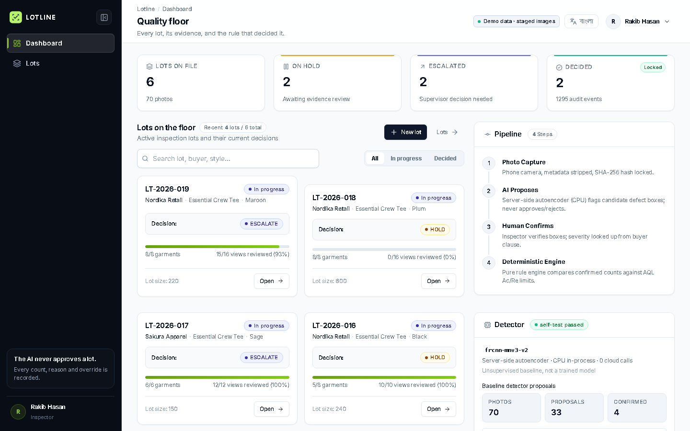
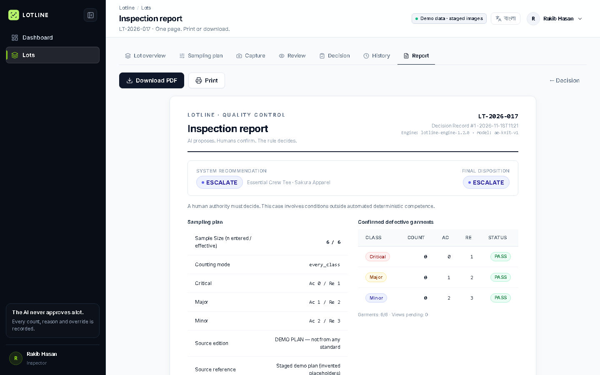
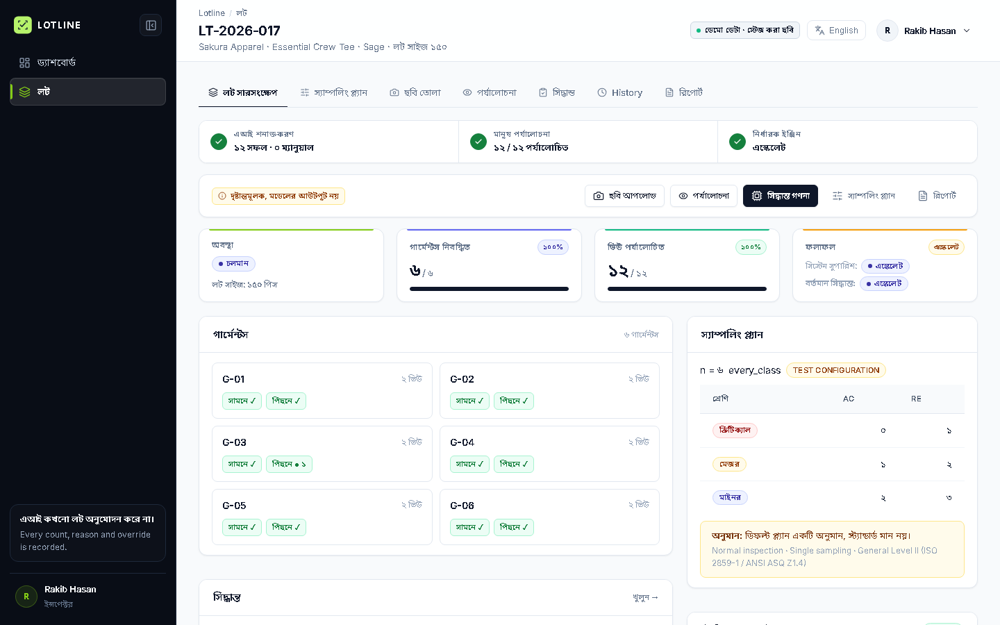

# Lotline

**AI proposes. Humans confirm. The rule decides.**

Lotline is a working, auditable knitwear **lot-acceptance** system. A photo of a
garment goes in. An on-device vision model proposes defect boxes. An inspector
confirms, corrects or rejects each proposal. A deterministic sampling engine — a
pure function with no model inside it — then returns **ACCEPT · REJECT · HOLD ·
ESCALATE**, with the exact reason code and the exact rule that produced it.

Built for the **International AI Builders Congress 2026 · IndustrySphere AI
(Quality Vision)** challenge, Dhaka.

| Lot overview | Human review | Decision |
|---|---|---|
|  |  |  |

| Dashboard | Report | Bangla |
|---|---|---|
|  |  |  |

---

## The one invariant

> The AI never approves a lot.

This is enforced structurally, not by policy text:

1. `app/domain/engine.py` is a pure function. It imports only `hashlib` and `json`
   (there is a test that parses its AST and fails if anything else appears).
   It cannot call a model, a database or the network.
2. The engine never sees a proposal. It sees **human-confirmed defects**, the
   entered sampling plan, and completeness evidence. A bounding box on its own
   counts for nothing.
3. Every failure path terminates in `HOLD`, `ESCALATE` or `REJECT`. The only
   path to `ACCEPT` is *complete sample + every view reviewed + zero reject
   numbers reached*. `ACCEPT_PLAN_MET` is the only ACCEPT reason code.
4. An unanswered critical proposal escalates; it never quietly disappears.
   Closing a view while a proposal is still open is refused by the server.

| Layer | Who decides | Can it approve a lot? |
|---|---|---|
| Vision model (`app/services/vision.py`) | proposes boxes + a type guess | **no** |
| Inspector | confirms / edits / rejects each box, marks the view | **no** |
| Supervisor | sets the plan, second-reviews rejected criticals, overrides | **only via an audited two-person override** |
| Engine (`app/domain/engine.py`) | counts confirmed defects, compares Ac/Re, returns the outcome | **this is the only decision-maker** |

---

## Run it (2 minutes, no Docker)

```bash
# Python 3.11+ ; on this machine use the full interpreter path
python -m app.seed          # 6 lots, 70 staged photos, ~25 s (first run trains the detector)
python -m uvicorn app.main:app --host 127.0.0.1 --port 8077
```

Or with make: `make seed`, `make run`, `make test`, `make data`, `make reset`.

or `run.bat` (Windows) / `./run.sh`.

Open <http://127.0.0.1:8077> and press **Inspector**, **Supervisor** or
**Admin** for one-click demo access (no password typing during a pitch).
The seeded password is `QualityFloor2026!`.

```bash
python -m pytest -q         # 36 engine tests, ~40 ms
python -m ruff check app    # import order, undefined names, dead code
```

`python -m app.seed --force` rebuilds the demo from scratch.

---

## The 90-second demo path

| Step | Screen | What the judge sees |
|---|---|---|
| 1 | Dashboard | six lots, five different outcomes, zero AI approvals |
| 2 | `LT-2026-019` | an open lot: AI proposed a hole, nobody has confirmed it → decision is **ESCALATE_CRITICAL_UNREVIEWED** |
| 3 | Review | the hole is boxed in red (critical routing); confirm it, correct its type/zone, reject the noise proposal |
| 4 | Decision → Recompute | **REJECT_LIMIT_REACHED**, critical count 1 ≥ Re 1, snapshot hash, append-only history |
| 5 | Report | one page PDF: plan source, counts, reason codes, evidence, signatures, honest limits |
| 6 | `LT-2026-014` | AI proposals that humans **rejected** — the AI does not win arguments |
| 7 | `LT-2026-017` | Sakura Apparel clause map is missing an oil-stain zone → **ESCALATE_UNMAPPED_CLAUSE** |
| 8 | `LT-2026-018` | no plan → **HOLD_PLAN_MISSING** (the engine refuses to guess) |
| 9 | Audit | 100+ append-only events: who did what, to which entity, when |
| 10 | বাংলা | the whole UI in Bangla, same logic, same report |

---

## What is real, and what is not

Honesty is part of the product. Every limitation below is also printed in the
UI and in the PDF report.

**Real**
- The detector is a genuine unsupervised autoencoder (numpy, in-process, CPU,
  ~0.4 s/photo). Trained only on **clean synthetic knit patches** — no defect
  labels — and it localises defects by reconstruction residual on a 3×3 patch
  grid, with a robust z-score (median/MAD), connected components and IoU dedupe.
- The engine, the counting modes, the precedence order, `Re = Ac + 1`
  validation, the append-only decision/override/audit model, Argon2id + CSRF +
  server-side sessions, the PDF report: all production-shaped, not mocked.
- Photos are generated procedurally (knit texture + staged defects) — no real
  buyer, worker or factory data is used anywhere.

**Not real (stated in the UI)**
- **Uncalibrated.** Scores are anomaly residuals, not probabilities.
- Evaluated on **staged synthetic panels only**. Factory performance is unknown
  and must be measured on-site before any production claim.
- Defect-type classification is a heuristic; the reviewer can change the type.
- Critical **non-visual** defects (needle, metal) cannot be photographed; a
  supervisor records them separately.
- Sampling randomness is **self-declared**; the software cannot verify a draw.
- The demo plan (`n=8`, critical 0/1, major 1/2, minor 2/3) is an **invented
  placeholder**, labelled `DEMO PLAN — not from any standard`. No ISO 2859-1 /
  ANSI Z1.4 table is reconstructed and no percentage allowance is claimed.
- SQLite + in-process vision replaces the production Postgres / InferenceWorker
  / Vision-container topology, so judges can click through without Docker.
  The schema, the privilege split and the audit model follow the design docs.

---

## Architecture (demo)

```
browser ── TLS ──▶ FastAPI (app/main.py)
                     │  Argon2id · server sessions · CSRF · Origin check · role gate
                     ├──▶ app/web/routes/          (auth · lots · capture · review · decisions · reports · admin)
                     ├──▶ app/services/review.py ──▶ app/domain/engine.py  (pure, deterministic)
                     │        │                         └─ 15 reason codes, precedence
                     │        ├──▶ app/core/db.py          (SQLite WAL, append-only decisions)
                     │        └──▶ app/services/report.py  (one-page PDF, snapshot hash)
                     ├──▶ app/services/vision.py  (numpy autoencoder, in-process)
                     └──▶ app/core/security.py    (Argon2id · sessions · CSRF · login delay)
```

Production topology from `SYSTEM_DESIGN_v1_2.md` §11 — Proxy → API →
InferenceWorker (no table privileges) → Vision container (no database) →
PostgreSQL, each on its own network — is documented in `docs/` and summarised
on the **How it works** screen. This build collapses it into one process for a
2-minute judge demo.

### Decision precedence

```
plan (missing/invalid) → REJECT → ESCALATE → other HOLD → ACCEPT
```

15 canonical reason codes, e.g. `HOLD_PLAN_MISSING`, `HOLD_PLAN_INVALID`,
`REJECT_CRITICAL_NONVISUAL_FAILED`, `REJECT_LIMIT_REACHED`,
`ESCALATE_CRITICAL_UNREVIEWED`, `ESCALATE_UNMAPPED_CLAUSE`,
`ESCALATE_CRITICAL_REJECTION_UNCONFIRMED`, `ESCALATE_SECOND_OPINION_REQUESTED`,
`HOLD_UNITS_MISSING`, `HOLD_VIEWS_PENDING`, `HOLD_CRITICAL_NONVISUAL_PENDING`,
`HOLD_VIEW_STATE_INCONSISTENT`, `HOLD_EVIDENCE_INTEGRITY`,
`HOLD_COMPUTE_ERROR`, `ACCEPT_PLAN_MET`.

### Counting modes

- `highest_class_only` — a garment with several defects counts **once**, in its
  highest class.
- `every_class` — a garment counts once in **every** class it has.

The mode is part of the plan, printed on the report, and stored with the
decision, because it changes the count.

### Overrides (DL-02)

- Only a **Supervisor** can override, and only an `ACCEPT` or `REJECT`.
- `OVERRIDE_ACCEPT` needs a **second, different Supervisor** to approve.
- `Admin` cannot override. The Admin is for accounts, model activation, audit.
- Overrides never edit the decision row. They append an `override` row and the
  final disposition becomes `ACCEPT (overridden)` — visible on every screen and
  in the PDF.

---

## Security & responsible AI

- Argon2id password hashing; 15+ character policy with context-word rejection.
- Server-side sessions (30 min idle / 8 h absolute), HttpOnly + SameSite=Lax,
  CSRF double-submit on every POST, Origin check.
- Progressive login delay (0 → 30 s → doubling, capped 15 min) per account+IP.
- Single role per user, enforced server-side on every route (Admin is blocked
  from images, review and report).
- Every state change writes an `audit_event`; decisions, overrides and model
  activations are append-only. Evidence files are SHA-256 hashed and re-checked
  before a decision may count them (`HOLD_EVIDENCE_INTEGRITY`).
- The AI is **assistive by construction**: no autonomy, no auto-approve, no
  confidence threshold that can substitute for a human confirmation.
- Data minimisation: no worker names, no faces, no buyer identities beyond a
  demo label; Bangla + English UI for the people who actually do the work.
- Data sovereignty: the production design keeps evidence and decisions in the
  customer's jurisdiction; the demo runs entirely local, no third-party API.

---

## Repository map

```
app/
  main.py                 application factory: error handlers, middleware, routers
  config.py               paths, upload limits, demo flag — every setting in one place
  domain/engine.py        pure decision engine + 15 reason codes + precedence
  core/db.py              SQLite schema (organization … model_activation), audit helper
  core/security.py        Argon2id, sessions, CSRF, login delay, password policy
  services/review.py      evidence assembly, decision rows, overrides, timeline
  services/vision.py      unsupervised knit-defect detector (numpy) + self-test
  services/report.py      one-page FPDF report (Bangla-capable font fallback)
  services/seed.py        demo data generator (idempotent, --force to rebuild)
  web/pages.py            template environment + shared context
  web/deps.py             sessions, role gates, CSRF, write permissions
  web/routes/             auth · dashboard · lots · capture · review · decisions · reports · admin · system
  i18n.py                 English + Bangla strings
scripts/build_dataset.py  build or download the staged dataset, verify every hash
ml/                       GPU workstream (owner: Hridoy) — dataset, train, evaluate, export
templates/                Jinja2 screens
static/                   design system CSS + review-workspace JS
tests/                    36 deterministic engine tests
docs/spec/                the original 13.6k-line specification set this build implements
tools/                    specification cross-document audit (legacy, kept for provenance)
```

Old import paths (`app.engine`, `app.service`, `app.db`, …) still work through
thin re-export shims, so branches written before the restructure keep running.

### Data

`data/` is generated, never committed:

```bash
python scripts/build_dataset.py            # staged dataset + manifest with SHA-256 per file
python scripts/build_dataset.py --verify   # integrity check
python -m app.seed --force                 # demo database, evidence images, model card
```

Directories created at runtime: `data/lotline.db`, `data/store/` (content-addressed
evidence), `data/models/` (detector + model card), `data/dataset/v1/` (staged set).
See `docs/DATA.md` for provenance, splits and the honest limits of the data.

---

## Production path

1. Swap SQLite for PostgreSQL 18 using the schema in `app/core/db.py` (already
   normalised, FKs and CHECK constraints in place).
2. Split vision into the InferenceWorker/Vision containers per the documented
   privilege split; the model interface is already a pure function of bytes.
3. Replace staged photos with the phone capture flow (EXIF strip, SHA-256,
   retake guidance) — the upload pipeline already does the first two.
4. Calibrate on a factory-labelled holdout set and publish a model card with
   per-class precision/recall before making any accuracy claim.
5. Add buyer clause packs as versioned data, not code, so each buyer's manual is
   reviewable and attributable.

---

*Demo build for the International AI Builders Congress 2026. Staged garment
images; no real buyer, factory or worker data. Engine `lotline-engine-1.2.0`.*
