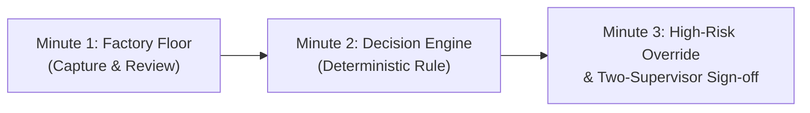

# LOTLINE — 3-Minute Live Hackathon Demo Script

> **Platform:** LOTLINE (AI-Assisted Knitwear Quality & Acceptance Decision-Support)  
> **Target Event:** International AI Builders Congress 2026  
> **Core Principle:** *"AI proposes. Humans verify. The decision engine decides."*  
> **Local Base URL:** `http://127.0.0.1:8077`  

---

## 1. Demo Credentials & One-Click Role Switcher

LOTLINE provides real session logouts and logins via the demo switcher:

| Role | Name | One-Click URL | Form Login Credentials |
|---|---|---|---|
| **Inspector** | Rakib Hasan | `http://127.0.0.1:8077/demo/inspector` | `rakib@lotline.demo` / `DemoPass12345!` |
| **Supervisor A** | Farhan Chowdhury | `http://127.0.0.1:8077/demo/supervisor` | `farhan@lotline.demo` / `DemoPass12345!` |
| **Supervisor B** | Lead Supervisor | `http://127.0.0.1:8077/login` | `lead@lotline.demo` / `LeadDemoPass2026!` |
| **Admin** | Nusrat Jahan | `http://127.0.0.1:8077/demo/admin` | `nusrat@lotline.demo` / `DemoPass12345!` |

---

## 2. 3-Minute Minute-by-Minute Flow

### Minute 1: The Factory Floor — Mobile Capture & Human Review
**Goal:** Show on-device AI anomaly proposals corrected by human inspectors without AI ever making the final call.

1. **Open on Phone or Mobile Emulation (375px):**
   - Click one-click Inspector link: `http://127.0.0.1:8077/demo/inspector`
   - Navigate to **Lot 3** (`/lots/3` or `/lots/3/capture`).
2. **Talk Track:**
   > *"In garment manufacturing, factory floors don't need cloud AI that promises 99% accuracy but hallucinates approvals. LOTLINE runs on-device anomaly detection on phone photos, strips metadata, and stores SHA-256 evidence hashes."*
3. **Action:**
   - Go to image review for an open view (`/review/5` or select view in Review Queue).
   - Point out the label: **`Score (uncalibrated)`** — *"We never pretend raw anomaly distances are calibrated probabilities."*
   - Toggle **Show attention map** to show the autoencoder visual focus.
   - Click on proposal: Select defect type (`Hole`), Zone (`Zone 1`), and confirm. Show that severity (`Critical`) is **server-assigned** from the buyer clause, not chosen by AI.
   - Click **Finish Image (Defects Confirmed)**.

---

### Minute 2: The Decision Engine — Deterministic Decision Center
**Goal:** Prove that AI never approves a lot; a pure function compares confirmed defect counts with entered ISO 2859-1 limits.

1. **Switch to Laptop Projection (1280px):**
   - Click Supervisor link: `http://127.0.0.1:8077/demo/supervisor`
   - Navigate to **Lot 1 Decision Center**: `http://127.0.0.1:8077/lots/1/decision`
2. **Talk Track:**
   > *"Notice the hero outcome: **REJECT**. Why? The table breaks down every defect class against the entered ISO 2859-1 sampling plan. Critical defect limit was Ac=0, Re=1. The inspector confirmed 1 critical hole, triggering an immediate deterministic REJECT with PRD §9.4 code `REJECT_CRITICAL_DEFECT`."*
3. **Action:**
   - Point to the **Two-Line Disposition**:
     - **System recommendation:** `REJECT`
     - **Final disposition:** `REJECT`
   - Click **View Official Report** (`/lots/1/report`):
     - Show the one-page inspection certificate preview.
     - Click **Download PDF** (`/lots/1/report.pdf`) — show instant server-rendered vector PDF with evidence SHA-256 hash.

---

### Minute 3: High-Risk Accountability — Two-Supervisor Approval Flow
**Goal:** Demonstrate rigorous governance where a supervisor overriding a system REJECT to ACCEPT cannot self-approve.

1. **Step A (Supervisor A requests override):**
   - On `http://127.0.0.1:8077/lots/1/decision`, scroll down to the **Supervisor Override** panel.
   - Select **Accept (Override)**.
   - Type reason (must be $\ge 20$ characters): *"Garment was reinspected by Master Tailor; defect is in hem allowance."*
   - Live counter reaches 20+ chars. Click **Submit Override**.
   - **Visual Result:** Banner appears: **HIGH RISK · PENDING APPROVAL**.
   - Notice: Supervisor A sees: **`Self-approval forbidden — awaiting review by another supervisor.`** The Final Disposition **remains REJECT**.
2. **Step B (Supervisor B approves):**
   - Switch to Lead Supervisor: Log out and log in at `http://127.0.0.1:8077/login` with `lead@lotline.demo` / `LeadDemoPass2026!`.
   - On the Dashboard (`/`), notice the amber banner: **High-Risk Overrides Awaiting Second Supervisor**.
   - Click **Review & Decide** → opens `/lots/1/decision`.
   - Supervisor B sees the **Second Supervisor Action** card with **Approve Override** and **Refuse Override** buttons.
   - Type note: *"Re-inspection confirmed acceptable per buyer tolerance"* and click **Approve Override**.
   - **Visual Result:** Final Disposition flips to **ACCEPT (OVERRIDE)**!
   - Audit event is permanently recorded in `/audit`.

---

## 3. Wrap-up & Final Punchline (15 seconds)

> *"LOTLINE doesn't replace human judgement with black-box AI. It empowers factory inspectors with on-device assistance, enforces mathematical ISO limits, and holds human supervisors accountable through cryptographic evidence and multi-party sign-off. Thank you."*

