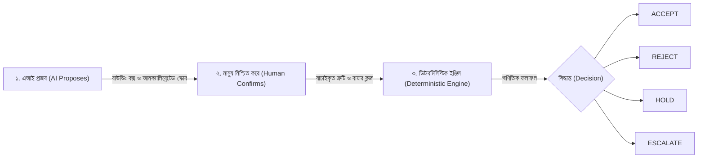
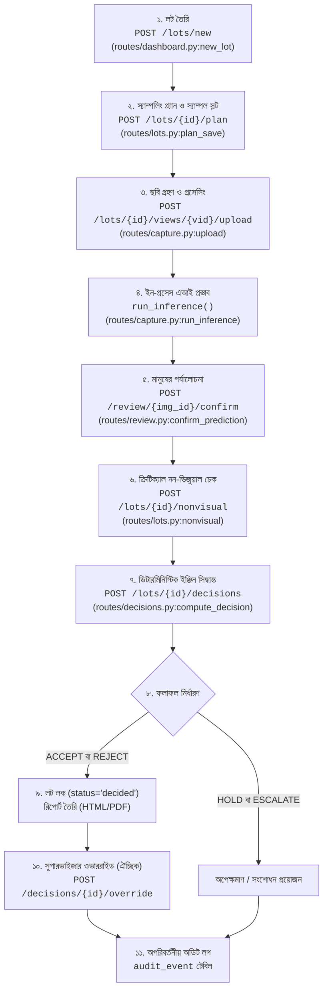
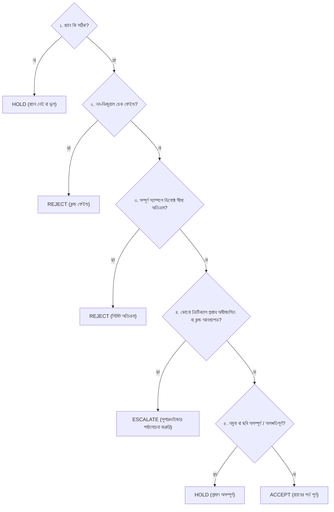
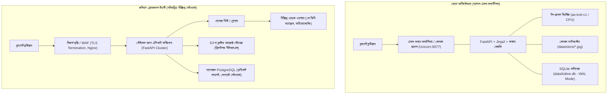
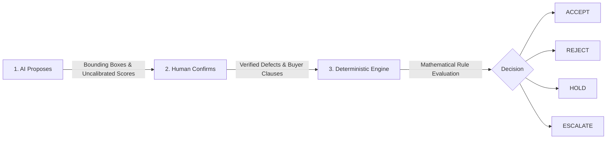
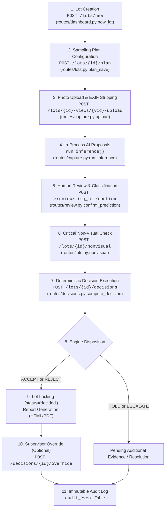
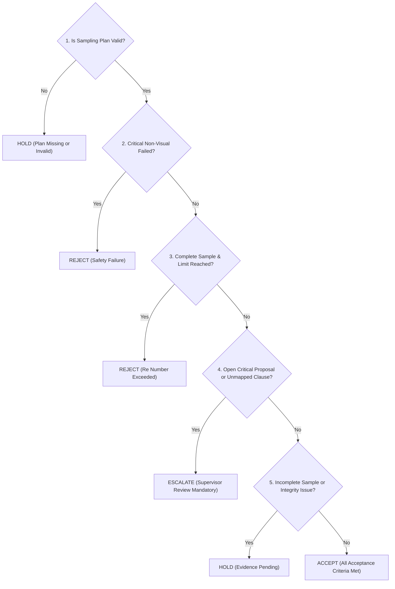
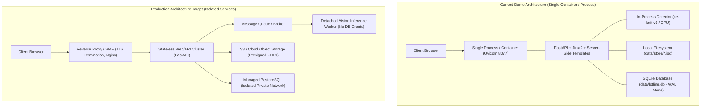

# Lotline: How the System Works / সিস্টেমের অভ্যন্তরীণ কার্যপদ্ধতি

> **নথি পরিচিতি (Document Metadata)**  
> **সফটওয়্যার সংস্করণ (Software Version):** Lotline v1.2 (`lotline-engine-1.2.0`)  
> **উদ্দেশ্য (Purpose):** তৈরি পোশাক (Knitwear) রপ্তানি শিল্পের জন্য এআই-সহায়তাপ্রাপ্ত ও অডিটযোগ্য লট অ্যাকসেপ্টেন্স সিস্টেমের সামগ্রিক কারিগরি কার্যপদ্ধতি।  
> **ভাষার বিন্যাস (Structure):** প্রথমে সম্পূর্ণ বাংলা বিবরণ, পরবর্তীতে অভিন্ন কাঠামোর সম্পূর্ণ ইংরেজি বিবরণ (English section follows Bengali section).

---

# [বাংলা বিভাগ / Bengali Section]

## ১. সারসংক্ষেপ (Summary)

Lotline হলো রপ্তানিমুখী তৈরি পোশাক (Knitwear / Single Jersey) কারখানার জন্য নির্মিত একটি অডিটযোগ্য লট অ্যাকসেপ্টেন্স ও কোয়ালিটি কন্ট্রোল সিস্টেম। কারখানার পরিদর্শক (Inspector) এবং কোয়ালিটি সুপারভাইজারদের (Supervisor) ব্যবহারের জন্য প্রস্তুত এই প্ল্যাটফর্মটি AQL (Acceptance Quality Limit) ভিত্তিক লট অনুমোদন প্রক্রিয়ার দীর্ঘদিনের অস্বচ্ছতা, সাবজেক্টিভ খামখেয়ালি এবং অডিট ট্রেইলের অভাব দূর করে। পোশাকের ছবি থেকে এআই মডেল সম্ভাব্য ত্রুটি (Hole, Oil Stain, Needle Line ইত্যাদি) চিহ্নিত করে প্রস্তাব করে; অনুমোদিত পরিদর্শক সেই প্রস্তাব সরাসরি যাচাই, সংশোধন বা বাতিল করেন; এবং সবশেষে একটি কঠোরভাবে ডিটারমিনিস্টিক (গাণিতিক ও রুল-ভিত্তিক) ইঞ্জিন AQL স্যাম্পলিং প্ল্যানের ভিত্তিতে লটের চূড়ান্ত সিদ্ধান্ত (ACCEPT, REJECT, HOLD, ESCALATE) নির্ধারণ করে। প্রতিটি সিদ্ধান্তের পেছনে রয়েছে অপরিবর্তনীয় অডিট ট্রেইল এবং ক্রিপ্টোগ্রাফিক প্রমাণের নিশ্চয়তা।

---

## ২. মূল নীতি (Core Principle)

Lotline-এর মূল নকশা নীতি একটি তিন-স্তরের দায়িত্ব বিভাজনের ওপর প্রতিষ্ঠিত:
$$\text{AI Proposes} \longrightarrow \text{Human Confirms} \longrightarrow \text{Deterministic Engine Decides}$$



### ডিটেক্টর আসলে কী এবং কীভাবে কাজ করে?
- **মডেল আর্কিটেকচার:** কোডবেসের ডিফল্ট মডেল হলো `ae-knit-v1` (`app/services/vision.py`), যা লোকাল প্যাচ এমবেডিংয়ের ওপর ভিত্তি করে নির্মিত একটি আনসুপারভাইজড প্যাচ অটোএনকোডার ($23 \to 12 \to 23$, `tanh` অ্যাক্টিভেশন)। এটি অ্যাডাম (Adam) অপটিমাইজার দিয়ে কেবল ত্রুটিহীন সিন্থেটিক নিট ফেব্রিকের টেক্সচারে প্রশিক্ষিত; এটি প্রশিক্ষণে কোনো বাস্তব ত্রুটির লেবেল ব্যবহার করেনি। বিকল্প হিসেবে `frcnn-mnv3-v1` (`app/services/detector.py`) রয়েছে, যা অন-ডিভাইস ONNX রানটাইম দিয়ে চালানো যায় যদি `LOTLINE_DETECTOR=onnx` সক্রিয় থাকে।
- **রানটাইম অবস্থান:** মডেলটি সম্পূর্ণরূপে লোকাল সিপিইউ-তে ইন-প্রসেস (In-process) চলে (প্রতি ছবিতে গড়ে প্রায় ০.৪ সেকেন্ড সময় নেয়)। কোনো ক্লাউড এপিআই বা বাহ্যিক নেটওয়ার্ক কল করা হয় না।
- **আনক্যালিব্রেটেড স্কোর:** মডেলটি পুনর্গঠন ত্রুটি (Reconstruction Error) থেকে একটি অসংলগ্ন অ্যানোমালি স্কোর (Uncalibrated Score) তৈরি করে। এটি কোনো সত্য সম্ভাব্যতা (True Probability) নয়।

### এআই যা কখনোই করে না (What the AI Never Does)
1. **কখনোই কোনো লট অনুমোদন (ACCEPT) বা বাতিল (REJECT) করে না:** এআই-এর কোনো প্রশাসনিক সিদ্ধান্ত দেওয়ার অনুমতি নেই।
2. **কখনোই সরাসরি AQL ডিফেক্ট কাউন্ট পরিবর্তন করে না:** ডিটেক্টরের প্রস্তাব যতক্ষণ না কোনো মানুষ দ্বারা অনুমোদিত হচ্ছে, ততক্ষণ তা ইঞ্জিনের কাছে অদৃশ্য থাকে।
3. **কখনোই কোনো বায়ার ক্লজ বা সিভিয়ারিটি (Critical/Major/Minor) সরাসরি আরোপ করতে পারে না:** সিভিয়ারিটি নির্ধারিত হয় মানুষ কর্তৃক চিহ্নিত জোন ও ডিফেক্ট টাইপকে বায়ারের স্পেসিফিকেশন ম্যাপিং টেবিল (`clause_mapping`) দ্বারা মিলিয়ে।

---

## ৩. ভূমিকা ও অনুমতি (Roles and Permissions)

Lotline প্ল্যাটফর্মে ৩টি সুনির্দিষ্ট ইউজার রোল রয়েছে। `app/web/deps.py`, `app/web/routes/lots.py`, `app/web/routes/capture.py`, `app/web/routes/review.py`, `app/web/routes/decisions.py`, এবং `app/web/routes/admin.py` ফাইলসমূহে কঠোরভাবে রোল চেক প্রয়োগ করা হয়েছে:

| অ্যাকশন / সক্ষমতা (Action) | ইন্সপেক্টর (Inspector) | সুপারভাইজার (Supervisor) | অ্যাডমিন (Admin) | কোড রেফারেন্স (Code Reference) |
| :--- | :---: | :---: | :---: | :--- |
| **লগইন ও ড্যাশবোর্ড দেখা** | হ্যা | হ্যা | হ্যা | `deps.py:require_user`, `routes/dashboard.py:dashboard` |
| **নতুন লট তৈরি (`POST /lots/new`)** | হ্যা | হ্যা | **না** | `routes/dashboard.py:new_lot`, `require_role("inspector", "supervisor")` |
| **পোশাক ইউনিট ও ছবি আপলোড (`POST /lots/{id}/units`)** | হ্যা (নিজের তৈরিকৃত লটে) | হ্যা (যেকোনো লটে) | **না** | `routes/capture.py:add_unit`, `deps.py:can_write_lot` |
| **এআই প্রস্তাব পর্যালোচনা (`POST /review/{id}/confirm`)** | হ্যা | হ্যা | **না** | `routes/review.py:confirm_prediction` |
| **ম্যানুয়াল ডিফেক্ট যোগ করা (`POST /review/{id}/add`)** | হ্যা | হ্যা | **না** | `routes/review.py:add_defect` |
| **রিভিউ স্টেট নির্ধারণ (`POST /review/{id}/state`)** | হ্যা | হ্যা | **না** | `routes/review.py:set_view_state` |
| **স্যাম্পলিং প্ল্যান কনফিগার (`POST /lots/{id}/plan`)** | **না** (শুধু দেখতে পারে) | **হ্যা** | **না** | `routes/lots.py:plan_save`, `require_role("supervisor")` |
| **নন-ভিজুয়াল চেক রেকর্ড (`POST /lots/{id}/nonvisual`)** | **না** | **হ্যা** | **না** | `routes/lots.py:nonvisual`, `require_role("supervisor")` |
| **ইঞ্জিনের সিদ্ধান্ত গণনা (`POST /lots/{id}/decisions`)** | হ্যা (নিজের লটে) | হ্যা | **না** | `routes/decisions.py:compute_decision` |
| **সিদ্ধান্ত ওভাররাইড (`POST /decisions/{id}/override`)** | **না** | **হ্যা** | **না** | `routes/decisions.py:make_override`, `require_role("supervisor")` |
| **ওভাররাইড অনুমোদন (`POST /overrides/{id}/approval`)** | **না** | **হ্যা** (দ্বিতীয় সুপারভাইজার) | **না** | `routes/decisions.py:approve_override` |
| **ক্রিটিক্যাল প্রস্তাবের সেকেন্ড রিভিউ (`POST /review/{id}/second-review`)** | **না** | **হ্যা** (ভিন্ন সুপারভাইজার) | **না** | `routes/review.py:second_review` |
| **ইনস্পেকশন রিপোর্ট ও PDF দেখা** | হ্যা | হ্যা | **না** | `routes/reports.py:report_page`, `report_pdf` (Admin 403 Forbidden) |
| **অডিট লগ ওয়েব পেজ দেখা (`GET /audit`)** | **না** | হ্যা | হ্যা | `routes/admin.py:audit_page`, `require_role("supervisor", "admin")` |
| **অডিট লগ CSV এক্সপোর্ট (`GET /audit.csv`)** | **না** | **না** | **হ্যা** | `routes/admin.py:audit_csv`, `require_role("admin")` |
| **ইউজার তৈরি ও নিষ্ক্রিয়করণ (`POST /admin/users`)** | **না** | **না** | **হ্যা** | `routes/admin.py:admin_create_user` |
| **মডেল সেল্ফ-টেস্ট ও অ্যাক্টিভেশন** | **না** | **না** | **হ্যা** | `routes/admin.py:admin_selftest`, `admin_activate` |

### অ্যাডমিন (Admin) কী করতে পারে না?
`test_p5_qa.py:test_role_gating_matrix` টেস্ট অনুসারে অ্যাডমিনের ক্ষমতা কঠোরভাবে প্ল্যাটফর্ম প্রশাসন এবং ইউজার ব্যবস্থাপনায় সীমাবদ্ধ:
- অ্যাডমিন কোয়ালিটি নিয়ন্ত্রণের কোনো ধাপে লিখতে পারে না: লট তৈরি করতে পারে না, ছবি আপলোড করতে পারে না, এআই প্রস্তাব গ্রহণ বা বাতিল করতে পারে না, স্যাম্পলিং প্ল্যান সম্পাদনা করতে পারে না, সিদ্ধান্ত গণনা করতে পারে না এবং কোনো সিদ্ধান্ত ওভাররাইড করতে পারে না।
- অ্যাডমিন এমনকি ফ্লোরের পরিদর্শন রিপোর্ট (`/lots/{id}/report`) বা পিডিএফ (`/lots/{id}/report.pdf`) দেখতেও পারে না (HTTP 403 Forbidden)।

---

## ৪. প্রান্তিক কার্যপ্রণালী (End-to-End Flow)

লটের যাত্রা শুরু থেকে অডিট ট্রেইল ও লক হওয়া পর্যন্ত প্রতিটি ধাপ কোডের বাস্তবায়নসহ নিচে তুলে ধরা হলো:



### ধাপ ১: লট তৈরি (Lot Creation)
- **রুট:** `POST /lots/new` | **কোড:** `app/web/routes/dashboard.py:new_lot`
- **কার্যপদ্ধতি:** ইন্সপেক্টর বা সুপারভাইজার লট কোড (যেমন `LT-2026-025`), বায়ার (`buyer_id`), প্রোডাক্ট (`product_id`), কাপড়ের রঙ, এবং মোট লটের আকার (`lot_size`) দিয়ে লট খোলেন। লটের প্রাথমিক স্ট্যাটাস থাকে `'open'` এবং নন-ভিজুয়াল স্ট্যাটাস `'pending'`।

### ধাপ ২: স্যাম্পলিং প্ল্যান কনফিগারেশন (Sampling Plan)
- **রুট:** `POST /lots/{lot_id}/plan` | **কোড:** `app/web/routes/lots.py:plan_save`
- **কার্যপদ্ধতি:** শুধুমাত্র সুপারভাইজার নমুনার আকার ($n$), কাউন্টিং মোড (`highest_class_only` বা `every_class`), এবং ক্রিটিক্যাল/মেজর/মাইনর ত্রুটির জন্য গ্রহণযোগ্য ($Ac$) ও প্রত্যাখ্যান ($Re$) সীমা নির্ধারণ করেন। এখানে সিঙ্গেল স্যাম্পলিংয়ের গাণিতিক নিয়ম $Re = Ac + 1$ এবং $n \le \text{lot\_size}$ সার্ভার-সাইডে যাচাই করা হয়। সুপারভাইজারকে বাধ্যতামূলকভাবে চেকবক্সে সম্মতি দিতে হয় যে তিনি মূল স্ট্যান্ডার্ড মিলিয়ে দেখেছেন। প্ল্যান সংরক্ষিত হলে স্বয়ংক্রিয়ভাবে প্রয়োজনীয় সংখ্যক গার্মেন্টস ইউনিট (`sample_unit`) ও ভিউ (`front`, `back`) স্লট তৈরি হয়।

### ধাপ ৩: ছবি গ্রহণ ও সিকিউর প্রসেসিং (Photo Capture & EXIF Strip)
- **রুট:** `POST /lots/{lot_id}/views/{view_id}/upload` | **কোড:** `app/web/routes/capture.py:upload`
- **নিরাপত্তা ও স্বাভাবিকীকরণ:** 
  1. আপলোড করা ফাইলের সাইজ চেক করা হয় (`MAX_BYTES = 12 MB`)।
  2. ম্যাজিক বাইটস দিয়ে ফাইল ভ্যালিডেশন করা হয় (`\xff\xd8\xff` বা `\x89PNG`)।
  3. মূল ফাইলের ক্রিপ্টোগ্রাফিক হ্যাশ (`sha256_original`) নির্ণয় করে একই লটে ডুপ্লিকেট আপলোড প্রতিহত করা হয়।
  4. পাইথন পিলো (Pillow) লাইব্রেরির মাধ্যমে পিক্সেল সাইজ সীমা (`MAX_PIXELS = 40 MP`) যাচাই করা হয়।
  5. `ImageOps.exif_transpose()` চালিয়ে ক্যামেরার ওরিয়েন্টেশন ঠিক করা হয় এবং র' EXIF মেটাডেটা (যেমন ক্যামেরা সিরিয়াল, জিপিএস) সম্পূর্ণ মুছে ফেলা হয়।
  6. ছবিটিকে সর্বোচ্চ ১২০০ পিক্সেল সাইজে নামিয়ে এনে অপ্টিমাইজড JPEG হিসেবে ডিস্কের `data/store/` ফোল্ডারে র্যান্ডমাইজড ফাইলে সংরক্ষণ করা হয়।
  7. কাজের কপির অপরিবর্তনীয় হ্যাশ (`sha256_working`) ডেটাবেজের `image` টেবিলে সংরক্ষিত হয়।

### ধাপ ৪: ইন-প্রসেস এআই প্রস্তাবনা (In-process Detector Proposals)
- **ফাংশন:** `app/web/routes/capture.py:run_inference`
- **কার্যপদ্ধতি:** আপলোড সম্পন্ন হওয়ামাত্র ব্যাকগ্রাউন্ডে ইন-প্রসেস ডিটেক্টর সক্রিয় হয়। `inference_job` টেবিলে কাজ রেজিস্টার হয়। মডেল ছবির প্যাচ বিশ্লেষণ করে ডিফেক্ট টাইপ, বাউন্ডিং বক্স কোঅর্ডিনেট (`x1, y1, x2, y2`) এবং আনক্যালিব্রেটেড স্কোর প্রস্তাব করে। বায়ারের রুল টেবিল দেখে যদি কোনো প্রস্তাবিত ত্রুটি সম্ভাব্য ক্রিটিক্যাল হয়, তবে `provisional_critical = 1` সেট করা হয়। প্রতিটি প্রস্তাব `prediction` টেবিলে `'proposed'` অবস্থায় সংরক্ষিত হয়।

### ধাপ ৫: মানুষের পর্যালোচনা (Human Review)
- **রুটসমূহ:** `app/web/routes/review.py`
  - `POST /review/{img_id}/confirm`: ইন্সপেক্টর বা সুপারভাইজার প্রস্তাবিত ডিফেক্টের ধরন এবং জোন (Zone I, II, III) নির্ধারণ করে নিশ্চিত করেন। এটি সাথে সাথে বায়ারের স্পেসিফিকেশন থেকে সঠিক ক্লজ রেফারেন্স ও সিভিয়ারিটি যুক্ত করে।
  - `POST /review/{img_id}/reject`: প্রস্তাবটি ভুল পজিটিভ হলে তা বাতিল করেন। প্রস্তাবটি যদি ক্রিটিক্যাল হয়, তবে সুপারভাইজারের সেকেন্ড রিভিউ বাধ্যতামূলক হয়।
  - `POST /review/{img_id}/add`: এআই যদি কোনো ত্রুটি মিস করে, তবে স্ক্রিনে ক্লিক করে পরিদর্শক ম্যানুয়ালি ডিফেক্ট যুক্ত করতে পারেন।
  - `POST /review/{img_id}/state`: পুরো ছবির অবস্থা নির্ধারণ (`reviewed_clean`, `confirmed_defects`, অথবা `needs_retake`)। ছবি ঝাপসা বা আলো খারাপ হলে পরিদর্শক `needs_retake` চিহ্নিত করে পুনরায় ছবি তোলার অনুরোধ করতে পারেন।

### ধাপ ৬: নন-ভিজুয়াল চেক (Critical Non-Visual Check)
- **রুট:** `POST /lots/{lot_id}/nonvisual` | **কোড:** `app/web/routes/lots.py:nonvisual`
- **কার্যপদ্ধতি:** নিটওয়্যারের ক্ষেত্রে সুইয়ের ভাঙা অংশ বা মেটাল কন্টামিনেশন (নিডেল ডিটেক্টর টেস্ট) ক্যামেরায় ধরা পড়ে না। সুপারভাইজার এই চেকের স্ট্যাটাস (`pending`, `done`, `not_required`, `failed`) এবং মন্তব্য সিস্টেমে সংরক্ষণ করেন।

### ধাপ ৭: ডিটারমিনিস্টিক সিদ্ধান্ত ও লকিং (Deterministic Decision & Locking)
- **রুট:** `POST /lots/{lot_id}/decisions` | **কোড:** `app/web/routes/decisions.py:compute_decision`
- **কার্যপদ্ধতি:** সার্ভিস লেয়ার পুরো এভিডেন্স প্যাকেজ তৈরি করে পিওর পাইথন ফাংশন `engine.decide(ev)`-এ পাঠায়। ইঞ্জিন গণিত ও নিয়মানুযায়ী ফলাফল দেয়। ফলাফল যদি `ACCEPT` বা `REJECT` হয়, তবে ডেটাবেজে লটের স্ট্যাটাস সাথে সাথে `'decided'` হয়ে যায় (`UPDATE lot SET status='decided'`)। এর ফলে লটে নতুন ছবি আপলোড বা রিভিউ সম্পাদন বন্ধ হয়ে যায় (লকড)।

### ধাপ ৮: রিপোর্ট ও অডিট ট্রেইল (Report & Audit Logging)
- **রুটসমূহ:** `/lots/{lot_id}/report` এবং `/lots/{lot_id}/report.pdf`
- **কার্যপদ্ধতি:** এক পাতার অফিসিয়াল ইনস্পেকশন রিপোর্ট এবং ডাউনলোডযোগ্য পিডিএফ প্রস্তুত হয়। প্রতিটি অ্যাকশন (লগইন, আপলোড, কনফার্ম, সিদ্ধান্ত) সার্ভার ক্লক অনুসারে অপরিবর্তনীয় `audit_event` টেবিলে সংরক্ষিত থাকে।

---

## ৫. ডিসিশন ইঞ্জিন (Decision Engine)

ডিসিশন ইঞ্জিনটি (`app/domain/engine.py`) একটি পিওর ফাংশন (Pure Function), যা কোনো ফ্রেমওয়ার্ক, ডাটাবেজ বা মেশিন লার্নিং প্যাকেজের ওপর নির্ভরশীল নয় (`test_engine_imports_only_the_standard_library` দ্বারা পরীক্ষিত)।

### ইঞ্জিনের ইনপুট (Inputs)
1. **স্যাম্পলিং প্ল্যান (`plan`):** নমুনার আকার $n$, কাউন্টিং মোড, এবং ক্রিটিক্যাল, মেজর ও মাইনর ক্লাসের $Ac$ ও $Re$ সীমা।
2. **লটের মেটাডেটা (`lot`):** লটের আকার ও ক্রিটিক্যাল নন-ভিজুয়াল স্ট্যাটাস।
3. **নমুনা ইউনিট ও ভিউ তালিকা (`units`):** উপস্থিত নমুনার সংখ্যা, প্রতিটি ভিউর ছবি ও রিভিউ স্ট্যাটাস, এভিডেন্স হ্যাশ ইন্টিগ্রিটি।
4. **যাচাইকৃত ত্রুটির তালিকা (`defects`):** শুধুমাত্র মানুষের দ্বারা নিশ্চিতকৃত (`confirmed`), সক্রিয় বর্তমান ছবির এবং রিভিউ সম্পন্ন হওয়া ডিফেক্ট।

### রুল প্রিসিডেন্স অর্ডার (Rule Precedence Order)
ইঞ্জিন ধাপে ধাপে নিম্নোক্ত কঠোর ক্রম অনুসরণ করে সিদ্ধান্ত নেয়:

$$\text{প্ল্যান চেক (Tier 0/1)} \longrightarrow \text{REJECT (Tier 2a/2b)} \longrightarrow \text{ESCALATE (Tier 3-6)} \longrightarrow \text{HOLD (Tier 7-12)} \longrightarrow \text{ACCEPT}$$



### ১৫টি রিজন কোড ও তাদের অর্থ (All 15 Reason Codes)

| রিজন কোড (Reason Code) | ফলাফল (Outcome) | অর্থ (One-Line Meaning) |
| :--- | :---: | :--- |
| `HOLD_PLAN_MISSING` | **HOLD** | কোনো স্যাম্পলিং প্ল্যান কনফিগার করা হয়নি। |
| `HOLD_PLAN_INVALID` | **HOLD** | প্রবেশকৃত প্ল্যানটি বৈধ সিঙ্গেল স্যাম্পলিং নীতি ($Re = Ac + 1$) মেনে চলে না। |
| `REJECT_CRITICAL_NONVISUAL_FAILED` | **REJECT** | একটি ক্রিটিক্যাল নন-ভিজুয়াল নিরাপত্তা চেক (যেমন নিডেল ডিটেকশন) ব্যর্থ হয়েছে। |
| `REJECT_LIMIT_REACHED` | **REJECT** | সম্পূর্ণ যাচাইকৃত নমুনায় অন্তত একটি ডিফেক্ট ক্লাস তার রিজেকশন সীমায় ($Re$) পৌঁছেছে। |
| `ESCALATE_CRITICAL_UNREVIEWED` | **ESCALATE** | একটি উন্মুক্ত এআই প্রস্তাব রয়েছে যা বায়ারের ক্রিটিক্যাল ক্লজের সাথে মিলে যায়। |
| `ESCALATE_UNMAPPED_CLAUSE` | **ESCALATE** | মানুষের নিশ্চিতকৃত একটি ডিফেক্টের জন্য বায়ারের স্পেসিফিকেশন টেবিলে কোনো ক্লজ ম্যাপিং নেই। |
| `ESCALATE_CRITICAL_REJECTION_UNCONFIRMED` | **ESCALATE** | পরিদর্শক কর্তৃক বাতিলকৃত ক্রিটিক্যাল প্রস্তাবের জন্য দ্বিতীয় সুপারভাইজারের অনুমোদন প্রয়োজন। |
| `ESCALATE_SECOND_OPINION_REQUESTED` | **ESCALATE** | পর্যালোচক কোনো ডিফেক্টের ওপর সিনিয়র মতামতের অনুরোধ জানিয়েছেন। |
| `HOLD_UNITS_MISSING` | **HOLD** | প্রয়োজনীয় স্যাম্পল আকারের তুলনায় কম পোশাক নিবন্ধিত রয়েছে। |
| `HOLD_VIEWS_PENDING` | **HOLD** | একটি প্রয়োজনীয় কাপড়ের ভিউ এখনও পর্যালোচনা করা হয়নি বা রিটেক প্রয়োজন। |
| `HOLD_CRITICAL_NONVISUAL_PENDING` | **HOLD** | ক্রিটিক্যাল নন-ভিজুয়াল চেকের ফলাফল এখনও সিস্টেমে রেকর্ড করা হয়নি। |
| `HOLD_VIEW_STATE_INCONSISTENT` | **HOLD** | একটি ভিউর রিভিউ স্টেট (`reviewed_clean`) তার নিশ্চিতকৃত ডিফেক্টের সাথে সাংঘর্ষিক। |
| `HOLD_EVIDENCE_INTEGRITY` | **HOLD** | সংরক্ষিত ছবির ফাইল নিখোঁজ অথবা ডিস্কে এর সাইজ/হ্যাশ পরিবর্তিত হয়েছে। |
| `HOLD_COMPUTE_ERROR` | **HOLD** | গণনা প্রক্রিয়া চলাকালীন কোনো কারিগরি ত্রুটি ঘটেছে। |
| `ACCEPT_PLAN_MET` | **ACCEPT** | সম্পূর্ণ নমুনা যাচাইকৃত এবং প্রতিটি ক্লাস তার গ্রহণযোগ্য সীমার ($Ac$) ভেতরে রয়েছে। |

### যা ইঞ্জিনকে ডিটারমিনিস্টিক করে (What Makes It Deterministic)
1. **পিওর ফাংশন:** একই ইনপুট ডাটা ডিকশনারি দিলে ইঞ্জিন শতভাগ সময় একই আউটপুট, একই কাউন্ট এবং একই রিজন কোড তৈরি করে।
2. **অপরিবর্তনীয় এভিডেন্স স্ন্যাপশট হ্যাশ (`snapshot_hash`):** অনুমোদিত সব ডিফেক্ট রো-কে সর্ট করে ক্যানোনিকাল JSON-এ রূপান্তর করে SHA-256 হ্যাশ তৈরি করা হয় (`app/domain/engine.py:snapshot_hash`)।
3. **আইডেমপোটেন্ট ডিসিশন রেকর্ড:** ইনপুট হ্যাশ এবং রিজন কোড যদি অপরিবর্তিত থাকে, তবে সিস্টেমে অপ্রয়োজনীয় ডুপ্লিকেট ডিসিশন তৈরি হয় না (`app/services/review.py:compute_decision`)।

### সুপারভাইজার ওভাররাইড এবং অনুমোদন নীতি
- ইঞ্জিন যখন `ACCEPT` বা `REJECT` দেয়, তখনই কেবল সুপারভাইজার যুক্তিসঙ্গত কারণে (`>= 20` অক্ষর) ওভাররাইড করতে পারেন।
- নন-ভিজুয়াল চেক ফেইল্ড হলে (`REJECT_CRITICAL_NONVISUAL_FAILED`) ওভাররাইড আইনত নিষিদ্ধ।
- **হাই-রিস্ক ওভাররাইড (High-Risk Override):** ইঞ্জিন কর্তৃক `REJECT` হওয়া লটকে যদি সুপারভাইজার `OVERRIDE_ACCEPT` করতে চান, তবে সিস্টেম স্বয়ংক্রিয়ভাবে একে `pending_approval` অবস্থায় রাখে। এটি কার্যকর হতে **দ্বিতীয় একজন স্বাধীন সুপারভাইজারের** অনুমোদন লাগে। যিনি ওভাররাইড তৈরি করেছেন, তিনি নিজে তা অনুমোদন করতে পারেন না (`routes/decisions.py:approve_override` - এ সেল্ফ-অ্যাপ্রুভাল ব্লকড)।

---

## ৬. ডাটা ও আর্কিটেকচার (Data and Architecture)

### কারিগরি স্ট্যাক (Technical Stack)
- **ভাষা ও রানটাইম:** Python 3.11+, FastAPI (Starlette), Uvicorn ASGI সার্ভার।
- **ফ্রন্টএন্ড টেমপ্লেটিং:** Jinja2 সার্ভার-রেন্ডারড HTML, ভ্যানিলা CSS (`/static/app.css`), নো-ফ্রেমওয়ার্ক লাইটওয়েট ভ্যানিলা JS।
- **ইমেজ প্রসেসিং:** Pillow (PIL), NumPy।
- **রিপোর্ট তৈরি:** fpdf2 (পিডিএফ জেনারেশন)।
- **ডাটাবেজ:** SQLite (WAL মোড ও ফরেন কি সক্রিয়)।

### বর্তমান ডেমো বনাম প্রোডাকশন আর্কিটেকচার (Demo vs Production Architecture)



### ডাটাবেজ টেবিলসমূহ (২২টি টেবিল ও তাদের উদ্দেশ্য)
কোডবেসের `app/core/db.py`-এ সংজ্ঞায়িত ২২টি টেবিল হলো:
1. `organization`: কারখানা বা প্রাতিষ্ঠানিক পরিচিতি।
2. `app_user`: ব্যবহারকারীর তথ্য, রোল এবং পাসওয়ার্ড হ্যাশ।
3. `user_session`: সার্ভার-সাইড সেশন ট্র্যাকিং ও CSRF টোকেন।
4. `login_attempt`: প্রগ্রেসিভ ডিলেসহ ব্রুট-ফোর্স প্রতিরোধ ট্র্যাকিং।
5. `buyer`: পোশাক ক্রেতা বা ব্র্যান্ডের প্রোফাইল।
6. `clause_mapping`: বায়ারের স্পেসিফিকেশন অনুযায়ী ডিফেক্ট, জোন ও সিভিয়ারিটি ম্যাপিং।
7. `product`: তৈরি পোশাকের ধরন (গার্মেন্ট আইটেম ও ফ্যাব্রিক পরিবার)।
8. `lot`: ইনস্পেকশন লটের প্রধান রেকর্ড ও স্ট্যাটাস।
9. `plan`: লটভিত্তিক AQL স্যাম্পলিং প্ল্যানের অপরিবর্তনীয় সংস্করণ।
10. `sample_unit`: নমুনায় অন্তর্ভুক্ত নির্দিষ্ট পোশাক ইউনিট।
11. `unit_view`: প্রতিটি পোশাকের ফ্রন্ট ও ব্যাক ভিউ স্লট।
12. `image`: আপলোডকৃত ছবির মূল ও কার্যকরী SHA-256 হ্যাশ এবং ডাইমেনশন।
13. `inference_job`: এআই ডিটেকশন প্রসেসের রানটাইম লগ ও ল্যাটেন্সি।
14. `prediction`: ডিটেক্টরের প্রস্তাবিত ত্রুটির কোঅর্ডিনেট ও মানুষের রিভিউ স্টেট।
15. `view_review`: কাপড়ের সম্পূর্ণ ভিউর সমাপ্তি অবস্থা (`reviewed_clean` ইত্যাদি)।
16. `decision`: ডিটারমিনিস্টিক ইঞ্জিনের গণনাকৃত ডিসিশন হিস্ট্রি।
17. `override`: সুপারভাইজার কর্তৃক ইঞ্জিন সিদ্ধান্ত ওভাররাইড লগ।
18. `override_approval`: উচ্চ-ঝুঁকিপূর্ণ ওভাররাইডে দ্বিতীয় সুপারভাইজারের অনুমোদন।
19. `audit_event`: প্রতিটি সিস্টেম পরিবর্তনের অপরিবর্তনীয় অডিট ট্রেইল।
20. `model_version`: ব্যবহৃত ভিশন মডেল আর্টফ্যাক্ট ও হ্যাশ।
21. `model_selftest`: মডেলের স্বয়ংক্রিয় সেল্ফ-টেস্ট হিস্ট্রি।
22. `model_activation`: মডেল চালু বা রোলব্যাকের প্রশাসনিক ট্রেইল।

---

## ৭. নিরাপত্তা ও অডিট ট্রেইল (Security and Audit)

### প্রমাণীকরণ ও সেশন নিরাপত্তা (Authentication & Sessions)
- **পাসওয়ার্ড হ্যাশিং:** OWASP স্ট্যান্ডার্ডের Argon2id অ্যালগরিদম (`argon2-cffi`, `time_cost=2`, `memory_cost=19 MB`, `parallelism=1`)।
- **পাসওয়ার্ড পলিসি:** ন্যূনতম ১৫ অক্ষর, সর্বোচ্চ ১২৮ অক্ষর, সাধারণ পাসওয়ার্ড ও নামের মিল নিষিদ্ধ (`security.py:policy_errors`)।
- **সার্ভার-সাইড সেশন:** সেশন কুকি `ll_session` এ কেবল আইডি এবং ভেরিফায়ার টোকেন পাঠানো হয়; আসল স্টেট থাকে ডাটাবেজে। আইডল টাইমআউট ৩০ মিনিট এবং অ্যাবসোলিউট এক্সপায়ারি ৮ ঘণ্টা।
- **লগইন রেট-লিমিটিং:** ভুল লগইনের জন্য প্রগ্রেসিভ ডিলে (৪টি ভুলের পর ৩০ সেকেন্ড, এরপর দ্বিগুণ হয়ে সর্বোচ্চ ১৫ মিনিট)।

### সিএসআরএফ ও ইনপুট হার্ডেনিং (CSRF & Input Hardening)
- স্টেট পরিবর্তনের প্রতিটি `POST` রিকোয়েস্টে ডাবল-সাবমিট ক্রিপ্টোগ্রাফিক CSRF টোকেন বাধ্যতামূলক (`deps.py:assert_csrf`)। সাথে অরিজিন ও হোস্ট হেডারের তুলনা করা হয়।
- ব্রাউজার ফ্রন্টএন্ডে কোনো লোকাল স্টোরেজ বা সেশন স্টোরেজে সংবেদনশীল টোকেন রাখা নিষিদ্ধ (`test_no_storage_of_sensitive_data_in_frontend`)।
- কোনো বহিরাগত CDN বা দূরবর্তী গুগল ফন্টস ব্যবহার করা হয়নি; সব অ্যাসেট অফলাইন হোস্ট করা (`test_no_external_cdns_or_remote_fonts`)।

### অডিট লগ ও হ্যাশ চেইনের সৎ অবস্থা (Audit Log & Honest Limitations)
- সিস্টেমে প্রতিটি লট তৈরি, ছবি আপলোড, এআই ইনফারেন্স, ডিফেক্ট নিশ্চিতকরণ, প্ল্যান সংরক্ষণ এবং ডিসিশন ক্যালকুলেশন `audit_event` টেবিলে অ্যাপেন্ড-অনলি (Append-only) ইনসার্ট হয়।
- **সৎ প্রকাশ (Honest Statement on Hash Chain):** বর্তমান সিস্টেমে কোনো ক্রিপ্টোগ্রাফিক হ্যাশ চেইনিং (যেমন পূর্ববর্তী রো-এর হ্যাশ বা ব্লকচেইন লিংক) কোডে ইমপ্লিমেন্ট করা **নেই**। অডিট লগটি রিলেশনাল ডাটাবেজের সাধারণ অ্যাপেন্ড-অনলি টেবিল হিসেবে কাজ করে। ক্রিপ্টোগ্রাফিক হ্যাশ চেইনিং ভবিষ্যৎ কাজের তালিকায় অন্তর্ভুক্ত।

---

## ৮. সিস্টেম চালানোর নিয়মাবলী (How to Run)

নিম্নোক্ত কমান্ডগুলো কোডবেসে সরাসরি যাচাইকৃত:

### ১. পরিবেশ প্রস্তুতকরণ ও ডিপেন্ডেন্সি ইনস্টলেশন
```bash
# পাইথন ভার্চুয়াল এনভায়রনমেন্ট তৈরি ও ডিপেন্ডেন্সি ইনস্টল
python -m venv .venv
# লিনাক্স/ম্যাক: source .venv/bin/activate | উইন্ডোজ: .venv\Scripts\activate
pip install -r requirements.txt
```

### ২. ডেমো ডাটা সিড বা রিসেট করা
```bash
# সম্পূর্ণ নতুন ডেমো ডাটাবেজ ও ফ্যাক্টরি লট ডাটা তৈরি
python -m app.seed --force
```

### ৩. অটোমেটেড টেস্ট সুট চালানো
```bash
# ৬১টি ইউনিটি ও ইন্টিগ্রেশন টেস্ট রান করা
pytest -q
```

### ৪. লোকাল ডেভেলপমেন্ট সার্ভার শুরু করা
```bash
# পোর্ট ৮০৭৭-এ সার্ভার চালু করা
uvicorn app.main:app --host 0.0.0.0 --port 8077
```

### ৫. ডকার কনটেইনারের মাধ্যমে চালানো (Single Container)
```bash
docker build -t lotline .
docker run -p 8077:8077 lotline
```

### ডেমো অ্যাকাউন্টে প্রবেশের তথ্য
- **সাধারণ পাসওয়ার্ড (সব ডেমো ইউজারের জন্য):** `QualityFloor2026!`
- **ইন্সপেক্টর:** `inspector@lotline.demo` (রাকিব হাসান)
- **কোয়ালিটি সুপারভাইজার ১:** `supervisor@lotline.demo` (ফারহান চৌধুরী)
- **কোয়ালিটি সুপারভাইজার ২:** `lead@lotline.demo` (আয়েশা করিম - ওভাররাইড অনুমোদনের জন্য)
- **সিস্টেম অ্যাডমিন:** `admin@lotline.demo` (নাদিয়া রহমান)
- **লগইনে OAuth ও অতিথি পথ:** ‘GitHub দিয়ে চালিয়ে যান’ ও ‘Google দিয়ে চালিয়ে যান’ (সংশ্লিষ্ট OAuth অ্যাপ কনফিগার করা থাকলে) এবং ‘অতিথি হিসেবে দেখুন’ — অতিথি পুরো ডেমো পড়তে পারেন, কিন্তু কোনো লেখার কাজ (প্ল্যান, ছবি, রিভিউ, সিদ্ধান্ত) করতে পারেন না; সার্ভার ও এপিআই দুই জায়গাতেই তা আটকানো। কোনো পাসওয়ার্ড ফর্ম বা ডেমো-অ্যাকাউন্ট তালিকা নেই।
- **ডেমোতে ঢোকার পথ:** `/demo/inspector`, `/demo/supervisor`, বা `/demo/admin` (শর্ত: `LOTLINE_DEMO=1`) — পাসওয়ার্ড ছাড়াই সংশ্লিষ্ট রোল।

---

## ৯. সৎ সীমাবদ্ধতা ও ভবিষ্যৎ কাজ (Honest Limitations & Future Work)

### সৎ সীমাবদ্ধতা (Honest Limitations)
1. **ডেমো ডাটা কেবলমাত্র স্টেজড ও সিন্থেটিক:** ডেমোতে ব্যবহৃত সমস্ত কাপড়ের ছবি প্রোগ্রামেটিক্যালি স্টেজড নিট টেক্সচার প্যানেল। এখানে কোনো বাস্তব কারখানার রিয়েল ছবি ব্যবহার করা হয়নি।
2. **আনসুপারভাইজড ডিটেক্টরের সীমাবদ্ধতা:** ব্যবহৃত ডিটেক্টর (`ae-knit-v1`) একটি সাধারণ আনসুপারভাইজড প্যাচ অটোএনকোডার। এটি বাস্তব প্রোডাকশন ফ্লোরের আলো বা জটিল কুঁচকানো কাপড়ের ওপর যাচাইকৃত নয়।
3. **একক কনটেইনার ও ডাটাবেজ আইসোলেশন নেই:** বর্তমানে ডেমোটি একক প্রসেসে SQLite ডাটাবেজ ব্যবহার করে চলে। প্রোডাকশনের মতো ডাটাবেজ নেটওয়ার্ক আইসোলেশন বর্তমান ডেমোতে সক্রিয় নেই।

### ভবিষ্যৎ কাজ (Future Work)
- **ক্রিপ্টোগ্রাফিক অডিট হ্যাশ চেইন:** প্রতিটি অডিট রো-তে `prev_hash` এবং `merkle_root` যুক্ত করে অপরিবর্তনীয় ক্রিপ্টোগ্রাফিক সিল তৈরি।
- **বিচ্ছিন্ন মাইক্রোসার্ভিস আর্কিটেকচার:** অ্যাপ সার্ভার, ডিটেকশন ওয়ার্কার এবং পোস্টগ্রেস ডাটাবেজকে ডকার-কম্পোজ/কুবারনেটিসের মাধ্যমে পৃথক প্রাইভেট নেটওয়ার্কে স্থাপন করা।
- **ক্যালিব্রেটেড প্রোবাবিলিস্টিক ভিশন মডেল:** বাস্তব কারখানার ডিফেক্ট ডেটাসেটে প্রশিক্ষিত কনভলিউশনাল/ট্রান্সফরমার ব্যাকবোন এবং কনফর্মাল প্রেডিকশন ভিত্তিক ক্যালিব্রেটেড কনফিডেন্স স্কোর।

---

## ১০. শব্দকোষ (Glossary)

1. **লট (Lot):** কারখানায় একই ফেব্রিক, রঙ ও স্টাইলের উৎপাদিত পোশাকের একটি সুনির্দিষ্ট ব্যাচ।
2. **AQL (Acceptance Quality Limit):** স্যাম্পলিং স্ট্যান্ডার্ড অনুযায়ী গ্রহণযোগ্য সর্বোচ্চ ডিফেক্ট পার্সেন্টেজ।
3. **Ac / Re (Acceptance / Rejection Number):** নমুনায় সর্বোচ্চ কতটি ডিফেক্ট থাকলে লট পাস হবে ($Ac$) এবং কতটি হলে রিজেক্ট হবে ($Re$) তার গাণিতিক সীমা।
4. **ডিফেক্ট বনাম ডিফেক্টিভ গার্মেন্টস (Defect vs Defective Garment):** একটি কাপড়ে একাধিক ডিফেক্ট থাকতে পারে। `highest_class_only` মোডে কাপড়ের সর্বোচ্চ তীব্রতার একটি ডিফেক্ট গণনা হয়; `every_class` মোডে প্রতিটি ক্লাসে আলাদা গণনা হয়।
5. **প্রস্তাব বনাম অনুমোদন (Proposal vs Confirmation):** এআই কেবল ত্রুটির স্থান ও ধরন "প্রস্তাব" করে; মানুষ পর্যালোচক যাচাই করে একে আইনত "অনুমোদন" করেন।
6. **ওভাররাইড (Override):** ইঞ্জিনের চূড়ান্ত সিদ্ধান্তের ওপর সুপারভাইজারের আইনানুগ হস্তক্ষেপ, যার জন্য লিখিত যুক্তি ও ক্ষেত্রবিশেষে দ্বিতীয় সম্মতি প্রয়োজন।
7. **অডিট ট্রেইল (Audit Trail):** কে, কখন, কোন আইপি থেকে সিস্টেমে কী পরিবর্তন করেছে তার অপরিবর্তনীয় রেকর্ড।
8. **রিজন কোড (Reason Code):** ইঞ্জিন কোন সুনির্দিষ্ট নিয়মের ভিত্তিতে সিদ্ধান্ত দিয়েছে তার ১৫টি প্রমিত কোডের একটি (যেমন `ACCEPT_PLAN_MET`)।

---
---

# [English Section / ইংরেজি বিভাগ]

## 1. Summary

Lotline is an auditable lot acceptance and quality-control system designed for export-oriented knitwear manufacturing (specifically single-jersey tees). Developed for factory floor inspectors and quality supervisors, Lotline eliminates the opacity, subjective bias, and lack of auditable evidence historically associated with traditional AQL (Acceptance Quality Limit) inspections. The system integrates computer vision to propose candidate fabric defects (such as holes, oil stains, and needle lines), mandates human verification and classification against buyer specification clauses, and executes an uncompromising, strictly deterministic decision engine to compute the final lot disposition (`ACCEPT`, `REJECT`, `HOLD`, or `ESCALATE`). Every calculation is supported by an immutable audit trail and cryptographic evidence verification.

---

## 2. Core Principle

Lotline is architected on a non-negotiable three-tier separation of concerns:
$$\text{AI Proposes} \longrightarrow \text{Human Confirms} \longrightarrow \text{Deterministic Engine Decides}$$



### What the Detector Actually Is
- **Architecture:** Two paths, both in-process on CPU. (a) `ae-knit-v1` (`app/services/vision.py`) is the unsupervised patch autoencoder ($23 \to 12 \to 23$, `tanh`) trained only on clean synthetic knit; it produced the seeded demo history. (b) `frcnn-mnv3-v2` (`app/services/detector.py`) is supervised: a COCO-pretrained Faster R-CNN with MobileNetV3-Large FPN, four fabric-defect classes, trained on BDFD9 (CC BY 4.0) plus staged panels, and it serves new uploads when the ONNX artifact is present (`LOTLINE_DETECTOR=auto|onnx`). Numbers are in `docs/MODEL_CARD.md`: mAP@0.5 0.9474 on 42 held-out test photos, 0.7479 on 68 validation photos, all from the same four factories. `det_v1` is retired and must not be quoted.
- **Execution Environment:** The model executes completely in-process on the local CPU (~0.4 seconds per image). No cloud services or external network roundtrips are involved.
- **Uncalibrated Anomaly Scores:** Defect bounding boxes are clustered from reconstruction error against a held-out clean threshold. Scores are raw distances, not calibrated probabilities.

### What the AI Never Does
1. **Never approves or rejects a lot:** The AI has no authority to output a final disposition.
2. **Never directly mutates AQL defect counts:** Defect proposals are completely invisible to the decision engine until explicitly confirmed by a human reviewer.
3. **Never assigns defect severity or buyer clauses:** Defect severity (`critical`, `major`, `minor`) is mapped deterministically from human-assigned defect types and garment zones against buyer specification rules (`clause_mapping`).

---

## 3. Roles and Permissions

Lotline enforces strict role boundaries across three user classes (`inspector`, `supervisor`, `admin`). Permission checks are implemented in `app/web/deps.py` and route definitions:

| Action / Capability | Inspector | Supervisor | Admin | Implementation Reference |
| :--- | :---: | :---: | :---: | :--- |
| **Login & Dashboard Access** | Yes | Yes | Yes | `deps.py:require_user`, `routes/dashboard.py:dashboard` |
| **Create Lot (`POST /lots/new`)** | Yes | Yes | **No** | `routes/dashboard.py:new_lot`, `require_role("inspector", "supervisor")` |
| **Add Garments & Upload Photos (`POST /lots/{id}/units`)** | Yes (Own lots) | Yes (All lots) | **No** | `routes/capture.py:add_unit`, `deps.py:can_write_lot` |
| **Review AI Proposals (`POST /review/{id}/confirm`)** | Yes | Yes | **No** | `routes/review.py:confirm_prediction` |
| **Manually Add Defects (`POST /review/{id}/add`)** | Yes | Yes | **No** | `routes/review.py:add_defect` |
| **Finalize View Review State (`POST /review/{id}/state`)** | Yes | Yes | **No** | `routes/review.py:set_view_state` |
| **Configure Sampling Plan (`POST /lots/{id}/plan`)** | **No** (Read-only) | **Yes** | **No** | `routes/lots.py:plan_save`, `require_role("supervisor")` |
| **Record Critical Non-Visual Check (`POST /lots/{id}/nonvisual`)** | **No** | **Yes** | **No** | `routes/lots.py:nonvisual`, `require_role("supervisor")` |
| **Compute Decision (`POST /lots/{id}/decisions`)** | Yes (Own lots) | Yes | **No** | `routes/decisions.py:compute_decision` |
| **Execute Override (`POST /decisions/{id}/override`)** | **No** | **Yes** | **No** | `routes/decisions.py:make_override`, `require_role("supervisor")` |
| **Approve Override (`POST /overrides/{id}/approval`)** | **No** | **Yes** (2nd Supervisor) | **No** | `routes/decisions.py:approve_override` |
| **Second Review of Rejected Criticals** | **No** | **Yes** (Different user) | **No** | `routes/review.py:second_review` |
| **View Inspection Report & PDF** | Yes | Yes | **No** | `routes/reports.py:report_page`, `report_pdf` (Admin 403 Forbidden) |
| **View Web Audit Log (`GET /audit`)** | **No** | Yes | Yes | `routes/admin.py:audit_page`, `require_role("supervisor", "admin")` |
| **Export Audit Log CSV (`GET /audit.csv`)** | **No** | **No** | **Yes** | `routes/admin.py:audit_csv`, `require_role("admin")` |
| **User Management (`POST /admin/users`)** | **No** | **No** | **Yes** | `routes/admin.py:admin_create_user` |
| **Model Self-test & Activation** | **No** | **No** | **Yes** | `routes/admin.py:admin_selftest`, `admin_activate` |

### What Admin Cannot Do
As explicitly asserted by `tests/test_p5_qa.py:test_role_gating_matrix`:
- The Admin role has zero write permissions on factory floor quality operations: Admins cannot create lots, cannot upload garment photos, cannot confirm/reject defect proposals, cannot configure sampling plans, cannot compute decisions, and cannot override outcomes.
- Admins are forbidden from viewing or generating lot inspection reports (`/lots/{id}/report` and `/lots/{id}/report.pdf` return HTTP 403 Forbidden).

---

## 4. End-to-End Flow

The inspection lifecycle proceeds through eleven discrete, verified operational steps:



### Step 1: Lot Creation
- **Route:** `POST /lots/new` | **Handler:** `app/web/routes/dashboard.py:new_lot`
- **Details:** Initiated by an inspector or supervisor with lot code (`LT-2026-xxx`), buyer, product family, color, and total quantity (`lot_size`). The lot starts with status `'open'` and non-visual status `'pending'`.

### Step 2: Sampling Plan Configuration
- **Route:** `POST /lots/{lot_id}/plan` | **Handler:** `app/web/routes/lots.py:plan_save`
- **Details:** Supervisor configures sample size ($n$), counting mode (`highest_class_only` or `every_class`), acceptance ($Ac$) and rejection ($Re$) numbers for critical, major, and minor classes. Server enforces single sampling constraints ($Re = Ac + 1$, $n \le \text{lot\_size}$) and records mandatory verification confirmation. Garment unit and view slots are automatically provisioned.

### Step 3: Photo Capture and Hardened Ingestion
- **Route:** `POST /lots/{lot_id}/views/{view_id}/upload` | **Handler:** `app/web/routes/capture.py:upload`
- **Details:** 
  1. Chunked streaming enforces size limit (`MAX_BYTES = 12 MB`).
  2. Magic byte inspection validates true JPEG/PNG headers.
  3. Original SHA-256 hash check prevents duplicate image injection.
  4. Pillow enforces max pixel bounds (`MAX_PIXELS = 40 MP`).
  5. `ImageOps.exif_transpose()` normalizes orientation and strips all metadata (EXIF/GPS).
  6. Resized working copy (max edge 1200 px) is saved with `os.fsync()`.
  7. Working copy SHA-256 hash (`sha256_working`) is recorded in the `image` table.

### Step 4: In-Process Detection Inference
- **Handler:** `app/web/routes/capture.py:run_inference`
- **Details:** Runs synchronously in-process on CPU. Bounding boxes, defect categories, and uncalibrated anomaly scores are generated. Proposals matching buyer critical clauses receive `provisional_critical = 1`. Stored in `prediction` with status `'proposed'`.

### Step 5: Human Review & Classification
- **Routes:** `app/web/routes/review.py`
  - `POST /review/{img_id}/confirm`: Reviewer selects human defect class and zone (Zone I, II, III). Clause reference and severity are assigned from `clause_mapping`.
  - `POST /review/{img_id}/reject`: False positive proposal rejected. Provisional critical rejections trigger a mandatory second supervisor review.
  - `POST /review/{img_id}/add`: Manual defect insertion with coordinates and zone mapping.
  - `POST /review/{img_id}/state`: Finalizes view status (`reviewed_clean`, `confirmed_defects`, `needs_retake`). Contradictory states are blocked.

### Step 6: Critical Non-Visual Inspection
- **Route:** `POST /lots/{lot_id}/nonvisual` | **Handler:** `app/web/routes/lots.py:nonvisual`
- **Details:** Supervisor logs needle-detector / metal-contamination check (`pending`, `done`, `not_required`, `failed`).

### Step 7: Deterministic Decision Execution
- **Route:** `POST /lots/{lot_id}/decisions` | **Handler:** `app/web/routes/decisions.py:compute_decision`
- **Details:** Service layer builds evidence and passes it to `app/domain/engine.py:decide`. Final outcomes (`ACCEPT`, `REJECT`) immediately transition lot status to `'decided'`, locking further capture or edits.

### Step 8: Reporting and Audit Trail
- **Routes:** `/lots/{lot_id}/report` and `/lots/{lot_id}/report.pdf`
- **Details:** Generates official one-page inspection certificate with complete evidence hash snapshot. All actions are logged into `audit_event`.

---

## 5. Decision Engine

The decision engine (`app/domain/engine.py`) is implemented as a pure function: `decide(inp: dict) -> dict`. It imports exclusively from the Python standard library (`hashlib`, `json`).

### Engine Inputs
1. `plan`: Sample size $n$, counting mode, per-class $Ac$ and $Re$ limits.
2. `lot`: Lot size and non-visual status.
3. `units`: Garment units, required views, view review states, image integrity flags.
4. `defects`: Eligible defect list (confirmed, current image, view reviewed, not retracted).

### Rule Precedence Order
The engine evaluates rules in strict order:

$$\text{Plan Integrity (Tier 0/1)} \longrightarrow \text{REJECT (Tier 2a/2b)} \longrightarrow \text{ESCALATE (Tier 3-6)} \longrightarrow \text{HOLD (Tier 7-12)} \longrightarrow \text{ACCEPT}$$



### Complete 15 Reason Codes

| Reason Code | Outcome | Meaning / Condition |
| :--- | :---: | :--- |
| `HOLD_PLAN_MISSING` | **HOLD** | No sampling plan is configured for this lot. |
| `HOLD_PLAN_INVALID` | **HOLD** | Entered plan violates single-sampling invariants ($Re \neq Ac + 1$). |
| `REJECT_CRITICAL_NONVISUAL_FAILED` | **REJECT** | Critical non-visual safety test (needle detector) failed. |
| `REJECT_LIMIT_REACHED` | **REJECT** | On a complete verified sample, at least one defect class reached its rejection number ($Re$). |
| `ESCALATE_CRITICAL_UNREVIEWED` | **ESCALATE** | An open AI proposal routes to a critical buyer clause. |
| `ESCALATE_UNMAPPED_CLAUSE` | **ESCALATE** | A confirmed defect has no corresponding rule in the buyer clause table. |
| `ESCALATE_CRITICAL_REJECTION_UNCONFIRMED` | **ESCALATE** | A rejected critical proposal requires secondary supervisor review. |
| `ESCALATE_SECOND_OPINION_REQUESTED` | **ESCALATE** | An inspector explicitly requested a supervisor second opinion. |
| `HOLD_UNITS_MISSING` | **HOLD** | Registered garment units are fewer than required sample size ($n$). |
| `HOLD_VIEWS_PENDING` | **HOLD** | A required garment view has no image, unreviewed proposals, or needs retake. |
| `HOLD_CRITICAL_NONVISUAL_PENDING` | **HOLD** | Critical non-visual safety check has not been recorded. |
| `HOLD_VIEW_STATE_INCONSISTENT` | **HOLD** | View state conflicts with confirmed defects (`reviewed_clean` with confirmed defects). |
| `HOLD_EVIDENCE_INTEGRITY` | **HOLD** | An image file is missing or its SHA-256 hash fails disk verification. |
| `HOLD_COMPUTE_ERROR` | **HOLD** | System calculation encountered an unhandled execution error. |
| `ACCEPT_PLAN_MET` | **ACCEPT** | Sample complete, verified, and every class is at or below acceptance number ($Ac$). |

### Two-Supervisor High-Risk Override Protocol
- Overrides are permissible only on lots with `ACCEPT` or `REJECT` outcomes.
- Overrides are permanently prohibited when `primary_reason == "REJECT_CRITICAL_NONVISUAL_FAILED"`.
- Overriding `REJECT` to `ACCEPT` is categorized as **High-Risk**. The initial override is held in `pending_approval` until a **second, independent supervisor** executes `POST /overrides/{id}/approval`. Self-approval is rejected with HTTP 303 `err=self_approval` (`routes/decisions.py:101-103`).

---

## 6. Data and Architecture

### Stack Components
- **Framework & ASGI:** Python 3.11, FastAPI (Starlette), Uvicorn.
- **Frontend:** Jinja2 server-rendered templates, vanilla CSS (`app.css`), zero external JS frameworks.
- **Database:** SQLite with WAL mode (`PRAGMA journal_mode=WAL`) and foreign keys enforced (`PRAGMA foreign_keys=ON`).
- **File Storage:** Local disk directory (`data/store/`) holding SHA-256 hashed JPEG working copies.

### Current Demo vs Production Target



### Complete Database Schema (22 Tables)
Defined in `app/core/db.py`:
1. `organization`: Factory entity.
2. `app_user`: User profiles, roles, and Argon2id password hashes.
3. `user_session`: Server-side sessions and CSRF tokens.
4. `login_attempt`: Brute-force tracking and exponential delays.
5. `buyer`: Buyer brands and countries.
6. `clause_mapping`: Defect type, zone, size band, and severity specifications.
7. `product`: Product family classifications.
8. `lot`: Primary lot master record.
9. `plan`: Sampling plans with immutable versioning.
10. `sample_unit`: Garment unit entities.
11. `unit_view`: Front, back, and detail view tracking.
12. `image`: Working/original SHA-256 hashes, file dimensions, and byte counts.
13. `inference_job`: AI detection execution logs and latency.
14. `prediction`: Proposed defect coordinates, human review state, and buyer clause links.
15. `view_review`: Comprehensive view status (`reviewed_clean`, `confirmed_defects`, `needs_retake`).
16. `decision`: Engine evaluation outputs and evidence snapshots.
17. `override`: Supervisor decision overrides with mandatory justifications.
18. `override_approval`: Second-supervisor approval tracking for high-risk overrides.
19. `audit_event`: System audit events with actor, action, and JSON state diffs.
20. `model_version`: Model artifacts, SHA hashes, and training notes.
21. `model_selftest`: Automated synthetic defect benchmark records.
22. `model_activation`: Administrative model deployment audit log.

---

## 7. Security and Audit

### Authentication & Sessions
- **Password Hashing:** Argon2id (`argon2-cffi`, `time_cost=2`, `memory_cost=19 MB`, `parallelism=1`).
- **Password Enforcement:** Minimum 15 characters, maximum 128 characters, reject common passwords and personal identifiers (`security.py:policy_errors`).
- **Session Architecture:** Server-stored session tokens with split-verifier design (`{id}.{verifier}`). Idle timeout: 30 minutes; Absolute expiry: 8 hours.
- **Brute Force Protection:** Progressive delay starting after 4 failures (30 s, doubling up to 15 min).

### CSRF & Network Hardening
- Double-submit CSRF token checked on every state-mutating `POST` request (`deps.py:assert_csrf`), coupled with `Origin` and `Host` header parity validation.
- Zero client-side storage of sensitive tokens (`localStorage` and `sessionStorage` are completely empty of authentication credentials).
- Strictly self-hosted assets: zero external CDN scripts, zero Google Fonts, zero external analytics beacons.

### Audit Log & Cryptographic Hash Chain Reality
- Every significant state change writes an append-only row to `audit_event`.
- **Honest Disclosure on Hash Chaining:** Cryptographic hash chaining (`prev_hash` chaining across audit records) is **not implemented** in the current code. Audit entries are standard append-only database rows. Cryptographic chain sealing remains classified under Future Work.

---

## 8. How to Run

The following commands are verified against the repository:

### 1. Environment Setup & Dependency Installation
```bash
python -m venv .venv
# Linux/macOS: source .venv/bin/activate | Windows: .venv\Scripts\activate
pip install -r requirements.txt
```

### 2. Demo Seed & Database Initialization
```bash
# Force fresh rebuild of demo database and factory records
python -m app.seed --force
```

### 3. Automated Test Execution
```bash
# Execute full suite of 61 unit, integration, and security tests
pytest -q
```

### 4. Local Development Server Execution
```bash
# Start server on port 8077
uvicorn app.main:app --host 0.0.0.0 --port 8077
```

### 5. Single Container Execution
```bash
docker build -t lotline .
docker run -p 8077:8077 lotline
```

### Verified Demo User Credentials
- **Universal Password:** `QualityFloor2026!`
- **Inspector:** `inspector@lotline.demo` (Rakib Hasan)
- **Quality Supervisor 1:** `supervisor@lotline.demo` (Farhan Chowdhury)
- **Quality Supervisor 2:** `lead@lotline.demo` (Ayesha Karim)
- **Administrator:** `admin@lotline.demo` (Nadia Rahman)
- **One-Click Demo Bypass:** Navigate directly to `/demo/inspector`, `/demo/supervisor`, or `/demo/admin`.

---

## 9. Honest Limitations & Future Work

### Honest Limitations
1. **Procedural Staged Data Only:** All demo images are synthetically generated knit texture panels. The system has not been calibrated or verified on real factory floor camera streams.
2. **Unsupervised Autoencoder Baseline:** `ae-knit-v1` operates on reconstruction anomaly thresholds; it is not a production-grade multi-defect deep convolutional detector.
- **Same-Factory Evaluation:** `frcnn-mnv3-v2` is scored on BDFD9's own held-out split from the same four factories as training. No cross-factory or finished-garment claim is made, and the calibration fit was rejected (ECE 0.106 → 0.118), so runtime scores stay raw.
3. **Absence of Network & Database Isolation:** In the demo environment, all services run inside a single process/container against SQLite. No physical network segregation exists between the API, detector, and database.

### Future Work
- **Cryptographic Merkle Audit Log:** Implement `prev_hash` cryptographic chaining on `audit_event` rows.
- **Service Isolation & Orchestration:** Package the system into dedicated multi-container configurations (Nginx reverse proxy + FastAPI backend + detached vision inference worker without database grants + managed PostgreSQL).
- **Factory-Calibrated Deep Detection:** Integrate production-grade object detection models trained on real factory defect imagery with conformal prediction calibration.

---

## 10. Glossary

1. **Lot:** A defined batch of manufactured garments sharing identical style, fabric, and color specifications.
2. **AQL (Acceptance Quality Limit):** The maximum percentage of non-conforming units considered acceptable under statistical sampling standards.
3. **Ac / Re (Acceptance / Rejection Number):** Mathematical thresholds specifying the maximum allowed defect count to accept ($Ac$) and the minimum defect count to reject ($Re$) a lot.
4. **Defect vs Defective Garment:** A garment may contain multiple defects. In `highest_class_only` mode, each garment is counted once by its most severe defect; in `every_class` mode, defects are counted once per category.
5. **Proposal vs Confirmation:** The AI proposes candidate defect coordinates and anomaly scores; an authorized human must explicitly confirm or discard each proposal.
6. **Override:** A structured supervisor action modifying an engine disposition, requiring written justification and peer supervisor approval for high-risk reversals.
7. **Audit Trail:** An append-only chronological record documenting every security, quality, and decision event.
8. **Reason Code:** One of fifteen standardized operational codes explaining why the engine rendered a specific disposition (e.g., `ACCEPT_PLAN_MET`).

---

## 11. Appendix: Complete Application Route Table

Exhaustively extracted from `app/web/routes/*.py` (39 endpoints):

| HTTP Method | Route Path | Handler Function | Minimum Role Required | Functional Description |
| :--- | :--- | :--- | :--- | :--- |
| `GET` | `/` | `dashboard.py:dashboard` | Logged In User | System dashboard with lot cards and KPI counters. |
| `GET` | `/lots` | `dashboard.py:lots_page` | Logged In User | Lot search, filter, and management overview page. |
| `GET` | `/lots/new` | `dashboard.py:new_lot_page` | Inspector / Supervisor | New lot creation form. |
| `POST` | `/lots/new` | `dashboard.py:new_lot` | Inspector / Supervisor | Creates a new lot record. |
| `GET` | `/lots/{lot_id}` | `lots.py:lot_page` | Logged In User | Lot overview, evidence stepper, and audit history. |
| `GET` | `/lots/{lot_id}/plan` | `lots.py:plan_page` | Logged In User | Sampling plan configuration and live preview page. |
| `POST` | `/lots/{lot_id}/plan` | `lots.py:plan_save` | Supervisor | Validates, confirms, and saves an AQL sampling plan. |
| `POST` | `/lots/{lot_id}/nonvisual` | `lots.py:nonvisual` | Supervisor | Records critical non-visual (needle detector) status. |
| `GET` | `/lots/{lot_id}/capture` | `capture.py:capture_page` | Inspector / Supervisor | Garment capture management and upload screen. |
| `POST` | `/lots/{lot_id}/units` | `capture.py:add_unit` | Inspector / Supervisor | Adds a new garment sample unit. |
| `POST` | `/lots/{lot_id}/views/{view_id}/upload` | `capture.py:upload` | Inspector / Supervisor | Hardened photo upload, EXIF strip, and inference trigger. |
| `POST` | `/images/{img_id}/infer` | `capture.py:infer_again` | Inspector / Supervisor | Re-runs inference on a stored image. |
| `GET` | `/images/{img_id}` | `capture.py:image_bytes` | Inspector / Supervisor | Serves working JPEG image with no-store cache headers. |
| `GET` | `/images/{img_id}/heat` | `capture.py:image_heat` | Inspector / Supervisor | Generates and serves anomaly heatmap overlay. |
| `GET` | `/lots/{lot_id}/review` | `review.py:review_queue_page` | Inspector / Supervisor | Defect review queue for a specific lot. |
| `GET` | `/review/{img_id}` | `review.py:review_page` | Inspector / Supervisor | Interactive review screen for defect proposals. |
| `POST` | `/review/{img_id}/confirm` | `review.py:confirm_prediction` | Inspector / Supervisor | Confirms an AI defect proposal with zone and clause. |
| `POST` | `/review/{img_id}/reject` | `review.py:reject_prediction` | Inspector / Supervisor | Rejects a proposal; flags criticals for second review. |
| `POST` | `/review/{img_id}/second-review` | `review.py:second_review` | Supervisor | Secondary supervisor review on rejected critical defect. |
| `POST` | `/review/{img_id}/add` | `review.py:add_defect` | Inspector / Supervisor | Manually annotates a defect directly onto the image. |
| `POST` | `/review/{img_id}/state` | `review.py:set_view_state` | Inspector / Supervisor | Finalizes review state (`reviewed_clean`, `confirmed_defects`, `needs_retake`). |
| `POST` | `/lots/{lot_id}/decisions` | `decisions.py:compute_decision` | Inspector / Supervisor | Executes deterministic decision engine and locks lot if decided. |
| `GET` | `/lots/{lot_id}/decision` | `decisions.py:decision_page` | Logged In User | Decision center detailing calculations, limits, and reasons. |
| `POST` | `/decisions/{decision_id}/override` | `decisions.py:make_override` | Supervisor | Executes or registers a decision override. |
| `POST` | `/overrides/{override_id}/approval` | `decisions.py:approve_override` | Supervisor (2nd) | Approves or rejects a pending high-risk override. |
| `GET` | `/lots/{lot_id}/report` | `reports.py:report_page` | Inspector / Supervisor | One-page official HTML inspection certificate. |
| `GET` | `/lots/{lot_id}/report.pdf` | `reports.py:report_pdf` | Inspector / Supervisor | Official inspection report exported as a PDF file. |
| `GET` | `/audit` | `admin.py:audit_page` | Supervisor / Admin | Searchable audit event log view. |
| `GET` | `/audit.csv` | `admin.py:audit_csv` | Admin | Exports complete system audit trail as a CSV file. |
| `GET` | `/admin` | `admin.py:admin_page` | Admin | Administrative console (users, models, system health). |
| `POST` | `/admin/users` | `admin.py:admin_create_user` | Admin | Creates a new user account with enforced password policy. |
| `POST` | `/admin/users/{user_id}` | `admin.py:admin_user_action` | Admin | Toggles user active status, alters role, or resets password. |
| `POST` | `/admin/models/selftest` | `admin.py:admin_selftest` | Admin | Triggers vision model self-test against synthetic suite. |
| `POST` | `/admin/models/activate` | `admin.py:admin_activate` | Admin | Activates a tested model version. |
| `GET` | `/login` | `auth.py:login_page` | Public | User authentication login page. |
| `POST` | `/login` | `auth.py:login` | Public | Authenticates user with Argon2id and sets session cookie. |
| `GET` | `/demo/{role}` | `auth.py:demo_login` | Public | Quick one-click demo login bypass for evaluator roles. |
| `POST` | `/logout` | `auth.py:logout` | Logged In User | Revokes session and clears session cookie. |
| `GET` | `/lang/{code}` | `auth.py:set_lang` | Public | Toggles interface language between Bengali and English. |
| `GET` | `/how` | `system.py:how_page` | Public / User | System principles, model card, and design transparency page. |
| `GET` | `/healthz` | `system.py:healthz` | Public | Basic HTTP liveness health probe. |
| `GET` | `/readyz` | `system.py:readyz` | Public | Application readiness probe validating database connectivity. |

