# Lotline — System Design Document

**Status:** Implementation baseline  
**Version:** 1.0  
**Date:** 15 November 2026  
**Owner:** Senior Software Architect / Technical Lead  
**Primary source of truth:** `lotline_research_prompt_v3.md` — *Lotline: architecture and dataset research prompt (v3, 15 Nov 2026)*, including decisions D1–D8 and rules R1–R14.  
**PRD:** None found in the workspace on 15 November 2026. This document does not invent PRD requirements. Where a PRD would normally settle a product question, the question is recorded in §13.3 as unresolved.

> **How to read this document.** v3 is the approved architecture and dataset research brief. Its fixed decisions are preserved. This document adds implementation-level detail: schema, module boundaries, API contracts, workflows, deployment, and failure behavior. It does not replace the PRD or the ML research record. It does not reproduce copyrighted sampling tables.

## Document conventions

| Term | Meaning |
|---|---|
| **Sample unit** | One garment drawn into the sample. One garment is one sample unit, never one bounding box. |
| **View** | A required or optional photograph of one sample unit, for example `front` or `back`. |
| **Proposal** | A model prediction. It is not a defect and is never counted. |
| **Confirmed defect** | A human-accepted defect row. Only confirmed rows can affect a decision. |
| **Reviewed view** | A view whose current image has been explicitly marked `confirmed_clean` or `confirmed_defects` by a human. |
| **Effective n** | The plan's `n`, reduced to the lot size when `n >= lot_size` (100% inspection). |
| **Decision** | An immutable computed outcome: `ACCEPT`, `REJECT`, `HOLD`, or `ESCALATE`. |
| **Override** | A supervisor's recorded decision that sits beside, never replaces, a decision. |
| **DEMO PLAN** | Any example `(n, Ac, Re)` in this document is a placeholder and is labelled **DEMO PLAN, not from any standard**. |

**Canonical component names.** `WebApp`, `Proxy`, `API`, `Identity`, `Lots`, `Plan`, `Capture`, `Vision`, `Review`, `Uncertainty`, `Decision`, `Report`, `InferenceWorker`, `Postgres`, `ImageStore`. These names are used verbatim in every diagram.

**Tag legend.** `[V]` verified in v3 against an opened page; `[L]` lead from v3; `[A]` assumption; `[R]` recommendation or design decision in this document; `[NS]` not stated. This document does not re-tag v3's evidence; it cites v3 decisions directly.

---

# 1. System Overview

## 1.1 System objectives

Lotline helps a knitwear QC lead decide a buyer sample. The lead photographs sampled garments on a phone. A closed-set detector proposes visible surface defects. A person confirms, edits, rejects, or adds each defect. Confirmed results become counts of defective garments. A deterministic, buyer-configured sampling engine compares those counts with the plan's acceptance and rejection numbers and returns one of four outcomes.

The system has five objectives, in priority order:

1. **Never manufacture a clean result.** A missing image, failed inference, empty proposal list, or open question is not zero defects. `ACCEPT` requires a complete sample, a human-reviewed result for every required view, and a valid plan whose limits are met.
2. **Keep the model outside the decision.** Computer vision proposes boxes and classes. It never assigns severity, never counts a defective unit, and never chooses an outcome.
3. **Make every outcome explainable and reproducible.** The server computes counts from stored confirmed rows. Each computation stores the plan, counting mode, counts, limit snapshot, input hash, engine version, and actor. Decisions and overrides are append-only.
4. **Preserve the audit trail.** A decided lot is locked. Reopening is a supervisor action with a reason and produces a new decision. Nothing deletes a prior recommendation.
5. **Fit a four-person team and a 41-day build.** One modular monolith, one database, one proxy, one optional inference worker. No microservices, message bus, Kubernetes, or second detector in version 1.

**Competition objective.** v3 targets a top-two finish at the International AI Builders Congress 2026. The architecture therefore optimises for a reliable live demo on one laptop, a phone joining over a hotspot, a recorded fallback, and an honest limits slide. It does not optimise for multi-tenant SaaS scale.

## 1.2 Architectural principles

| # | Principle | Consequence |
|---|---|---|
| P1 | **Server is authoritative** | The browser never sends defect counts or an outcome. `Decision` recomputes from `Postgres` rows on every request. |
| P2 | **Human confirmation is a gate** | A view is `pending` until a person explicitly sets `confirmed_clean` or `confirmed_defects`. Zero proposals is not clean. |
| P3 | **Prediction ≠ defect** | `prediction` and `confirmed_defect` are separate tables with separate lifecycles. Only the latter is counted. |
| P4 | **Severity is a human/clause output** | Severity is attached only when a confirmed defect is mapped through the buyer's clause list. An unmapped confirmed defect escalates; it is never guessed. |
| P5 | **Empty is not clean; failure is not zero** | A failed job, unreadable image, or absent worker leaves the view pending. Manual review remains possible. |
| P6 | **Append-only where trust matters** | `decision`, `override`, `exclusion_log`, and `audit_event` are insert-only. Database triggers block update and delete. |
| P7 | **One organisation boundary everywhere** | Every tenant table carries `organization_id`; composite foreign keys make cross-organisation references impossible at the database level. |
| P8 | **One origin, one backend** | `Proxy` serves the built `WebApp` and forwards `/api` to `API`. No CORS, no second server runtime, cookie sessions. |
| P9 | **Boring, replaceable infrastructure** | `Postgres` is the queue, the audit store, and the source of truth. `ImageStore` is a local volume. No Redis, Celery, Kafka, or Kubernetes. |
| P10 | **License-clean artefacts** | RF-DETR Small/Medium (Apache 2.0) is the default detector. YOLO is a fallback only with AGPL-3.0 publication of the repository. Public datasets are used only under their verified terms. |
| P11 | **Module boundaries are enforceable** | `Plan` and `Decision` are pure domain modules with no import of `Vision`. `InferenceWorker` imports `Vision` but never `Decision`. |
| P12 | **Design for the demo, not for fiction** | Local volume, one machine, daily backup, no HA claim, no calibration claim, no “ISO-compliant AI” claim. |

## 1.3 High-level architecture

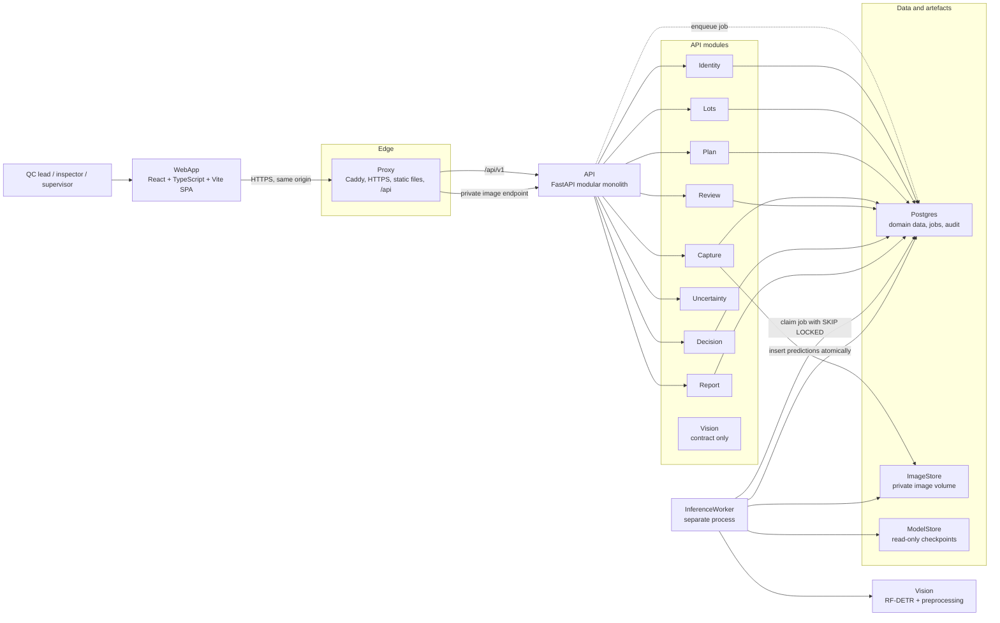

**Reading the diagram.** `WebApp` never talks to `Postgres`, `ImageStore`, or `InferenceWorker` directly. `InferenceWorker` never serves HTTP to the browser. The only browser-visible data path is through `Proxy` to `API`. Model artefacts sit outside `ImageStore`; images and checkpoints have different retention and access rules.

## 1.4 Why a modular monolith

v3 fixes a modular monolith: one Python API and one web app served through one proxy, with a separate inference process only so the site stays up when the model is down. The justification is concrete:

| Force | Modular monolith response |
|---|---|
| Four developers, 41 days | One deployable API, one frontend build, one database. No service discovery, distributed tracing, or cross-service contracts. |
| Strong consistency | Confirmations, counts, decisions, and audit events commit in one `Postgres` transaction. A microservice split would introduce distributed transactions or eventual consistency exactly where auditability matters. |
| Single authoritative backend | `API` owns authorization, validation, counting, and decisions. A second runtime would create a second place to enforce authorization, which v3 rejects for Next.js. |
| Failure isolation that matters | Only inference needs isolation. The `InferenceWorker` is a separate process, so a model crash or GPU/CPU stall cannot take down uploads, review, or manual decisions. |
| Operational budget | `Docker Compose` on one machine, one `Postgres`, one image volume. No message bus. Inference jobs are rows in `Postgres`. |
| Future extraction | Module boundaries (`Identity`, `Lots`, `Plan`, `Capture`, `Vision`, `Review`, `Uncertainty`, `Decision`, `Report`) are package boundaries with explicit interfaces. If scale later demands extraction, `Vision`/`InferenceWorker` is the first candidate, not the whole system. |

**What is deliberately not modularised.** The database is shared. Modules do not own separate schemas in version 1. Foreign keys cross module boundaries by design (for example `confirmed_defect` → `unit_view`), because referential integrity is more valuable than theoretical service autonomy. Module ownership is enforced in Python imports and code review, not by network calls.

## 1.5 Approved decisions carried forward

| v3 decision | Design position |
|---|---|
| **D1** React + TypeScript + Vite SPA; no Next.js; FastAPI only backend | Preserved. `Proxy` serves static files and proxies `/api`. One origin, cookie sessions, no CORS. |
| **D2** FastAPI, SQLAlchemy, Alembic; Compose services Proxy, API, InferenceWorker, Postgres, image volume; jobs in Postgres; `FOR UPDATE SKIP LOCKED` | Preserved. `WebApp` is a build artefact served by `Proxy`, not a runtime service. |
| **D3** Closed-set detector: `hole`, `oil_stain`, `needle_line`, `dropped_stitch`; RF-DETR Small/Medium Apache 2.0; YOLO fallback with AGPL-3.0 | Preserved. Baseline is RF-DETR Small; Medium is a training-time accuracy option. No second detector, no anomaly model in v1. |
| **D4** Public fabric data for transfer learning and a public test column; staged garments for evidence; dedup, license checks, per-source holdout | Preserved in §7. |
| **D5** BDFD9 primary; ISL-Knit conditional on license; FabriD v3 supplementary; AFID, RAW-FABRID, MVTec AD 2 negative controls | Preserved; dataset execution detail is not duplicated here. |
| **D6** One `n` per plan; `(Ac, Re)` per class; decision order from v3 §H | Preserved in §8. |
| **D7** Argon2id, HttpOnly/SameSite cookie, CSRF, `organization_id` + composite FKs, upload checks, `torch >= 2.6`, team-only checkpoints | Preserved in §4, §5, §7, §12. |
| **D8** Cuts: browser-printed HTML report, seeded clause mapping, no Bangla UI, no native app, no second detector | Preserved. Staged shooting and labelling start in week 1. |

## 1.6 Version-1 scope

**In scope**

- One organisation, one knit family (tee or polo), one buyer per lot.
- Email/password login with roles `admin`, `inspector`, `supervisor`.
- Lot creation, product/colour/lot size/buyer, sample units, front/back views, optional detail views.
- Phone-browser image upload, server-side normalisation, duplicate detection, private storage.
- One detector, four detector classes, CPU inference, model version recorded per prediction.
- Human review: confirm, edit box, reject, add a miss, choose zone and optional size band, mark a view clean.
- Buyer-seeded clause mapping; severity only on confirmed rows.
- Deterministic plan engine with one `n`, per-class `(Ac, Re)`, explicit counting mode.
- `ACCEPT`, `REJECT`, `HOLD`, `ESCALATE`; append-only decisions; supervisor override; lot lock/reopen.
- Printable one-page report.
- Critical non-visual checklist status.
- Manual mode when inference is unavailable.
- Docker Compose deployment with HTTPS on one machine.

**Out of scope**

- Line-scan cameras, smart glasses, worker surveillance, factory ERP integration.
- All garment types; more than one knit family.
- Native mobile apps; offline-first sync; Bangla UI.
- Multi-factory SaaS; multiple organisations in the UI; OAuth/SSO.
- Microservices, Kubernetes, message bus, Redis, Celery.
- A second detector, anomaly model, or automatic severity from pixels.
- PDF library, server-side PDF generation, calibration/coverage claims.
- Automated random sampling verification; the selection method is self-declared.

## 1.7 Quality attributes and targets

These are engineering targets, not measurement claims. Where v3 gives a target, it is marked; otherwise the value is an `[R]` design choice and must be validated before the demo.

| Attribute | Target | Notes |
|---|---|---|
| Decision correctness | Every engine test in §8.10 passes; a forced miss/HOLD/ESCALATE demo matches a hand calculation | v3 definition of done. |
| Availability of review | `API` stays up when `InferenceWorker` is down | Required by D2. Manual review remains available. |
| CPU inference latency | About 3 s per view; a 16-view lot about 1 min | v3 `[R]` target, not a measurement. |
| Upload limit | 25 MB and 50 megapixels per image, configurable | `[R]` default; server rejects above. |
| Session lifetime | 8 h absolute, 30 min idle, configurable | `[R]`. |
| Job lease | 120 s stale threshold, 3 attempts, configurable | `[R]`. |
| Backup | Daily `pg_dump` + image volume + checksum manifest; restore tested before demo | v3 O. No RPO/RTO guarantee. |
| Org isolation | Cross-organisation access returns 404; automated test per endpoint group | `[R]`. |
| Audit | Override, critical-check change, decision recompute, reopen, exclusion always audited | v3 O. |
| Browser support | Current Chrome/Safari on Android/iOS; desktop Chromium/Firefox for review | `[R]`. |

## 1.8 Team ownership

| Role | Primary modules | Secondary |
|---|---|---|
| Vision/data engineer | `Vision`, dataset pipeline, model training, `InferenceWorker` | `Uncertainty` signals, evaluation tables |
| Backend/decision engineer | `API`, `Identity`, `Lots`, `Plan`, `Capture`, `Review`, `Decision`, schema/migrations | Audit, backup, security tests |
| Frontend/capture engineer | `WebApp`, camera flow, annotation canvas, report print CSS | Responsive review UX, accessibility |
| QC domain/evaluation/pitch lead | Clause mapping seed, plan configuration, evaluation protocol, report wording, demo script | Staged shooting schedule, acceptance tests |

The fourth person owns the written evaluation. No role is a full-time integrator. Integration is a shared weekly checkpoint, not a separate job.

---

# 2. Technology Stack

## 2.1 Stack summary

| Layer | Choice | Baseline version | Responsibility |
|---|---|---|---|
| Web client | React + TypeScript + Vite | React 19, Vite 7, TypeScript 5.x | SPA, capture, annotation, review, report print view |
| Routing | React Router | v7 | Protected routes, lot/unit/view navigation |
| Server state | TanStack Query | v5 | Cache, invalidation, retries, loading/error states |
| Styling | Plain CSS modules or a small utility layer | — | No design system dependency required |
| API | Python + FastAPI | Python 3.12, FastAPI 0.11x | Single authoritative REST backend |
| ORM | SQLAlchemy 2.0 (sync) | 2.0.x | Persistence, transactions, row locks |
| Migrations | Alembic | 1.1x | Versioned schema, seed data |
| Database | PostgreSQL | 17.x | Domain data, jobs, audit, sessions |
| Inference | PyTorch + RF-DETR Small | PyTorch ≥ 2.6, RF-DETR current | Object detection on CPU |
| Worker | Python process, same image as API | — | Claim jobs, run model, write predictions |
| Reverse proxy | Caddy 2 | 2.x | TLS, static files, `/api` proxy, security headers |
| Packaging | Docker Compose | Compose v2 | One-machine deployment |
| Image storage | Local named volume | — | Private original/re-encoded images |
| Model storage | Read-only host/volume mount | — | Team-produced checkpoints and manifests |
| Password hashing | Argon2id via `argon2-cffi` | OWASP minimum | Password storage |
| Image processing | Pillow + `pillow-heif` | Current | Decode, orient, strip metadata, re-encode |

## 2.2 React + TypeScript + Vite

**Responsibility.** `WebApp` is a login-gated single-page application. It renders lot lists, capture screens, the review workspace, the decision panel, and the printable report. It never computes a decision.

**Why Vite.** The product has no SEO or server-rendering requirement `[A]`. Vite produces static files that `Proxy` can serve directly. There is no Node runtime in production, no React Server Components surface, and no second place to enforce authorization. v3 D1 records that the Next.js static-export variant drops cookies, rewrites, redirects, headers, proxy, and Server Actions `[V]`; a Next.js server runtime would add a second authorization boundary and attack surface for a four-person team. Next.js is not used.

**TypeScript policy.** `strict: true`. API response types are generated from the FastAPI OpenAPI schema in CI or via a developer script; handwritten duplicate DTOs are avoided where practical. The generated client is a development aid, not a second source of truth.

**Why React Router and TanStack Query.** v3 recommends React Router and a data-fetching library such as TanStack Query `[R]`. Router guards handle authentication and role visibility; Query handles server state, caching, retries, and invalidation after mutations. No Redux: the only global client states are session identity and a small UI shell.

## 2.3 Python + FastAPI

**Responsibility.** `API` is the only authoritative backend. It authenticates sessions, enforces roles and organisation scope, validates uploads, stores images, manages lots/plans/units/views, records reviews, runs the decision engine, serves reports, and enqueues inference jobs.

**Why FastAPI.** Typed request/response models, automatic OpenAPI, dependency injection for auth/CSRF/DB sessions, and a small team-friendly learning curve. Pydantic v2 provides boundary validation; SQLAlchemy and database constraints provide defence in depth.

**Synchronous SQLAlchemy decision.** Version 1 uses synchronous SQLAlchemy 2.0 with psycopg 3. FastAPI runs synchronous endpoints in its thread pool. Rationale: a four-person team, low concurrency, heavy image I/O, and a worker that is naturally synchronous. Async SQLAlchemy would add session-management and blocking-call hazards without a measured need. Concurrency that matters — job claiming and review edits — is handled by `Postgres` row locks and version columns, not by an event loop.

**Single process model.** One `API` container, one Uvicorn process (or a small number of workers) behind `Proxy`. If multiple API workers are used, sessions and rate limits remain in `Postgres`, so no sticky sessions are required. Alembic runs once at container start; scaling the API beyond one replica would require a separate migration job and is out of scope.

## 2.4 PyTorch and the selected detection model

**Selected model.** RF-DETR Small, Apache 2.0, as the version-1 baseline. RF-DETR Medium is permitted as a training-time accuracy comparison if Small fails the pre-declared localization check. The detector is a closed-set object detector with four classes: `hole`, `oil_stain`, `needle_line`, `dropped_stitch`.

**Why this model.** v3 D3 selects RF-DETR Small or Medium as the license-clean default `[V]` for the Apache 2.0 detection sizes. The class set is limited to labels in hand. Ultralytics YOLO is the fallback only if RF-DETR fails to train within three working days; in that case the whole repository is published under AGPL-3.0 `[V]`. No RT-DETR sweep and no anomaly model in version 1.

**PyTorch policy.** PyTorch 2.6 or newer. `torch.load` defaults to `weights_only=True` from 2.6, but this narrows rather than eliminates risk `[V]`. The worker loads only team-produced checkpoints from a read-only `ModelStore`, verifies the SHA-256 against `model_version.weights_sha256`, and never loads a user-supplied file. Pretrained weights used during training are official, hash-pinned artefacts; they are not accepted from users.

**CPU inference.** The `InferenceWorker` runs on CPU in version 1. The model is loaded once at process start, inference runs under `torch.inference_mode()`, and thread count is bounded by configuration. The ~3 s/view target is a target, not a guarantee. If the target is missed on demo hardware, the fallback is manual mode, not a hidden timeout that marks a view clean.

## 2.5 PostgreSQL

**Responsibility.** `Postgres` stores all domain state, review state, confirmed defects, decisions, overrides, audit events, sessions, login attempts, and inference jobs. It is also the queue: workers claim jobs with `SELECT ... FOR UPDATE SKIP LOCKED`.

**Why PostgreSQL.** Strong constraints, transactional DDL, partial unique indexes, composite foreign keys, JSONB for snapshots, and row-level locking for jobs. The team already needs a relational store for audit and counts; adding a queue product would add operational surface without a measured need.

**Version and extensions.** PostgreSQL 17.x. Only core features are required. UUIDs use `gen_random_uuid()`. No `citext` extension: email normalisation is a generated lowercase column plus a unique index. No row-level security in version 1; organisation isolation is application-scoped plus composite foreign keys, tested explicitly. RLS is a future hardening option, not a v1 dependency.

**Enum policy.** Status and type columns use `text` plus named `CHECK` constraints rather than native PostgreSQL enums. Rationale: Alembic migrations for enum values are error-prone; check constraints are explicit, portable, and easy to extend with a reviewed migration.

## 2.6 SQLAlchemy and Alembic

**SQLAlchemy 2.0.** Declarative models with explicit `mapped_column` types, naming conventions for constraints and indexes, and a session-per-request unit of work. Repositories accept an `Session` and never open their own transactions. The API layer owns commit/rollback; the worker owns its job transaction.

**Alembic.** Every schema change is a reviewed migration. Autogenerate is a drafting aid, never the final artefact. Migrations are forward-only in version 1; rollback scripts are written where safe. Seed data (demo clause mapping, demo plan template, initial admin) is idempotent and separated from schema migrations. The migration head is checked in CI against a fresh database.

**Naming conventions.** `pk_`, `fk_`, `uq_`, `ck_`, `ix_` prefixes. Constraint names are stable so migrations and error mapping can reference them. Example: `ck_plan_re_gt_ac`.

## 2.7 Docker Compose

**Responsibility.** One Compose file describes `proxy`, `api`, `worker`, and `db`, plus named volumes `pgdata`, `imagestore`, and read-only `modelstore`. `WebApp` is built in a multi-stage build and its static output is copied into the `proxy` image or mounted read-only.

**Why Compose.** v3 fixes one Compose file, one machine, one reverse proxy with HTTPS `[R]`. Compose gives reproducible startup order, health checks, volume persistence, and a demo that runs from one laptop. It does not claim high availability. Kubernetes and a service mesh are out of scope.

## 2.8 Reverse proxy and image storage

**Proxy: Caddy 2.** Caddy serves the built SPA with a history fallback to `index.html`, forwards `/api/*` to `api:8000`, terminates TLS, sets security headers, and enforces request-body limits at the edge as a second line of defence. Caddy's configuration is short enough for a four-person team to audit. nginx is an acceptable substitute if the team already operates it; v3 allows either `[A]`. This document standardises on Caddy.

**HTTPS.** `getUserMedia` is available only in secure contexts `[V]`. The demo therefore terminates HTTPS at `Proxy`. On a laptop hotspot without public DNS, use Caddy's internal CA and install the Caddy root certificate on the demo phone, or use a trusted tunnel/domain if one is already available. The plain file input with `capture="environment"` is the fallback; it does not require a live camera stream, but the page itself should still be served over HTTPS for secure cookies and browser permissions.

**ImageStore.** A local named volume mounted read-write into `API` and read-only into `InferenceWorker`. Files are private; there is no static file route. `API` streams image bytes only through an authenticated endpoint that checks organisation, role, and lot access. The database stores a relative `storage_key`, never an absolute host path. S3-compatible storage is out of scope unless a bucket already exists `[R]`; the storage interface is kept narrow so it can be replaced later.

---

# 3. Component Architecture

## 3.1 Component responsibilities and boundaries

| Component | Type | Owns | Must not do |
|---|---|---|---|
| **WebApp** | Browser SPA | Navigation, capture UI, annotation, review forms, progress display, report print view | Compute counts or outcomes; call the database; hold long-lived secrets; infer severity |
| **Proxy** | Caddy container | TLS, static SPA, `/api` reverse proxy, edge body limit, security headers | Apply business rules; authenticate users; parse domain payloads |
| **API** | FastAPI app | HTTP boundary, session auth, CSRF, role checks, validation, transactions, module orchestration, error mapping | Run the detector in-process; serve public image files; trust client-supplied counts |
| **Identity** | API module | Users, sessions, login rate limit, password hashing, roles, organisation context | Own lot data; decide inspection outcomes |
| **Lots** | API module | Product, lot, lot status, lot size, buyer, critical non-visual status, lot lock/reopen, sample units, required views | Assign severity; run inference; compute AQL limits |
| **Plan** | API module + pure domain | Plan versions, one `n`, per-class `AQL/Ac/Re`, counting mode, source edition, plan validation | Import `Vision`; read predictions; change counts |
| **Capture** | API module | Upload validation, orientation normalisation, metadata stripping, re-encode, checksum, duplicate detection, image supersession/exclusion, enqueue inference | Count defects; mark a view clean; decide severity |
| **Vision** | API contract + worker domain | Detector loading, preprocessing, inference, class/score/box output, model version identity | Write confirmed defects; assign severity; compute decisions; expose an HTTP server to the browser |
| **Review** | API module | Proposal confirm/edit/reject, manual defect add, zone/size band, clause lookup, view review state, optimistic concurrency, second-person critical rejection check | Change plan limits; bypass organisation scope; auto-confirm proposals |
| **Uncertainty** | API module | Low-score, blur/darkness, quality-gate flags, review priority, advisory projection inputs | Change `Ac`/`Re`; block a decision except through the explicit quality-gate HOLD condition; output severity |
| **Decision** | API module + pure domain | Input assembly, counting, precedence, outcome, reason codes, snapshot hash, decision history, override orchestration | Import `Vision`; read image pixels; mutate confirmed rows; update prior decisions |
| **Report** | API module | Read-only one-page report projection, wording, model/training-domain disclosure, override line, print payload | Become a second source of truth; recompute counts differently from `Decision` |
| **InferenceWorker** | Separate Python process | Poll/claim jobs, load image, run model, write predictions and job status atomically, heartbeat, retry | Serve user requests; make decisions; mark views clean; write confirmed defects |
| **Postgres** | Database | Durable state, constraints, transactions, job queue, audit, sessions | Hold image bytes; enforce HTTP authorization |
| **ImageStore** | Volume | Private image bytes, atomic writes, checksum-verifiable files | Serve bytes directly; store checkpoints or database dumps |

## 3.2 Module interaction rules

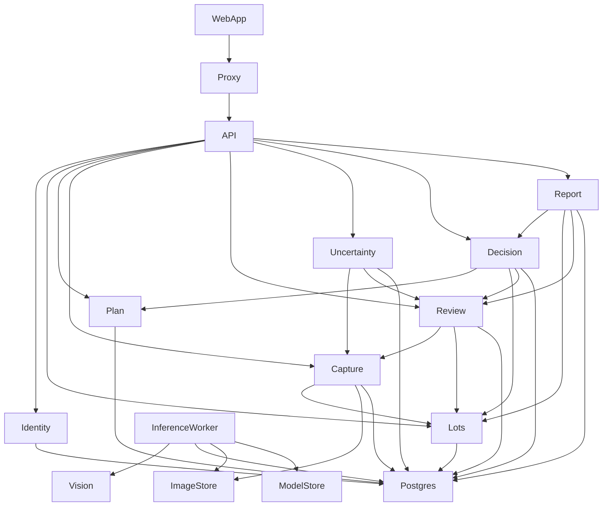

**Dependency rules (enforced in code review and import-linter):**

1. `Plan` imports no other Lotline domain module except shared types. It never imports `Vision`, `Capture`, `Review`, or `Decision`.
2. `Decision` imports `Plan` domain types and shared value objects. It assembles input through a read port; it never imports `Vision`, `InferenceWorker`, or model libraries.
3. `Vision` imports model libraries and `ImageStore` access only. It never imports `Decision`, `Plan`, `Review`, or `Report`.
4. `InferenceWorker` imports `Vision`, job repository, and `ImageStore`. It never imports `Decision`.
5. `Report` reads `Decision` outputs and reference data. `Decision` never imports `Report`.
6. `API` routers call services; services call repositories and pure engines. Routers never contain counting logic.
7. Cross-module reads go through a narrow service or read-model function, not by importing another module's ORM model into domain logic.

## 3.3 Business-rule ownership

| Rule | Owner | Enforcement point |
|---|---|---|
| R1 AQL is an index, not a percent allowance | `Plan` | Plan UI copy, report wording, engine only uses `n/Ac/Re` |
| R2 Count defective units, not boxes or cartons | `Decision` | Counting function; `counting_mode` required |
| R3 Three classes, three comparisons, one sample | `Plan` + `Decision` | Plan validation; per-class counts; `Re > Ac` check |
| R4 Severity is not a model output | `Review` | Severity only on `confirmed_defect`, via clause mapping; no severity field on `prediction` |
| R5 HOLD/ESCALATE are Lotline states | `Decision` | Outcome enum; report wording |
| R6 Model cannot bypass plan | `Decision` + `API` | Server computes counts; client cannot send counts; override is separate |
| R7 No reproduced sampling tables | `Plan` | Plan parameters entered/stored; no table in UI or code |
| R8 Default plan is an assumption | `Plan` | `is_demo` flag; report prints source/assumption |
| R9 No statistical guarantee | `Report` | Fixed wording; “uncalibrated” where applicable |
| R10 Random draw is self-declared | `Lots` | `selection_method` and optional seed stored and printed |
| R11 Empty is not clean; failure is not zero | `Review` + `Capture` + `Decision` | View starts `pending`; failure creates no clean state |
| R12 Exclusion needs a logged reason | `Capture` | `exclusion_log`; replacement required; open proposal/confirmed defect blocks exclusion |
| R13 Critical non-visual check | `Lots` + `Decision` | `critical_nonvisual_status`; blocks ACCEPT, not REJECT |
| R14 Honest outcome wording | `Report` | Report template; no “defect-free lot” claim |

## 3.4 End-to-end data flow

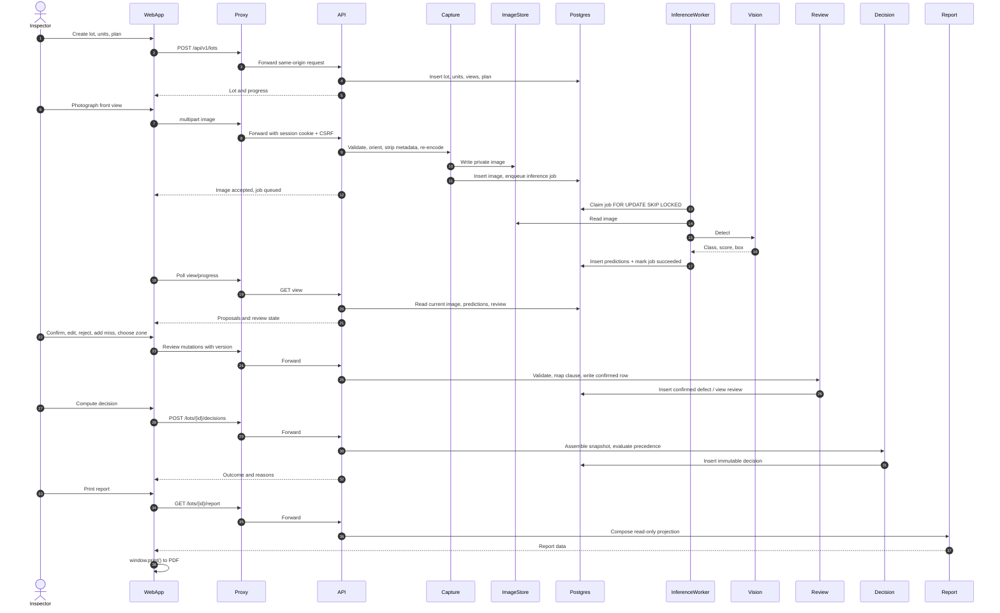

## 3.5 Transaction boundaries

| Action | Single transaction | Notes |
|---|---|---|
| Login | Session insert + audit event | Rate-limit attempt recorded before/after; password verification outside the write transaction |
| Create lot + plan + units + views | One transaction | The lot is usable only when all required views exist for each unit |
| Upload image | Image row + supersession + job insert | File write is staged and reconciled; see §12.4 |
| Review mutation | Confirmed defect / prediction status / view review + audit | Version check inside the transaction |
| Decision | Lot lock + read snapshot + insert decision + audit | `SELECT ... FOR UPDATE` on `lot` first; snapshot reads and insert run in `READ COMMITTED`; no prior decision update |
| Override | Insert override + audit | Must read the referenced decision in the same transaction |
| Reopen | Lot status update + audit | Prior decisions untouched |
| Worker job | Claim transaction; prediction-write transaction; heartbeat on its own connection | Claim commits before slow inference; predictions and `succeeded` commit together; heartbeat never shares the inference or write session |

**Lot-scoped write serialization.** Every write that can change decision input begins with `SELECT ... FROM lot WHERE organization_id = :org AND id = :lot FOR UPDATE` and holds that row lock until commit. This covers plan creation, lot open, sample-unit and view changes, image upload/replacement/exclusion, review and defect mutations, critical non-visual status, decision computation, override, reopen, and the worker's prediction-write transaction. A decision therefore cannot read counts and insert a row while a review commits between the read and the insert. Lock order is fixed: `lot` → `sample_unit` → `unit_view` → `image` → `prediction` → `confirmed_defect`/`view_review` → `decision` → `override`. No transaction takes these in reverse. Read-only endpoints take no lock. Login, model registration, and audit queries are not lot-scoped.

## 3.6 Cross-cutting concerns

- **Request identity:** every request gets a `request_id` from `Proxy` (`X-Request-ID`) or the API; it appears in logs, error bodies, and audit events.
- **Organisation context:** resolved from the session row, never from a request header or body. Repositories require an `org_id` argument.
- **Time:** all database timestamps are `timestamptz`, stored and displayed in UTC; the report prints UTC with an explicit label.
- **Money/statistics:** none. AQL values are configuration, not currency; counts are integers.
- **Feature flags:** `INFERENCE_ENABLED`, `QUALITY_GATE_ENABLED`, `AUTO_ENQUEUE_INFERENCE`. Flags are environment-level in v1, not per-user feature flags.
- **No hidden background work in the API:** FastAPI `BackgroundTasks` is not used for inference. The worker is the only inference executor.

# 4. Database Design

## 4.1 Conventions and invariants

| Convention | Rule |
|---|---|
| Primary keys | `uuid` generated by `gen_random_uuid()`. `audit_event` and `login_attempt` use `bigserial` because they are high-volume append-only logs. |
| Tenant key | Every tenant table has `organization_id uuid not null`. The `organization` table is the tenant root and is the only exception. |
| Organisation isolation | Every reference to a tenant row uses a composite foreign key `(organization_id, parent_id)` → `(organization_id, id)`. Parent tables therefore carry a unique constraint on `(organization_id, id)`. |
| Timestamps | `timestamptz not null default now()`, stored in UTC. No local-time columns. |
| Status columns | `text` plus named `CHECK` constraints. No native PostgreSQL enums. |
| Money/statistics | No floating-point counts. Counts are `integer`. Scores are `double precision` constrained to `[0,1]`. |
| Deletion | Hard deletion is prohibited for lots, units, views, images, predictions, confirmed defects, decisions, overrides, and audit events. Users are deactivated, not deleted. Only sessions, login attempts, and stale queued jobs may be purged. |
| Append-only | `decision`, `override`, `exclusion_log`, and `audit_event` are protected by a trigger that raises on `UPDATE` and `DELETE`. |
| Mutable reference data | `plan` rows are immutable after insert except `is_active`; edits create a new `version`. `clause_mapping` is seeded/read-only in v1; v2 adds an editor. |
| Images | Bytes live only in `ImageStore`. The database stores metadata and a relative `storage_key`. |
| Optimistic concurrency | `unit_view`-scoped review rows and `confirmed_defect` rows carry `version integer`; clients must send the version they read. |
| Naming | `pk_`, `fk_`, `uq_`, `ck_`, `ix_` prefixes, stable for error mapping and migrations. |

**Three database-level rules that are deliberately not triggers.** (1) A view is `confirmed_defects` only if at least one active confirmed defect exists on its current image; (2) a view is `confirmed_clean` only if no active confirmed defect and no open proposal exists; (3) a confirmed defect's severity must match the clause mapping applied at confirmation time. These are service invariants because they span rows, need actor context, and must produce domain error codes. Each has a dedicated integration test. The database still carries the simpler per-row checks listed below.

## 4.2 Identity and access tables

### `organization`

| Column | Type | Constraints |
|---|---|---|
| `id` | uuid | PK, default `gen_random_uuid()` |
| `code` | text | not null, unique, `^[a-z0-9][a-z0-9-]{1,31}$` |
| `name` | text | not null, non-empty |
| `is_active` | boolean | not null default true |
| `created_at` | timestamptz | not null default `now()` |
| `updated_at` | timestamptz | not null default `now()` |

### `app_user`

| Column | Type | Constraints |
|---|---|---|
| `id` | uuid | PK |
| `organization_id` | uuid | not null, FK → `organization(id)` |
| `email` | text | not null, length ≤ 320 |
| `email_normalized` | text | generated always as `lower(btrim(email))` stored, not null |
| `password_hash` | text | not null, Argon2id encoded hash |
| `display_name` | text | not null, non-empty |
| `role` | text | not null, `CHECK (role IN ('admin','inspector','supervisor'))` |
| `is_active` | boolean | not null default true |
| `last_login_at` | timestamptz | null |
| `created_at`, `updated_at` | timestamptz | not null default `now()` |

**Constraints and indexes:** `UNIQUE (organization_id, id)`; `UNIQUE (email_normalized)` globally, because the login form has no organisation selector in v1; `ix_app_user_org_role` on `(organization_id, role)`; check `email_normalized <> ''`.

**Rationale for global email uniqueness.** v1 has one organisation. A globally unique email keeps login unambiguous. If multi-organisation SaaS is added, this becomes `UNIQUE (organization_id, email_normalized)` plus an organisation selector or email-domain routing; that is a v3+ change, not a v1 concern.

### `user_session`

| Column | Type | Constraints |
|---|---|---|
| `id` | uuid | PK |
| `organization_id` | uuid | not null, FK → `organization(id)` |
| `user_id` | uuid | not null, composite FK `(organization_id, user_id)` → `app_user(organization_id, id)` |
| `token_hash` | char(64) | not null, unique, lowercase hex SHA-256 of a 32-byte random token |
| `csrf_token_hash` | char(64) | not null, lowercase hex SHA-256 of a 32-byte random CSRF token |
| `created_at` | timestamptz | not null default `now()` |
| `last_seen_at` | timestamptz | not null default `now()` |
| `expires_at` | timestamptz | not null |
| `revoked_at` | timestamptz | null |

**Constraints and indexes:** `UNIQUE (organization_id, id)`; `ix_user_session_user` on `(user_id)`; `ix_user_session_expiry` on `(expires_at)`; checks `expires_at > created_at`, `revoked_at IS NULL OR revoked_at >= created_at`. The raw session token and raw CSRF token are never stored.

### `login_attempt`

| Column | Type | Constraints |
|---|---|---|
| `id` | bigserial | PK |
| `organization_id` | uuid | not null, FK → `organization(id)`; v1 uses the single configured organisation (`DEFAULT_ORGANIZATION_CODE`) even for unknown emails |
| `email_normalized` | text | not null |
| `ip_hash` | char(64) | not null, keyed hash of the client IP; raw IP not stored |
| `success` | boolean | not null |
| `attempted_at` | timestamptz | not null default `now()` |

**Constraints and indexes:** `ix_login_attempt_email_time` on `(organization_id, email_normalized, attempted_at DESC)`; `ix_login_attempt_ip_time` on `(organization_id, ip_hash, attempted_at DESC)`. Insert-only from the application; the 30-day retention purge is the only delete path, and rows are never updated. This table exists solely for rate limiting and is not part of the decision audit.

## 4.3 Product, lot, and plan tables

### `product`

| Column | Type | Constraints |
|---|---|---|
| `id` | uuid | PK |
| `organization_id` | uuid | not null, FK → `organization(id)` |
| `code` | text | not null |
| `name` | text | not null |
| `family` | text | not null default `'knit_top'`, non-empty |
| `required_views` | text[] | not null default `'{front,back}'`; check `required_views <@ ARRAY['front','back']` and `cardinality(required_views) >= 1` |
| `is_active` | boolean | not null default true |
| `created_at`, `updated_at` | timestamptz | not null default `now()` |

**Constraints:** `UNIQUE (organization_id, code)`, `UNIQUE (organization_id, id)`.

`required_views` is snapshotted into `unit_view.is_required` when units are created. Detail shots are always optional and are not listed here.

### `lot`

| Column | Type | Constraints |
|---|---|---|
| `id` | uuid | PK |
| `organization_id` | uuid | not null, FK → `organization(id)` |
| `product_id` | uuid | not null, composite FK `(organization_id, product_id)` → `product(organization_id, id)` |
| `code` | text | not null, lot code |
| `buyer_name` | text | not null |
| `buyer_key` | text | generated always as `lower(btrim(buyer_name))` stored |
| `color` | text | not null |
| `lot_size` | integer | not null, `CHECK (lot_size > 0)` |
| `status` | text | not null default `'draft'`, `CHECK (status IN ('draft','open','decided','reopened'))` |
| `critical_nonvisual_status` | text | not null default `'pending'`, `CHECK (critical_nonvisual_status IN ('pending','done','not_required'))` |
| `critical_nonvisual_set_by` | uuid | null, composite FK `(organization_id, critical_nonvisual_set_by)` → `app_user(organization_id, id)` |
| `critical_nonvisual_set_at` | timestamptz | null |
| `critical_nonvisual_note` | text | null |
| `selection_method` | text | not null default `'self_declared_manual'`, `CHECK (selection_method IN ('self_declared_manual','random_helper','convenience','other'))` |
| `selection_seed` | text | null; present only for `random_helper` |
| `selection_note` | text | null |
| `created_by` | uuid | not null, composite FK to `app_user` |
| `decided_at` | timestamptz | null |
| `reopened_at` | timestamptz | null |
| `created_at`, `updated_at` | timestamptz | not null default `now()` |

**Constraints and indexes:** `UNIQUE (organization_id, code)`, `UNIQUE (organization_id, id)`; `ix_lot_org_status` on `(organization_id, status)`; check `critical_nonvisual_status = 'pending' OR (critical_nonvisual_set_by IS NOT NULL AND critical_nonvisual_set_at IS NOT NULL)`; check `status <> 'decided' OR decided_at IS NOT NULL`; check `selection_method <> 'random_helper' OR selection_seed IS NOT NULL`.

**Status semantics.** `draft` means setup is incomplete. `open` means inspection is active. `decided` means the latest effective outcome is ACCEPT or REJECT and the lot is locked. `reopened` means a supervisor unlocked the lot; prior decisions remain. A lot moves `draft → open` explicitly, `open → decided` when the API stores an ACCEPT/REJECT decision or an override to ACCEPT/REJECT, and `decided → reopened` only by a supervisor with a reason. `reopened → decided` requires a new decision or a supervisor override of the latest decision. A system HOLD or ESCALATE does not lock the lot.

### `plan`

| Column | Type | Constraints |
|---|---|---|
| `id` | uuid | PK |
| `organization_id` | uuid | not null |
| `lot_id` | uuid | not null, composite FK `(organization_id, lot_id)` → `lot(organization_id, id)` |
| `version` | integer | not null, `CHECK (version > 0)` |
| `is_active` | boolean | not null default true |
| `sampling_type` | text | not null default `'single'`, `CHECK (sampling_type = 'single')` |
| `inspection_level` | text | not null default `'II'` |
| `n` | integer | not null, `CHECK (n > 0)` |
| `counting_mode` | text | not null, `CHECK (counting_mode IN ('highest_class_only','every_class'))` |
| `critical_aql` | numeric(6,3) | null, `CHECK (critical_aql IS NULL OR critical_aql >= 0)` |
| `critical_ac` | integer | not null, `CHECK (critical_ac >= 0)` |
| `critical_re` | integer | not null |
| `major_aql` | numeric(6,3) | null, non-negative |
| `major_ac` | integer | not null, non-negative |
| `major_re` | integer | not null |
| `minor_aql` | numeric(6,3) | null, non-negative |
| `minor_ac` | integer | not null, non-negative |
| `minor_re` | integer | not null |
| `source_edition` | text | not null, e.g. the edition recorded from the licensed copy or buyer order |
| `source_reference` | text | not null, free text identifying the licensed copy or buyer order |
| `is_demo` | boolean | not null default false |
| `notes` | text | null |
| `created_by` | uuid | not null, composite FK to `app_user` |
| `created_at` | timestamptz | not null default `now()` |

**Constraints and indexes:** `UNIQUE (organization_id, lot_id, version)`, `UNIQUE (organization_id, id)`; partial unique `uq_plan_one_active_per_lot` on `(organization_id, lot_id) WHERE is_active`; `ck_plan_re_gt_ac` enforces `critical_re > critical_ac AND major_re > major_ac AND minor_re > minor_ac`; `ix_plan_lot_active` on `(organization_id, lot_id, is_active)`.

**Immutability.** Once inserted, all columns except `is_active` are immutable. A trigger `trg_plan_immutable_fields` raises if a numeric, source, counting-mode, or `n` value changes. Editing a plan creates a new row with `version + 1`, sets the previous row's `is_active = false`, and writes an audit event. Decisions reference the exact plan row used.

**Gap between Ac and Re.** The schema permits `Re > Ac + 1` because R3 only forbids `Re <= Ac`. The plan is accepted; a count that falls strictly between `Ac` and `Re` produces `HOLD` with `HOLD_PLAN_AMBIGUOUS_LIMITS` at decision time; see §8.6. The seeded v1 plans use `Re = Ac + 1`.

## 4.4 Sample, view, and image tables

### `sample_unit`

| Column | Type | Constraints |
|---|---|---|
| `id` | uuid | PK |
| `organization_id` | uuid | not null |
| `lot_id` | uuid | not null, composite FK `(organization_id, lot_id)` → `lot(organization_id, id)` |
| `unit_no` | integer | not null, `CHECK (unit_no > 0)` |
| `garment_code` | text | not null |
| `created_by` | uuid | not null, composite FK to `app_user` |
| `created_at` | timestamptz | not null default `now()` |

**Constraints and indexes:** `UNIQUE (organization_id, id)`, `UNIQUE (organization_id, lot_id, id)`, `UNIQUE (organization_id, lot_id, unit_no)`, `UNIQUE (organization_id, lot_id, garment_code)`; `ix_sample_unit_lot` on `(organization_id, lot_id, unit_no)`.

**Invariant.** A unit belongs to exactly one lot. `garment_code` is the unique physical identifier within the lot; `unit_no` is the draw/order index and is never reused. A unit has no stored completeness flag; completeness is derived from its required views.

### `unit_view`

| Column | Type | Constraints |
|---|---|---|
| `id` | uuid | PK |
| `organization_id` | uuid | not null |
| `lot_id` | uuid | not null |
| `sample_unit_id` | uuid | not null |
| `side` | text | not null, `CHECK (side IN ('front','back','detail'))` |
| `detail_label` | text | null |
| `is_required` | boolean | not null default true |
| `review_priority` | text | not null default `'normal'`, `CHECK (review_priority IN ('normal','high'))` |
| `uncertainty_flags` | jsonb | not null default `'{}'`; advisory only |
| `created_at` | timestamptz | not null default `now()` |

**Constraints and indexes:** `UNIQUE (organization_id, id)`, `UNIQUE (organization_id, lot_id, sample_unit_id, id)`; `UNIQUE (organization_id, sample_unit_id, side, detail_label) NULLS NOT DISTINCT`; composite FK `(organization_id, lot_id, sample_unit_id)` → `sample_unit(organization_id, lot_id, id)`; check `side = 'detail' OR detail_label IS NULL`; index `(organization_id, lot_id, is_required)`.

**Why `NULLS NOT DISTINCT`.** It allows exactly one front view and one back view per unit, while allowing multiple detail views distinguished by `detail_label`. A detail view with a null label is permitted but only one per unit.

**Uncertainty flags.** `uncertainty_flags` is a small JSON object such as `{"low_score": true, "blur": true, "dark": false, "quality_gate": "retake"}`. It is advisory, is never read as a count, and is not part of the decision snapshot hash except through the explicit quality-gate HOLD reason. It is stored on the view, not on the image, because review priority belongs to the view.

### `image`

| Column | Type | Constraints |
|---|---|---|
| `id` | uuid | PK |
| `organization_id` | uuid | not null |
| `lot_id` | uuid | not null |
| `sample_unit_id` | uuid | not null |
| `unit_view_id` | uuid | not null |
| `storage_key` | text | not null, relative path under `ImageStore` |
| `original_filename` | text | null, sanitised for display only |
| `source_mime_type` | text | not null, detected by magic bytes |
| `mime_type` | text | not null default `'image/jpeg'`, `CHECK (mime_type = 'image/jpeg')` |
| `byte_size` | bigint | not null, `CHECK (byte_size > 0)` |
| `width_px` | integer | not null, `CHECK (width_px > 0)` |
| `height_px` | integer | not null, `CHECK (height_px > 0)` |
| `sha256_hex` | char(64) | not null, `CHECK (sha256_hex ~ '^[0-9a-f]{64}$')` |
| `is_current` | boolean | not null default true |
| `duplicate_of_image_id` | uuid | null, composite FK `(organization_id, duplicate_of_image_id)` → `image(organization_id, id)` |
| `superseded_by_image_id` | uuid | null, composite FK to `image` |
| `excluded_at` | timestamptz | null |
| `uploaded_by` | uuid | not null, composite FK to `app_user` |
| `uploaded_at` | timestamptz | not null default `now()` |
| `quality_state` | text | not null default `'unassessed'`, `CHECK (quality_state IN ('unassessed','ok','blurry','dark'))` |
| `quality_metrics` | jsonb | null, e.g. `{"laplacian_var": 123.4, "mean_luma": 0.42}` |
| `quality_checked_at` | timestamptz | null |

**Constraints and indexes:** `UNIQUE (organization_id, id)`; `UNIQUE (organization_id, storage_key)`; partial unique `uq_image_one_current_per_view` on `(organization_id, unit_view_id) WHERE is_current`; partial unique `uq_image_original_checksum_per_lot` on `(organization_id, lot_id, sha256_hex) WHERE duplicate_of_image_id IS NULL`; check `duplicate_of_image_id IS NULL OR is_current = false`; check `superseded_by_image_id IS NULL OR is_current = false`; check `excluded_at IS NULL OR is_current = false`; composite FK `(organization_id, lot_id, sample_unit_id, unit_view_id)` → `unit_view(organization_id, lot_id, sample_unit_id, id)`; indexes on `(organization_id, lot_id)`, `(organization_id, unit_view_id, is_current)`, `(organization_id, sha256_hex)`.

**Duplicate policy.** One original image per lot and SHA-256 is enforced. A duplicate upload is stored with `is_current = false` and `duplicate_of_image_id` pointing at the original, or rejected with `409 duplicate_image` and the original id. Either way it is linked, never counted twice. A duplicate row cannot become current.

**Replacement and exclusion.** Uploading a replacement for a view sets the old current image to `is_current = false`, writes `superseded_by_image_id`, and inserts the new current image. Excluding a current image sets `is_current = false`, sets `excluded_at`, and inserts an `exclusion_log` row. A view with no current image is incomplete until a replacement is uploaded.

### `exclusion_log`

| Column | Type | Constraints |
|---|---|---|
| `id` | uuid | PK |
| `organization_id` | uuid | not null |
| `lot_id` | uuid | not null |
| `unit_view_id` | uuid | not null |
| `image_id` | uuid | not null, composite FK `(organization_id, image_id)` → `image(organization_id, id)` |
| `reason` | text | not null, `CHECK (reason IN ('duplicate_checksum','not_an_image','unreadable','other'))` |
| `note` | text | null |
| `excluded_by` | uuid | not null, composite FK to `app_user` |
| `created_at` | timestamptz | not null default `now()` |

**Constraints and indexes:** `UNIQUE (organization_id, image_id)`; composite FKs to lot and view; check `reason <> 'other' OR note IS NOT NULL`; `ix_exclusion_lot` on `(organization_id, lot_id, created_at DESC)`. Append-only.

## 4.5 Model, inference, and prediction tables

### `model_version`

| Column | Type | Constraints |
|---|---|---|
| `id` | uuid | PK |
| `organization_id` | uuid | not null |
| `name` | text | not null, e.g. `rfdetr-knit` |
| `version` | text | not null, e.g. `2026-12-01.1` |
| `detector_family` | text | not null, `CHECK (detector_family IN ('rfdetr','yolo'))` |
| `weights_sha256` | char(64) | not null |
| `artifact_ref` | text | not null, relative path under `ModelStore` |
| `license` | text | not null, e.g. `Apache-2.0` or `AGPL-3.0` |
| `license_notes` | text | null |
| `training_domains` | text[] | not null default `'{}'` |
| `classes` | text[] | not null default `'{hole,oil_stain,needle_line,dropped_stitch}'` |
| `metrics` | jsonb | not null default `'{}'`, per-domain only |
| `dataset_manifest_hash` | char(64) | null |
| `is_active` | boolean | not null default false |
| `created_at` | timestamptz | not null default `now()` |
| `activated_at` | timestamptz | null |
| `deactivated_at` | timestamptz | null |

**Constraints and indexes:** `UNIQUE (organization_id, name, version)`, `UNIQUE (organization_id, weights_sha256)`, `UNIQUE (organization_id, id)`; partial unique `uq_model_one_active` on `(organization_id) WHERE is_active`; check `is_active = false OR activated_at IS NOT NULL`.

**Activation.** Only an `admin` may activate a model version. Activation deactivates the prior active row in the same transaction and writes an audit event. The worker reads the active row when claiming a job and stores `model_version_id` on the job. A model is never activated by a file drop; it is registered with a manifest and hash first.

### `inference_job`

| Column | Type | Constraints |
|---|---|---|
| `id` | uuid | PK |
| `organization_id` | uuid | not null |
| `lot_id` | uuid | not null |
| `sample_unit_id` | uuid | not null |
| `unit_view_id` | uuid | not null |
| `image_id` | uuid | not null, composite FK to `image` |
| `status` | text | not null default `'queued'`, `CHECK (status IN ('queued','running','succeeded','failed','canceled'))` |
| `attempts` | integer | not null default 0, `CHECK (attempts >= 0)` |
| `max_attempts` | integer | not null default 3, `CHECK (max_attempts > 0)` |
| `model_version_id` | uuid | null, composite FK to `model_version` |
| `worker_id` | text | null |
| `error_code` | text | null |
| `error_message` | text | null, sanitised |
| `created_at` | timestamptz | not null default `now()` |
| `started_at` | timestamptz | null |
| `heartbeat_at` | timestamptz | null |
| `lease_expires_at` | timestamptz | null |
| `finished_at` | timestamptz | null |

**Constraints and indexes:** `UNIQUE (organization_id, id)`; partial unique `uq_inference_one_active_per_image` on `(organization_id, image_id) WHERE status IN ('queued','running')`; `ix_inference_claim` on `(status, created_at)`; `ix_inference_lot` on `(organization_id, lot_id, status)`; `ix_inference_stale` on `(status, lease_expires_at)`; check `attempts <= max_attempts`.

**Job ownership.** A job refers to one image. Repredicting the same image creates a new job after the prior one is terminal. Predictions from a prior job remain historical but are not used for the current image review if a newer job has succeeded; the review UI reads the latest succeeded job for the current image.

### `prediction`

| Column | Type | Constraints |
|---|---|---|
| `id` | uuid | PK |
| `organization_id` | uuid | not null |
| `lot_id` | uuid | not null |
| `sample_unit_id` | uuid | not null |
| `unit_view_id` | uuid | not null |
| `image_id` | uuid | not null |
| `inference_job_id` | uuid | not null, composite FK to `inference_job` |
| `model_version_id` | uuid | not null, composite FK to `model_version` |
| `ordinal` | integer | not null, `CHECK (ordinal >= 0)` |
| `class_label` | text | not null, `CHECK (class_label IN ('hole','oil_stain','needle_line','dropped_stitch'))` |
| `score` | double precision | not null, `CHECK (score >= 0 AND score <= 1)` |
| `x1`, `y1`, `x2`, `y2` | double precision | not null, normalised `[0,1]`; check `0 <= x1 < x2 <= 1` and `0 <= y1 < y2 <= 1` |
| `status` | text | not null default `'proposed'`, `CHECK (status IN ('proposed','confirmed','rejected'))` |
| `provisional_critical` | boolean | not null default false; routing hint only, never a severity |
| `reviewed_by` | uuid | null, composite FK to `app_user` |
| `reviewed_at` | timestamptz | null |
| `second_review_required` | boolean | not null default false |
| `second_review_status` | text | null, `CHECK (second_review_status IN ('pending','confirmed','overturned'))` |
| `second_reviewer_id` | uuid | null, composite FK to `app_user` |
| `second_reviewed_at` | timestamptz | null |
| `created_at` | timestamptz | not null default `now()` |

**Constraints and indexes:** `UNIQUE (organization_id, inference_job_id, ordinal)`, `UNIQUE (organization_id, id)`, `UNIQUE (organization_id, id, unit_view_id)`; check `reviewed_by IS NULL OR reviewed_at IS NOT NULL`; check `status = 'proposed' OR (reviewed_by IS NOT NULL AND reviewed_at IS NOT NULL)`; check `second_reviewer_id IS NULL OR second_reviewer_id <> reviewed_by`; check `second_review_required = false OR second_review_status IS NOT NULL`; indexes on `(organization_id, image_id, status)`, `(organization_id, unit_view_id, status)`, `(organization_id, lot_id, class_label, status)`.

**`provisional_critical` is not severity.** It is a boolean routing hint computed from the predicted type's clause mappings (for example, if any mapping for that type is critical). It drives review priority and the E1/E3 escalation conditions. It is never displayed as `critical`, never stored on `confirmed_defect`, and never counted. The name is deliberately not `severity`.

## 4.6 Review, clause, and decision tables

### `confirmed_defect`

| Column | Type | Constraints |
|---|---|---|
| `id` | uuid | PK |
| `organization_id` | uuid | not null |
| `lot_id` | uuid | not null |
| `sample_unit_id` | uuid | not null |
| `unit_view_id` | uuid | not null |
| `image_id` | uuid | not null |
| `prediction_id` | uuid | null |
| `source` | text | not null, `CHECK (source IN ('prediction','manual'))` |
| `defect_type` | text | not null, `CHECK (defect_type IN ('hole','dropped_stitch','skipped_stitch','needle_line','oil_stain','shade_band','other'))` |
| `x1`, `y1`, `x2`, `y2` | double precision | not null, normalised final human box |
| `zone_code` | text | not null, non-empty |
| `size_band` | text | null |
| `severity` | text | null, `CHECK (severity IN ('critical','major','minor'))` |
| `clause_mapping_id` | uuid | null, composite FK to `clause_mapping` |
| `reviewer_id` | uuid | not null, composite FK to `app_user` |
| `note` | text | null |
| `version` | integer | not null default 1, `CHECK (version > 0)` |
| `retracted_at` | timestamptz | null |
| `retracted_by` | uuid | null, composite FK to `app_user` |
| `retraction_reason` | text | null |
| `created_at`, `updated_at` | timestamptz | not null default `now()` |

**Constraints and indexes:** `UNIQUE (organization_id, id)`; partial unique `uq_confirmed_one_per_prediction` on `(organization_id, prediction_id) WHERE prediction_id IS NOT NULL`; composite FK `(organization_id, prediction_id, unit_view_id)` → `prediction(organization_id, id, unit_view_id)`; check `(source = 'prediction') = (prediction_id IS NOT NULL)`; check `(severity IS NULL) = (clause_mapping_id IS NULL)`; check `retracted_at IS NULL OR (retracted_by IS NOT NULL AND retraction_reason IS NOT NULL)`; bbox checks; indexes on `(organization_id, lot_id, severity) WHERE retracted_at IS NULL`, `(organization_id, sample_unit_id)`, `(organization_id, unit_view_id)`.

**Severity rule.** `severity` is written only from the clause mapping selected by `(buyer_key, defect_type, zone_code, size_band)`. If no mapping exists, both `severity` and `clause_mapping_id` are null, the defect is still confirmed and stored, and `Decision` returns `ESCALATE` (E2). `defect_type = 'other'` always has null severity and escalates.

**Retraction.** A confirmed defect may be retracted before the lot is decided, by a reviewer or supervisor, with a reason. Retraction is an audited correction, not a delete: the row remains, `retracted_at` is set, and `Decision` excludes it. Once a lot is `decided`, no retraction is possible until a supervisor reopens it. This is the only way counts can decrease; the decision engine's monotonic argument applies within a computation, not across an audited correction.

### `view_review`

| Column | Type | Constraints |
|---|---|---|
| `id` | uuid | PK |
| `organization_id` | uuid | not null |
| `lot_id` | uuid | not null |
| `sample_unit_id` | uuid | not null |
| `unit_view_id` | uuid | not null |
| `image_id` | uuid | not null, composite FK to `image` |
| `state` | text | not null, `CHECK (state IN ('confirmed_clean','confirmed_defects'))` |
| `reviewer_id` | uuid | not null, composite FK to `app_user` |
| `reviewed_at` | timestamptz | not null default `now()` |
| `note` | text | null |
| `version` | integer | not null default 1, `CHECK (version > 0)` |
| `created_at`, `updated_at` | timestamptz | not null default `now()` |

**Constraints and indexes:** `UNIQUE (organization_id, unit_view_id, image_id)`; `UNIQUE (organization_id, id)`; composite FKs to lot, unit, and view; index `(organization_id, lot_id, state)`; index `(organization_id, unit_view_id)`.

**Why `image_id` is part of the key.** A review applies to the image the reviewer saw. Replacing the image does not silently carry a clean result forward. The old review remains as history, but completeness checks join the current image to a review with the same `image_id`. A replaced view is reviewed again.

**State invariants (service-enforced).** `confirmed_defects` requires at least one active confirmed defect on the reviewed image. `confirmed_clean` requires zero active confirmed defects and zero `proposed` predictions on that image. A view with zero proposals is `pending` until a human marks it clean. A reviewer cannot set a view review while a proposal is still `proposed`; E1 is evaluated for interim decision computations where a view is not yet reviewed.

### `clause_mapping`

| Column | Type | Constraints |
|---|---|---|
| `id` | uuid | PK |
| `organization_id` | uuid | not null |
| `buyer_name` | text | not null |
| `buyer_key` | text | generated always as `lower(btrim(buyer_name))` stored |
| `defect_type` | text | not null, `CHECK (defect_type IN ('hole','dropped_stitch','skipped_stitch','needle_line','oil_stain','shade_band'))` |
| `zone_code` | text | not null, non-empty |
| `size_band` | text | null |
| `severity` | text | not null, `CHECK (severity IN ('critical','major','minor'))` |
| `clause_ref` | text | not null |
| `source` | text | not null, e.g. buyer clause list or licensed copy reference |
| `is_active` | boolean | not null default true |
| `created_at`, `updated_at` | timestamptz | not null default `now()` |

**Constraints and indexes:** `UNIQUE (organization_id, id)`; `UNIQUE (organization_id, buyer_key, defect_type, zone_code, size_band) NULLS NOT DISTINCT`; index `(organization_id, buyer_key, defect_type, zone_code) WHERE is_active`; check `defect_type <> 'other'` because “other” always escalates by rule.

**Lookup rule.** Try an exact `(buyer_key, defect_type, zone_code, size_band)` match first; if `size_band` was supplied and no exact row exists, try the same key with `size_band IS NULL`. If neither exists, no severity is assigned and E2 escalates. v1 loads this table from a reviewed JSON seed; there is no editing screen. v2 adds supervisor editing with versioned rows.

### `decision`

| Column | Type | Constraints |
|---|---|---|
| `id` | uuid | PK |
| `organization_id` | uuid | not null |
| `lot_id` | uuid | not null, composite FK to `lot` |
| `sequence` | integer | not null, `CHECK (sequence > 0)` |
| `plan_id` | uuid | null only for `HOLD_PLAN_MISSING`; otherwise composite FK to `plan` |
| `plan_version` | integer | null only for `HOLD_PLAN_MISSING` |
| `outcome` | text | not null, `CHECK (outcome IN ('ACCEPT','REJECT','HOLD','ESCALATE'))` |
| `reason_code` | text | not null; stable string from §8.6 |
| `reason_details` | jsonb | not null default `'{}'` |
| `counting_mode` | text | null only for `HOLD_PLAN_MISSING` or `HOLD_PLAN_INVALID` |
| `lot_size` | integer | not null, `CHECK (lot_size > 0)` |
| `n_entered` | integer | null only for `HOLD_PLAN_MISSING` or `HOLD_PLAN_INVALID`; an invalid entered value is stored as entered, so there is no positivity check here |
| `n_effective` | integer | null in the same two cases; `CHECK (n_effective IS NULL OR (n_effective > 0 AND n_effective <= lot_size))` |
| `units_present` | integer | not null, non-negative |
| `required_view_count` | integer | not null, non-negative |
| `reviewed_view_count` | integer | not null, non-negative |
| `critical_count`, `major_count`, `minor_count` | integer | not null, non-negative |
| `critical_ac`, `critical_re` | integer | null only for `HOLD_PLAN_MISSING` or `HOLD_PLAN_INVALID` |
| `major_ac`, `major_re` | integer | null only for `HOLD_PLAN_MISSING` or `HOLD_PLAN_INVALID` |
| `minor_ac`, `minor_re` | integer | null only for `HOLD_PLAN_MISSING` or `HOLD_PLAN_INVALID` |
| `critical_nonvisual_status` | text | not null |
| `plan_snapshot` | jsonb | null only for `HOLD_PLAN_MISSING`; when present, records the entered plan values even if they are invalid |
| `counts_snapshot` | jsonb | not null, per-class counted unit ids and retraction-aware defect ids |
| `confirmed_snapshot_hash` | char(64) | not null |
| `model_versions` | jsonb | not null default `'[]'` |
| `engine_version` | text | not null |
| `computed_by` | uuid | not null, composite FK to `app_user` |
| `supersedes_decision_id` | uuid | null, composite FK to `decision` |
| `idempotency_key` | text | null |
| `created_at` | timestamptz | not null default `now()` |

**Constraints and indexes:** `UNIQUE (organization_id, lot_id, sequence)`, `UNIQUE (organization_id, id)`, partial unique `uq_decision_idempotency` on `(organization_id, lot_id, idempotency_key) WHERE idempotency_key IS NOT NULL`; index `(organization_id, lot_id, sequence DESC)`; append-only trigger.

**Plan-derived nullability.** A decision with `reason_code = 'HOLD_PLAN_MISSING'` is a real, auditable row even though there is no plan: every plan-derived column is null. A `HOLD_PLAN_INVALID` row keeps `plan_id`, `plan_version`, and `plan_snapshot` (there is a plan row) but may leave `counting_mode`, `n_entered`, `n_effective`, or individual limits null, because the invalid input must be storable for the report. Every other outcome implies a fully valid plan and all plan-derived values present.

```sql
ALTER TABLE decision ADD CONSTRAINT ck_decision_plan_fields CHECK (
  CASE
    WHEN reason_code = 'HOLD_PLAN_MISSING' THEN
      outcome = 'HOLD'
      AND plan_id IS NULL AND plan_version IS NULL AND plan_snapshot IS NULL
      AND counting_mode IS NULL AND n_entered IS NULL AND n_effective IS NULL
      AND critical_ac IS NULL AND critical_re IS NULL
      AND major_ac IS NULL AND major_re IS NULL
      AND minor_ac IS NULL AND minor_re IS NULL
    WHEN reason_code = 'HOLD_PLAN_INVALID' THEN
      outcome = 'HOLD'
      AND plan_id IS NOT NULL AND plan_version IS NOT NULL AND plan_snapshot IS NOT NULL
    ELSE
      plan_id IS NOT NULL AND plan_version IS NOT NULL AND plan_snapshot IS NOT NULL
      AND counting_mode IS NOT NULL AND n_entered IS NOT NULL AND n_effective IS NOT NULL
      AND critical_ac IS NOT NULL AND critical_re IS NOT NULL
      AND major_ac IS NOT NULL AND major_re IS NOT NULL
      AND minor_ac IS NOT NULL AND minor_re IS NOT NULL
  END
);
```

There is deliberately **no** `Re > Ac` check on the decision snapshot: `HOLD_PLAN_INVALID` must be able to store the rejected limits exactly as entered. `plan` itself carries `ck_plan_re_gt_ac`; the decision table records history, not a second validation.

**Snapshot.** `plan_snapshot` contains the entered plan fields and source edition. `counts_snapshot` contains the per-class unit ids and the active confirmed-defect ids used. `confirmed_snapshot_hash` is SHA-256 over a canonical, sorted JSON representation of those rows. `model_versions` contains id, name, version, family, license, and training domains for each model that produced a prediction on a current image. The report renders this snapshot; it does not recompute a different count.

**Decision sequence.** `sequence` starts at 1 per lot and increments for every computation, including HOLD and ESCALATE. A decision is never updated. The latest decision by sequence is the current recommendation. A prior decision is superseded only by a later row; it is not deleted or marked invalid.

### `override`

| Column | Type | Constraints |
|---|---|---|
| `id` | uuid | PK |
| `organization_id` | uuid | not null |
| `lot_id` | uuid | not null, composite FK to `lot` |
| `decision_id` | uuid | not null, composite FK `(organization_id, decision_id)` → `decision(organization_id, id)` |
| `supervisor_id` | uuid | not null, composite FK to `app_user` |
| `override_outcome` | text | not null, `CHECK (override_outcome IN ('ACCEPT','REJECT'))` |
| `reason` | text | not null, non-empty |
| `created_at` | timestamptz | not null default `now()` |

**Constraints and indexes:** `UNIQUE (organization_id, decision_id)` (one override per decision); `UNIQUE (organization_id, id)`; index `(organization_id, lot_id, created_at DESC)`; append-only trigger.

**Allowed targets.** A supervisor may override an `ACCEPT` or `REJECT` decision to `ACCEPT` or `REJECT` (affirmation or reversal). An `ESCALATE` or `HOLD` may be overridden **only to `REJECT`**, never to `ACCEPT`: `ESCALATE` has an unresolved human question and `HOLD` has incomplete data, so an ACCEPT would manufacture a clean result. The remedy for an ACCEPT is to resolve the question, complete the sample, and recompute. This outcome-dependent rule is service-enforced because it references the decision row; the service checks the supervisor role and writes the audit event in the same transaction. The system recommendation and confirmed counts are untouched.

### `audit_event`

| Column | Type | Constraints |
|---|---|---|
| `id` | bigserial | PK |
| `organization_id` | uuid | not null |
| `actor_user_id` | uuid | null, composite FK to `app_user` |
| `action` | text | not null |
| `entity_type` | text | not null |
| `entity_id` | uuid | null |
| `lot_id` | uuid | null, composite FK to `lot` |
| `before` | jsonb | null, redacted |
| `after` | jsonb | null, redacted |
| `reason` | text | null |
| `request_id` | text | null |
| `created_at` | timestamptz | not null default `now()` |

**Constraints and indexes:** `ix_audit_org_time` on `(organization_id, created_at DESC)`; `ix_audit_lot_time` on `(organization_id, lot_id, created_at DESC)`; `ix_audit_entity` on `(organization_id, entity_type, entity_id)`; `ix_audit_action` on `(organization_id, action)`. Append-only trigger.

**Audited actions (minimum).** `login.succeeded`, `login.failed`, `session.revoked`, `user.created`, `user.role_changed`, `user.deactivated`, `lot.created`, `lot.opened`, `lot.reopened`, `lot.critical_status_changed`, `plan.created`, `plan.activated`, `unit.created`, `image.uploaded`, `image.duplicate_detected`, `image.superseded`, `image.excluded`, `inference.enqueued`, `inference.failed`, `prediction.confirmed`, `prediction.rejected`, `prediction.second_reviewed`, `defect.added`, `defect.edited`, `defect.retracted`, `view.reviewed`, `view.review_cleared`, `decision.computed`, `decision.overridden`, `model.registered`, `model.activated`, `clause_mapping.seeded`. Audit payloads never contain password hashes, session tokens, CSRF tokens, raw image bytes, or full image EXIF.

## 4.7 Entity relationships

| Relationship | Cardinality | Delete rule | Meaning |
|---|---|---|---|
| `organization` → `app_user` | 1:N | RESTRICT | Users belong to one organisation in v1. |
| `app_user` → `user_session` | 1:N | RESTRICT | A user may have multiple browser sessions. |
| `organization` → `product` | 1:N | RESTRICT | Product catalogue is organisation-scoped. |
| `product` → `lot` | 1:N | RESTRICT | A lot is one product/colour/buyer combination. |
| `lot` → `plan` | 1:N | RESTRICT | Plan versions; one active plan at a time. |
| `lot` → `sample_unit` | 1:N | RESTRICT | A lot contains sample units, not the whole production lot. |
| `sample_unit` → `unit_view` | 1:N | RESTRICT | Required front/back plus optional details. |
| `unit_view` → `image` | 1:N | RESTRICT | One current image plus historical superseded/duplicate rows. |
| `unit_view` → `view_review` | 1:N | RESTRICT | One review per reviewed image; history retained. |
| `image` → `inference_job` | 1:N | RESTRICT | A retry creates a new job; prior jobs remain. |
| `inference_job` → `prediction` | 1:N | RESTRICT | Predictions are written atomically with job success. |
| `model_version` → `prediction` | 1:N | RESTRICT | Every prediction names the exact model. |
| `image` → `prediction` | 1:N | RESTRICT | Predictions belong to one image. |
| `prediction` → `confirmed_defect` | 1:0..1 | RESTRICT | A proposal can be confirmed at most once. |
| `unit_view` → `confirmed_defect` | 1:N | RESTRICT | A view may contain several confirmed defects. |
| `clause_mapping` → `confirmed_defect` | 1:N | RESTRICT | Severity is snapshotted from the mapping used. |
| `image` → `exclusion_log` | 1:0..1 | RESTRICT | An excluded image has one logged reason. |
| `lot` → `decision` | 1:N | RESTRICT | Every computation is retained. |
| `plan` → `decision` | 0..1:N | RESTRICT | A decision references the exact plan version, except `HOLD_PLAN_MISSING`, which has no plan. |
| `decision` → `override` | 1:0..1 | RESTRICT | At most one supervisor override per decision. |
| `decision` → `decision` | 1:0..1 | RESTRICT | A later decision may supersede an earlier one. |
| `lot` → `audit_event` | 1:N | RESTRICT | Audit events may be lot-scoped. |

## 4.8 Index and constraint summary

**Partial unique indexes that carry business rules**

1. `uq_plan_one_active_per_lot` — one active plan per lot.
2. `uq_image_one_current_per_view` — one current image per view.
3. `uq_image_original_checksum_per_lot` — one original image per SHA-256 per lot; duplicates are linked.
4. `uq_inference_one_active_per_image` — no duplicate queued/running job for one image.
5. `uq_confirmed_one_per_prediction` — a proposal becomes at most one confirmed defect.
6. `uq_decision_idempotency` — a repeated decision request with the same key returns the same row.
7. `uq_model_one_active` — one active model version per organisation.

**Hot-path indexes**

| Query | Index |
|---|---|
| Login by email | `app_user(email_normalized)` unique |
| Session lookup | `user_session(token_hash)` unique |
| Lot list | `lot(organization_id, status, updated_at DESC)` |
| Plan for lot | `plan(organization_id, lot_id, is_active)` |
| Unit list | `sample_unit(organization_id, lot_id, unit_no)` |
| Current image for view | `image(organization_id, unit_view_id, is_current)` |
| Job claim | `inference_job(status, created_at)` plus `SKIP LOCKED` |
| Predictions for view | `prediction(organization_id, unit_view_id, status)` |
| Counts for decision | `confirmed_defect(organization_id, lot_id, severity) WHERE retracted_at IS NULL` |
| Decision history | `decision(organization_id, lot_id, sequence DESC)` |
| Audit by lot | `audit_event(organization_id, lot_id, created_at DESC)` |

**Checks that must never be dropped**

- `Re > Ac` for all three classes on `plan` rows; decision snapshots are exempt so a rejected `HOLD_PLAN_INVALID` input is storable exactly as entered.
- `n > 0`; `lot_size > 0`; `n_effective` is null only for `HOLD_PLAN_MISSING`/`HOLD_PLAN_INVALID`, otherwise `0 < n_effective <= lot_size`.
- One current image per view; duplicates cannot be current.
- Confirmed defect severity is either fully mapped or fully unmapped.
- Decision and override rows are append-only.
- Every tenant reference is organisation-composite.

## 4.9 Organisation-level isolation

Isolation is enforced at four layers:

1. **Session context.** `organization_id` comes from the authenticated session row, never from a header, query parameter, or request body.
2. **Repository scope.** Every tenant query includes `WHERE organization_id = :org_id`. Repositories require the organisation id as an explicit argument; there is no “find by id only” method for tenant tables.
3. **Composite foreign keys.** A row cannot reference a parent in another organisation because the foreign key includes `organization_id`. This is the database-level backstop if a service bug omits a filter.
4. **Tests.** Each endpoint group has a cross-organisation test: create a row in organisation A, authenticate as organisation B, attempt read/write/delete, expect `404` (not `403`, to avoid confirming existence). A direct SQL test attempts a cross-organisation insert and expects a foreign-key violation.

No row-level security in v1. If multi-organisation SaaS is pursued, RLS becomes a second backstop, but it does not replace the repository scope or the tests. The single-organisation v1 still exercises the boundary so it does not rot.

## 4.10 Inspection and decision traceability

The audit chain is designed so a report can answer: *which image, which model, which proposal, which human, which clause, which plan, which counts, which decision, which override.*

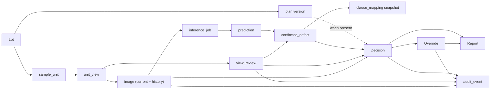

**Traceability rules**

- A prediction always names `image_id`, `inference_job_id`, and `model_version_id`.
- A confirmed defect always names `image_id`, `unit_view_id`, `sample_unit_id`, `reviewer_id`, `zone_code`, and either a `prediction_id` or `source = 'manual'`.
- A decision names the plan row, plan version, counting mode, counts, per-class limits, lot size, effective n, critical non-visual status, model versions used, engine version, and snapshot hash. The single exception is `HOLD_PLAN_MISSING`: it names no plan and stores null plan-derived fields, while still storing counts, lot size, model versions, engine version, snapshot hash, actor, and timestamp.
- An override always names the decision, supervisor, outcome, reason, and timestamp. It never changes the decision row.
- A reopen always names the supervisor, reason, timestamp, and the prior decision sequence; it never deletes history.
- An image replacement never deletes the prior image or its predictions; it marks the prior image non-current and links the replacement. Review of the old image is historical, not current.
- A retracted confirmed defect remains visible in the audit trail with actor, reason, and timestamp; it is excluded from new decision snapshots.

## 4.11 Mermaid ER diagram

Key attributes are shown for readability; the tables above are the complete column reference. Every entity and relationship is present.

```mermaid
erDiagram
  organization {
    uuid id PK
    text code
    text name
    bool is_active
    timestamptz created_at
  }
  app_user {
    uuid id PK
    uuid organization_id FK
    text email_normalized
    text password_hash
    text role
    bool is_active
    timestamptz last_login_at
  }
  user_session {
    uuid id PK
    uuid organization_id FK
    uuid user_id FK
    char token_hash
    char csrf_token_hash
    timestamptz expires_at
    timestamptz revoked_at
  }
  login_attempt {
    bigint id PK
    uuid organization_id FK
    text email_normalized
    char ip_hash
    bool success
    timestamptz attempted_at
  }
  product {
    uuid id PK
    uuid organization_id FK
    text code
    text family
    text_array required_views
    bool is_active
  }
  lot {
    uuid id PK
    uuid organization_id FK
    uuid product_id FK
    text code
    text buyer_key
    int lot_size
    text status
    text critical_nonvisual_status
    text selection_method
    text selection_seed
    timestamptz decided_at
  }
  plan {
    uuid id PK
    uuid organization_id FK
    uuid lot_id FK
    int version
    bool is_active
    int n
    text counting_mode
    int critical_ac
    int critical_re
    int major_ac
    int major_re
    int minor_ac
    int minor_re
    text source_edition
    bool is_demo
  }
  sample_unit {
    uuid id PK
    uuid organization_id FK
    uuid lot_id FK
    int unit_no
    text garment_code
  }
  unit_view {
    uuid id PK
    uuid organization_id FK
    uuid lot_id FK
    uuid sample_unit_id FK
    text side
    text detail_label
    bool is_required
    text review_priority
    jsonb uncertainty_flags
  }
  image {
    uuid id PK
    uuid organization_id FK
    uuid lot_id FK
    uuid sample_unit_id FK
    uuid unit_view_id FK
    text storage_key
    char sha256_hex
    bool is_current
    uuid duplicate_of_image_id FK
    uuid superseded_by_image_id FK
    timestamptz excluded_at
    text quality_state
  }
  exclusion_log {
    uuid id PK
    uuid organization_id FK
    uuid lot_id FK
    uuid unit_view_id FK
    uuid image_id FK
    text reason
    uuid excluded_by FK
    timestamptz created_at
  }
  model_version {
    uuid id PK
    uuid organization_id FK
    text name
    text version
    text detector_family
    char weights_sha256
    text license
    text_array training_domains
    bool is_active
  }
  inference_job {
    uuid id PK
    uuid organization_id FK
    uuid lot_id FK
    uuid sample_unit_id FK
    uuid unit_view_id FK
    uuid image_id FK
    text status
    int attempts
    uuid model_version_id FK
    text worker_id
    timestamptz lease_expires_at
  }
  prediction {
    uuid id PK
    uuid organization_id FK
    uuid lot_id FK
    uuid sample_unit_id FK
    uuid unit_view_id FK
    uuid image_id FK
    uuid inference_job_id FK
    uuid model_version_id FK
    int ordinal
    text class_label
    float score
    float x1
    float y1
    float x2
    float y2
    text status
    bool provisional_critical
    uuid reviewed_by FK
    text second_review_status
    uuid second_reviewer_id FK
  }
  confirmed_defect {
    uuid id PK
    uuid organization_id FK
    uuid lot_id FK
    uuid sample_unit_id FK
    uuid unit_view_id FK
    uuid image_id FK
    uuid prediction_id FK
    text source
    text defect_type
    float x1
    float y1
    float x2
    float y2
    text zone_code
    text size_band
    text severity
    uuid clause_mapping_id FK
    uuid reviewer_id FK
    int version
    timestamptz retracted_at
  }
  view_review {
    uuid id PK
    uuid organization_id FK
    uuid lot_id FK
    uuid sample_unit_id FK
    uuid unit_view_id FK
    uuid image_id FK
    text state
    uuid reviewer_id FK
    int version
    timestamptz reviewed_at
  }
  clause_mapping {
    uuid id PK
    uuid organization_id FK
    text buyer_key
    text defect_type
    text zone_code
    text size_band
    text severity
    text clause_ref
    bool is_active
  }
  decision {
    uuid id PK
    uuid organization_id FK
    uuid lot_id FK
    int sequence
    uuid plan_id FK
    int plan_version
    text outcome
    text reason_code
    jsonb reason_details
    text counting_mode
    int lot_size
    int n_entered
    int n_effective
    int critical_count
    int major_count
    int minor_count
    int critical_ac
    int critical_re
    int major_ac
    int major_re
    int minor_ac
    int minor_re
    jsonb plan_snapshot
    jsonb counts_snapshot
    char confirmed_snapshot_hash
    jsonb model_versions
    text engine_version
    uuid computed_by FK
    uuid supersedes_decision_id FK
    text idempotency_key
  }
  override {
    uuid id PK
    uuid organization_id FK
    uuid lot_id FK
    uuid decision_id FK
    uuid supervisor_id FK
    text override_outcome
    text reason
    timestamptz created_at
  }
  audit_event {
    bigint id PK
    uuid organization_id FK
    uuid actor_user_id FK
    text action
    text entity_type
    uuid entity_id
    uuid lot_id FK
    jsonb before
    jsonb after
    text reason
    text request_id
    timestamptz created_at
  }

  organization ||--o{ app_user : "has"
  organization ||--o{ product : "owns"
  organization ||--o{ model_version : "owns"
  organization ||--o{ clause_mapping : "owns"
  organization ||--o{ login_attempt : "records"
  app_user ||--o{ user_session : "opens"
  app_user ||--o{ view_review : "writes"
  app_user ||--o{ confirmed_defect : "confirms"
  product ||--o{ lot : "defines"
  lot ||--o{ plan : "has"
  lot ||--o{ sample_unit : "contains"
  lot ||--o{ decision : "evaluated_by"
  lot ||--o{ override : "has"
  lot ||--o{ audit_event : "logs"
  plan |o--o{ decision : "parameterizes"
  sample_unit ||--o{ unit_view : "has"
  unit_view ||--o{ image : "captures"
  unit_view ||--o{ view_review : "reviewed_in"
  unit_view ||--o{ confirmed_defect : "contains"
  image ||--o{ inference_job : "queued_for"
  image ||--o{ prediction : "produces"
  image ||--o{ exclusion_log : "excluded_by"
  inference_job ||--o{ prediction : "contains"
  model_version ||--o{ prediction : "labels"
  model_version ||--o{ inference_job : "runs"
  prediction ||--o| confirmed_defect : "confirmed_as"
  clause_mapping ||--o{ confirmed_defect : "maps"
  decision ||--o| override : "overridden_by"
  decision ||--o| decision : "supersedes"
```

---

# 5. Backend Architecture

## 5.1 FastAPI project structure

```text
backend/
├─ pyproject.toml
├─ Dockerfile
├─ alembic.ini
├─ alembic/
│  ├─ env.py
│  └─ versions/
├─ app/
│  ├─ main.py                     # app factory, routers, exception handlers
│  ├─ core/
│  │  ├─ config.py                # pydantic-settings, env validation
│  │  ├─ security.py              # Argon2id, token generation, hashing
│  │  ├─ csrf.py                  # double-submit validation
│  │  ├─ errors.py                # domain errors -> problem+json
│  │  ├─ logging.py               # structured logs, request id
│  │  └─ request_context.py
│  ├─ db/
│  │  ├─ session.py               # engine, SessionLocal, get_db
│  │  ├─ base.py                  # DeclarativeBase, naming convention
│  │  └─ types.py                 # shared column types
│  ├─ api/
│  │  ├─ deps.py                  # session, org, role, csrf dependencies
│  │  └─ v1/
│  │     ├─ router.py             # aggregate /api/v1 router
│  │     ├─ auth.py
│  │     ├─ lots.py
│  │     ├─ plans.py
│  │     ├─ units.py
│  │     ├─ images.py
│  │     ├─ predictions.py
│  │     ├─ reviews.py
│  │     ├─ decisions.py
│  │     ├─ reports.py
│  │     ├─ models.py
│  │     └─ users.py
│  ├─ modules/
│  │  ├─ identity/{models,repository,service,schemas}.py
│  │  ├─ lots/{models,repository,service,schemas}.py
│  │  ├─ plan/{models,repository,service,schemas,engine}.py
│  │  ├─ capture/{models,repository,service,schemas,validation}.py
│  │  ├─ vision/{contracts.py,client.py}      # no model code in API
│  │  ├─ review/{models,repository,service,schemas}.py
│  │  ├─ uncertainty/{service,schemas}.py
│  │  ├─ decision/{models,repository,service,schemas,engine,ports}.py
│  │  └─ report/{service,schemas}.py
│  ├─ storage/
│  │  ├─ image_store.py           # atomic write, read, delete, reconcile
│  │  └─ model_store.py           # read-only checkpoint verification
│  ├─ workers/
│  │  └─ inference_worker.py      # separate entry point
│  └─ shared/
│     ├─ audit.py
│     ├─ pagination.py
│     ├─ idempotency.py
│     └─ transactions.py
└─ tests/
   ├─ unit/
   ├─ integration/
   └─ contract/
```

**Layering rule.** `api/v1/*.py` is HTTP-only: parse, call service, return schema. `modules/*/service.py` owns orchestration, authorization decisions that depend on domain state, and transaction boundaries. `modules/*/repository.py` owns SQL. `modules/*/engine.py` is pure. `modules/*/models.py` is persistence mapping. `schemas.py` is the API boundary, not the domain model.

## 5.2 Request path and service layers

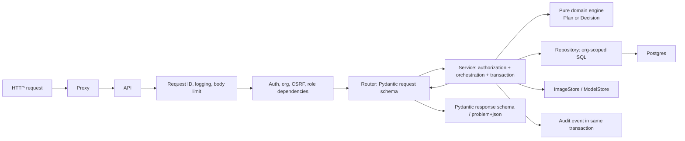

**Rules.**

1. Routers never call `Session.commit()` and never contain counting logic.
2. Services open one unit of work per command. Read endpoints may use a read-only session.
3. Repositories never commit, never start transactions, and never return ORM objects outside the session boundary; they return DTOs or detached read models.
4. Domain engines receive plain value objects. They do not receive `Session`, HTTP request objects, or Pydantic models.
5. Audit events are appended in the same transaction as the state change they describe. If the audit insert fails, the command fails.
6. A service that needs another module's data uses a read port or a service call, not the other module's ORM model in its domain logic.

## 5.3 Repository and data-access layer

- **Base scope.** Every tenant repository method takes `org_id` and includes it in the `WHERE` clause. There is no generic `get_by_id(id)` for tenant data.
- **Composite lookups.** Parent references use `(org_id, id)`; child inserts also carry `lot_id`, `sample_unit_id`, and `unit_view_id` where applicable. The service checks hierarchy consistency before insert.
- **Row locks.** Every lot-scoped command, including the worker's prediction write, begins with `SELECT ... FOR UPDATE` on the `lot` row and holds it to commit; see §3.5. This is the serialization point that keeps a decision snapshot stable against reviews and uploads. `FOR UPDATE SKIP LOCKED` is used only for job claims. `FOR UPDATE` is also used for decision idempotency and override creation. Optimistic `version` checks remain for review edits. Read endpoints do not lock.
- **Optimistic concurrency.** `view_review.version` and `confirmed_defect.version` are checked in the `UPDATE ... WHERE version = :expected`. Zero rows updated → `409 version_conflict` with the current version. The client must refresh and retry; the server never merges silently.
- **N+1 avoidance.** Lot detail pages load units, views, current images, and review states in bounded queries (select-in batches), not per-unit loops. The report is one read model with explicit joins.
- **No lazy loading outside the session.** DTO mapping happens inside the service/session boundary.
- **Migrations.** Every repository query is tested against the migrated schema, not a hand-built test schema.

## 5.4 Authentication and authorization

**Password storage.** Argon2id via `argon2-cffi`, at or above the OWASP minimum: memory ≥ 19 MiB, iterations ≥ 2, parallelism 1 `[V]`. Parameters are stored in the encoded hash so they can be raised later. Password length 12–128 characters; no forced composition classes; reject known-breached passwords only if a local list is available (not a network call in v1). Login uses a constant-time verify path and a dummy verify for unknown emails to reduce timing leakage `[R]`.

**Session.** On successful login: generate a 32-byte random session token and a 32-byte CSRF token; store SHA-256 hashes; rotate any existing session id; set cookies:

- `lotline_session` — `HttpOnly`, `Secure`, `SameSite=Lax`, `Path=/`, expiry = absolute session expiry.
- `lotline_csrf` — readable by JavaScript, `Secure`, `SameSite=Lax`, `Path=/`.

The session is opaque; there is no JWT. Server-side revocation is immediate. Absolute expiry 8 h; idle expiry 30 min; both configurable. `last_seen_at` is updated at most once per minute to avoid write amplification.

**CSRF.** Every unsafe method (`POST`, `PUT`, `PATCH`, `DELETE`) requires `X-CSRF-Token`. The server checks: header equals the CSRF cookie, and the SHA-256 of the header equals `user_session.csrf_token_hash`. Login is exempt from the session-bound check but uses a pre-session CSRF cookie or an origin check; the login response rotates the token. Same-origin deployment and `SameSite=Lax` are defences in depth, not substitutes.

**Authorization matrix.**

| Capability | Inspector | Supervisor | Admin |
|---|---:|---:|---:|
| View lots, units, images, reports | ✓ | ✓ | ✓ |
| Create lot / product / sample units | ✓ | ✓ | ✓ |
| Create plan version | — | ✓ | ✓ |
| Open lot for inspection | ✓ | ✓ | ✓ |
| Upload/replace/exclude image | ✓ | ✓ | ✓ |
| Review proposals, add/edit/retract defect, mark view | ✓ | ✓ | ✓ |
| Run decision computation | ✓ | ✓ | ✓ |
| Set critical non-visual status | — | ✓ | ✓ |
| Reopen decided lot | — | ✓ | ✓ |
| Override decision | — | ✓ | ✓ |
| Register/activate model | — | — | ✓ |
| Import/seed clause mapping | — | — | ✓ |
| Manage users and roles | — | — | ✓ |

**Role checks are server-side.** The UI hides unavailable actions, but hiding is not enforcement. Every write endpoint has an explicit role dependency. A supervisor cannot escalate their own role; only an admin can change roles, and an admin cannot demote the last active admin.

**Organisation resolution.** The session row carries `organization_id`. The auth dependency loads the user and session in one query, verifies `user.is_active`, `session.revoked_at IS NULL`, and `session.expires_at > now()`, and returns an `AuthContext` with user id, role, org id, and session id. The context is request-scoped and immutable.

**Login rate limiting.** Count failed attempts per `(email_normalized, ip_hash)` and per `ip_hash` in the last 15 minutes. Five failures for the same email+IP or twenty for an IP trigger `429` with `Retry-After`. A successful login clears the email+IP counter. The client IP is resolved through the trusted-proxy rule in §11.3; if no trustworthy address is available, the per-email counter still applies and the event is logged. The table is insert-only from the application and purged after 30 days; the retention purge is the only delete path. This is a v1 baseline, not a claim of resistance to distributed attacks.

**Logout and revocation.** Logout sets `revoked_at`, deletes neither the row nor the audit event, clears both cookies, and returns `204`. An admin can revoke all sessions for a user after a role change or deactivation.

## 5.5 Business logic separation

| Concern | Location | Forbidden location |
|---|---|---|
| HTTP parsing, status codes | `api/v1` | services |
| Authentication, CSRF, role dependency | `api/deps.py` + `Identity` | repositories |
| Plan validation, `n/Ac/Re` semantics | `Plan.engine` | routers, SQL |
| Counting and outcome precedence | `Decision.engine` | `Vision`, routers, SQL |
| Clause lookup, severity assignment | `Review.service` | `Vision`, `Decision` |
| Image validation/normalisation/dedup | `Capture.service` + `storage` | browser only |
| Prediction writes | `InferenceWorker` + `Vision` | API request path |
| Report wording | `Report.service` | database defaults |
| Audit payload construction | `shared/audit.py` | triggers (except append-only guard) |

**Pure engine contract.** `Plan` exposes `validate(plan_input) -> ValidatedPlan | PlanError`. `Decision` exposes `evaluate(decision_input) -> DecisionResult`. Both are deterministic, side-effect free, and covered by table-driven tests. `Decision` receives a fully assembled snapshot; it does not query the database. This is what keeps the AQL engine independent of computer vision.

## 5.6 Database migrations

- **One migration per logical change.** Schema, backfill, and constraint are separate migrations when a backfill is needed.
- **Forward-only in v1.** A rollback is written only when it is safe and tested; otherwise the rollback is “restore from backup”, documented in the migration header.
- **Expand/contract for live data.** Add nullable column → backfill → add constraint → switch reads → drop old column in a later release. The demo freeze means no destructive migration after 13 December 2026.
- **Seed migrations are idempotent.** Demo clause mapping, demo plan template, and the initial admin are inserted with `ON CONFLICT DO NOTHING` or a guarded existence check. The seed organisation code must equal `DEFAULT_ORGANIZATION_CODE` (`lotline` by default); startup fails if it does not resolve. Seed data is labelled `is_demo = true` where applicable.
- **CI checks.** `alembic upgrade head` on an empty PostgreSQL 17 database; `alembic check` for model drift; a smoke query for every table; down-migration test only where a down script exists.
- **Backup before migration.** The deployment runbook requires a `pg_dump` and image manifest before any migration that touches existing lots or decisions. The demo database is not migrated during the judging window.

## 5.7 Background inference job handling

**Enqueue.** `Capture` inserts an `inference_job` row in the same transaction as the image row when `INFERENCE_ENABLED=true` and `AUTO_ENQUEUE_INFERENCE=true`. If the worker is down, the job stays `queued`; nothing blocks the upload.

**Claim.** The worker runs a loop:

1. Begin transaction.
2. Select one `queued` job or a `running` job whose `lease_expires_at < now()`.
3. `FOR UPDATE SKIP LOCKED` so multiple workers never claim the same row.
4. Set `status='running'`, `attempts = attempts + 1`, `worker_id`, `started_at`, `heartbeat_at`, `lease_expires_at = now() + lease`.
5. Load the active `model_version`; if none, fail with `no_active_model`.
6. Commit the claim before doing slow inference.

**Execute.** Load the image from `ImageStore`, verify the SHA-256, run preprocessing and detection, and map raw class ids to the four canonical labels. Scores and boxes are stored as returned; no severity, no AQL count.

**Supersession and lot-state check.** Immediately before the write transaction, reload `image.is_current`, `image.excluded_at`, `lot.status`, and `job.status`. If the image is no longer current or is excluded, or the lot is `decided`, or the job is `canceled`, mark the job `canceled` with `error_code='superseded_image'` or `'lot_locked'`, write no predictions, and exit. This is not a retryable failure. The upload transaction cancels `queued` jobs for a superseded image; a `running` job is stopped by this check. Inside the write transaction the worker takes the `lot` row `FOR UPDATE` and repeats the check before inserting, so a replacement upload cannot commit between the check and the predictions. A prediction whose image is no longer current is never used for review or decision input.

**Write.** Begin a transaction. Insert all predictions with `ordinal` 0..N-1. Set `status='succeeded'`, `finished_at`, clear `error_*`, and set `model_version_id`. Commit predictions and job success together. If the transaction fails, no predictions and no success state exist.

**Failure.** Catch model/IO errors, sanitise the message, set `status='failed'`, `error_code`, `finished_at`, and no predictions. If `attempts < max_attempts`, the next poll may requeue by resetting to `queued` after a backoff; if attempts are exhausted, it remains `failed`. A failed job never writes zero predictions as a success.

**Heartbeat.** While running, update `heartbeat_at` and `lease_expires_at` every 10 s. The heartbeat uses its own short-lived database connection (a separate session or thread), never the session doing inference or the write transaction; a slow model cannot starve the lease. If the process dies, the lease expires and another worker reclaims the job. The reclaim path increments attempts; a job that repeatedly crashes eventually fails.

**Idempotency.** Predictions are unique by `(inference_job_id, ordinal)`. A reclaimed job first deletes any predictions for that job (there should be none if the prior transaction rolled back) and then inserts. The success state and prediction inserts are one transaction, so a crash cannot leave a succeeded job with partial predictions.

**Retry endpoint.** `POST /images/{id}/inference` creates a new job after the prior job is terminal. The UI shows the latest job status for the current image. Old predictions remain historical but are not shown as current review material.

**Backpressure.** The worker processes one job at a time by default; `WORKER_CONCURRENCY` may be raised only after measuring CPU and memory. There is no unbounded thread pool. If the queue grows, the UI shows queued jobs; reviewers can use manual mode.

## 5.8 Error handling and validation

**Validation layers**

| Layer | Responsibility | Example |
|---|---|---|
| Browser | Obvious form checks, file type/size pre-check, disabled actions | Required zone before confirm; file > 25 MB blocked early |
| Pydantic request schema | Shape, types, bounds, unknown-field rejection on writes | `n > 0`, `role` enum, `score` range |
| Service/domain | Cross-row invariants, state transitions, role rules | Lot locked; view has open proposal; plan `Re > Ac` |
| Database | Last-resort integrity | Composite FK, unique checksum, `Re > Ac` check on `plan`, append-only trigger |

**Problem+json envelope.** All API errors use `application/problem+json`:

```json
{
  "type": "https://lotline.local/problems/version-conflict",
  "title": "Version conflict",
  "status": 409,
  "code": "version_conflict",
  "detail": "The view review was changed by another user. Reload and retry.",
  "instance": "/api/v1/views/7f4c.../review",
  "request_id": "req_01J...",
  "errors": [
    {"field": "version", "code": "stale", "message": "Expected 3, current 4"}
  ]
}
```

`type` is a stable local URI in v1, not a claim of a public standard. `code` is the machine-readable contract; the UI branches on `code`, not on prose. `detail` is safe to display. `request_id` is always present.

**Domain error mapping**

| Domain error | HTTP | Code |
|---|---|---|
| Invalid credentials | 401 | `invalid_credentials` |
| Session missing/expired/revoked | 401 | `unauthenticated` |
| CSRF mismatch/missing | 403 | `csrf_failed` |
| Role not permitted | 403 | `forbidden` |
| Resource not found in organisation scope | 404 | `not_found` |
| Lot locked / decided | 409 | `lot_locked` |
| Stale `version` | 409 | `version_conflict` |
| Duplicate image checksum | 409 | `duplicate_image` |
| Second review already resolved | 409 | `second_review_already_done` |
| Active inference job already exists | 409 | `inference_already_queued` |
| Plan create/update invalid (`Re <= Ac`, missing `n`, unset counting mode) | 422 | `plan_invalid` |
| Decision gap (`Ac < count < Re`) | 200 with HOLD decision, not an error | `HOLD_PLAN_AMBIGUOUS_LIMITS` |
| View has open proposal | 409 | `open_prediction` |
| Image has confirmed defect | 409 | `confirmed_defect_present` |
| Lot has fewer than `n` units | 200 with HOLD decision, not an error | `HOLD_UNITS_MISSING` |
| File too large | 413 | `payload_too_large` |
| Unsupported/unreadable image | 415/422 | `unsupported_media` / `invalid_image` |
| Rate limited | 429 | `rate_limited` |
| Database unavailable | 503 | `database_unavailable` |
| ImageStore unavailable | 503 | `storage_unavailable` |

**Never leak internals.** No stack traces, SQL, file paths, model paths, or raw Pillow/libmagic errors in responses. The server logs the exception with `request_id`; the response carries the id. Database constraint violations are translated by constraint name, not by string matching on the full error.

**Transaction rules.** A command either commits all state and its audit event or commits nothing. On any domain error, the session rolls back. If the audit insert fails, the command fails. File writes follow the compensating procedure in §12.4; a database failure after a file write must not leave a current image row.

## 5.9 Logging and observability

- **Structured JSON logs** to stdout: timestamp, level, service (`api`/`worker`), request_id, method, path template (not raw ids), status, duration_ms, user_id (if authenticated), org_id, error_code. No passwords, tokens, image bytes, or full EXIF.
- **Request id.** `Proxy` forwards or generates `X-Request-ID`; API returns it in the response header and error body. The worker generates a `job_id`-scoped id and includes it in job error logs.
- **Health.** `GET /healthz` returns process liveness without touching the database. `GET /readyz` checks a `SELECT 1` and returns 503 if the database is unavailable. `Proxy` and Compose use these endpoints. The worker’s health is visible through job heartbeats; a Compose restart policy handles process death.
- **Metrics.** v1 does not deploy Prometheus/Grafana. The following are logged and queryable in `Postgres`: queue depth (`inference_job` by status), job failure count, decision outcome counts, HOLD/ESCALATE reason counts, upload failure codes. A lightweight admin dashboard may render these with SQL; no extra service is required. This is a deliberate scope cut, flagged in §13.2.
- **No tracing.** A four-person team does not need distributed tracing for one API and one worker. `request_id` and `job_id` provide correlation. Revisit if the worker becomes a separate service.

## 5.10 Backend testing strategy

| Level | What is tested | Examples |
|---|---|---|
| Unit | Pure `Plan` and `Decision` engines, security helpers, coordinate/validation helpers | `count = Ac` accepts; `count = Re` rejects; invalid plan refused; both counting modes; R14 wording |
| Service | State transitions and invariants with a real database | Locked lot rejects writes; duplicate upload links; open proposal blocks exclusion; retraction excludes from counts |
| Integration | Repositories, composite FKs, migrations, append-only triggers | Cross-organisation insert fails; decision update raises; one active plan |
| API contract | Request/response schemas, status codes, problem+json, auth/CSRF | 401/403/404/409/422 matrix; OpenAPI snapshot |
| Security | Cross-org access, role matrix, CSRF, upload magic bytes, session revocation | Inspector cannot override; supervisor cannot manage models; expired session rejected |
| End-to-end smoke | One seeded lot through upload → review → decision → report | Manual mode and inferred mode; forced HOLD and ESCALATE |

**Test data.** The demo plan is a fixture labelled `is_demo = true`; no test asserts a “correct” outcome from remembered sampling values. Decision tests use symbolic values (`n`, `Ac`, `Re`) and state the expected arithmetic. Every forced case in the v3 definition of done has a named test.

---

# 6. Frontend Architecture

## 6.1 React application structure

```text
frontend/
├─ package.json
├─ vite.config.ts
├─ tsconfig.json
├─ index.html
├─ src/
│  ├─ main.tsx
│  ├─ App.tsx
│  ├─ router.tsx
│  ├─ api/
│  │  ├─ client.ts              # fetch wrapper, problem+json, CSRF
│  │  ├─ auth.ts
│  │  ├─ lots.ts
│  │  ├─ plans.ts
│  │  ├─ units.ts
│  │  ├─ images.ts
│  │  ├─ predictions.ts
│  │  ├─ reviews.ts
│  │  ├─ decisions.ts
│  │  ├─ reports.ts
│  │  └─ types.ts               # generated from OpenAPI where practical
│  ├─ auth/
│  │  ├─ AuthProvider.tsx
│  │  ├─ RequireAuth.tsx
│  │  └─ RequireRole.tsx
│  ├─ components/
│  │  ├─ layout/{AppShell,TopBar,Breadcrumbs}.tsx
│  │  ├─ ui/{Button,Dialog,Field,ErrorBanner,Spinner,EmptyState,StatusBadge}.tsx
│  │  ├─ lot/{LotHeader,LotProgress,UnitGrid,UnitCard,ViewChecklist}.tsx
│  │  ├─ capture/{CameraCapture,FileFallback,UploadQueue,ImagePreview}.tsx
│  │  ├─ annotate/{Annotator,BoxLayer,BoxEditor,ClassLegend,ZoomControls}.tsx
│  │  ├─ review/{ProposalList,DefectForm,ClauseHint,SecondReviewDialog,CleanViewDialog}.tsx
│  │  ├─ decision/{DecisionPanel,ReasonList,CountsTable,OverrideDialog}.tsx
│  │  └─ report/{ReportLayout,ReportHeader,ReportTable,PrintButton}.tsx
│  ├─ pages/
│  │  ├─ LoginPage.tsx
│  │  ├─ LotListPage.tsx
│  │  ├─ LotNewPage.tsx
│  │  ├─ LotOverviewPage.tsx
│  │  ├─ PlanPage.tsx
│  │  ├─ UnitPage.tsx
│  │  ├─ ViewPage.tsx
│  │  ├─ ReviewQueuePage.tsx
│  │  ├─ DecisionPage.tsx
│  │  ├─ ReportPage.tsx
│  │  ├─ UsersPage.tsx
│  │  ├─ ModelsPage.tsx
│  │  ├─ ClauseMappingsPage.tsx
│  │  └─ NotFoundPage.tsx
│  ├─ hooks/{useAuth,useLot,useUnits,useView,useInferencePolling,useUpload}.ts
│  ├─ lib/{coordinates.ts,image.ts,format.ts,queryKeys.ts,cookie.ts}
│  └─ styles/{tokens.css,app.css,print.css}
```

**No application logic is duplicated from the backend.** The frontend may format a count, render a reason, and show an advisory projection, but it never derives an outcome. The decision endpoint is the only source of an outcome.

## 6.2 Routing and protected pages

| Route | Page | Access | Notes |
|---|---|---|---|
| `/login` | Login | Public | Redirects authenticated users to `/lots` |
| `/` | — | Authenticated | Redirect to `/lots` |
| `/lots` | Lot list | All roles | Status filter, search by code/buyer |
| `/lots/new` | Create lot | Inspector+ | Product, buyer, colour, lot size, plan |
| `/lots/:lotId` | Overview | All roles | Progress, plan summary, critical status, latest decision |
| `/lots/:lotId/plan` | Plan | Supervisor+ | Create a new plan version; inspector sees read-only |
| `/lots/:lotId/units` | Units | All roles | Unit grid; completeness badges |
| `/lots/:lotId/units/:unitId` | Unit | All roles | Views, capture status, review status |
| `/lots/:lotId/units/:unitId/views/:viewId` | View workspace | All roles | Capture, annotate, confirm/reject |
| `/lots/:lotId/review` | Review queue | All roles | Prioritised pending/high-uncertainty views |
| `/lots/:lotId/decision` | Decision | All roles | Compute, history, reasons, override (supervisor) |
| `/lots/:lotId/report` | Report | All roles | Print layout |
| `/admin/users` | Users | Admin | Create/deactivate/role change |
| `/admin/models` | Models | Admin | Register/activate model |
| `/admin/clause-mappings` | Clause mapping | Admin (read-only v1) | Seed provenance, search |
| `*` | Not found | — | No data leakage |

**Guards.** `RequireAuth` checks `/auth/me` once at app start, stores the user in context, and redirects to `/login?next=...` on 401. `RequireRole` hides routes and renders a 403 page; the API still enforces the role. A deep link to a view refreshes correctly because the router uses the URL, not in-memory wizard state.

## 6.3 Component organisation

- **Pages** compose data hooks and feature components. They do not fetch with raw `fetch`.
- **Feature components** own one concern: capture, annotate, proposal review, decision panel, report.
- **UI primitives** are dumb and accessible: buttons, dialogs, fields, banners.
- **No global component library** in v1. A small token file controls spacing, type, colour, focus rings, and print styles. This avoids a design-system dependency and keeps the bundle small.
- **State boundaries.** A component receives data and callbacks. It does not read the router or query cache directly unless it is a page or a dedicated hook.

## 6.4 State management

| State | Mechanism | Rationale |
|---|---|---|
| Authenticated user / CSRF | React context from `/auth/me` | Small, app-wide, changes rarely |
| Server data (lots, units, predictions, decisions) | TanStack Query | Cache, retries, invalidation, polling |
| URL filters and selected tab | URL search params | Shareable, survives refresh |
| Annotation selection, draft box, zoom | Local `useState`/`useReducer` | Ephemeral, not server state |
| Upload queue and progress | Local component state + XHR | Progress events are not Query’s strength |
| Form drafts | Local controlled state | No global store; avoid stale cross-page drafts |
| Decision result | Query cache from POST response + invalidated lot query | Server is authoritative |

**Query keys.** `['lots']`, `['lot', lotId]`, `['lot', lotId, 'units']`, `['view', viewId]`, `['view', viewId, 'predictions']`, `['lot', lotId, 'decisions']`, `['lot', lotId, 'report']`, `['me']`. Mutations invalidate the smallest affected set: a review invalidates the view, unit, lot progress, and decision history; an upload invalidates the view, unit, lot, and job.

**Polling.** While an inference job is `queued` or `running`, the view page polls `GET /inference-jobs/{id}` every 2 s, then stops on `succeeded`/`failed`. The poll pauses when the tab is hidden. A failed job shows “not inferred” and the manual-review path; it never shows a clean state.

**No optimistic review updates.** Review is audited and versioned. The UI waits for the server, then updates the cache. This avoids showing a confirmed defect that the server rejected due to a stale version.

## 6.5 API communication

- **Base.** Same-origin `/api/v1`; no CORS. `fetch` sends cookies by default for same-origin. The CSRF cookie is read by `lib/cookie.ts` and sent as `X-CSRF-Token` on unsafe methods.
- **Client wrapper.** One `apiRequest` function handles JSON, problem+json, `request_id`, 401 redirect, 403 message, 409 conflict payload, 422 field errors, and network errors. It never retries unsafe requests automatically; the user retries. Query retries only idempotent GETs, with a small bounded count.
- **Typed contracts.** `types.ts` is generated from the FastAPI OpenAPI document where practical. Handwritten types are allowed only for UI-only view models.
- **Uploads.** `XMLHttpRequest` for progress and abort. The request is `multipart/form-data` with `file`, optional `captured_at`, and optional `client_request_id`. The server ignores client-declared MIME type and determines magic bytes.
- **Images.** `` points to `/api/v1/images/{id}/content`, which requires the session cookie and returns `Cache-Control: private, max-age=300`. The image id changes when replaced, so stale caching is bounded. No public object URLs.
- **Errors.** A global error boundary catches render failures. Page-level `ErrorState` shows `code`, safe `detail`, and `request_id`; a “copy diagnostic” button copies the request id. A 409 version conflict opens a reload prompt, not a silent overwrite.

## 6.6 Camera and image-upload workflow

1. **Check secure context.** If `window.isSecureContext` is false, hide the live camera and show the file input fallback with an explanation. `getUserMedia` is available only in secure contexts `[V]`.
2. **Choose input.** Prefer a rear-facing live preview (`facingMode: { ideal: 'environment' }`) with a shutter button. Fallback: `<input type="file" accept="image/*" capture="environment">`. The fallback works even when the live stream is unavailable, but the page should still be HTTPS for secure cookies.
3. **Frame the garment.** Show the required side (front/back/detail), a plain background hint, and a “fill the frame” guide. Do not claim a calibrated capture; ambient light and table/hanging are accepted.
4. **Capture.** For live camera, draw the video frame to a canvas and export JPEG at a bounded maximum dimension. For file input, use the file unchanged. The server remains authoritative for orientation, metadata stripping, pixel limits, and re-encoding.
5. **Preview and confirm.** Show the image, side, and unit. Warn if the view already has a current image; replacing it clears the current review and may be blocked by confirmed defects.
6. **Upload.** Show progress, then “processing”, then “queued for inference”. If inference is disabled or the worker is down, show “not inferred — manual review available”.
7. **Retake/replace.** A replacement is a new image row; the old image is superseded, not deleted. The view becomes unreviewed until the new image is reviewed.
8. **HEIC.** iPhones may deliver HEIC. The server detects it by magic bytes and converts to JPEG with `pillow-heif`; the browser preview may fail for HEIC, so show a neutral file card until upload completes. Do not rely on the file extension.
9. **Offline/failed upload.** Keep the selected file in memory for a retry button. Do not queue uploads across page reloads in v1; no offline guarantee.

## 6.7 Interactive defect annotation

**Rendering.** The image is displayed in a fixed-aspect container. An absolutely positioned SVG layer uses a `viewBox="0 0 1 1"` with `preserveAspectRatio="none"`, so boxes are stored and drawn in normalised coordinates `[0,1]`. The `` uses `object-fit: contain`; the container is sized from the image’s intrinsic aspect ratio so there is no letterbox offset to guess. If a letterbox exists, `lib/coordinates.ts` converts pointer coordinates using the displayed image rect.

**Interactions.**

- Tap a proposal box to select it; the proposal list scrolls to the same item.
- Drag a box to move; drag corner handles to resize; minimum box size 1% of each dimension.
- “Add miss” enters draw mode: drag a new box, then choose type and zone. A manual box has `source = 'manual'`.
- Confirm opens a form with type prefilled from the prediction, zone required, size band optional, note optional. The final box is whatever the reviewer drew, not the raw model box.
- Reject removes the proposal from the review set but keeps the prediction row with `status='rejected'`.
- A provisional-critical rejection shows “second person required” and does not allow the lot to reach ACCEPT; it becomes ESCALATE until the second review.
- “Mark view clean” is enabled only when zero proposals are open and zero active confirmed defects exist. It requires an explicit confirmation dialog; it is never the default action.
- Keyboard: `Tab` selects boxes, arrow keys nudge, `Delete` rejects the selected proposal (with confirmation), `Esc` cancels draw. Touch targets are at least 44 px.

**Colour and labels.** Each detector class has a distinct colour plus a text label, never colour alone. Severity badges (`critical`, `major`, `minor`, `unmapped`) appear only on confirmed rows. The model’s class is shown as a proposal, not a severity.

**Zoom.** Fit-to-width is the default. Desktop has zoom in/out and pan; mobile has double-tap zoom and one-finger pan when not drawing. Pinch-to-zoom is optional; if it is not reliable on the demo phone, it is cut rather than shipped half-working.

## 6.8 Responsive inspection interface

| Context | Layout | Priorities |
|---|---|---|
| Phone capture | Single column; camera preview or file card; sticky bottom action | One-handed shutter, side label, upload state, retake |
| Phone review | Image first; proposal list as a bottom sheet; large confirm/reject buttons | Avoid accidental clean; show zone selector clearly |
| Tablet review | Image left, proposal list right; collapsible decision panel | Drawing precision, multi-touch |
| Desktop review | Three panes: unit list, image/annotator, defect/decision panel | Keyboard, bulk progress, report |
| Report | Print layout, A4; screen preview | One page, legible counts, override first line |

**Mobile rules.** Use `100dvh`, safe-area insets, and a sticky action bar. Do not rely on hover. Disable double-tap zoom on the annotator only when drawing, not on the whole app. Tables become stacked definition lists. The decision panel is reachable in one tap from the lot header.

**Loading and empty states.** A lot with no units shows “add sample units”, not a zero-defect badge. A view with no image shows “not captured”. A view with an image but no inference shows “not inferred”, not “clean”. A HOLD decision shows the blocking reasons with links to the exact unit/view; an ESCALATE shows the exact proposal/defect and the required human action.

## 6.9 Accessibility and print

- Labels are associated with inputs; errors are announced via `aria-live`.
- Focus is trapped in dialogs and restored on close.
- Colour contrast meets WCAG AA for text; status is never colour-only.
- The report uses semantic headings and a real table; print CSS hides navigation, removes shadows, uses black on white, sets `@page { size: A4; margin: 12mm; }`, and avoids page breaks inside count rows.
- `window.print()` is the only PDF path in v1. The report page offers “Print / Save as PDF” and a warning if the content exceeds one page in the browser preview. No PDF library is added.

## 6.10 Frontend testing

| Test | Tool | Scope |
|---|---|---|
| Coordinate conversion | Vitest | Letterboxing, zoom, drag/resize, normalised round-trip |
| Auth/role guards | React Testing Library | Redirect, 403, deep link |
| Review state rules | React Testing Library | Clean disabled with open proposal; confirm requires zone; stale version |
| Upload flow | Vitest + mocked XHR | Progress, failure, retry, HEIC fallback card |
| Print snapshot | Playwright or manual | One-page report at A4, override line first |
| Device smoke | Manual | Android Chrome, iPhone Safari, desktop Chromium |

No visual regression suite in v1. The demo device matrix is more valuable than pixel snapshots for a four-person team.

# 7. AI/ML Integration

## 7.1 Detector scope and model selection

**Task.** Closed-set object detection on phone photographs of plain-colour knit garment body panels. Output: zero or more boxes, each with one of four labels and a confidence score.

**Classes.** `hole`, `oil_stain`, `needle_line`, `dropped_stitch`.

**Not detector classes.** `skipped_stitch`, `shade_band`, and `other` are human-entered only in version 1. Seam/hem defects are outside the detector scope because no open finished-garment dataset with boxes has been found; public data cover fabric surfaces `[R]`. The human reviewer can add these misses.

**Model.** RF-DETR Small, Apache 2.0, baseline. RF-DETR Medium is a training-time accuracy option. The fallback is Ultralytics YOLO only if RF-DETR fails to train within three working days, with the whole repository published under AGPL-3.0 `[V]`. No second detector in version 1, no RT-DETR sweep, no anomaly model.

**Why a closed set.** An open-vocabulary or “unknown defect” head would produce classes the team cannot validate and could invite the UI to display a severity. The closed set is honest about what the labels support. A human adds anything outside it.

**License gate.** Before a checkpoint is registered, the team records the detector code license, pretrained-weight license, and dataset licenses. RF-DETR Small/Medium detection sizes are Apache 2.0 `[V]`. A YOLO fallback changes the repository license to AGPL-3.0 `[V]`; this is a product decision, not a build detail, and must be approved before training with YOLO.

## 7.2 Dataset ingestion and preprocessing

**Sources (v3 D5).**

| Role | Dataset | Use |
|---|---|---|
| Primary public | BDFD9 (`10.17632/z49cc7zvfc.1`, CC BY 4.0) | Transfer learning; its 105-image test split is the only public phone-photo test column |
| Conditional primary | ISL-Knit | Excluded until its Kaggle dataset license is confirmed; then candidate for knit/phone transfer |
| Supplementary | FabriD v3 (`10.17632/vncdwps24r.3`, CC BY 4.0) | Needle mark, missing yarn, stain, hole, defect-free; capture device unknown |
| Negative controls | AFID, RAW-FABRID, MVTec AD 2 | Never trained on; woven/line-scan/non-commercial checks only |
| Evidence | Staged own garments | Mandatory; no public finished-garment box dataset found |

**Ingestion pipeline.** Offline, versioned, and reproducible. It is not part of the API runtime.

1. **Acquire** each source through its official route. Record URL, version/DOI, access date, license text, and SHA-256 of the archive.
2. **Inventory** every file: source path, image hash, dimensions, annotation path, and source split if one exists.
3. **Validate** decode, colour mode, and annotation syntax. Reject corrupt or zero-byte files; log them in a manifest, not silently.
4. **Normalise labels** to a canonical record: `source`, `source_image_id`, `sha256`, `phash`, `width`, `height`, `class`, `x1,y1,x2,y2` in normalised coordinates, `source_split`, `garment_id`, `lot_id`, `session_id`, `device`, `lighting`, `distance`, `annotator_count`, `license`, `notes`.
5. **Convert geometry.** YOLO `(cx,cy,w,h)` → corners; COCO `[x,y,w,h]` → corners; polygons/masks → axis-aligned envelope box. Envelope conversion is lossy; record `geometry_source = polygon|mask|box`.
6. **Clip and filter.** Clip to `[0,1]`; drop degenerate boxes below a minimum area; record the count dropped.
7. **Crosswalk classes** using §7.3. Leave unmapped classes unmapped; do not force a match.
8. **Deduplicate** with a perceptual hash (pHash) before any split. Near-duplicates, multi-class duplicates, augmented copies, and adjacent video frames stay in one cluster.
9. **Assign splits** by `garment_id` and `lot_id` where available; otherwise by pHash cluster. A garment’s clean and defective photos never straddle train and test. No random file-level split.
10. **Freeze** the split manifest, compute its SHA-256, and store it with the model version. The test set is read-only after freeze.

**Manifest format.** CSV or Parquet with a stable schema and a header checksum. The manifest is stored outside the application database in the training workspace; `model_version.dataset_manifest_hash` records the hash. The application database does not need to store tens of thousands of training images.

## 7.3 Class crosswalk and unmapped types

| Lotline type | BDFD9 candidate | FabriD v3 candidate | ISL-Knit candidate (conditional) | Detector? |
|---|---|---|---|---|
| `hole` | Hole | Hole | Hole | Yes |
| `oil_stain` | Oil Spot | Stains | Oil Spot | Yes |
| `needle_line` | Vertical LineMark (candidate) | Needle Mark (candidate) | Needle Mark (candidate) | Yes, after visual verification |
| `dropped_stitch` | DropStitch | — | — | Yes |
| `skipped_stitch` | — | — | — | Human only |
| `shade_band` | — | — | — | Human only |
| `other` | — | — | — | Human only; always ESCALATE |

**Rules.**

- “Candidate” means the class name is suggestive but the visual definition must be checked on a sample of images before inclusion. If the check fails, the class is unmapped rather than forced.
- FabriD “Missing Yarn” is not mapped to `dropped_stitch` without visual verification. The two are not synonyms by default.
- BDFD9 classes `Horizontal Mark`, `Knot`, `Setup`, `Slub`, `Yarn Dust` are not mapped to a detector class unless a reviewed crosswalk says so. They remain extra source classes, ignored for detection training, or become negative examples only with care.
- AFID, RAW-FABRID, and MVTec AD 2 are negative controls. They are never added to the training union, even if their classes look similar.
- No pooled metric across sources. Each source has its own test column; staged and factory data are separate columns.

## 7.4 Training and model versioning

**Split contract.**

| Split | Contents | Rule |
|---|---|---|
| Train | Deduplicated public train + staged train | Per-source holdout preserved; pHash clusters whole |
| Validation | Per-source validation + staged validation | Used for early stopping and threshold selection only |
| Public test | BDFD9 official 105-image test split | Frozen; never trained or tuned on |
| Staged test | Frozen manifest of staged garments | Frozen by manifest hash; never added to training |
| Factory test | None in v1 unless access exists | If none, the report says “no factory evidence” |

**Training procedure.**

1. Freeze the manifest and record its hash.
2. Fine-tune RF-DETR Small from official pretrained weights. Record the exact library version, input resolution, augmentation policy, batch size, learning-rate schedule, and random seed.
3. Select the checkpoint and score threshold on the validation split only. Do not look at the public or staged test set.
4. Evaluate per domain: BDFD9 public test, staged test, and any factory column separately. Report precision, recall, mAP at a stated IoU, per-class AP, false-negative rate on holes and dropped stitches, and view-level recall.
5. Run the reviewer automation-bias check and the lot-level decision tests separately; image mAP does not replace them.
6. Export the checkpoint and a model card: classes, training domains, dataset licenses, manifest hash, weights SHA-256, evaluation table, known failures, and threshold.
7. Register a `model_version` row; do not activate it automatically.

**Version identity.** `name` + `version` + `weights_sha256` + `dataset_manifest_hash`. A retrain, a class change, a threshold change that affects stored proposals, or a new data source creates a new version. A threshold-only change that is applied at inference is still a new version because stored predictions would differ.

**What is not claimed.** No “ISO-compliant AI”, no calibration coverage, no conformal guarantee, no production factory performance. The model card says which domains were trained and tested. If no calibration set from the same distribution exists, the report says “not calibrated”.

## 7.5 InferenceWorker architecture

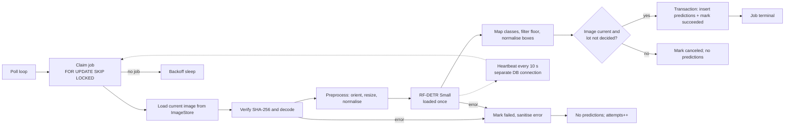

**Process model.**

- Separate container/process from `API`, same code image, different entry point.
- Loads the active model once at startup. If no active model exists, it stays alive and fails claimed jobs with `no_active_model` rather than crashing silently.
- One job at a time by default. `WORKER_CONCURRENCY` is a measured knob, not a default.
- CPU inference. GPU is for training, not required in production Compose.
- The worker never serves HTTP to the browser. A local health endpoint may be exposed only to Compose, not through `Proxy`.
- The worker reads `ImageStore` read-only and `ModelStore` read-only. It writes only `Postgres`.
- Before writing predictions, the worker takes the lot row lock and re-checks that the image is still current, is not excluded, and the lot is not `decided`; otherwise it marks the job `canceled` and writes nothing.
- The heartbeat runs on a separate database connection from inference and from the write transaction.

**Preprocessing.** Decode the server-normalised JPEG; apply EXIF orientation only if it survived the upload re-encode (it should not); resize with letterboxing to the model input; normalise pixel values exactly as the training pipeline. The same preprocessing code is imported from `Vision` by both training export validation and worker, so train/serve skew is testable.

**Postprocessing.** Map raw class ids to the four canonical labels. Convert boxes back to original image coordinates, then normalise by width/height. Filter detections below `DETECTION_FLOOR` (default 0.10, configurable) for storage; flag detections below `REVIEW_CONFIDENCE` (default 0.35) as low-confidence for review priority. These thresholds are frozen before test and recorded in the model version. The decision engine never reads a score.

**Prediction writing.** One row per retained detection, `ordinal` 0..N-1. `provisional_critical` is computed from the predicted class and the active clause routing table, not from severity. If the routing lookup fails, it stays false; the human review still applies the clause. Predictions and job success commit in one transaction.

**Heartbeat and lease.** See §5.7. The heartbeat uses its own database connection; it never shares the session doing inference or the prediction-write transaction. The worker is a replaceable process; the API and manual review never depend on it being alive.

## 7.6 Prediction storage and image-to-prediction relationships

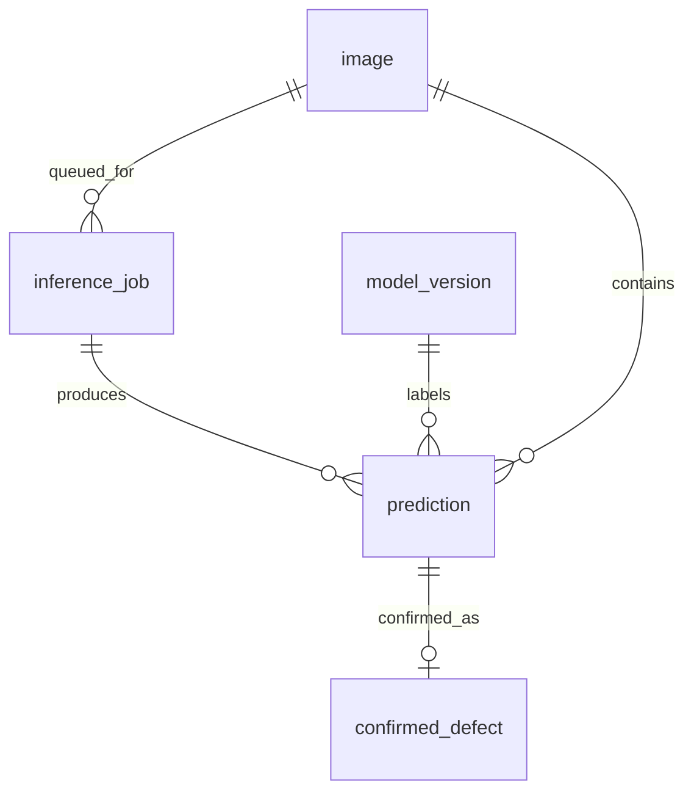

| Object | Immutability | Notes |
|---|---|---|
| `image` | Metadata immutable after insert except `is_current`, `superseded_by_image_id`, `excluded_at`, quality fields | Replacement creates a new row |
| `inference_job` | Status fields mutable; input reference immutable | Retry creates a new job |
| `prediction` | Geometry, class, score, model, job immutable | Human status fields mutable |
| `confirmed_defect` | Geometry/type/zone/severity editable before lock; retraction audited | Never deleted |

**Current review material.** For a view, the review UI reads the current image (`is_current = true`) and the latest `succeeded` inference job for that image. Predictions from older images/jobs remain for audit but are not displayed as current proposals. A prediction whose image is no longer current cannot be confirmed.

**Model version per prediction.** Every prediction names the exact model version. A lot may contain predictions from two model versions if a model is activated mid-inspection. The report lists all model versions used on current images; it does not pretend a single model produced everything.

**No severity in prediction.** The `prediction` table has no `severity` column. It has `provisional_critical` only as a routing hint. This is deliberate: it makes it impossible to accidentally count a model output as a severity.

## 7.7 Human verification boundary

| Step | Actor | Stored result |
|---|---|---|
| Model proposes | `InferenceWorker` / `Vision` | `prediction` row with class, score, box, model version |
| Accept proposal | Reviewer | `prediction.status = confirmed`; `confirmed_defect` row with final box, type, zone, optional size band, severity from clause mapping |
| Edit and accept | Reviewer | `confirmed_defect` stores the edited box; prediction keeps the original box for audit |
| Reject proposal | Reviewer | `prediction.status = rejected`; no confirmed defect |
| Add a miss | Reviewer | `confirmed_defect` with `source = manual`, no prediction |
| Mark view clean | Reviewer | `view_review` with `confirmed_clean`, only when no open proposal and no active defect |
| Second review of a critical rejection | A different person | `prediction.second_review_status = confirmed` or `overturned`; if overturned, a confirmed defect is created |

**Invariants.**

- A prediction is never auto-confirmed.
- A confirmed defect is never created without a human reviewer.
- A view is never auto-cleaned by an empty prediction list.
- A rejection of a `provisional_critical` prediction requires a second person before ACCEPT; until then the decision is ESCALATE (E3).
- If the second person overturns the rejection, the proposal becomes a confirmed defect with human-chosen zone and clause-mapped severity; if they confirm the rejection, the proposal stays rejected.
- On overturn, `confirmed_defect.reviewer_id` is the **second reviewer** — the person accountable for confirming the defect — while `prediction.reviewed_by` remains the original rejector. The original rejection is not rewritten. `prediction.second_reviewer_id` names the overturning person.
- An overturn writes the confirmed defect and moves the current image's `view_review` to `confirmed_defects` in one transaction, so a clean review cannot coexist with the new active defect.
- The second reviewer must be a different user. The API checks this; the database check also forbids `second_reviewer_id = reviewed_by`.

## 7.8 Uncertainty and model failure

**Uncertainty signals (v1, advisory).**

| Signal | Source | Effect |
|---|---|---|
| Low score | `prediction.score < REVIEW_CONFIDENCE` | Set view `review_priority = high`; sort those proposals first |
| Blur | Upload-time Laplacian variance below a configured threshold | Advisory flag; review prompt to retake |
| Darkness | Mean luminance below a configured threshold | Advisory flag; review prompt to retake |
| Quality gate | `QUALITY_GATE_ENABLED=true` and image flagged | View is not reviewable until retaken or a supervisor override is recorded; this is a HOLD condition, not a defect count |
| Anomaly flag | None in v1 | Do not implement; an anomaly model never increments AQL |

**v1/v2 boundary.** v3’s version plan places the image-quality gate in v2, while the architecture’s HOLD list includes “a quality-gated image not retaken”. This document implements the gate as an **optional, disabled-by-default** flag in v1. When disabled, blur/darkness are advisory only, so v1 scope is preserved. When enabled, the decision engine’s quality-gate HOLD condition is active. This is flagged in §13.4.

**Model failure.** A failed inference job leaves the view `pending`. The UI says “not inferred” and offers manual review. The decision engine cannot treat the view as clean. The lot can still reach ACCEPT or REJECT after a human reviews every required view manually. This is the manual mode required by v3.

**Unknown class.** The detector is closed-set; it cannot output an unknown class. A human can add `other`, which always escalates (E2). The model never produces `skipped_stitch`, `shade_band`, or `other`.

**Empty detection list.** A succeeded job with zero predictions is a valid inference result, not a clean view. The view remains `pending` until a human marks it clean. The UI must not render a green check on zero proposals.

**Low confidence.** Low confidence raises review priority; it does not change Ac/Re and does not create a HOLD unless the quality gate is enabled. A low-score proposal still needs a human confirm/reject.

## 7.9 Model registration, activation, and rollback

1. **Register.** Admin uploads or mounts a model artefact, computes its SHA-256, and creates a `model_version` row with the model card and manifest hash. The API verifies the file exists under `ModelStore` and the hash matches; it never accepts a user-supplied checkpoint for inference.
2. **Validate.** The model card must list the four canonical classes, the license, training domains, and per-domain metrics. A model with a different class set is rejected for v1.
3. **Activate.** Admin activates one model. The prior active row is deactivated in the same transaction. Audit event `model.activated`.
4. **Use.** New jobs claim the active model. In-flight jobs keep the model version they started with. Predictions always name it.
5. **Roll back.** Admin activates the prior version. No deletion. New jobs use the rollback model; old predictions remain traceable.
6. **Fail closed.** If no model is active, jobs fail with `no_active_model`; the UI offers manual review. There is no fallback to a random or stale checkpoint.

**Checkpoint handling.** PyTorch 2.6+ defaults `torch.load` to `weights_only=True` `[V]`, but the worker still treats checkpoints as trusted build artefacts: read-only mount, SHA-256 verification, no user upload, no network fetch at inference time. Training may download official pretrained weights; those are hash-pinned and recorded.

## 7.10 Evaluation reporting

The evaluation table is owned by the QC/evaluation lead and is not duplicated in this design document. The system must be able to print:

- Model name/version/family/license.
- Training domains and dataset manifest hash.
- Per-domain metrics: public, staged, factory (or “no factory evidence”).
- The detector threshold and whether the model is calibrated (v1: “not calibrated” unless a valid calibration set exists).
- Known failure modes: holes below the size floor, low contrast, oil stains on dark colours, dropped stitches near seams, and any class not in the detector set.

**What the report must not say.** “Defect-free lot”, “ISO-certified AI”, “guaranteed quality”, “100% inspection” unless `n >= lot_size` and the engine actually set `n_effective = lot_size`, or “calibrated” without a calibration set from the same distribution.

# 8. AQL and Decision Engine

## 8.1 Position and copyright constraint

The decision engine implements the **single-sampling procedure with entered parameters**. It stores and compares `n`, `Ac`, and `Re`; it does not reproduce, embed, or reconstruct ISO 2859-1 or ANSI/ASQ Z1.4 tables. The team enters parameters from a licensed copy or the buyer's order and records the edition and source in `plan.source_edition` and `plan.source_reference`. The UI never displays a sampling table. The report prints the entered parameters and their source, not a table excerpt.

`AQL` is a quality-level index, not a percent allowance (R1). AQL 2.5 does not mean “2.5% defective”. The operative numbers are `n`, `Ac`, and `Re`. The engine does not infer them from lot size.

**No statistical guarantee.** Without a calibration set from the same distribution, the report says “uncalibrated”. The engine does not claim conformal coverage, “ISO-compliant AI”, or that an accepted lot is defect-free. ACCEPT means the sample met the plan, which is a statistical inference.

## 8.2 Sampling plan representation

One active plan per lot. One `n` for all classes, because one physical sample is inspected for all classes `[V: Global Sources]`. Per-class `(AQL, Ac, Re)`. The plan also carries the counting mode, sampling type, inspection level, source edition, and demo flag.

| Field | Type | Rule |
|---|---|---|
| `sampling_type` | text | `single` in v1 |
| `inspection_level` | text | entered, default `II`; not used to compute `n` |
| `n` | integer | > 0; the entered sample size |
| `counting_mode` | text | `highest_class_only` or `every_class`; required |
| `critical_aql` | numeric or null | informational; non-negative |
| `critical_ac`, `critical_re` | integer | `Re > Ac >= 0` |
| `major_aql`, `major_ac`, `major_re` | numeric/integer | same |
| `minor_aql`, `minor_ac`, `minor_re` | numeric/integer | same |
| `source_edition` | text | edition read from the licensed copy or buyer order |
| `source_reference` | text | identifies the source document |
| `is_demo` | boolean | true for the seeded demo plan |

**Effective sample size.** If `n >= lot_size`, the engine sets `n_effective = lot_size` and the lot is 100% inspected. `n_entered` remains the entered value. The report prints both and states “100% inspection” only when this rule fires.

**DEMO PLAN placeholder.** The following values are invented placeholders for tests and payload examples. They are **not** from ISO 2859-1, ANSI/ASQ Z1.4, any buyer, or any table. They exist only to exercise the engine.

| Field | DEMO value |
|---|---|
| `n` | 8 |
| `critical` | AQL 0.0, `Ac = 0`, `Re = 1` |
| `major` | AQL 2.5, `Ac = 1`, `Re = 2` |
| `minor` | AQL 4.0, `Ac = 2`, `Re = 3` |
| `counting_mode` | `highest_class_only` |
| `is_demo` | true |

> **DEMO PLAN, not from any standard.** A real deployment must replace these numbers with parameters read from a licensed copy or the buyer's order and must record the edition.

**Plan validation.** The engine refuses a plan when `n` is absent or ≤ 0, when `Re <= Ac` for any class, when `counting_mode` is unset, or when a class limit is missing. A plan with `Re > Ac + 1` is accepted, but any count that falls strictly between `Ac` and `Re` yields `HOLD` with `HOLD_PLAN_AMBIGUOUS_LIMITS` rather than a guess. This is the safe reading of R3’s “accept at or under Ac” and “reject at or above Re”; see §8.6 and §13.4.

## 8.3 Defect counting logic

**Only human-confirmed defects count.** A prediction, score, box count, view count, or carton count never enters `Ac`/`Re`. The server assembles the confirmed rows from `Postgres`; the client cannot send counts.

**Eligible confirmed defects.**

1. `confirmed_defect.retracted_at IS NULL`.
2. The defect’s `image_id` is the current image of its view (`image.is_current = true`).
3. The view has a current `view_review` with `state = 'confirmed_defects'` for that image. If a defect exists without that state, the engine returns `HOLD` with `VIEW_STATE_INCONSISTENT` rather than counting silently.
4. The defect has a non-null severity. A defect with null severity (type `other` or no clause mapping) is not counted, but it triggers ESCALATE E2.

**Grouping.** Group eligible defects by `sample_unit_id`. A garment is one sample unit. A unit with several defects is counted according to `counting_mode`:

| Mode | Rule |
|---|---|
| `highest_class_only` | The unit contributes once, in its highest confirmed severity (`critical > major > minor`). |
| `every_class` | The unit contributes once to each severity class in which it has at least one confirmed defect. |

**Example.** Unit A has one critical and one major; Unit B has two majors; Unit C has one minor.

| Mode | Critical | Major | Minor |
|---|---:|---:|---:|
| `highest_class_only` | 1 (A) | 1 (B) | 1 (C) |
| `every_class` | 1 (A) | 2 (A, B) | 1 (C) |

Two defects of the same class on one unit never count twice. A bounding box is not a sample unit. A carton is not a sample unit. The report prints the counting mode, because the same confirmed defects can produce different counts under the two modes. Which mode the standard or buyer requires is an open question in v3; a production plan must set it explicitly. The demo plan uses `highest_class_only` and is labelled as an assumption.

**Critical non-visual status.** `critical_nonvisual_status` is a lot-level gate, not a defect count. While it is `pending`, ACCEPT is blocked (HOLD), but REJECT is not. `done` means the checklist was completed and no critical non-visual nonconformity was recorded; `not_required` means the buyer/plan does not require it. If a critical non-visual issue is found, the supervisor records it in the note and rejects the lot through the override path (HOLD → REJECT only); the status is not set to `done` to bypass the gate. This is a design decision flagged in §13.3 because v3’s status enum has no “failed” value.

## 8.4 Buyer-specific severity mapping

Severity is never a model output. After a human confirms a defect type, `Review` maps it through the buyer's clause list.

**Key:** `(buyer_key, defect_type, zone_code, size_band)`.

- `buyer_key` is the normalised `lot.buyer_name`.
- `defect_type` is one of `hole`, `dropped_stitch`, `skipped_stitch`, `needle_line`, `oil_stain`, `shade_band`. `other` is never mapped.
- `zone_code` is chosen by the reviewer from the buyer's zone list (for example zone I, II, III). The addendum records that the same defect can be major in a front zone and minor in a back zone `[L]`; the row stores the chosen zone.
- `size_band` is optional and only present when the clause needs one.

**Lookup.** Exact match first; if a size band was supplied and no exact row exists, try the same key with `size_band IS NULL`. If no row exists, no severity is assigned. The confirmed defect is stored with `severity = NULL`, and the decision escalates (E2). The system does not guess, default to major, or use the model's class as a severity.

**Snapshot.** `confirmed_defect.severity` and `clause_mapping_id` are written at confirmation time. If the clause mapping is later edited in v2, old rows keep the severity they were confirmed with; a re-confirmation or new decision does not silently rewrite history. The report prints the clause reference used.

**Provisional routing lookup.** The system may look up the predicted type in the clause list only to set review priority and ESCALATE routing (R4). `prediction.provisional_critical` is a boolean routing hint, not a severity. It is never displayed as `critical`, never counted, and never copied to `confirmed_defect`. A predicted type that maps to critical in any zone is routed for priority review; the human still chooses the zone and the clause mapping.

## 8.5 Decision input and validation

`Decision` receives one immutable input assembled by a read service. It does not query the database or import `Vision`.

| Input group | Fields |
|---|---|
| Lot | id, status, lot_size, critical_nonvisual_status, selection_method, buyer_key |
| Plan | exists, active, id, version, n, counting_mode, per-class Ac/Re, source_edition, is_demo |
| Units | effective n, units present, per-unit required views, current image per view, review state per current image |
| Confirmed defects | id, unit id, image id, type, severity, clause mapping id, zone, size band, retracted flag |
| Predictions | open proposals with `provisional_critical = true`; rejected critical proposals with pending second review |
| Quality | quality gate flag per required view, if enabled |
| Model | model versions used on current images, for the report snapshot |
| Engine | engine version string |

**Pre-validation.**

- If no active plan exists, return HOLD (`HOLD_PLAN_MISSING`). Do not use a default plan silently.
- If `n` is missing or ≤ 0, `Re <= Ac` for any class, or `counting_mode` is unset, return HOLD (`HOLD_PLAN_INVALID`).
- Compute `n_effective = min(n, lot_size)`. If `n >= lot_size`, the sample is the whole lot.
- Compute counts from eligible confirmed defects as §8.3.
- Determine completeness: `units_present >= n_effective`, and for every unit every required view has a current image and a `view_review` row for that image. An excluded view without a replacement, or a view with only a superseded image, is incomplete. A current image with a `queued` or `running` inference job is incomplete even if a review row exists, because new proposals may still arrive.
- Determine open critical proposals, unmapped/other defects, and pending critical rejection second reviews.
- Determine whether any count falls in the `Ac < count < Re` gap.

**No client counts.** The decision request body contains only an optional `Idempotency-Key` and a note; it never contains `critical_count`, `major_count`, `minor_count`, or an outcome. If a client sends them, the request schema rejects unknown fields (`extra = 'forbid'`).

## 8.6 Decision precedence

The first matching tier wins. Within a tier, all matching reasons are recorded in `reason_details`; the primary `reason_code` is the first in the documented order. A later tier cannot override an earlier one.

| Order | Outcome | Condition | Primary reason code |
|---:|---|---|---|
| 0 | **HOLD** | No active plan | `HOLD_PLAN_MISSING` |
| 1 | **HOLD** | Plan invalid: `n` absent/≤0, any `Re <= Ac`, `counting_mode` unset, class limit missing | `HOLD_PLAN_INVALID` |
| 2 | **REJECT** | Complete sample and any class count `>= Re` | `REJECT_LIMIT_REACHED` |
| 3 | **ESCALATE** | E1: an open proposal with `provisional_critical = true` | `ESCALATE_CRITICAL_UNREVIEWED` |
| 4 | **ESCALATE** | E2: a confirmed defect has type `other` or null severity / no clause mapping | `ESCALATE_UNMAPPED_CLAUSE` |
| 5 | **ESCALATE** | E3: a rejected `provisional_critical` proposal has second review pending | `ESCALATE_CRITICAL_REJECTION_UNCONFIRMED` |
| 6 | **HOLD** | H1: fewer than `n_effective` units exist | `HOLD_UNITS_MISSING` |
| 7 | **HOLD** | H2: a required view is not reviewed: no current image, no review for current image, open proposals, an active (`queued`/`running`) inference job on the current image, inference failed/never ran and no manual review, quality gate retake required, excluded view without replacement | `HOLD_VIEWS_PENDING` |
| 8 | **HOLD** | H3: `critical_nonvisual_status = 'pending'` | `HOLD_CRITICAL_NONVISUAL_PENDING` |
| 9 | **HOLD** | H4: any class count falls in `Ac < count < Re` | `HOLD_PLAN_AMBIGUOUS_LIMITS` |
| 10 | **HOLD** | H5: a current view has active confirmed defects but its review state is not `confirmed_defects`, or a clean review has an active defect | `HOLD_VIEW_STATE_INCONSISTENT` |
| 11 | **ACCEPT** | Otherwise: complete, all counts `<= Ac`, critical non-visual not pending | `ACCEPT_PLAN_MET` |

Reason codes are stable API strings. HOLD reasons use `HOLD_*`, escalation reasons use `ESCALATE_*`, and terminal reasons use `ACCEPT_*` or `REJECT_*`. `reason_details.conditions[]` carries the specific blocker code (H1, E2, …) and the exact unit/view/defect ids; the UI branches on the reason code and renders the ids as links.

**Why REJECT precedes ESCALATE and HOLD.** R3 says any class reaching `Re` rejects. Once every required view of every sampled unit is reviewed and a class reaches `Re`, an open severity question or second-person check cannot reverse the rejection; counts only grow as further defects are confirmed. The engine still records E2/E3 details for the audit trail, but the outcome is REJECT. A `critical_nonvisual_status = pending` does not block REJECT; it blocks ACCEPT.

**Why ESCALATE precedes HOLD.** An unmapped critical case or a pending second review needs a human decision even if the sample is also incomplete. The human can resolve it while the inspector finishes the sample. The next computation re-evaluates from the top.

**Why HOLD is not an ISO outcome.** Under single sampling, ISO 2859-1 ends in accept or reject once the sample is complete and the counts are real. HOLD and ESCALATE are Lotline states for “the rule cannot be applied yet” and “a person must decide” (R5). A failed model, blurry photo, or empty detection list is not a defect count of zero.

**Gap handling.** If `Re = Ac + 1`, no count can fall in the gap. If a buyer supplies `Re > Ac + 1`, a count strictly between `Ac` and `Re` is neither an acceptance nor a rejection under the entered limits. The engine returns HOLD rather than assuming the count is acceptable. This is stricter than a literal “reject at Re” reading but consistent with R3’s acceptance condition. It is flagged in §13.4 and must be checked against the licensed procedure before production.

**Override interaction.** An override never changes the decision’s outcome or counts. It is a separate row. The effective lot outcome is the override outcome if one exists, otherwise the decision outcome. See §8.9.

## 8.7 Outcome semantics and report wording

| Outcome | Meaning | Required report text |
|---|---|---|
| `ACCEPT` | The sample met the entered plan. | “The sample met the plan. This is a statistical inference, not proof that the lot is defect-free.” |
| `REJECT` | At least one severity class reached its rejection number. | “At least one class reached its rejection number. The sample failed the plan.” |
| `HOLD` | The sampling rule cannot be applied yet. | “The sampling rule cannot be applied yet.” Followed by the blocking reasons and links to the exact units/views. |
| `ESCALATE` | A person must decide; the case is outside the system's competence. | “A person must decide.” Followed by the exact proposal/defect and required human action. |

**Always printed:** outcome and reason code, lot size, counts, selection method (self-declared), critical non-visual status, model versions and training domains, override line, decision sequence, snapshot hash, and timestamp.

**Printed only when a plan exists:** plan source edition, `is_demo`, `n_entered`, `n_effective`, per-class `Ac/Re`, and counting mode. For `HOLD_PLAN_MISSING` the report prints “No sampling plan is configured” and omits the limits; for `HOLD_PLAN_INVALID` it prints the entered values and the validation errors.

**Never printed:** “defect-free lot”, “guaranteed quality”, “ISO-compliant AI”, a claim that AQL is a percent allowance, a reconstructed sampling table, or a percentage without `N` in evaluation contexts.

**Isolated-lot caveat.** AQL schemes were designed for a continuing series of lots; for an isolated lot the standards family offers a limiting-quality approach `[L]`. The report says which plan was applied and does not claim more. The operating-characteristic view is version 2, computed only from entered `n` and `Ac`, with no copyrighted table.

## 8.8 Append-only decision history

- `decision.sequence` starts at 1 and increments per lot. Every computation, including HOLD and ESCALATE, creates a row.
- A decision row is never updated or deleted. A database trigger blocks `UPDATE` and `DELETE`.
- `decision.supersedes_decision_id` points to the prior latest decision, if any. `lot` does not store a “current decision id”; the latest row by `sequence` is current.
- `decision.confirmed_snapshot_hash` is SHA-256 over a canonical sorted JSON representation of the eligible confirmed defects (id, unit, image, type, severity, mapping, zone, size band, retracted flag). Recomputing the same snapshot yields the same hash.
- `decision.plan_snapshot`, `counts_snapshot`, and `model_versions` are immutable evidence.
- A `HOLD_PLAN_MISSING` row has null `plan_id`, `plan_version`, `plan_snapshot`, `counting_mode`, `n_entered`, `n_effective`, and null per-class limits. The report prints “No sampling plan is configured” and shows no Ac/Re table. A `HOLD_PLAN_INVALID` row keeps the plan identity and snapshot, stores the invalid entered values exactly, and the report prints the validation errors. Neither row is a fabricated zero-count decision.
- `Idempotency-Key` on compute prevents a double-click from creating two identical rows. A repeated key returns the stored decision with `200`; a new key creates a new sequence.
- A `HOLD` or `ESCALATE` decision does not lock the lot. Reviews may continue; the next computation creates a new sequence. An `ACCEPT` or `REJECT` decision locks the lot.
- Reopening a decided lot requires a supervisor, a reason, and an audit event. It sets `lot.status = 'reopened'`; prior decisions remain. The next decision sequence is `max(sequence) + 1`.
- A decision computed before a review change is stale but still valid history. The UI shows the latest decision and its timestamp; it does not silently rewrite older rows.

## 8.9 Supervisor override

**Permission.** Only `supervisor` or `admin`. The supervisor must be authenticated in the same organisation.

**Eligible decision.** The latest decision of an `open`, `reopened`, or `decided` lot. A `decided` lot must be reopened first, which is an audited supervisor action. After reopening, the supervisor may override the latest (pre-reopen) decision without recomputing; a new decision is optional, and if one is computed it becomes the latest and is then the only eligible row. This preserves the lock rule and the append-only history, and it makes an override of an ACCEPT/REJECT decision reachable: the reopen lifts the lock, the override records the human judgement, and the lot becomes `decided` again with the effective override outcome.

**Allowed outcomes.**

| System outcome | Override to ACCEPT | Override to REJECT |
|---|---:|---:|
| `ACCEPT` | ✓ (affirmation) | ✓ |
| `REJECT` | ✓ | ✓ (affirmation) |
| `ESCALATE` | — | ✓ only |
| `HOLD` | — | ✓ only |

A `HOLD` or `ESCALATE` cannot be overridden to ACCEPT because that would bypass incomplete data or an unresolved human question. Both may be overridden to REJECT when a supervisor has a documented reason, including a critical non-visual finding. Rejecting is conservative and never claims a clean lot. To reach ACCEPT, the supervisor resolves the blocker (complete the sample, confirm/reject the proposal, map the clause, complete the second review) and computes again.

**Recorded fields.** `decision_id`, `supervisor_id`, `override_outcome`, `reason` (non-empty), `created_at`. One override per decision. A second change requires a reopen and a new decision, not an update.

**Effect.** The decision row is untouched. The effective outcome is the override outcome. The lot becomes `decided` with `decided_at` set. The report’s first line reads `OVERRIDDEN — system: <outcome>, supervisor: <outcome>` and the reason is printed. Counts and confirmed defects are unchanged. An audit event `decision.overridden` is written in the same transaction.

**What an override is not.** It is not a new AQL computation, not a deletion of the recommendation, not a severity change, not a way to edit counts, and not a way to accept a lot whose sample is incomplete or whose escalation is unresolved. It is a human accountability record.

## 8.10 Engine test matrix

All tests use symbolic values or the labelled DEMO PLAN. No test asserts a value “from the standard”.

| # | Test | Expected |
|---:|---|---|
| 1 | `count = Ac` for every class, complete sample | `ACCEPT` |
| 2 | `count = Re` in one class, complete sample | `REJECT` |
| 3 | `Re <= Ac` in any class | `HOLD_PLAN_INVALID` |
| 4 | `n` absent or 0 | `HOLD_PLAN_INVALID` |
| 5 | `n >= lot_size`, all units present | `n_effective = lot_size`; 100% inspection |
| 6 | `n >= lot_size`, fewer units than lot size | `HOLD_UNITS_MISSING` |
| 7 | One critical defective unit, otherwise clean | `REJECT` under critical `Ac=0, Re=1` |
| 8 | E2 unmapped defect and a class at `Re` | `REJECT`; E2 recorded but does not outrank |
| 9 | E1 open critical proposal, incomplete sample | `ESCALATE_CRITICAL_UNREVIEWED` |
| 10 | E3 critical rejection waiting for second person | `ESCALATE_CRITICAL_REJECTION_UNCONFIRMED` |
| 11 | H1 missing unit | `HOLD_UNITS_MISSING` |
| 12 | H2 required view pending | `HOLD_VIEWS_PENDING` |
| 13 | H3 critical non-visual pending, otherwise complete | `HOLD_CRITICAL_NONVISUAL_PENDING`; not ACCEPT |
| 14 | H3 pending and a class at `Re` | `REJECT`; status does not block REJECT |
| 15 | H4 count strictly between `Ac` and `Re` | `HOLD_PLAN_AMBIGUOUS_LIMITS` |
| 16 | H5 clean review with active confirmed defect | `HOLD_VIEW_STATE_INCONSISTENT` |
| 17 | One unit with major + minor, `highest_class_only` | Major 1, Minor 0 |
| 18 | One unit with major + minor, `every_class` | Major 1, Minor 1 |
| 19 | Two majors on one unit | Major 1 |
| 20 | Retracted defect | Excluded from counts and snapshot hash |
| 21 | Defect on superseded image | Excluded; view incomplete until replacement reviewed |
| 22 | Zero proposals, no view review | `HOLD_VIEWS_PENDING`; never clean |
| 23 | Zero proposals, human marks clean | View complete; counts unchanged |
| 24 | Inference failed, human marks clean | View complete; report says “not inferred” |
| 25 | Quality gate enabled, retake required | `HOLD_VIEWS_PENDING` |
| 26 | Quality gate disabled, blur advisory | No HOLD; review priority high |
| 27 | HOLD decision overridden to ACCEPT | `422 override_not_allowed_for_hold` |
| 28 | HOLD decision overridden to REJECT | Allowed; report first line OVERRIDDEN |
| 29 | ESCALATE overridden to ACCEPT | `422 override_not_allowed_for_escalate` |
| 30 | Reopen decided lot, recompute | New sequence; prior decision intact |
| 31 | Same `Idempotency-Key` twice | One decision row; second returns stored row |
| 32 | Snapshot hash recomputed from same rows | Identical hash |
| 33 | Cross-organisation decision read | `404` |
| 34 | Client sends counts in request body | `422` unknown field |

## 8.11 Advisory projection

Before the sample is complete, the UI may show an **advisory projection** built from model proposals and current confirmed counts. It is labelled “uncalibrated projection — not a decision”. It may show a banner when a class has already reached its `Re` based on confirmed defects. It is never stored as a `decision`, never locks the lot, and never changes a view review. With a real calibration set from the same distribution, a future version may show an interval; without one, the projection is uncalibrated. An interval is not a HOLD condition, because decisions use only confirmed counts.

## 8.12 Open statistical questions

These remain open and are not silently resolved:

1. The exact `n`, `Ac`, and `Re` values, which must be read from a licensed copy or the buyer's order; this document contains only a labelled demo placeholder.
2. How `n` is set when classes carry different AQLs; secondary sources disagree.
3. How the critical class is treated under ISO 2859-1:2026, including the special reservation clause; the team must read a licensed copy.
4. Whether the standard or buyer requires `highest_class_only` or `every_class`.
5. Whether the buyer contract implies an isolated-lot (ISO 2859-2 / limiting quality) approach.
6. Whether random draw can be evidenced; v1 records a self-declared method and an optional seed.
7. Whether a gap `Re > Ac + 1` is permissible in the buyer's procedure; the engine holds rather than guesses.
8. The meaning of `critical_nonvisual_status = 'done'` when a critical non-visual issue is found; this design uses HOLD → REJECT override and flags the gap.
9. The buyer's zone list and size bands; v1 seeds them as text codes and validates lookup, not a separate buyer/zone entity.
10. Who may act as the second person for a critical rejection; v1 allows any active user other than the rejecting reviewer, with supervisor/admin able to review.

# 9. API Architecture

## 9.1 Conventions

| Topic | Decision |
|---|---|
| Base path | `/api/v1` |
| Transport | HTTPS only in deployment; JSON except image upload (multipart) and image content (binary) |
| Authentication | Opaque session cookie `lotline_session` (HttpOnly, Secure, SameSite=Lax) |
| CSRF | `X-CSRF-Token` header on POST/PUT/PATCH/DELETE, checked against `lotline_csrf` cookie and session hash |
| Organisation | Derived from the session; never accepted from the client |
| Content type | `application/json` except uploads; errors `application/problem+json` |
| Unknown fields | Rejected on write schemas (`extra = 'forbid'`) |
| Pagination | `limit` (default 50, max 100) and `offset`; responses include `items`, `total`, `limit`, `offset` |
| Filtering | Explicit query parameters; no arbitrary SQL/filter language |
| Concurrency | `version` in the body for `view_review` and `confirmed_defect` mutations; `409 version_conflict` on mismatch |
| Idempotency | `Idempotency-Key` header on `POST /lots/{id}/decisions`; stored per lot |
| Time | ISO 8601 UTC with `Z` |
| IDs | UUID strings |
| Versioning | Additive changes within v1; breaking changes require `/api/v2` |
| OpenAPI | Generated by FastAPI; contract tested against the frontend types |

**Why no CORS.** `Proxy` serves the SPA and forwards `/api` on the same origin. Browser requests are same-origin; cookies are sent without CORS. A CORS configuration would be unnecessary surface area. If a separate frontend origin is ever introduced, it requires a reviewed CORS and cookie policy, not a wildcard.

## 9.2 Endpoint catalogue

### Authentication and session

| Method | Path | Auth | Role | Purpose |
|---|---|---|---|---|
| POST | `/auth/login` | Public, rate-limited | — | Email/password login; sets cookies |
| POST | `/auth/logout` | Session + CSRF | Any | Revoke current session |
| GET | `/auth/me` | Session | Any | Current user, role, org, CSRF token presence |
| GET | `/healthz` | Public | — | Liveness, no DB |
| GET | `/readyz` | Public | — | Readiness, `SELECT 1` |

### Products, lots, plans, units

| Method | Path | Auth | Role | Purpose |
|---|---|---|---|---|
| GET | `/products` | Session | Any | Active product list |
| POST | `/products` | Session + CSRF | Admin | Create a product (seeded in the demo) |
| GET | `/lots` | Session | Any | List/filter lots |
| POST | `/lots` | Session + CSRF | Inspector+ | Create a draft lot |
| GET | `/lots/{lotId}` | Session | Any | Lot detail, active plan summary, progress, latest decision |
| PATCH | `/lots/{lotId}` | Session + CSRF | Inspector+ | Edit draft-only fields (buyer, colour, selection note) |
| POST | `/lots/{lotId}/open` | Session + CSRF | Inspector+ | `draft → open`; requires an active plan |
| POST | `/lots/{lotId}/critical-nonvisual-status` | Session + CSRF | Supervisor+ | Set `pending/done/not_required` with audit |
| POST | `/lots/{lotId}/reopen` | Session + CSRF | Supervisor+ | `decided → reopened` with reason |
| POST | `/lots/{lotId}/sample-draw` | Session + CSRF | Inspector+ | Optional random helper; stores seed and positions |
| GET | `/lots/{lotId}/plans` | Session | Any | Plan version history |
| GET | `/lots/{lotId}/plan` | Session | Any | Active plan |
| POST | `/lots/{lotId}/plans` | Session + CSRF | Supervisor+ | Create a new active plan version |
| GET | `/lots/{lotId}/units` | Session | Any | Units with view progress |
| POST | `/lots/{lotId}/units` | Session + CSRF | Inspector+ | Bulk-create sample units and required views |
| GET | `/units/{unitId}` | Session | Any | Unit, views, current images, reviews |
| POST | `/units/{unitId}/views` | Session + CSRF | Inspector+ | Add an optional detail view |
| GET | `/views/{viewId}` | Session | Any | View workspace payload: image, review, predictions, job |
| GET | `/views/{viewId}/predictions` | Session | Any | Current proposals with status |
| POST | `/views/{viewId}/review` | Session + CSRF | Inspector+ | Mark `confirmed_clean` or `confirmed_defects` with version |
| POST | `/views/{viewId}/defects` | Session + CSRF | Inspector+ | Add a human-confirmed miss |
| PATCH | `/defects/{defectId}` | Session + CSRF | Inspector+ | Edit type/box/zone/size band with version |
| POST | `/defects/{defectId}/retract` | Session + CSRF | Inspector+ | Retract with reason and version |

### Capture, inference, review

| Method | Path | Auth | Role | Purpose |
|---|---|---|---|---|
| POST | `/views/{viewId}/images` | Session + CSRF | Inspector+ | Upload/replace a view image; may enqueue inference |
| GET | `/images/{imageId}/content` | Session | Any | Stream private JPEG bytes |
| GET | `/images/{imageId}` | Session | Any | Image metadata |
| POST | `/images/{imageId}/exclude` | Session + CSRF | Inspector+ | Exclude current image with reason |
| POST | `/images/{imageId}/inference` | Session + CSRF | Inspector+ | Retry/enqueue inference |
| GET | `/inference-jobs/{jobId}` | Session | Any | Job status, attempts, error code |
| POST | `/predictions/{predictionId}/confirm` | Session + CSRF | Inspector+ | Accept/edit a proposal into a confirmed defect |
| POST | `/predictions/{predictionId}/reject` | Session + CSRF | Inspector+ | Reject a proposal |
| POST | `/predictions/{predictionId}/second-review` | Session + CSRF | Inspector+ (different user) | Confirm or overturn a critical rejection |
| GET | `/lots/{lotId}/review-queue` | Session | Any | Pending/high-priority views |

### Decision, override, report, admin

| Method | Path | Auth | Role | Purpose |
|---|---|---|---|---|
| POST | `/lots/{lotId}/decisions` | Session + CSRF | Inspector+ | Compute and store an immutable decision |
| GET | `/lots/{lotId}/decisions` | Session | Any | Decision history, newest first |
| GET | `/decisions/{decisionId}` | Session | Any | One decision with reasons and snapshot |
| POST | `/decisions/{decisionId}/override` | Session + CSRF | Supervisor+ | Record supervisor override |
| GET | `/lots/{lotId}/report` | Session | Any | Report projection for browser printing |
| GET | `/lots/{lotId}/audit-events` | Session | Supervisor+ | Lot audit trail |
| GET | `/users` | Session | Admin | List users |
| POST | `/users` | Session + CSRF | Admin | Create user |
| PATCH | `/users/{userId}` | Session + CSRF | Admin | Change role/display name/active |
| POST | `/users/{userId}/revoke-sessions` | Session + CSRF | Admin | Revoke all sessions |
| GET | `/model-versions` | Session | Any | Model list and active flag |
| POST | `/model-versions` | Session + CSRF | Admin | Register a model artefact |
| POST | `/model-versions/{modelId}/activate` | Session + CSRF | Admin | Activate one model |
| GET | `/clause-mappings` | Session | Any | Seeded clause mappings (read-only v1) |

**Not exposed in v1:** clause-mapping editing (v2), model training, dataset upload, user registration, password reset by email, OAuth, report PDF generation, public image URLs, and any endpoint that accepts counts or outcomes.

## 9.3 Authentication API

### `POST /auth/login`

Request:

```json
{
  "email": "qc.lead@example.com",
  "password": "correct horse battery staple"
}
```

Response `200 OK`, with headers:

```http
Set-Cookie: lotline_session=<opaque>; HttpOnly; Secure; SameSite=Lax; Path=/
Set-Cookie: lotline_csrf=<opaque>; Secure; SameSite=Lax; Path=/
Content-Type: application/json
```

```json
{
  "user": {
    "id": "6d2f5b44-6f0e-4c3c-9c1a-2a4a0d9a8b11",
    "email": "qc.lead@example.com",
    "display_name": "QC Lead",
    "role": "supervisor",
    "organization": {"id": "f0b1c2d3-e4f5-4a6b-8c7d-9e0f1a2b3c4d", "name": "Demo Factory"}
  },
  "csrf_token": "<same value as the readable cookie>"
}
```

**Validation.** Email normalised to lowercase/trim; password 12–128 characters. Unknown email and wrong password return the same `401 invalid_credentials` with a dummy hash verification. Five failures per email+IP or twenty per IP in 15 minutes → `429 rate_limited` with `Retry-After`. Login success rotates the session id and CSRF token. Login failure writes `login.failed` audit and a `login_attempt` row.

### `GET /auth/me`

Response `200`:

```json
{
  "user": {
    "id": "6d2f5b44-6f0e-4c3c-9c1a-2a4a0d9a8b11",
    "email": "qc.lead@example.com",
    "display_name": "QC Lead",
    "role": "supervisor"
  },
  "organization": {"id": "f0b1c2d3-e4f5-4a6b-8c7d-9e0f1a2b3c4d", "name": "Demo Factory"},
  "session": {"expires_at": "2026-11-15T18:00:00Z"}
}
```

`401 unauthenticated` if missing/expired/revoked. The frontend calls this once on load; a 401 clears local state and redirects to `/login`.

## 9.4 Upload API

### `POST /views/{viewId}/images`

`Content-Type: multipart/form-data`:

| Part | Type | Required | Notes |
|---|---|---|---|
| `file` | binary | Yes | JPEG/PNG/WebP/HEIC; server detects magic bytes |
| `captured_at` | string | No | Client capture hint, not trusted for decision |
| `client_request_id` | string | No | Upload correlation, max 128 chars |

Response `201 Created`:

```json
{
  "image": {
    "id": "1b9d6bcd-bbfd-4b2d-9b5d-ab8dfbbd4bed",
    "view_id": "a3c1e8f0-1b2c-4d5e-8f90-123456789abc",
    "sha256_hex": "9f2c1c0e6d5b4a39281706f5e4d3c2b1a09f8e7d6c5b4a39281706f5e4d3c2b1",
    "mime_type": "image/jpeg",
    "source_mime_type": "image/heic",
    "byte_size": 1843200,
    "width_px": 3024,
    "height_px": 4032,
    "is_current": true,
    "duplicate_of_image_id": null,
    "created_at": "2026-11-15T10:12:03Z"
  },
  "view": {
    "id": "a3c1e8f0-1b2c-4d5e-8f90-123456789abc",
    "review_state": "pending",
    "current_image_id": "1b9d6bcd-bbfd-4b2d-9b5d-ab8dfbbd4bed"
  },
  "inference_job": {
    "id": "b7e2c4d6-8f01-4a2b-9c3d-4e5f60718293",
    "status": "queued",
    "created_at": "2026-11-15T10:12:03Z"
  },
  "duplicate": false
}
```

**Server processing order.**

1. Reject body > 25 MB at `Proxy` and again at `API` (`413 payload_too_large`).
2. Detect magic bytes; reject extension spoofing (`415 unsupported_media`).
3. Decode; reject corrupt/unsupported; enforce max 50 MP (`422 invalid_image` / `413`).
4. Apply EXIF orientation, strip GPS and all metadata, re-encode JPEG (quality 90), compute SHA-256.
5. If the same SHA-256 is already current for this view, return `200` with the existing image and `duplicate: true` (idempotent re-upload).
6. If the SHA-256 exists elsewhere in the lot, do not create a second original. Return `409 duplicate_image` with `original_image_id`, or store a linked non-current duplicate with `is_current=false` and `duplicate_of_image_id` set. The default is `409`; the link is always available.
7. If the view has a current image: block replacement if any active confirmed defect exists (`409 confirmed_defect_present`); otherwise mark the old image non-current, set `superseded_by_image_id`, and insert the new current image. In the same transaction, set any `queued` inference job for the superseded image to `canceled` with `error_code='superseded_image'`. A `running` job is not touched here; the worker re-checks before writing.
8. Write the file to `ImageStore` under a generated key, then commit the image row; on database failure, delete the orphaned file. On file failure, no row is committed.
9. Insert the inference job in the same transaction if enabled.
10. Audit `image.uploaded`; audit `image.duplicate_detected` for a linked duplicate; audit `image.superseded` on replacement.

**Duplicate response** `409 application/problem+json`:

```json
{
  "type": "https://lotline.local/problems/duplicate-image",
  "title": "Duplicate image",
  "status": 409,
  "code": "duplicate_image",
  "detail": "This image already exists in the lot. The original is linked; it was not counted twice.",
  "instance": "/api/v1/views/a3c1e8f0-1b2c-4d5e-8f90-123456789abc/images",
  "request_id": "req_01J8Z3K4M5",
  "original_image_id": "1b9d6bcd-bbfd-4b2d-9b5d-ab8dfbbd4bed"
}
```

**Image content endpoint.** `GET /images/{id}/content` requires a session and checks organisation and lot access. It returns `image/jpeg`, `ETag: "<sha256>"`, `Cache-Control: private, max-age=300`, and `Content-Disposition: inline`. It never serves a path from `storage_key` directly; the key is resolved by the server.

## 9.5 Decision API

### `POST /lots/{lotId}/decisions`

Headers: `Idempotency-Key: <optional stable string>`, `X-CSRF-Token`.

Request:

```json
{
  "note": "End-of-sample computation"
}
```

The body never contains counts or an outcome. Unknown fields are rejected.

Response `200 OK` (the following is a **DEMO PLAN** example; all numbers are placeholders):

```json
{
  "decision": {
    "id": "d4f6a8b0-c2d4-4e6f-8a0b-1c2d3e4f5a6b",
    "lot_id": "3c2b1a09-8f7e-4d6c-9b5a-4c3d2e1f0a9b",
    "sequence": 3,
    "outcome": "HOLD",
    "reason_code": "HOLD_VIEWS_PENDING",
    "reason_details": {
      "conditions": [
        {
          "code": "H2",
          "view_id": "a3c1e8f0-1b2c-4d5e-8f90-123456789abc",
          "unit_no": 7,
          "side": "back",
          "detail": "current image exists; view review is pending"
        }
      ],
      "demo_plan": "DEMO PLAN, not from any standard"
    },
    "plan": {
      "id": "e5a7c9d1-3f5b-4a7c-9e1d-2f4a6b8c0d2e",
      "version": 2,
      "source_edition": "DEMO ONLY — replace with the licensed edition",
      "is_demo": true,
      "n_entered": 8,
      "n_effective": 8,
      "counting_mode": "highest_class_only",
      "limits": {
        "critical": {"ac": 0, "re": 1},
        "major": {"ac": 1, "re": 2},
        "minor": {"ac": 2, "re": 3}
      }
    },
    "counts": {"critical": 0, "major": 1, "minor": 2},
    "lot_size": 120,
    "units_present": 8,
    "required_view_count": 16,
    "reviewed_view_count": 15,
    "critical_nonvisual_status": "done",
    "model_versions": [
      {
        "id": "f1b3d5a7-9c1e-4b3d-8f5a-7c9e1b3d5f7a",
        "name": "rfdetr-knit",
        "version": "2026-12-01.1",
        "detector_family": "rfdetr",
        "license": "Apache-2.0",
        "training_domains": ["bdfd9", "fabrid", "staged"]
      }
    ],
    "confirmed_snapshot_hash": "0000000000000000000000000000000000000000000000000000000000000000",
    "engine_version": "decision-engine-1.0.0",
    "computed_at": "2026-11-15T10:30:00Z",
    "computed_by": "6d2f5b44-6f0e-4c3c-9c1a-2a4a0d9a8b11"
  },
  "lot": {
    "id": "3c2b1a09-8f7e-4d6c-9b5a-4c3d2e1f0a9b",
    "status": "open",
    "effective_outcome": "HOLD"
  }
}
```

> **DEMO PLAN, not from any standard.** `n = 8`, `Ac/Re` values, and the source edition are placeholders. A real plan must use parameters read from a licensed copy or the buyer's order and must record the edition.

**Plan-missing and invalid responses.** `decision.plan` is `null` only for `HOLD_PLAN_MISSING`; `counts` is still present (usually zeros) and `reason_details` explains that no plan is configured. For `HOLD_PLAN_INVALID`, `decision.plan` is present with the rejected entered values and `reason_details.conditions` lists every validation failure. In both cases the HTTP status is `200`; a HOLD is a decision, not a transport error.

**Status and locks.** If the lot is `draft`, return `409 lot_not_open`. If the lot is `decided`, return `409 lot_locked`; a supervisor must reopen. A `HOLD` or `ESCALATE` response does not change the lot status. An `ACCEPT` or `REJECT` response sets `lot.status = 'decided'`, `decided_at`, and locks writes that affect plan, units, images, reviews, and defects.

**Idempotency.** If the key was used for this lot, return the stored decision with `200` and `Idempotency-Replayed: true`. If a different key is used, compute a new sequence even if the inputs are identical. This preserves the audit of deliberate recomputations.

## 9.6 Review API examples

### Confirm a proposal

`POST /predictions/{predictionId}/confirm`

```json
{
  "defect_type": "hole",
  "box": {"x1": 0.312, "y1": 0.441, "x2": 0.378, "y2": 0.503},
  "zone_code": "II",
  "size_band": "M",
  "note": "Confirmed at the front panel"
}
```

Response `201`:

```json
{
  "defect": {
    "id": "9a8b7c6d-5e4f-4a3b-8c2d-1e0f9a8b7c6d",
    "prediction_id": "c1d2e3f4-a5b6-4c7d-8e9f-0a1b2c3d4e5f",
    "source": "prediction",
    "defect_type": "hole",
    "box": {"x1": 0.312, "y1": 0.441, "x2": 0.378, "y2": 0.503},
    "zone_code": "II",
    "size_band": "M",
    "severity": "major",
    "clause_ref": "BUYER-CLAUSE-EXAMPLE",
    "reviewer_id": "6d2f5b44-6f0e-4c3c-9c1a-2a4a0d9a8b11",
    "version": 1,
    "created_at": "2026-11-15T10:18:00Z"
  },
  "prediction": {"id": "c1d2e3f4-a5b6-4c7d-8e9f-0a1b2c3d4e5f", "status": "confirmed"}
}
```

If no clause mapping exists, `severity` and `clause_ref` are null; the response includes `"mapping_status": "unmapped"` and the lot will ESCALATE. If the prediction is already confirmed/rejected, `409 prediction_already_reviewed`. If the view’s current image changed, `409 image_not_current`. If the lot is decided, `409 lot_locked`.

### Reject a proposal

`POST /predictions/{predictionId}/reject`

```json
{"reason": "Fabric crease, not a hole"}
```

Response `200`; if `provisional_critical` was true, the response includes `"second_review_required": true, "second_review_status": "pending"`. The lot will ESCALATE until a different user confirms or overturns the rejection.

### Second review of a critical rejection

`POST /predictions/{predictionId}/second-review`

```json
{
  "decision": "overturned",
  "defect_type": "hole",
  "box": {"x1": 0.310, "y1": 0.440, "x2": 0.380, "y2": 0.500},
  "zone_code": "II",
  "size_band": "M",
  "note": "Second reviewer sees a hole at the seam"
}
```

The endpoint accepts only a `rejected` prediction with `provisional_critical = true` and `second_review_status = 'pending'`. The caller must differ from `prediction.reviewed_by`. `decision: "confirmed"` leaves the proposal rejected and sets `second_review_status = 'confirmed'`. `decision: "overturned"` sets it to `'overturned'`, creates exactly one `confirmed_defect` (`source = 'prediction'`, `reviewer_id` = the second reviewer), recalculates severity from the clause mapping, and sets the current image's `view_review` to `confirmed_defects` in the same transaction. `prediction.status` stays `rejected` and `reviewed_by` remains the original rejector. A repeat returns `409 second_review_already_done`.

### Mark a view

`POST /views/{viewId}/review`

```json
{
  "state": "confirmed_clean",
  "note": "Inspected at fit-to-width; no visible surface defect",
  "version": 0
}
```

`version: 0` means no prior review for this image. Existing reviews use the current version. Response `200` returns the review and the updated view progress. `409 version_conflict` if stale; `409 open_prediction` if any proposal remains; `409 active_defect` if marking clean with an active defect.

## 9.7 Validation rules

| Field/action | Rule | Error |
|---|---|---|
| `email` | ≤320 chars, valid shape, normalised | `422 validation_error` |
| `password` | 12–128 chars | `422 validation_error` |
| `lot.code` | 1–64 chars, unique per org | `409 duplicate_code` |
| `lot.lot_size` | integer > 0 | `422 validation_error` |
| `lot.status` transition | Only documented transitions | `409 invalid_transition` |
| `plan.n` | integer > 0 | `422 plan_invalid` |
| `plan` limits | `Re > Ac >= 0` for all classes | `422 plan_invalid` |
| `plan.counting_mode` | enum, required | `422 plan_invalid` |
| `plan` on decided lot | rejected | `409 lot_locked` |
| `unit.garment_code` | 1–128 chars, unique per lot | `409 duplicate_garment_code` |
| `unit` count | no duplicate `unit_no`; cannot exceed lot size | `422 invalid_unit_count` |
| `view.side` | `front/back/detail`; front/back once per unit | `409 duplicate_view` |
| image file | magic bytes, decodable, ≤25 MB, ≤50 MP | `413/415/422` |
| image replacement | no active confirmed defect | `409 confirmed_defect_present` |
| image exclusion | current, no open proposal, no confirmed defect | `409 open_prediction` / `409 confirmed_defect_present` |
| `box` | normalised, `0 ≤ x1 < x2 ≤ 1`, `0 ≤ y1 < y2 ≤ 1`, min area | `422 validation_error` |
| `zone_code` | non-empty, ≤32 chars, from configured list | `422 invalid_zone` |
| `size_band` | ≤32 chars, optional | `422 validation_error` |
| `defect_type` | canonical enum | `422 validation_error` |
| `review.version` | matches current | `409 version_conflict` |
| `prediction` state | proposed only for confirm/reject | `409 prediction_already_reviewed` |
| `second-review` | different user; prediction rejected and critical; not already resolved; an overturn requires `box` and `zone_code` | `409 second_review_same_user` / `409 second_review_already_done` / `422 not_second_reviewable` / `422 validation_error` |
| decision request | no counts/outcome fields | `422 unknown_field` |
| override | supervisor; latest decision; lot open/reopened (decided requires reopen); ACCEPT/REJECT may change either way; ESCALATE/HOLD→REJECT only | `403/409/422` |
| upload `Idempotency-Key` | optional, ≤128 chars | `422 validation_error` |
| pagination | `limit` 1–100, `offset` ≥0 | `422 validation_error` |

**Pydantic and database both enforce.** A validation that can be expressed as a column check is also a check constraint. A validation that spans rows is a service invariant with an integration test. The API never relies on the browser to enforce a rule.

## 9.8 Error responses

**401 unauthenticated**

```json
{
  "type": "https://lotline.local/problems/unauthenticated",
  "title": "Authentication required",
  "status": 401,
  "code": "unauthenticated",
  "detail": "Sign in to continue.",
  "instance": "/api/v1/lots",
  "request_id": "req_01J8Z3K4M6"
}
```

**409 version conflict**

```json
{
  "type": "https://lotline.local/problems/version-conflict",
  "title": "Version conflict",
  "status": 409,
  "code": "version_conflict",
  "detail": "This view was reviewed by another user. Reload and retry.",
  "instance": "/api/v1/views/a3c1e8f0-1b2c-4d5e-8f90-123456789abc/review",
  "request_id": "req_01J8Z3K4M7",
  "errors": [{"field": "version", "code": "stale", "message": "Expected 2, current 3"}]
}
```

**422 plan invalid**

```json
{
  "type": "https://lotline.local/problems/plan-invalid",
  "title": "Plan invalid",
  "status": 422,
  "code": "plan_invalid",
  "detail": "The rejection number must be greater than the acceptance number for every class.",
  "instance": "/api/v1/lots/3c2b1a09-8f7e-4d6c-9b5a-4c3d2e1f0a9b/plans",
  "request_id": "req_01J8Z3K4M8",
  "errors": [{"field": "critical_re", "code": "re_not_gt_ac", "message": "critical_re must be greater than critical_ac"}]
}
```

**Status code policy.** `200` for reads and idempotent replays; `201` for created resources; `204` for logout/revoke; `400` for malformed syntax; `401` for missing/expired session; `403` for role/CSRF; `404` for not found in organisation scope; `409` for state/version/duplicate conflicts; `413` for size; `415` for media type; `422` for semantic validation; `429` for rate limit; `503` for database/storage unavailability. `500` is reserved for unexpected defects and always includes a `request_id`.

## 9.9 API contract tests

- Every endpoint has a success test, an unauthenticated test, a wrong-role test, and a cross-organisation test.
- Every write endpoint has a CSRF-missing test and an unknown-field test.
- Every state transition has a positive and negative test (for example `draft → open`, `decided → reopen`, `open → decided`).
- The OpenAPI schema is snapshotted; a breaking change fails CI unless the version changes.
- The upload endpoint is tested with JPEG, PNG, HEIC, a renamed text file, a truncated image, an oversized image, and a duplicate checksum.
- The decision endpoint is tested with the DEMO PLAN and symbolic fixtures; no test depends on a remembered standard value.

# 10. System Workflows

All diagrams use the canonical names. They describe version-1 behaviour, including manual mode when `InferenceWorker` is unavailable.

## 10.1 Overall system architecture

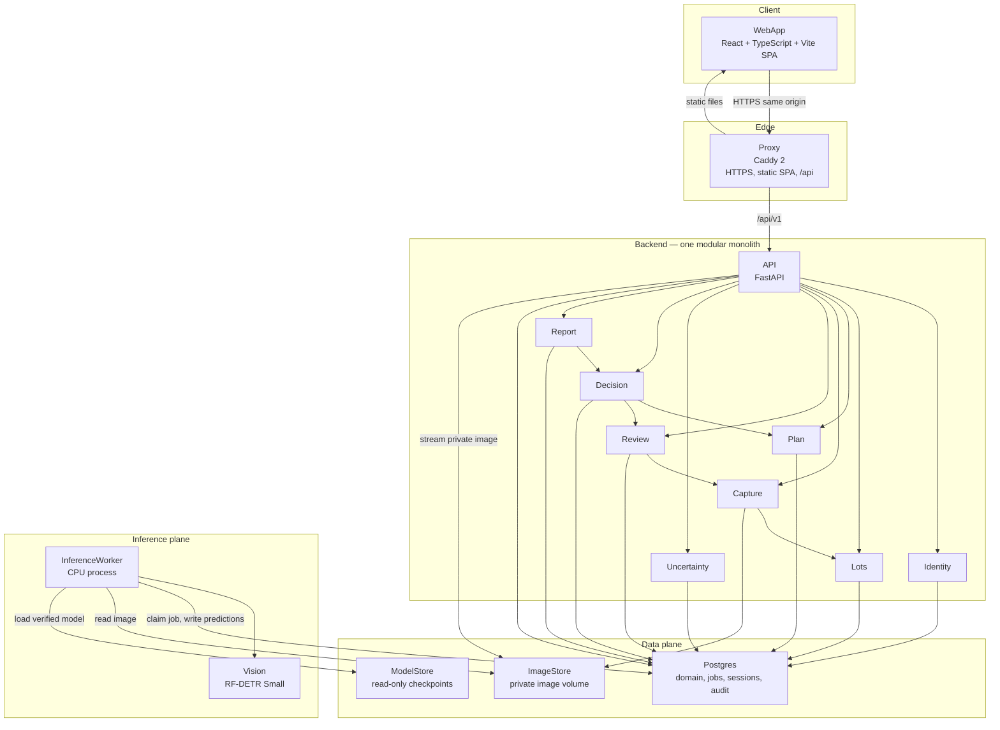

**Deployment note.** `WebApp` is a static build artefact served by `Proxy`; it is not a runtime container. `API` and `InferenceWorker` run the same application image with different entry points. `Postgres`, `ImageStore`, and `ModelStore` are persistent data planes. `ModelStore` is read-only at runtime.

## 10.2 User authentication

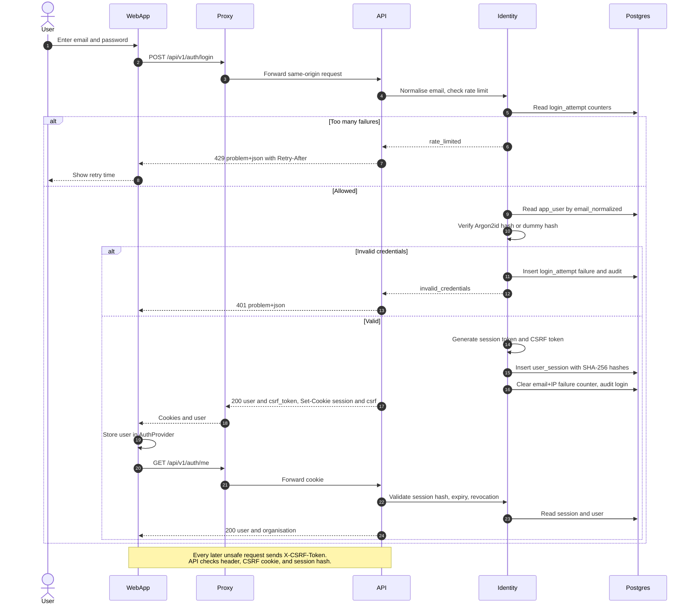

**Failure behavior.** A missing, expired, or revoked session returns `401 unauthenticated`; the WebApp clears local state and redirects to `/login?next=...`. A CSRF mismatch returns `403 csrf_failed`. Cookies are `HttpOnly`, `Secure`, `SameSite=Lax`, and the session is opaque; no JWT is issued.

## 10.3 Lot creation

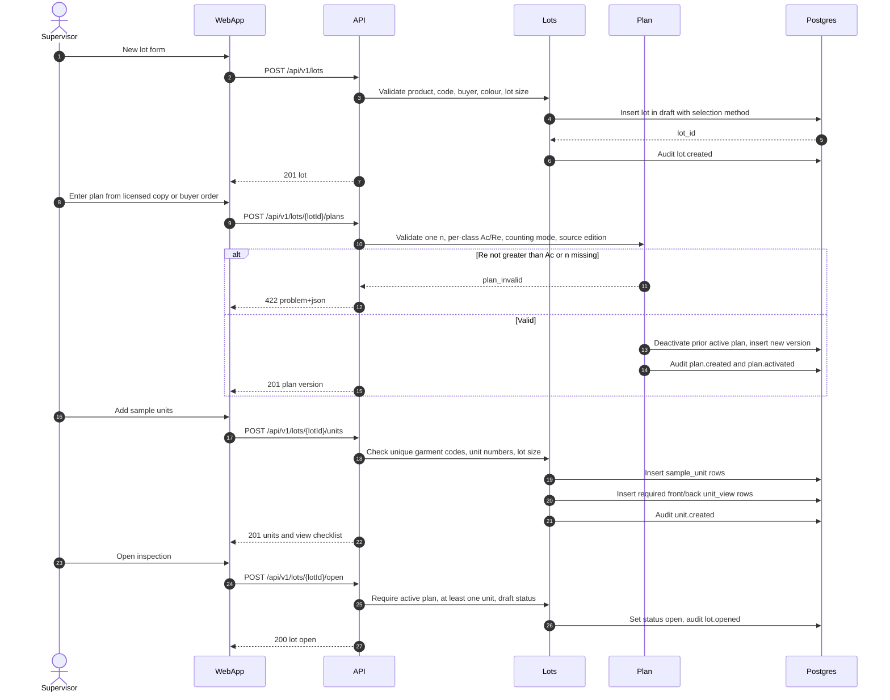

**Optional random helper.** `POST /lots/{lotId}/sample-draw` returns suggested positions and stores the seed and `selection_method = random_helper`. The draw is self-declared; Lotline cannot verify that the physical units were drawn at random (R10). The report prints the method and seed.

## 10.4 Garment image upload

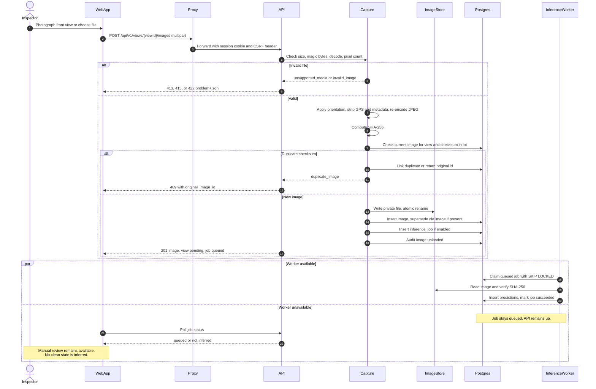

**Replacement rule.** Uploading a new image for a view with a current image marks the old image non-current and links the replacement. A view with an active confirmed defect cannot be replaced; the reviewer must retract the defect with a reason or a supervisor must reopen a decided lot. A replaced view must be reviewed again.

## 10.5 AI inference pipeline

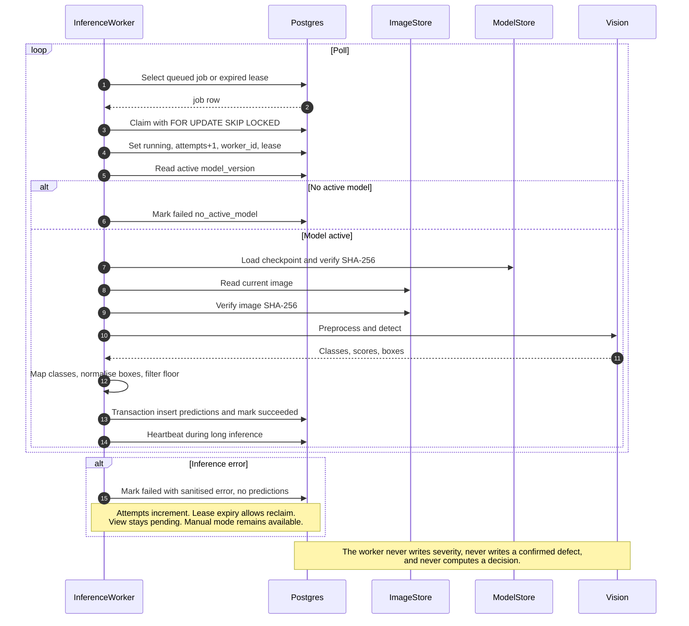

**Atomicity.** Predictions and `status = succeeded` commit together. A crash before commit leaves the job `running` until the lease expires; a reclaim deletes any partial predictions for that job before retrying. A failed job has no predictions and is never interpreted as “zero defects”.

## 10.6 Human defect verification

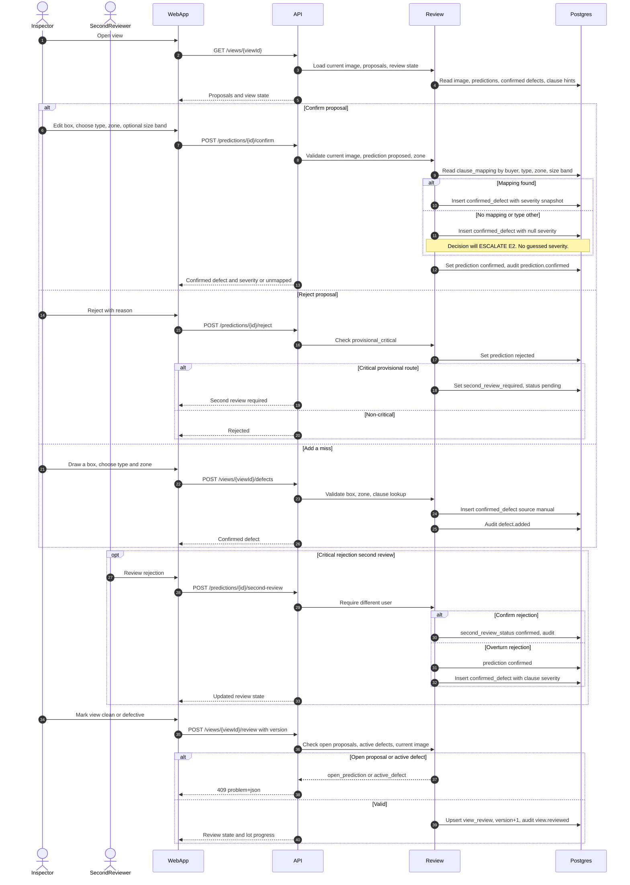

**Boundary.** The model output is shown as a proposal. The word `severity` is never rendered on a proposal. A confirmed row displays `critical`, `major`, `minor`, or `unmapped`, and only after the server applied the buyer's clause lookup. A view with zero proposals is still pending until the explicit clean action.

## 10.7 AQL decision workflow

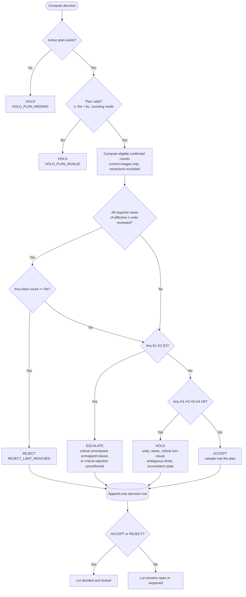

**Precedence.** The diagram follows §8.6: plan validity, REJECT, ESCALATE, HOLD, ACCEPT. REJECT is evaluated only when the sample is complete. If a class reaches `Re` before the sample is complete, the lot remains HOLD until the remaining required views are reviewed; a supervisor may override a HOLD to REJECT with a reason, never to ACCEPT.

**What is not automated.** The engine does not select `n`, `Ac`, or `Re`; does not decide severity; does not infer a clean view from zero proposals; does not accept a failed inference as zero; does not verify random draw; and does not claim statistical coverage.

## 10.8 Complete inspection lifecycle

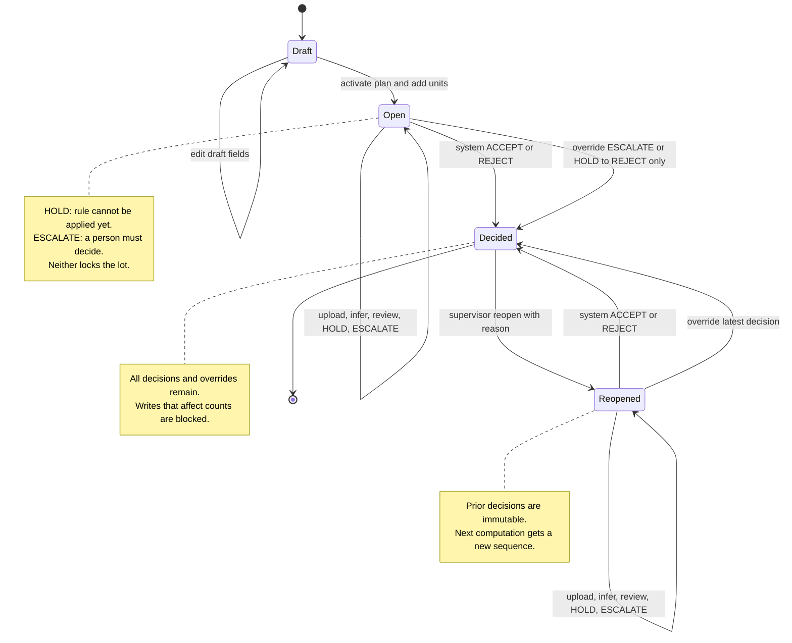

**Transition rules.**

| From | To | Actor | Preconditions | Audit |
|---|---|---|---|---|
| `draft` | `open` | Inspector+ | Active plan; at least one unit; not decided | `lot.opened` |
| `open` | `open` | Inspector+ | Upload/review/compute HOLD/ESCALATE | Per action |
| `open` | `decided` | Inspector+ | ACCEPT/REJECT decision, or override to ACCEPT/REJECT | `decision.computed` / `decision.overridden` |
| `decided` | `reopened` | Supervisor+ | Reason; prior decision retained | `lot.reopened` |
| `reopened` | `decided` | Inspector+/Supervisor | New ACCEPT/REJECT decision or override | `decision.computed` / `decision.overridden` |

A reopened lot is not a new lot. It uses the same lot, units, images, and confirmed history; only new reviews and new decision rows are added. This preserves the audit chain and avoids duplicate reports.

# 11. Deployment Architecture

## 11.1 Topology

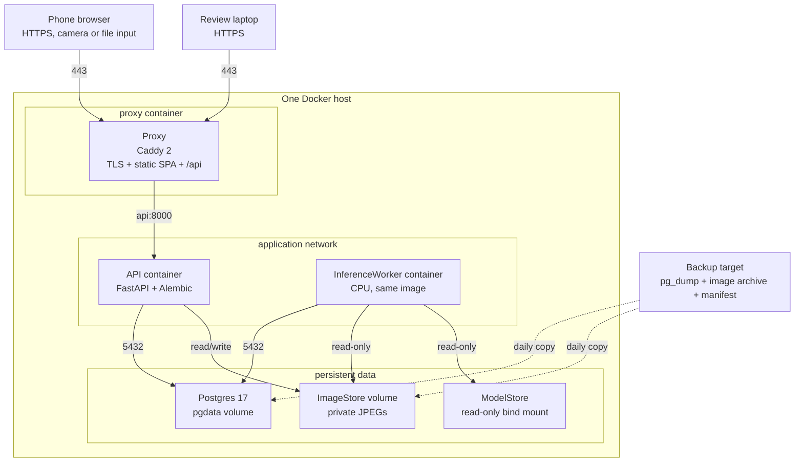

Only `Proxy` publishes host ports (80/443). `API`, `InferenceWorker`, and `Postgres` are on an internal Compose network. `Postgres` has no host port in the deployment profile; a local development override may expose `127.0.0.1:5432` for inspection.

## 11.2 Docker Compose services

| Service | Image / build | Ports | Volumes | Depends on | Restart |
|---|---|---|---|---|---|
| `proxy` | Multi-stage: Node build of `WebApp`, then Caddy 2 | `80:80`, `443:443` | `caddy_data`, `caddy_config`, static `dist` read-only, `Caddyfile` | `api` healthy | `unless-stopped` |
| `api` | `backend` image, API target | Internal `8000` | `imagestore:/data/images` read-write, `./models:/models:ro` | `db` healthy | `unless-stopped` |
| `worker` | Same `backend` image, worker target | None | `imagestore:/data/images:ro`, `./models:/models:ro` | `db` healthy | `unless-stopped` |
| `db` | `postgres:17-alpine` | Internal `5432`; optional `127.0.0.1:5432` for dev | `pgdata:/var/lib/postgresql/data` | — | `unless-stopped` |

**No `web` runtime service.** The `WebApp` build is a stage in the `proxy` image. This keeps the deployment to four services and one origin, as D1/D2 require. A separate static server would add a container without adding a capability.

**Startup sequence.**

1. `db` starts and passes `pg_isready`.
2. `api` starts, runs `alembic upgrade head`, then starts Uvicorn. If the migration fails, the container exits and Compose does not report healthy.
3. `worker` starts after the database is healthy. It waits for an active model; no active model is a job failure, not a crash loop.
4. `proxy` starts after `api` is healthy, serves the SPA, and forwards `/api`.
5. Health checks: `db` `pg_isready`; `api` `/readyz`; `proxy` `GET /healthz`; `worker` optional local health endpoint or process restart policy.

**Graceful shutdown.** `api` stops accepting new requests and finishes in-flight requests within the Uvicorn timeout. `worker` stops polling; if it is mid-job, it either finishes and commits or exits and lets the lease expire. It does not mark a job succeeded without predictions.

## 11.3 Reverse proxy and HTTPS

**Caddy responsibilities.**

- Terminate TLS.
- Serve the SPA with history fallback (`try_files {path} /index.html`).
- Proxy `/api/*` to `api:8000`.
- Enforce a request-body limit slightly above the application limit (26 MB for a 25 MB upload).
- Set security headers: `X-Content-Type-Options: nosniff`, `Referrer-Policy: same-origin`, `X-Frame-Options: DENY`, and a CSP that allows only same-origin scripts, styles, images, and connections. Tune the CSP to the built asset paths; do not add a CDN.
- Access log without cookies or query secrets.
- Trust forwarded addresses only from `TRUSTED_PROXY_CIDRS`. Caddy overwrites `X-Forwarded-For` with the observed peer; the API trusts the header only when the immediate peer is in that list and otherwise falls back to the socket peer. A client-supplied header from an untrusted peer is ignored.

**Illustrative Caddyfile** (deployment configuration, not application code):

```caddyfile
lotline.example.com {
  encode zstd gzip
  request_body {
    max_size 26MB
  }
  handle /api/* {
    reverse_proxy api:8000 {
      header_up X-Forwarded-For {remote_host}
    }
  }
  handle {
    root * /srv/web
    try_files {path} /index.html
    file_server
  }
  header {
    X-Content-Type-Options nosniff
    Referrer-Policy same-origin
    X-Frame-Options DENY
    -Server
  }
}
```

**Production HTTPS.** A real DNS name and a publicly reachable host allow Caddy to obtain a trusted certificate automatically. HSTS may be enabled only after the certificate path is proven; otherwise it can lock users out of a demo.

**Demo HTTPS without public DNS.** Use Caddy’s internal CA with a local hostname and install the Caddy root certificate on the demo phone. This is a setup step, not an application feature. Alternatives: a trusted tunnel or an existing domain. If neither works, the fallback is the file input over a trusted HTTPS page; do not run the session cookie over plain HTTP on a phone. If the page is plain HTTP, secure cookies fail and `getUserMedia` is unavailable `[V]`.

**WebSocket.** None. The SPA polls job status. This avoids proxy upgrade configuration and a persistent connection on a phone hotspot.

## 11.4 Frontend and backend deployment

- **Frontend build.** Node LTS build stage runs `npm ci` and `npm run build`, producing `dist/`. The Caddy stage copies `dist/` to `/srv/web`. The build is pinned by `package-lock.json`.
- **API image.** Python 3.12 slim base, pinned dependencies from `pyproject.toml`/lock file, non-root user, no build toolchain in the runtime layer. It runs Alembic then Uvicorn. It does not include the training dataset or model checkpoints.
- **Worker image.** Same image, different entry point. It includes the inference dependencies (PyTorch, RF-DETR, Pillow) and reads checkpoints from `ModelStore`. It does not include the frontend build.
- **Static cache.** Hashed Vite assets get a long cache; `index.html` gets `no-cache`. The service worker is not used in v1.
- **One origin.** No CORS. The SPA calls `/api/v1`. Cookies are same-origin and `SameSite=Lax`.

## 11.5 PostgreSQL persistence

- **Volume.** `pgdata` named volume. It is the only database state. Do not bind-mount a host directory with ad-hoc permissions unless the team has a backup.
- **Configuration.** `shared_buffers`, `work_mem`, and connection limits sized for one laptop; defaults are acceptable for the demo. The API uses a bounded connection pool; the worker uses a small pool. No PgBouncer.
- **Backups.** Daily `pg_dump -Fc` plus a pre-demo backup and a pre-migration backup. Store the dump, the image volume archive, and a SHA-256 manifest together. Keep at least one copy off the laptop.
- **Restore test.** Before the demo, restore into a scratch database and verify: schema head, lot count, latest decision count, image file checksums, and one report. An untested backup is not a backup.
- **No HA.** One Postgres instance. No streaming replica, no failover. This is a demo and single-factory deployment, not a claim of high availability.
- **Retention.** Keep audit and decisions indefinitely in v1. Sessions and login attempts are purged; stale queued jobs may be cancelled, not deleted if they have audit value.

## 11.6 Image volume management

**Layout.**

```text
/data/images/
├─ tmp/                                  # same-filesystem staging for atomic rename
├─ org/<organization_id>/
│  └─ lot/<lot_id>/
│     ├─ <image_id>.jpg
│     └─ ...
└─ quarantine/                           # orphan or failed-integrity files
```

The database stores `storage_key` relative to `IMAGE_ROOT`, for example `org/<org_id>/lot/<lot_id>/<image_id>.jpg`. Absolute paths are never stored.

**Write protocol.**

1. Validate and re-encode in memory or a bounded temp file.
2. Write to `tmp/<image_id>.jpg` with `fsync`.
3. Rename atomically to the final path.
4. Insert/commit the image row.
5. If the database commit fails, delete the file. If deletion fails, leave it for reconciliation.
6. On replacement, the old file stays; it is non-current but retained for audit. A retention job may archive old images after the decision is final, but it must not break audit.

**Access.** Only `API` streams bytes, after session, organisation, and lot checks. `InferenceWorker` reads read-only. `Proxy` never serves `/data/images`. There is no directory listing. File names are opaque UUIDs; the original filename is stored only as sanitised display metadata.

**Integrity.** A weekly (or pre-demo) reconciliation command compares `image.storage_key` to files, verifies SHA-256 for current images, and writes a manifest. A missing current image marks the view incomplete and blocks ACCEPT; it never becomes a clean view. Orphans are moved to `quarantine/`, not deleted until reviewed.

**Backup.** Archive the whole volume plus the manifest. Restore to the same path layout. After restore, run reconciliation before starting the API.

## 11.7 GPU training and CPU inference

**Training is not a Compose service.** It runs on a GPU workstation or a temporary cloud GPU environment, outside the demo host. The training workspace contains the dataset manifest, split hashes, training config, logs, checkpoints, and model card. The output is:

- `weights.pt` (or the detector’s serialised checkpoint),
- `model_card.json` (classes, training domains, licenses, metrics, threshold),
- `manifest.sha256`,
- `weights.sha256`.

**Promotion.** Copy the artefacts to `./models/<name>/<version>/`, verify hashes, register a `model_version` row, and activate it as admin. The demo host never trains and never downloads a checkpoint at inference time.

**CPU inference.** `InferenceWorker` loads the active checkpoint once, uses `torch.inference_mode()`, bounds thread count, and processes one image per job by default. The 3 s/view and 1 min/16-view figures are targets, not guarantees. If the target is missed, the UI still works in manual mode; do not shorten the job lease below the measured inference time.

**GPU not required at runtime.** Compose runs on a CPU-only laptop. A GPU is for training and, optionally, a faster offline evaluation run. The production design does not depend on CUDA being present.

## 11.8 Environment configuration

| Variable | Default | Purpose |
|---|---|---|
| `ENV` | `production` | `production`, `demo`, `test`; controls verbose errors |
| `DATABASE_URL` | — | PostgreSQL DSN; password from secret |
| `POSTGRES_DB`, `POSTGRES_USER`, `POSTGRES_PASSWORD` | — | Database bootstrap; only `db` and `api` need them |
| `PUBLIC_ORIGIN` | — | Expected browser origin for cookie/origin checks |
| `DEFAULT_ORGANIZATION_CODE` | `lotline` | Single-organisation v1; resolved once at startup to `organization.id`. A missing or ambiguous code is a startup error, not a silent fallback. Used for `login_attempt` on unknown emails. |
| `COOKIE_SECURE` | `true` | Must be `true` on HTTPS; `false` only for localhost development |
| `SESSION_ABSOLUTE_TTL_SECONDS` | `28800` | 8 h absolute session |
| `SESSION_IDLE_TTL_SECONDS` | `1800` | 30 min idle timeout |
| `IP_HASH_PEPPER` | — | Secret pepper for login-attempt IP hashing |
| `TRUSTED_PROXY_CIDRS` | `172.16.0.0/12` | Peer networks allowed to supply `X-Forwarded-For`; keep this to the Compose network, not the public internet. See §11.3. |
| `IMAGE_ROOT` | `/data/images` | `ImageStore` root |
| `MODEL_ROOT` | `/models` | Read-only checkpoint root |
| `MAX_UPLOAD_BYTES` | `26214400` | 25 MiB |
| `MAX_IMAGE_PIXELS` | `50000000` | 50 MP |
| `INFERENCE_ENABLED` | `true` | Allows enqueue; API stays up if false |
| `AUTO_ENQUEUE_INFERENCE` | `true` | Enqueue on upload |
| `DETECTION_FLOOR` | `0.10` | Store predictions above this score |
| `REVIEW_CONFIDENCE` | `0.35` | Below this, mark low-confidence review priority |
| `QUALITY_GATE_ENABLED` | `false` | v1 default; v2 can enable the gate |
| `WORKER_POLL_SECONDS` | `2` | Queue poll interval |
| `WORKER_LEASE_SECONDS` | `120` | Stale job threshold |
| `WORKER_MAX_ATTEMPTS` | `3` | Job retries |
| `WORKER_CONCURRENCY` | `1` | Measured knob |
| `LOG_LEVEL` | `INFO` | Structured logs |
| `TZ` | `UTC` | Server time zone |

**Secrets.** `POSTGRES_PASSWORD`, `IP_HASH_PEPPER`, and any TLS material are supplied through an untracked `.env` or Compose secret. `.env.example` contains placeholders only. No secret is committed, logged, or included in an image layer.

## 11.9 Demo deployment on one laptop

**Hardware.** One laptop running Docker Desktop/Compose, a phone on the same hotspot, and a pre-seeded lot. The model is on the laptop’s `ModelStore`; inference is CPU. No internet is required after the images and frontend are built.

**Network.** The phone connects to the laptop hotspot or a local Wi-Fi. `Proxy` serves `https://lotline.local` with a locally trusted certificate, or a tunnel/domain if available. The laptop firewall allows 443 only.

**Pre-demo checklist.**

1. `docker compose up -d --build`; all services healthy.
2. `alembic current` equals head; demo seed loaded.
3. Three demo lots exist: one inferred, one manual-mode, one forced HOLD/ESCALATE.
4. Phone trusts the certificate; camera and file fallback both tested.
5. Inference latency measured on the laptop; a 16-view lot completes within the demo window or the manual fallback is ready.
6. Report prints one page from Chrome and Safari.
7. Backup taken; restore tested on a scratch database.
8. Recorded fallback video exists; the live demo does not depend on venue Wi-Fi.

**What can fail on stage.** Venue Wi-Fi, phone certificate trust, camera permission, CPU thermal throttling, and the model. Each has a fallback: hotspot, file input, pre-seeded lot, manual review, recorded video. The pitch states the limits honestly rather than hiding a fallback.

## 11.10 Deployment limits

- Single host, single database, single worker. A host failure stops the demo.
- No horizontal scaling, no load balancer, no zero-downtime deploy.
- No automated failover or disaster recovery guarantee.
- No GPU requirement at runtime.
- No multi-organisation UI.
- No public status page or paging. The team monitors logs and health during the demo.
- Backups are only as good as the last tested restore.

# 12. Failure Handling and Reliability

## 12.1 Failure philosophy

1. **Fail closed for quality.** A failure never becomes a clean view, a zero count, or an ACCEPT. The worst acceptable outcome is HOLD with a clear reason.
2. **Degrade to manual, not to guessing.** If inference is unavailable, a human can still inspect and mark every required view. The UI says “not inferred”.
3. **Preserve evidence.** A failed job, rejected upload, excluded image, retracted defect, and failed authorization attempt leave an auditable trace where appropriate.
4. **Make recovery idempotent.** Re-uploading the same checksum, retrying a job, or repeating a decision request must not duplicate counted data.
5. **Separate availability from correctness.** The API can stay up with the worker down. The database is the one dependency that stops writes; it must not be bypassed.

## 12.2 Failure matrix

| Failure | Detection | System behaviour | Recovery | Audit |
|---|---|---|---|---|
| `InferenceWorker` process down | No worker heartbeat; jobs stay `queued` | API, upload, review, manual decisions remain available. UI shows “queued” or “not inferred”. No view becomes clean. | Start worker; it claims queued jobs. Or continue manual review. | `inference.enqueued`; worker restart logs |
| No active model | Job claim finds none | Job fails `no_active_model`; view pending; manual mode available. | Admin registers/activates a model; retry job. | `inference.failed`; model activation |
| Model/runtime error | Exception in worker | Job fails with sanitised code; no predictions; view pending. | Retry up to `max_attempts`; then manual review or fix model. | `inference.failed` |
| Worker crashes mid-job | Lease expires | Job is reclaimable; attempts increment; partial predictions are not committed. | Another worker or restart reclaims; if max attempts reached, manual review. | Job attempts, error code |
| Queue backlog | Queue depth grows; jobs wait | Uploads and review continue; UI shows queued. | Increase worker concurrency only after measuring; or manual review. | Job timestamps |
| Invalid image | Magic bytes/decode/pixel checks | `415` or `422`; no image row; view pending. | Retake/upload a valid image. | Upload failure code, request id |
| Duplicate image | SHA-256 match in lot | `409 duplicate_image` with original id, or linked non-current duplicate. Never counted twice. | Use the original view or upload a genuinely different image. | `image.duplicate_detected` |
| Failed upload after file write | DB commit fails | File is deleted; no image row. If delete fails, orphan is quarantined. | Retry upload; reconciliation removes/quarantines orphan. | Upload error, reconciliation report |
| Disk full on `ImageStore` | Write/rename fails; free-space check | `503 storage_unavailable`; no image row. | Free space/expand volume; retry. | Storage error |
| `Postgres` unavailable | `SELECT 1` fails; connection errors | API returns `503 database_unavailable`; no writes or decisions; worker backs off. Proxy may return 502/503. | Restore DB service; retry. Transactions rolled back. | Health/readiness, request id |
| `ImageStore` unavailable or file missing | Read/hash failure | Current view is incomplete; decision HOLD; worker job fails. | Restore file from backup; reconcile; retake if necessary. | Reconciliation manifest; `inference.failed` |
| Incomplete inspection | Engine completeness check | HOLD with exact unit/view/reason list. | Finish units/views, replace excluded images, retake quality-gated images. | Decision row with reason details |
| Open proposal | E1 check | ESCALATE if critical provisional route; otherwise view cannot be marked clean. | Confirm or reject the proposal. | Prediction status, audit |
| Unmapped defect / type other | E2 check | ESCALATE with defect ids; severity null; not counted. | Supervisor/QC resolves the clause and recomputes; if the lot must fail, override ESCALATE → REJECT. | Confirmed defect, decision reason |
| Critical rejection pending second review | E3 check | ESCALATE; ACCEPT blocked. | A different person confirms or overturns. | `prediction.second_reviewed` |
| Critical non-visual pending | Lot status | HOLD blocks ACCEPT; REJECT still possible. | Supervisor completes the check; if a finding exists, override HOLD to REJECT with reason. | `lot.critical_status_changed` |
| Unauthorized request | Auth dependency | `401` or `403`; no data returned. | Sign in or use an authorized role. | Security log; `login.failed` where relevant |
| Cross-organisation access | Repository scope/composite FK | `404`; no existence confirmation. | Correct the session/organisation. | Security test; audit if attempted |
| CSRF missing/mismatch | CSRF dependency | `403 csrf_failed`; no state change. | Reload the page to refresh the token; retry. | Security log |
| Session expired/revoked | Session check | `401 unauthenticated`. | Sign in again. | `session.revoked` / expiry |
| Concurrent review edit | Version check | `409 version_conflict` with current version. | Reload the view and reapply the decision. | Both review audit events |
| Duplicate decision request | Idempotency key | Stored decision returned with `Idempotency-Replayed: true`. | None; safe. | One decision row |
| Write to decided lot | Lot status check | `409 lot_locked`. | Supervisor reopens with reason; new decision sequence. | `lot.reopened` |
| Model wrong or empty | Human review | Proposals are not defects; empty list is pending. Reviewer adds misses or marks clean. | Correct review; retrain in a later version. | Confirmed/retracted defects |
| Low confidence | Predicted score below `REVIEW_CONFIDENCE` | Review priority high; no count change. | Human confirms/rejects. | Prediction score, view flags |
| Proxy/TLS failure | Browser cannot connect | No service. | Restart proxy; use recorded fallback in the demo. | Proxy logs |
| Clock skew | Timestamps inconsistent | Server timestamps are authoritative; client times are hints. | Sync host clock; restart services if needed. | Audit timestamps |
| Backup restore | Restore test fails | Do not proceed; demo uses the last known-good backup and a recorded fallback. | Fix restore, verify counts/images/report, then start. | Restore report |
| Audit gap after restore | Missing events after backup timestamp | The team records the gap in the incident log; decisions after the backup are lost. | Recompute from the restored state; new sequence. | Incident note in audit if possible |

## 12.3 Job lease, retry, and duplicate protection

- **Lease.** A running job has `lease_expires_at = now() + WORKER_LEASE_SECONDS` (120 s default). The heartbeat uses a separate database connection and updates `heartbeat_at`/`lease_expires_at` every 10 s; it is never part of the inference or prediction-write transaction. If the process dies, the lease expires and another worker may claim the job.
- **Attempts.** Each claim increments `attempts`. A job with `attempts >= max_attempts` is not reclaimed; it is failed and the UI offers manual review.
- **Backoff.** Requeue after a failed attempt uses a short exponential backoff via `created_at`/`lease_expires_at` or a `next_attempt_at` column if the team adds it. The design does not require a message bus.
- **Atomic write.** Predictions and `succeeded` commit together. On retry, any predictions for the same job are deleted inside the transaction before reinserting, then the success is set. A job cannot be `succeeded` with partial predictions.
- **Duplicate jobs.** The partial unique index prevents two active jobs for one image. A retry after a terminal job creates a new job; old predictions remain historical.
- **Canceled jobs.** A `queued` job for a superseded or excluded image is set to `canceled` in the same transaction that supersedes or excludes the image. A `running` job is stopped only by the worker's pre-write check. `canceled` is terminal and is never retried; it is not counted as a model failure.
- **Duplicate uploads.** The lot+checksum unique index and the upload service make retries idempotent. A duplicate is linked or rejected, never counted twice.
- **Duplicate decisions.** `Idempotency-Key` is unique per lot; replay returns the same row. A deliberate recompute uses a new key and creates a new sequence.

## 12.4 Upload consistency and orphan handling

The upload path spans a file write and a database commit. The chosen order is:

1. Validate and re-encode to a temp file.
2. Move/rename to the final private path.
3. Begin the database transaction; insert the image row, supersede the old image, insert the job, and audit.
4. Commit.
5. If the commit fails, attempt to delete the new file. If deletion fails, leave it under `tmp/` or `quarantine/` for reconciliation.

**Why this order.** A file without a database row is harmless if reconciled; a database row without a file is a broken current image and a HOLD. The system prefers an orphan file over a dangling row. Reconciliation runs before the demo and weekly: it lists files, compares `storage_key`, verifies current image hashes, quarantines unreferenced files, and reports missing current files.

**Replacement race.** Two reviewers upload simultaneously. Both commands take the lot row lock, so they serialize: the second sees the first image as current and returns `409 image_replaced` (with the new current id); the UI reloads. The partial unique index on `(organization_id, unit_view_id) WHERE is_current` is the database backstop. No two current images exist.

## 12.5 Database unavailable

- **API.** Readiness fails; commands return `503 database_unavailable` with `request_id`. No in-memory fallback, no local queue, no “optimistic” decision. The client shows a retry state.
- **Worker.** Polling backs off; a running job that loses the database marks nothing succeeded. The lease expires and the job is retried after the database returns.
- **Proxy.** Returns `502`/`503` for `/api`; the static SPA may still load, but no authenticated data is shown.
- **Recovery.** Restart Postgres, verify `pg_isready`, run `alembic current`, check a known lot and decision, then resume. Stale sessions remain valid until expiry; this is acceptable for a single-host demo. If the database was restored from backup, all clients must re-authenticate and the incident is logged.

**No dual-write.** There is no second database or cache that could diverge. This is a deliberate simplicity choice; the cost is availability during a database outage.

## 12.6 Unauthorized access and isolation failures

- **Missing/expired session:** `401`, no data. The WebApp clears its cache and redirects.
- **Wrong role:** `403 forbidden`; the server does not reveal whether the resource exists beyond the role check.
- **Cross-organisation:** query is scoped to the session organisation; the resource appears as `404 not_found`. A direct SQL cross-organisation insert fails on the composite foreign key. Tests cover every endpoint group.
- **CSRF:** `403 csrf_failed`; no state change. The token is rotated at login and logout.
- **Session fixation:** the session token is rotated on login; the old session row is revoked.
- **Password brute force:** login rate limit; failures are logged without the password. The response does not distinguish unknown email from wrong password.
- **Image access:** every image read checks session, organisation, and lot access. There is no public bucket, signed URL, or static path. Guessing an image UUID does not bypass authorization.
- **Model access:** only admin can register/activate; checkpoints are read-only to the worker; user uploads are never loaded as models.
- **Audit:** overrides, critical-status changes, decision recomputes, reopens, exclusions, role changes, and model activation are audited. A failed authorization attempt is logged; it does not create a domain audit event if no state changed, but security logs retain the request id.

## 12.7 Recovery and auditability

**Recovery order after an incident:**

1. Stop `api` and `worker` to prevent partial writes.
2. Check database health and migration head.
3. Restore the database backup if needed; restore the image volume and manifest.
4. Run image reconciliation and checksum verification for current images.
5. Start `api`; verify login, one lot, one decision, one report.
6. Start `worker`; verify one queued job succeeds or fails cleanly.
7. Record the incident: time, cause, backup timestamp, lost rows if any, and the decision sequences recomputed.
8. Re-run the forced HOLD/ESCALATE demo cases before resuming the demo.

**Audit guarantees.**

- Decisions and overrides are append-only; the database trigger blocks updates/deletes.
- Every decision with a plan stores the plan snapshot, counts snapshot, confirmed snapshot hash, model versions, engine version, actor, and timestamp. A `HOLD_PLAN_MISSING` decision stores the reason code, null plan-derived fields, and the same counts/audit evidence.
- Reopening does not delete prior decisions; it adds a new sequence.
- A retracted defect remains with actor and reason.
- An excluded image remains with its exclusion log; the file is retained.
- Backup manifests include image checksums, so a restored image can be verified.
- Audit events redact secrets and image bytes.

**What is not guaranteed.** No formal RPO/RTO, no write-ahead archival, no off-site replication, no tamper-evident ledger, no legal chain-of-custody. The design provides practical traceability for a factory demo and a four-person team, not a certified quality system.

## 12.8 Backup and restore runbook

**Backup (daily, before demo, before migration):**

1. `pg_dump -Fc` the database to a timestamped file.
2. Archive `ImageStore` (or copy new files) and generate a SHA-256 manifest of current images.
3. Copy the dump, archive, manifest, and `.env.example` (not secrets) to an off-laptop location.
4. Record the latest decision sequence per lot and the schema head.
5. Verify the dump opens with `pg_restore --list`.

**Restore test (before demo):**

1. Create a scratch database.
2. `pg_restore` the dump.
3. Restore images to a scratch volume.
4. Run `alembic current` and compare to head.
5. Verify lot/unit/view/decision counts against the recorded values.
6. Verify one current image hash and render one report.
7. Do not point the demo at the scratch database unless the real one is lost.

**Failure to restore.** If the restore test fails, the demo uses the last known-good backup and the recorded video fallback. The team does not improvise a partial restore during the judging window.

## 12.9 Explicit non-guarantees

- A failed model is not a clean lot.
- A missing image is not a clean view.
- A HOLD is not an ISO outcome.
- An ESCALATE is not a rejection.
- An ACCEPT is not proof the lot is defect-free.
- The system does not verify random sampling.
- The system does not guarantee model accuracy, calibration, or factory performance.
- The system does not provide high availability, disaster recovery, or multi-region durability.
- The system does not replace a licensed standard, buyer contract, or human QC judgement.

# 13. Final Architecture Review

## 13.1 Architectural risks

| # | Risk | Severity | Likelihood | Why it matters | Mitigation | Owner |
|---:|---|---:|---:|---|---|---|
| R-01 | No open finished-garment box dataset; staged data is small | High | High | The shipped detector is trained on fabric surfaces, not finished garments. Public mAP will not prove factory performance. | Staged shooting starts week 1; per-domain evaluation; report says staged-only and “no factory evidence” if true; no pooled metric. | Vision/data + QC lead |
| R-02 | RF-DETR fails to train or misses the 3-day gate | High | Medium | The demo needs one working detector. A late detector failure endangers the whole demo. | Pre-declared localization check; 3-day go/no-go; YOLO AGPL fallback with approval; manual mode always works. | Vision/data |
| R-03 | Class crosswalk is wrong, especially `needle_line` and `dropped_stitch` | High | Medium | A wrong label teaches the wrong thing and undermines trust. | Visual verification on a sample before training; leave a class unmapped rather than force it; document the crosswalk. | Vision/data + QC lead |
| R-04 | CPU inference misses the ~3 s/view target | Medium | Medium | A 16-view lot could exceed the demo window. | Measure on the demo laptop; one job at a time; reduce input size only with a recall check; manual fallback and recorded video. | Vision/data + frontend |
| R-05 | Exact `n`, `Ac`, `Re` are not available or are entered from an unlicensed source | High | High | A wrong plan produces a wrong decision, even if the engine is perfect. | Enter from a licensed copy or buyer order; record edition; label demo plans; no reconstructed table; engine tests use symbolic values. | QC lead + backend |
| R-06 | Mixed AQLs, critical class treatment, and isolated-lot approach are unresolved | High | High | The standard’s procedure is ambiguous in the secondary sources; a wrong interpretation can pass a bad lot. | One `n` per plan; per-class limits; ESCALATE/HOLD for ambiguity; report states the plan applied; obtain a licensed copy or buyer instruction before production. | QC lead |
| R-07 | Counting mode (`highest_class_only` vs `every_class`) changes the outcome | High | Medium | The same defects can count differently. | Explicit `counting_mode`; report prints it; demo plan labels its assumption; both modes tested. | Backend + QC lead |
| R-08 | `Re > Ac + 1` leaves an undefined gap | Medium | Medium | A count between `Ac` and `Re` is neither accept nor reject. | Engine returns HOLD `HOLD_PLAN_AMBIGUOUS_LIMITS`; no guess; flagged for licensed review. | Backend |
| R-09 | Random draw cannot be verified | Medium | High | AQL assumes random sampling; a convenience sample can misrepresent the lot. | Store self-declared method and optional seed; print it; never claim verified randomness. | QC lead |
| R-10 | Automation bias: reviewer marks a view clean without looking | High | Medium | A false clean view can produce a false ACCEPT. | “Empty is not clean”; explicit clean dialog; seeded known-defective garments in staged lots; review queue; second person for critical rejections. A second-person clean check is missing and flagged. | QC lead + frontend |
| R-11 | Critical non-visual finding has no dedicated “failed” status | High | Medium | `pending/done/not_required` cannot express “checked and failed”. | Keep status pending and override HOLD → REJECT with reason; document the gap; v2 may add a result field. | Backend + QC lead |
| R-12 | Quality gate is v2 in the version plan but appears as a HOLD condition | Medium | Medium | Implementing it in v1 expands scope; omitting it leaves HOLD wording dormant. | Ship it disabled by default in v1; enable only if time permits; flag the contradiction. | Backend + frontend |
| R-13 | Report overflows one printed page | Medium | Medium | v3 requires a one-page report; verbose reasons can push it to two. | Compact print CSS; key reasons only; full audit in the app; preview on Chrome and Safari; accept a documented two-page fallback if unavoidable. | Frontend + QC lead |
| R-14 | Image upload / HEIC / phone browser variance | Medium | High | The demo depends on a phone photo. | Server-side magic-byte detection and HEIC conversion; file input fallback; test on Android Chrome and iPhone Safari; keep the original if conversion fails. | Frontend + backend |
| R-15 | Local HTTPS / certificate trust fails on the phone | High | Medium | No secure context means no live camera and no secure cookies. | Pre-install the Caddy root CA; test the exact demo phone; fallback file input over a trusted HTTPS page; recorded video. | Frontend + ops |
| R-16 | Single host, single database, no HA | Medium | Medium | A laptop or database failure stops the demo. | Daily backup; pre-demo restore test; pre-seeded lots; recorded fallback; no claim of HA. | Ops |
| R-17 | Upload or database partial failure leaves inconsistent state | Medium | Medium | A dangling image row or lost file can corrupt a view. | Atomic file write + DB commit order; compensating delete; reconciliation; current-image checksum verification. | Backend |
| R-18 | Cross-organisation or role bypass | High | Low | Data leakage or unauthorized override would be fatal to trust. | Session-derived org; repository scope; composite FKs; role tests; CSRF; 404 for cross-org. | Backend |
| R-19 | Checkpoint or upload attack | High | Low | A malicious file could execute code or exhaust memory. | Magic bytes, decode, re-encode, pixel/size limits; team-only checkpoints; SHA-256; read-only model mount; `torch >= 2.6`. | Backend + Vision |
| R-20 | License breach in training data or detector code | High | Medium | A public demo or later commercial use could be blocked. | License register per source; ISL-Knit excluded until confirmed; BDFD9/FabriD CC BY 4.0; AFID/RAW-FABRID/MVTec controls only; YOLO AGPL approval. | Vision/data + lead |
| R-21 | 41-day schedule slips; data is the long pole | High | High | A late staged set means no credible evaluation. | Shooting/labelling starts week 1; freeze staged test 6 Dec; feature freeze 13 Dec; cut list ready. | Lead |
| R-22 | Privacy or factory-confidentiality complaint | Medium | Medium | Photos may contain factory context or people. | No faces/badges in staging; strip GPS; private images; role access; factory photos only with permission; no worker surveillance. | QC lead + frontend |
| R-23 | No metrics, tracing, or alerting | Medium | High | Failures may be discovered late. | Structured logs, health endpoints, SQL queue/outcome dashboards; pre-demo checks. Full observability is out of scope. | Ops |
| R-24 | Buyer/zone/size-band data is free text | Medium | Medium | A typo can cause a missing mapping and an unnecessary ESCALATE. | Normalised `buyer_key`; exact lookup; UI selects from seeded zones; v2 adds master data. | Backend + QC lead |

## 13.2 Missing components

These are not in v3 or not implementable as specified without a decision. They are recorded rather than silently invented.

| # | Missing component / gap | Consequence | Recommendation |
|---:|---|---|---|
| M-01 | Buyer master data; buyer is `lot.buyer_name` text | Typos can break clause lookup | Keep `buyer_key` normalisation in v1; add a `buyer` table in v2 if multiple buyers/lots. |
| M-02 | Zone and size-band master data | Free-text zone codes can drift | Seed a reviewed zone list; validate on write; v2 master table. |
| M-03 | Critical non-visual “failed” result | No first-class way to record a failed critical check | Keep `pending` + note and override HOLD → REJECT; add a result field in v2. |
| M-04 | Quality-gate activation policy | v1/v2 scope ambiguity | Disabled by default; enable only with a reviewed threshold and a retake workflow. |
| M-05 | Second-person check for clean views | Automation bias can pass a missed defect | v1 has seeded-defect checks and critical rejection second review; add random clean-view second review in v2 if time. |
| M-06 | Password reset, email verification, invitations | Admin must create/reset users manually | Acceptable for v1 single factory; document the admin procedure. |
| M-07 | Metrics/tracing/alerting stack | Failures rely on logs and manual checks | Add a lightweight SQL dashboard; do not add Prometheus/Grafana for the demo. |
| M-08 | Backup automation inside Compose | Backup depends on a human running a command | Add a host scheduled task/cron; test restore before demo. |
| M-09 | Audit export and audit UI | Audit is in the database, not a user-facing report | Lot audit endpoint exists for supervisors; export is v2. |
| M-10 | Model drift and false-negative monitoring | A silent model regression is possible | Model version registry, per-domain eval, staged known-defect checks; no runtime drift claim. |
| M-11 | Dataset registry and training UI | Training is offline and manual | Keep the manifest/model card in the training workspace; no app feature. |
| M-12 | Offline capture / upload queue across reloads | Poor connectivity can lose a capture | Retry in memory in v1; no offline guarantee. |
| M-13 | Calibration set and detection-calibration metric | “Calibrated” cannot be claimed | Report “not calibrated” unless a valid same-distribution set exists. |
| M-14 | Capture/lighting guide and hardware calibration | Photos vary; model performance varies | Provide a one-page capture guide; do not claim calibrated capture. |
| M-15 | Localisation (Bangla) | Some inspectors may prefer Bangla | Out of v1 scope by D8; keep UI strings externalisable. |
| M-16 | Retention/legal hold policy | Images/audit grow indefinitely | Define retention after the competition; do not delete decisions/audit in v1. |
| M-17 | Malware scanning of uploads | Re-encode reduces but does not prove safety | Decode/re-encode, size/pixel limits; no AV claim. Add AV only if a scanner exists. |
| M-18 | Plan approval workflow | A supervisor can enter a wrong plan without a second check | v1 records source and actor; add a second-person plan approval in v2 if buyer requires. |
| M-19 | Report signature / immutable export | The printed PDF is not signed | Keep decision snapshot hash; a signed export is v2/v3. |
| M-20 | Multi-organisation UI and RLS | Only one organisation in v1 | Schema is org-scoped; add UI/RLS only when the product requires it. |

## 13.3 Unresolved decisions

**Carried from v3 §P**

1. BDFD9 split integrity and the count of duplicated images.
2. ISL-Knit dataset license; FabriD capture device and garment-versus-swatch status.
3. License of each download mirror.
4. Exact `n`, `Ac`, `Re` values and the edition to cite.
5. Whether the standard or buyer requires `highest_class_only` or `every_class`.
6. How `n` is set when classes carry different AQLs.
7. How the critical class is treated under ISO 2859-1:2026.
8. Whether the buyer contract implies an isolated-lot approach.
9. Whether RF-DETR trains on the available labels and how it performs here.
10. The congress judging rubric.

**New decisions this design had to make, or leave open**

| # | Question | Current design choice | Status |
|---:|---|---|---|
| N-01 | Can a HOLD or ESCALATE be overridden? | Only to REJECT, never ACCEPT; requires reason and audit. ACCEPT requires resolving the blocker and recomputing. | Design choice; confirm with QC lead. |
| N-02 | Can a decided lot be overridden without reopening? | No. Reopen first; then override the latest decision. A new computation is optional. | Design choice; preserves lock. |
| N-03 | Does ACCEPT/REJECT lock immediately? | Yes. A supervisor must reopen to change it. | Design choice; consider supervisor sign-off if buyers require. |
| N-04 | What does `critical_nonvisual_status = done` mean? | Checklist completed with no finding; a finding stays pending and uses HOLD → REJECT override. | Gap; v2 result field recommended. |
| N-05 | Is the quality gate on in v1? | Disabled by default; advisory flags only. | Depends on v3 v1/v2 scope resolution. |
| N-06 | Who may be the second person for a critical rejection? | Any active user other than the rejecting reviewer; supervisor/admin can review. | Design choice; buyer may require supervisor only. |
| N-07 | Can an inspector retract a confirmed defect? | Yes, before the lot is decided, with audit; after decision, supervisor reopen. | Design choice; consider supervisor-only. |
| N-08 | Can a plan be edited after uploads? | Yes, by creating a new version; prior decisions keep the old plan row. | Design choice; report prints version. |
| N-09 | Is `n` per plan or per class when AQLs differ? | One `n` per plan (D6). | Open in the standard; one physical sample is inspected. |
| N-10 | Can a lot have multiple detail views? | Yes, one per `detail_label`; optional. | Design choice. |
| N-11 | Can a lot size change after units exist? | Not in v1; changing it would invalidate the sample. | Design choice; create a new lot or reopen with a new plan. |
| N-12 | Is the operator allowed to compute a decision on an incomplete lot? | Yes, it returns HOLD/ESCALATE and is recorded. | Design choice; useful for progress. |
| N-13 | Does the report have to fit one page absolutely? | Target one page; if content overflows, compact reasons and link to the app. | Verify on demo devices. |
| N-14 | Session TTL, upload limit, lease, retry count | 8 h / 30 min, 25 MB / 50 MP, 120 s, 3. | Defaults; tune before freeze. |
| N-15 | Should inference auto-enqueue on upload? | Yes by default; can be disabled. | Demo convenience. |
| N-16 | Is a buyer entity required? | No in v1; normalised text key. | Add if multiple buyers or mappings grow. |
| N-17 | What is the audit/retention period? | Indefinite in v1; purge sessions/login attempts only. | Define before production. |
| N-18 | Does the demo need a public judging rubric? | No rubric invented; v3 says do not. | Open until official page is read. |

## 13.4 Contradictions and deviations to disclose

**No PRD was found in the workspace.** Therefore there is no PRD contradiction to resolve. The following are v3-internal tensions or deliberate elaborations. They are disclosed, not silently “fixed”.

| # | v3 text | Tension | Resolution in this design |
|---:|---|---|---|
| C-01 | v3 is written as a two-message research prompt (“READY FOR PART B”) | This deliverable is a single system design, not a two-message research answer | Treated v3 as the approved decision source, not as the output protocol. No architectural change. |
| C-02 | §H ACCEPT: “below its Re, that is, at or under its Ac” | Only true when `Re = Ac + 1`; R3 allows `Re > Ac` | Engine holds on `Ac < count < Re` (`HOLD_PLAN_AMBIGUOUS_LIMITS`); no guess. |
| C-03 | §M defers the image-quality gate to v2; §H includes a quality-gated image in HOLD | v1 scope vs decision condition | Gate is implemented but disabled by default in v1; advisory flags only. |
| C-04 | §K says every table carries `organization_id` | The `organization` table is the tenant root | Documented exception; every other tenant table has it. |
| C-05 | R6 allows supervisor override broadly; a decided lot is locked | Override after lock could bypass the lock | Override only on the latest decision of an open/reopened lot; decided lot must be reopened. |
| C-06 | R13 uses `pending/done/not_required` only | No “failed” result for a critical non-visual finding | Keep `pending`, record note, override HOLD → REJECT; v2 result field. |
| C-07 | D2 lists Proxy, API, InferenceWorker, Postgres, image volume | WebApp is not a service | WebApp is a static build served by Proxy; no extra runtime. |
| C-08 | D7 says load only team-produced checkpoints | RF-DETR training uses official pretrained weights | Inference loads only team checkpoints; training may use hash-pinned official weights. |
| C-09 | “Plan is a pure function” | Plan also has a table and API | Pure validation/semantics engine is separated from the Plan persistence/service module. |
| C-10 | “A decided lot is locked; reopening creates a new decision” | Override is a separate human decision | Override does not edit the decision; it is a separate append-only row; a decided lot is reopened first. |
| C-11 | Front/back views are “configurable” | Product also needs a stable per-unit requirement | Product `required_views` is snapshotted into `unit_view.is_required` at unit creation. |
| C-12 | One organisation in v1; email login has no org selector | Global email uniqueness vs future multi-org | Global unique email in v1; documented migration path to per-org uniqueness. |
| C-13 | v3 says “No message bus”; the worker needs a queue | Postgres table + `SKIP LOCKED` is a queue | Preserved D2; no new infrastructure. |
| C-14 | v3 says “one n per plan” while mixed AQL `n` is open | Different AQLs can imply different sample sizes in some readings | One `n` per plan; per-class limits; the open question is recorded, not hidden. |

## 13.5 Unnecessary complexity and deliberate cuts

**Not introduced (and why).**

| Technology/approach | Why not |
|---|---|
| Next.js / server runtime | v3 D1; static export loses cookies/proxy; a second runtime adds an authorization boundary. |
| Microservices / Kubernetes | Four people, one machine, one database; network boundaries would add failure modes without a measured need. |
| Redis / Celery / message bus | Postgres jobs with `SKIP LOCKED` are sufficient; fewer services to operate. |
| GraphQL | REST endpoints are small and explicit; no client-driven query complexity. |
| WebSockets | Polling job status is enough; avoids proxy upgrades and phone connection issues. |
| PDF library | Browser print-to-PDF is the v1 requirement; no server-side PDF. |
| Second detector / RT-DETR sweep / anomaly model | v3 D3 cuts; no time, no validated benefit, anomaly never increments AQL. |
| Clause-mapping editor | v1 seeded mapping; v2 supervisor editor. |
| Bangla UI, native app | v3 D8 cuts. |
| S3 / object storage | Local volume for v1; storage interface narrow for later replacement. |
| OAuth/SSO | Email/password only in v1. |
| RLS | Composite FKs + repository scope + tests; RLS is future hardening. |
| Event sourcing | Append-only decisions/audit provide traceability without rebuilding all state from events. |
| Generic workflow/rule engine | The decision order is fixed and testable; a generic engine would hide the rules. |
| Dynamic model severity | Forbidden by R4; severity is clause-mapped human data. |

**Complexity kept, with justification.**

| Complexity | Why it earns its place |
|---|---|
| Plan versioning | Decisions must reference the exact entered parameters; editing in place would destroy traceability. |
| Per-image review rows | Replacing an image must invalidate a clean review; otherwise a stale clean result could count. |
| Composite organisation FKs | The database backstop for tenant isolation; cheaper than RLS for a small team. |
| Append-only triggers | Prevent accidental updates to decisions/overrides/audit. |
| Job lease/retry | Worker crashes are expected on a laptop; a stuck job must not block the queue. |
| Model version registry | Every prediction must name its model; the report must disclose training domains and license. |
| Uncertainty flags | Cheap routing signal; no AQL effect; helps reviewers find low-confidence views. |

**Cut list if the schedule slips (in order).**

1. Advisory projection.
2. Random-draw helper.
3. Quality gate (keep advisory flags).
4. Pinch zoom / advanced pan.
5. Detail-view support beyond front/back.
6. Admin dashboard beyond users/models.
7. Audit UI beyond a lot timeline.
8. Model metrics UI (keep the report/model card).
9. Multiple products in the UI (seed one knit product).
10. Any second-person clean-review feature.

Each cut must be recorded in the demo’s “what we cut” slide, with the risk it adds. The core upload → review → decision → report path and the three forced cases are never cut.

## 13.6 Module dependency matrix

`●` = direct import/call. `○` = through a narrow read port or service interface. `—` = no dependency. Infrastructure (`Postgres`, `ImageStore`, `ModelStore`) is omitted; every data module uses it.

| Module ↓ depends on → | Identity | Lots | Plan | Capture | Review | Uncertainty | Decision | Report | Vision |
|---|---:|---:|---:|---:|---:|---:|---:|---:|---:|
| **Identity** | — | — | — | — | — | — | — | — | — |
| **Lots** | — | — | — | — | — | — | — | — | — |
| **Plan** | — | — | — | — | — | — | — | — | — |
| **Capture** | — | ● | — | — | — | — | — | — | — |
| **Review** | — | ● | — | ● | — | — | — | — | — |
| **Uncertainty** | — | — | — | ● | ○ | — | — | — | — |
| **Decision** | — | ○ | ● | — | ○ | — | — | — | — |
| **Report** | — | ○ | — | — | ○ | — | ● | — | — |
| **Vision** | — | — | — | — | — | — | — | — | — |
| **InferenceWorker** | — | — | — | — | — | — | — | — | ● |

**Rules.**

- `Plan` is a pure domain module: it does not import `Lots`, `Review`, `Decision`, or `Vision`. Its table has a `lot_id` foreign key, but the engine receives plain values.
- `Decision` does not import `Vision` or `InferenceWorker`. It reads predictions only through a review/decision read port, and only for `provisional_critical` routing and E1/E3, never for severity or counting.
- `Report` reads the stored decision snapshot; it does not recompute a different outcome.
- `Lots` does not import `Plan`; API read models compose lot detail with the active plan. This keeps the dependency graph acyclic.
- The database has cross-module foreign keys; Python imports do not. A module may own its tables and expose read models, but it may not reach into another module’s ORM models from its domain logic.
- `Vision` has no dependency on domain modules. It can be tested with synthetic tensors and images. `InferenceWorker` is the only runtime that composes `Vision` with persistence.

**Cycle check.** Identity → none; Lots → none; Plan → none; Capture → Lots; Review → Capture, Lots; Uncertainty → Capture, Review; Decision → Plan, Lots, Review; Report → Decision, Lots, Review; Vision → none; Worker → Vision. No cycle.

## 13.7 Build order for a four-person team

**Assumption:** 41 days remain from 15 November 2026, with the event on 26 December 2026. The official date and rubric are not independently verified in this design; v3 says to confirm them. The plan below is a dependency order, not a promise.

| Phase | Dates | Deliverables | Primary owner | Exit gate |
|---|---|---|---|---|
| **0. Foundations** | 15–16 Nov | Repo, Compose skeleton, CI, schema/migrations, auth skeleton, demo fixtures, capture protocol, dataset manifest schema | Backend + lead | `docker compose up`; migration head; login shell; schema review |
| **1. Manual core** | 17–23 Nov | Identity, lots, plan, units, views, upload, ImageStore, manual clean/defect, decision engine v1, report skeleton | Backend + frontend | One lot can be completed manually and decided with a hand-checked result |
| **2. Inference + review** | 24–30 Nov | Annotator, proposal confirm/reject/add, clause mapping seed, second review, InferenceWorker, RF-DETR v0, job status | Vision + frontend + backend | One inferred lot end-to-end; worker-down manual mode; forced HOLD/ESCALATE |
| **3. Evidence + freeze test** | 1–6 Dec | Staged test frozen 6 Dec, model v1, evaluation table, security tests, bug fixes | Vision + QC lead | v3 definition of done: 8 staged garments, hand calculation, three forced cases |
| **4. Hardening** | 7–13 Dec | Backup/restore, performance, mobile polish, print polish, demo data, incident drills; **feature freeze 13 Dec** | All | Demo rehearsal; no P0/P1; restore test passed |
| **5. Rehearse** | 14–25 Dec | Evaluation table, deck, live script, recorded fallback, rehearsal; no new features | Lead + all | Two clean rehearsals; fallback tested |
| **Event** | 26 Dec | Live demo | All | Top-two objective; honest limits slide |

**Parallel tracks.**

- **Vision/data (long pole):** staged shooting and labelling start week 1; manifest and dedup week 1–2; baseline training week 2; model v1 by 6 Dec; evaluation table by 10 Dec. Do not wait for the backend to finish before shooting.
- **Backend:** schema and auth first; lots/plan/units next; capture and review next; decision engine in parallel with review; report last. The decision engine can be built against fixtures before the UI exists.
- **Frontend:** shell/login/lots first; capture and upload next; annotator/review next; decision/report last. The annotator is the highest-risk UI; prototype it in week 1 with a static image.
- **QC/evaluation:** clause mapping seed, plan source, staged garment selection, known-defective seeds, hand calculations, report wording, pitch. This role owns the written evaluation and the honest limits.

**Critical path.** Staged garments → labels → model → per-domain evaluation → report/model card → demo. The backend can ship manual mode without the model, so a model delay downgrades the demo rather than blocking it. The demo never depends on a feature that is not frozen by 13 Dec.

**Top-two strategy.** The architecture supports a credible demo by making the **decision arithmetic visible**: plan, counts, per-class limits, counting mode, snapshot hash, and the exact reason for HOLD/ESCALATE. A live forced HOLD and a forced ESCALATE are more convincing than a gallery of model boxes. Show one live inference, one human correction, one critical-gate block, and a report with honest limits. Do not claim factory performance, calibration, or a standard-compliant AI. The judging rubric is unknown; do not invent one. Reliability, traceability, and domain fit are the differentiators this design can actually deliver.

**If the schedule slips.** Cut in the order in §13.5. Never cut: upload/review/decision/report, the three forced cases, manual mode, backup/restore, or the honest limits slide. A smaller working system beats a broad broken one.

## 13.8 Definition of done and architecture acceptance

**v3 version-1 definition of done**

- [ ] At least eight staged garments run through the system.
- [ ] The outcome matches a hand calculation from the confirmed counts.
- [ ] A model miss is added by a reviewer; counts change and the outcome matches the hand calculation.
- [ ] A skipped unit/view produces HOLD.
- [ ] A possible critical left unconfirmed produces ESCALATE.
- [ ] A critical non-visual pending status blocks ACCEPT but not REJECT.
- [ ] Both counting modes are tested on a unit with a major and a minor defect.
- [ ] A decided lot is locked; a supervisor reopen creates a new decision.
- [ ] An override preserves the system recommendation and appears first on the report.

**Architecture acceptance**

- [ ] Schema matches §4; migrations apply to an empty PostgreSQL 17 database.
- [ ] Every tenant table has `organization_id`; composite FKs and cross-org tests pass.
- [ ] `Decision` and `Plan` engines have no import of `Vision`; `InferenceWorker` has no import of `Decision`.
- [ ] FastAPI is the only backend; no Next.js/Node runtime.
- [ ] `Proxy` is the only public entry point; images are private.
- [ ] Argon2id, session cookies, CSRF, upload validation, and role checks are tested.
- [ ] Inference down → manual mode; view never silently clean.
- [ ] Duplicate upload → linked, not double-counted.
- [ ] Decision, override, exclusion, and audit rows are append-only.
- [ ] Report prints one page on the demo devices, or the overflow is documented.
- [ ] Model card, license register, per-domain metrics, and “not calibrated” wording exist.
- [ ] Backup and restore are tested before the demo.
- [ ] Feature freeze is honoured; no unreviewed schema change during judging.

## 13.9 Architecture decision record summary

| ADR | Decision | Status | Consequence |
|---|---|---|---|
| ADR-001 | React + TypeScript + Vite SPA; FastAPI only backend; Caddy one origin | Accepted (v3 D1) | No Next.js, no CORS, cookie sessions |
| ADR-002 | Synchronous SQLAlchemy 2.0 + psycopg 3 | Accepted | Simpler code; concurrency via DB locks, not async |
| ADR-003 | Postgres table as inference queue with `SKIP LOCKED` | Accepted (v3 D2) | No Redis/Celery; worker is replaceable |
| ADR-004 | RF-DETR Small baseline; YOLO AGPL fallback only | Accepted (v3 D3) | License-clean default; fallback is a product decision |
| ADR-005 | Local private `ImageStore` volume | Accepted (v3 I) | No S3; storage interface narrow for later |
| ADR-006 | Append-only decision/override/audit rows | Accepted | Triggers block update/delete; history is evidence |
| ADR-007 | `Ac < count < Re` → HOLD, not guess | Proposed | Resolves the R3/§H gap safely; needs licensed review |
| ADR-008 | Override on open/reopened latest decision; ACCEPT/REJECT may reverse; ESCALATE/HOLD → REJECT only | Proposed | Preserves lock and safety; supervisor can always reject, never accept over an unresolved case |
| ADR-009 | Quality gate disabled by default in v1; advisory flags only | Proposed | Keeps v1 scope; HOLD condition exists for v2 |
| ADR-010 | Review is per image, not per view forever | Accepted | Replacement invalidates clean review; prevents stale clean |
| ADR-011 | One `n` per plan; per-class `(Ac, Re)` | Accepted (v3 D6) | Matches one physical sample; mixed-AQL `n` remains open |
| ADR-012 | Buyer is normalized text, not a table, in v1 | Proposed | Less setup; typo risk mitigated; v2 master data |
| ADR-013 | No second-person clean review in v1 | Proposed | Scope cut; automation-bias risk remains, flagged |
| ADR-014 | Report is browser-printed HTML; no PDF library | Accepted (v3 D8) | One-page print CSS; no server PDF |

---

# Appendix A — Canonical names and glossary

| Name | Meaning |
|---|---|
| `WebApp` | React SPA served by `Proxy` |
| `Proxy` | Caddy TLS/static/API reverse proxy |
| `API` | FastAPI modular monolith, the only backend |
| `Identity` | Users, sessions, roles, login rate limit |
| `Lots` | Product, lot, sample units, views, critical status, lock/reopen |
| `Plan` | Plan versions, `n`, `Ac/Re`, counting mode, source edition |
| `Capture` | Upload validation, normalisation, dedup, ImageStore, exclusion |
| `Vision` | Detector preprocessing/inference contract and implementation |
| `Review` | Proposal confirm/reject/add, zone, clause mapping, view review |
| `Uncertainty` | Low-score/blur/dark flags, review priority, optional gate |
| `Decision` | Counting, precedence, outcomes, history, override orchestration |
| `Report` | Read-only printable projection |
| `InferenceWorker` | Separate CPU process that claims jobs and writes predictions |
| `Postgres` | Relational database, queue, audit, sessions |
| `ImageStore` | Private local image volume |
| `ModelStore` | Read-only checkpoint volume |

**Domain terms.** Lot, sample unit, view, proposal, confirmed defect, reviewed view, effective n, decision, override, HOLD, ESCALATE, clause mapping, counting mode, critical non-visual status, snapshot hash.

# Appendix B — Status and outcome enums

| Enum | Values |
|---|---|
| User role | `admin`, `inspector`, `supervisor` |
| Lot status | `draft`, `open`, `decided`, `reopened` |
| Critical non-visual | `pending`, `done`, `not_required` |
| Plan counting mode | `highest_class_only`, `every_class` |
| View side | `front`, `back`, `detail` |
| View review | `confirmed_clean`, `confirmed_defects` |
| Prediction status | `proposed`, `confirmed`, `rejected` |
| Second review | `pending`, `confirmed`, `overturned` |
| Defect type | `hole`, `dropped_stitch`, `skipped_stitch`, `needle_line`, `oil_stain`, `shade_band`, `other` |
| Severity | `critical`, `major`, `minor` (null if unmapped) |
| Decision outcome | `ACCEPT`, `REJECT`, `HOLD`, `ESCALATE` |
| Job status | `queued`, `running`, `succeeded`, `failed`, `canceled` |
| Quality state | `unassessed`, `ok`, `blurry`, `dark` |

# Appendix C — Rule-to-module-to-test traceability

| Rule | Owning module | Key test |
|---|---|---|
| R1 AQL is not a percent | `Plan` | UI/report wording test; engine never multiplies AQL |
| R2 Count defective units | `Decision` | Two defects on one unit count once; both modes |
| R3 Three classes, one sample | `Plan`/`Decision` | `Re <= Ac` refused; per-class counts |
| R4 Severity not model output | `Review` | Prediction has no severity; unmapped defect escalates |
| R5 HOLD/ESCALATE are Lotline states | `Decision` | Outcome enum; report wording |
| R6 Model cannot bypass plan | `Decision`/`API` | Client-sent counts rejected; override separate |
| R7 No copied tables | `Plan` | No numeric table in code/UI; source fields required |
| R8 Demo plan is assumption | `Plan` | `is_demo` printed; DEMO label in payloads |
| R9 No statistical guarantee | `Report` | Fixed wording; “uncalibrated” |
| R10 Random draw self-declared | `Lots` | Method/seed printed; no verification claim |
| R11 Empty/failure not clean | `Review`/`Capture`/`Decision` | Zero proposals + no review → HOLD; failed job → HOLD |
| R12 Exclusion logged | `Capture` | Reason required; open proposal/defect blocks |
| R13 Critical non-visual | `Lots`/`Decision` | Pending blocks ACCEPT; REJECT still allowed |
| R14 Honest outcome wording | `Report` | One-page report; no “defect-free” |

# Appendix D — Demo-critical behaviours

The demo should prove, in this order:

1. **A real lot and a real plan** — show the entered `n`, `Ac`, `Re`, counting mode, source edition, and DEMO label if applicable.
2. **A phone photo upload** — show private storage, duplicate rejection, and the inference job.
3. **A model proposal** — show a box and score, not a severity.
4. **A human correction** — reject a false positive or add a miss; show the count change.
5. **A clause mapping** — choose a zone; show the confirmed severity and clause reference; show an unmapped defect escalating.
6. **A forced HOLD** — skip a required view; show the exact blocker.
7. **A forced ESCALATE** — leave a possible critical unconfirmed or a critical rejection without a second person.
8. **A clean decision** — show ACCEPT/REJECT arithmetic, snapshot hash, and report.
9. **An override** — show `OVERRIDDEN` first, system outcome retained, counts unchanged.
10. **A failure path** — stop the worker; show “not inferred”; mark views manually and still decide. Never show a clean pass from an empty list.

**Honest limits slide.** Public data are fabric surfaces, not finished garments; staged evidence only; no factory evidence unless collected; uncalibrated; exact sampling parameters must come from a licensed copy/buyer; random draw is self-declared; one detector, four classes; no claim of defect-free lots.

---

**Document status:** Ready for architecture and QC review. This is an implementation baseline, not a claim that any competition result has been achieved.

**End of document.**

