# Lotline: Security Architecture and Requirements (Version 1 – Improved Draft 0.4)

| | |
|---|---|
| **Status** | Draft 0.4 (reconciliation revision). A design document. **Nothing in it is implemented in a repository. No repository test has been run.** The only test evidence is the LL-01/LL-09 **design spike** (reduced schema, 39 checks, PostgreSQL 16.x and 18.7, 17 November 2026; Appendix F). Every other requirement and test is **planned**. |
| **Date** | 17 November 2026 |
| **Supersedes** | Draft 0.3 (`security-v0_3.md`), Draft 0.2 (`security-v0.2.md`) and Draft 0.1 (`security.md`). All stay unchanged for comparison. Companion documents of this revision: `PRD_v0_3.md`, `SYSTEM_DESIGN_v1_2.md`, `lotline_research_prompt_v3_1.md`; decision log `LOTLINE_DECISION_LOG.md`. |
| **Scope** | Version 1 only: React + TypeScript, FastAPI, PostgreSQL 18, PyTorch detector, private local disk, Docker Compose on one machine, roles Admin / Inspector / Supervisor. |
| **Not in scope** | Kubernetes, microservices, message brokers, Redis, cloud services, SSO, SIEM, multi-organization hosting, certifications. |
| **QC rules** | Unchanged from the project brief. This document protects them. It does not redefine them. Where a security control needs a decision the project owner must make, it is marked **(S)** and listed in Appendix E. |

---

## 0. How to read this document

| Label | Meaning |
|---|---|
| **F#** Verified fact | A statement I found on a source page I opened or retrieved. Section 14 says, for every source, whether I read the **full page** or only a **search excerpt**, and which software version the page describes. |
| **A#** Assumption | A number or condition I am assuming. The project owner must confirm it. **(S)** = needs Supervisor or project-owner approval (Appendix E). |
| **R** Recommendation | An engineering decision proposed for Lotline. It is advice, not a fact. Every requirement row is a Recommendation. The **Basis** column names the facts and assumptions behind it. |
| **U#** Unverified | A claim I could **not** verify. It is written down so nobody mistakes it for a fact (section 3.3). |

**Tier column:** **E** = essential for Version 1. **O** = optional hardening.

**Planned versus implemented:** all requirements are planned. Where a diagram shows a box, the control is planned, not built.

---

## Executive summary

Lotline is a QC decision-support tool for a knitwear buyer sample. A detector proposes defects on phone photos. People confirm them. A deterministic plan engine compares **human-confirmed** counts of defective garments with a configured plan (one sample size `n`, and `(Ac, Re)` per class) and gives ACCEPT, REJECT, HOLD, or ESCALATE.

The security design has one main aim: **a failure or an attacker must never turn into a false ACCEPT.** Accounts, uploads, and servers are protected for that reason. The design uses four Docker networks so the `vision` container has no route to the database or the API, a separate `inference-worker` that reaches PostgreSQL only through SECURITY DEFINER functions, a private image volume, a decision path that PostgreSQL re-checks, and an evidence record that ties every decision to the exact image files a person reviewed.

Draft 0.4 reconciles this document with the PRD, System Design and Research Prompt (summary of changes from Draft 0.3 below); Draft 0.3 fixed problems found in Draft 0.2. The honest limits stay visible: PostgreSQL cannot see image files, a trigger cannot stop a database superuser **or the table owner** (spike S-26),  a hash chain is not tamper-proof, and none of this has been built or tested.

### Summary of changes from Draft 0.3 (reconciliation, 17 November 2026)

| # | Change | Finding | Where |
|---|---|---|---|
| R1 | **Execution architecture (Option A, approved by the project owner).** `api` has no route to inference. A separate `inference-worker` claims jobs from the PostgreSQL `inference_job` queue and talks to a DB-less `vision` container over `infer_net`. The worker has **no table privileges**; it calls SECURITY DEFINER functions only. | LL-01 | 4.2, 4.6, 5.9, 7.2, 7.3, App. F |
| R2 | **Decision precedence** now follows Research Prompt v3.1 §H (HOLD for plan, then REJECT, then ESCALATE, then other HOLD, then ACCEPT). Reason-code strings are the System Design strings. | LL-02 | A28, 5.2, BR-07 |
| R3 | **Override policy confirmed** (Admin cannot override; ACCEPT and REJECT only; second Supervisor for high-risk). One addition is **PROPOSED**: a decision rejected for a failed critical non-visual check is not overridable (OV-10). | LL-03 | 5.6 |
| R4 | Role matrix gains rows for the critical non-visual status and for cancelling a queued job; "Run inference" means "enqueue a job". | LL-04 | 6 |
| R5 | **Critical non-visual gate** added (BR-16). Only a Supervisor sets it. | LL-05 | 5.2 |
| R6 | **One `n` per plan**, `(Ac, Re)` per class (A27, BR-05, DB-04). | LL-06 | A27, 5.2, 5.7 |
| R7 | **`counting_mode`** is a plan field, not hard-coded (BR-15). | LL-07 | 5.2 |
| R8 | **Zone and size-band** severity mapping key (BR-17). | LL-08 | 5.2 |
| R9 | **Database roles and definer functions** for worker, API cancel, model flow and decision (DB-15 to DB-22). Column-level grants replace table-level grants. | LL-09 | 5.7 |
| R10 | **Manual review cannot deadlock** when the worker is down (AI-16, T-84). | LL-10 | 5.9 |
| R11 | Spike-found gaps fixed in the design: API can no longer forge or revive jobs (P-02, P-03, P-07); worker has heartbeat and fail functions (P-04); Vision output validated in the database (P-05); lot lock uses a column-level grant (P-06); the table owner can bypass append-only triggers, so bypass is **detected** (P-01). | LL-01, LL-09 | 5.7, 5.9, App. F |
| R12 | Detector baseline corrected to **RF-DETR Small** (A15; approved D3). Ultralytics is a fallback only. RF-DETR checkpoint loading is **unverified for the pinned version** (U21, T-88). | LL-01 | A15, AI-05, AI-18 |

### Summary of important changes from Draft 0.2

1. **Backups redesigned.** A host-level backup job (no Docker access, no database password, read-only data access) collects a SELECT-only database dump from a small `dbdump` container, encrypts with a **public key** (the private key stays offline), and sends the archive to a second device. No container gets internet access. Failure detection, a manifest, and a full restore procedure are defined.
2. **Image deletion no longer contradicts "append-only".** The API never hard-deletes evidence. Purge is a host-operator procedure that takes the same lock as backups. A purge ledger survives restores.
3. **Decision guard and evidence.** The API verifies files and stores a detailed evidence snapshot. Decisions are inserted only through one SECURITY DEFINER database function that re-checks everything PostgreSQL can verify. The document lists exactly what stays outside the database.
4. **Plan validation.** Version 1 requires `Re = Ac + 1` for each class. The gap between Ac and Re is removed and enforced in API, database, and decision guard.
5. **Image quality.** Automated blur/dark detection is removed from Version 1. A human marks an image unusable and requests a retake.
6. **ESCALATE is separate from overrides.** Unknown clauses and second reviews are resolved by ordinary workflow and a recompute. Overrides apply only to ACCEPT and REJECT.
7. **AI wording fixed.** The AI proposes defect type and location only. "Potential critical" comes from a buyer-clause lookup, never from AI confidence.
8. **Model activation** uses immutable model-version rows plus an append-only activation table, written by an authenticated Admin in the web application.
9. **Login-attempt storage** is bounded (no per-email rows). Password limits include UTF-8 bytes.
10. **Dependencies:** PyTorch 2.6 or newer is no longer treated as sufficient. The full dependency set must be maintained, patched, pinned, and checked.
11. **References re-checked** for the versions actually specified (PostgreSQL 18). Several earlier unverified claims are now verified.
12. **Appendix and ID consistency** repaired (the S-list mismatch is fixed).

---

## 1. Document overview and scope

### 1.1 What Lotline is

Lotline helps a knitwear QC lead decide a buyer sample. A phone takes photos of sampled garments. A detector **proposes** defects (type and location only). A person **confirms, edits, rejects, or adds** defects. Confirmed defective-garment counts go to a plan engine that uses one sample size `n` per plan and `(Ac, Re)` per class (critical, major, minor), counted under the plan's `counting_mode`. Outcomes: ACCEPT and REJECT (ISO single-sampling outcomes), HOLD and ESCALATE (Lotline workflow states).

**Default plan assumption (an assumption, not a fact):** single sampling, normal inspection, General Inspection Level II; critical AQL 0 interpreted as `Ac = 0`, `Re = 1`; major AQL 2.5; minor AQL 4.0. Tightened and reduced inspection are outside Version 1. Buyer or order-specific `(n; Ac, Re)` values are entered as configuration. This repository holds **no** ISO 2859-1 or ANSI/ASQ Z1.4 table.

### 1.2 How Draft 0.3 was produced

1. I re-read Draft 0.2 in full (the version I produced earlier in this conversation) and checked it against your list of corrections.
2. I opened primary sources. Eleven pages were read in full (section 14). Others were read only as search excerpts, and the table says so.
3. I checked that each cited page matches the software version specified. Draft 0.2 had used a PostgreSQL 19 release-candidate page while the design targets PostgreSQL 18. That is fixed.
4. Nothing in the QC rules was changed. New design decisions that touch project rules are marked **(S)**.

### 1.3 Issues found in Draft 0.2 and where they are fixed

| ID | Issue found in Draft 0.2 | Priority | Fixed in |
|---|---|---|---|
| D-01 | Backup container had only `db_net`, yet had to read images and models and reach a second location. | Critical | BAK-09, BAK-10, DEP-01, DEP-14 |
| D-02 | "Append-only" images conflicted with withdrawal and purge. No interaction with backups. | Critical | UP-16, BAK-13, BAK-14 |
| D-03 | The decision guard trusted an `evidence_check` flag it could not verify. Direct decision inserts were not blocked. | Critical | EV-01 to EV-09 |
| D-04 | `0 <= Ac < Re` left the outcome between Ac and Re undefined. | Critical | BR-05 |
| D-05 | Automated blur/dark gating contradicted Version 1 scope. | High | BR-12, FH-07 |
| D-06 | ESCALATE could be resolved through an override, bypassing clause mapping. | Critical | ESC-01 to ESC-05, OV-03 |
| D-07 | "Possible critical" and "model disagreement" wording could imply AI-assigned severity. | High | ESC-05, BR-04, BR-14 |
| D-08 | Model versions were INSERT-only but Admins had to activate and roll back. | High | AI-08, AI-09 |
| D-09 | Role matrix, database grants, and master-data rights were not aligned. | High | MD-01 to MD-04, DB-03 |
| D-10 | Login-attempt storage could grow without limit from random email addresses. | High | AUTH-05, AUTH-11, AUD-11 |
| D-11 | Password limits counted characters only. | High | AUTH-02 |
| D-12 | Inspector access to other Inspectors' images was ambiguous. | Medium | AZ-10, A5 |
| D-13 | Host-level actions (backup, model staging, purge, break-glass) had no audit path. | High | AUD-10 to AUD-13 |
| D-14 | Working-copy handling of orientation, colour, and lossy re-encoding was vague. | High | UP-05 |
| D-15 | "PyTorch 2.6 or newer" still appeared as if sufficient. | High | AI-05, AI-06, DEP-10 |
| D-16 | Appendix E had S1–S13 but the roadmap said S1–S12. | Medium | Appendix E, P0 |
| D-17 | Backup retention did not say how withdrawn or purged images age out. | Medium | BAK-14 |
| D-18 | Audit text mixed append-only grants, hash chains, and superuser limits. | High | Section 5.10 |
| D-19 | A PostgreSQL 19 RC page and an old `pg_dump` mirror were used for a PostgreSQL 18 design. | High | Section 14, A21 |
| D-20 | Locking behavior (U1) was unverified. | Medium | F21 |
| D-21 | Backup diagram had no transfer, encryption, or lock. | Medium | Diagram 8 |
| D-22 | AI-03 said no endpoint loads a model, which conflicted with activation. | High | AI-03, AI-09 |
| D-23 | HOLD versus ESCALATE conditions were not separated cleanly. | High | Section 5.4 table |
| D-24 | "At least n units" was ambiguous when class `n` values differ. | Medium | A27, S15 |
| D-25 | After a restore, an old ACCEPT could still be shown for a lot whose evidence was lost. | High | EV-08, BAK-15 |
| D-26 | Compose keys were verified only through third-party pages. | Medium | U4 |
| D-27 | Threat model and failure table still mentioned blur and `QUALITY_FAIL`. | Medium | Sections 8, 9 |
| D-28 | No statement on calibration and uncertainty. | Medium | BR-11, AI-14 |

---

## 2. Security goals

| # | Goal | Why it matters here |
|---|---|---|
| G1 | Only people with the right role can confirm defects, set plans, map clauses, or override decisions. | Counts drive ACCEPT and REJECT. |
| G2 | AI proposals never change an AQL count or a severity. An empty detection list is never "no defects". | The model can miss defects. |
| G3 | A technical failure (inference, database, disk, audit, missing file, backup problem) never becomes ACCEPT, REJECT, or "zero defects". | Failures must fail toward HOLD or an error. |
| G4 | Every change that can affect a decision is traceable: who, when, before, after, why. | Buyers and Supervisors must be able to audit a decision. |
| G5 | The system recommendation and any human override are always shown separately. An override is never shown as an ordinary ISO acceptance. | Honest reporting. |
| G6 | Uploaded files cannot harm the server, and photos stay private. | Phone uploads are untrusted input. |
| G7 | Evidence (database rows and image files) stays consistent, including across backup, purge, and restore. | A lost image must never support an old ACCEPT. |
| G8 | Internal services (database, inference, backup) can reach only what they need. | Limits damage from a compromised container. |

**This document does not claim** that Lotline is secure, that any test has passed, or that any certification applies. OWASP and NIST are guidance sources, not certifications.

---

## 3. Facts, assumptions, recommendations, and unverified claims

### 3.1 Verified facts

R# = source in section 14.

| ID | Verified fact | Source |
|---|---|---|
| **F1** | OWASP: use Argon2id (minimum such as 19 MiB, 2 iterations, parallelism 1; several equivalent rows are listed). Benchmark; a hash should generally take under one second. Too high a work factor can let attackers exhaust CPU with many login attempts. Fast hashes such as SHA-256 are not suitable for passwords. Some PBKDF2 implementations make very long passwords expensive (a DoS risk). | R1 |
| **F2** | NIST SP 800-63B-4, "Password Verifiers": at least 15 characters when the password is the only factor (8 if only part of multi-factor); a maximum of at least 64 characters should be permitted; Unicode accepted and NFC-normalized; no other composition rules; no periodic change but force a change on evidence of compromise; no hints or security questions; verify the whole password; blocklist check (breached, common, and context words) with the reason given; allow password managers and paste; salt at least 32 bits; store the scheme and cost; passwords may be assigned randomly by the service. | R2 |
| **F3** | NIST SP 800-63B-4, "Rate Limiting (Throttling)": limit consecutive failed attempts on an account to **no more than 100** by disabling that authenticator (an upper bound; lower limits are allowed). To reduce lock-out abuse: wait times that grow (for example 30 seconds up to an hour), bot challenges, or risk-based checks. Disregard earlier failures after a successful login. | R2 |
| **F4** | OWASP Authentication: generic responses for wrong ID or password, unknown account, and locked or disabled account; watch for timing differences; the failure counter belongs to the **account**, not the IP address; lockout must not let an attacker lock out other users; exponential lockout is an option; log failures and lockouts; require re-authentication for sensitive operations. | R3 |
| **F5** | OWASP Session Management: at least 64 bits of entropy from a CSPRNG (128 bits if self-generated); cookies only; `Secure`, `HttpOnly`, explicit `SameSite` (`Strict` preferred); `__Host-` prefix recommended; identifier + secret verifier with a one-way SHA-256 verifier hash and constant-time compare; renew the ID after privilege changes; typical idle timeout 15–30 minutes and absolute timeout 4–8 hours for a working day; enforce on the server; logout invalidates on the server; no tokens in `localStorage`/`sessionStorage`; `Cache-Control: no-store` for sensitive responses; log a salted hash of the session ID, not the raw ID. | R4 |
| **F6** | OWASP CSRF: stateful applications should use the synchronizer token; do not carry that token in a cookie; a custom request header is a good carrier; use at least one defense-in-depth measure; `SameSite` is defense in depth, not a replacement; verify `Origin` against a **configured** target origin; a missing or `null` Origin is not evidence of same-origin; Fetch Metadata needs a fallback; login forms can be CSRF targets; XSS can defeat all CSRF defenses; GET must not change state; client-side CSRF comes from building requests out of attacker-controlled URL parts. | R5 |
| **F7** | OWASP File Upload: do not trust `Content-Type`; use an extension allowlist; a signature check alone is weak; for images, decode and re-encode and remove metadata with a maintained, resource-limited library; application-generated filenames; limit filename length; reject filenames with a colon; size limits; only authorized users; store outside the web root; protect uploads from CSRF; antivirus or sandbox if available. | R6 |
| **F8** | PyTorch 2.15 docs: `torch.load` uses pickle by default. Since 2.6 the default is `weights_only=True`, which narrows code-execution risk but does not guard against denial of service, and memory corruption may still be possible. A checkpoint holding a whole `nn.Module` needs `weights_only=False`; saving a `state_dict` is the recommended practice. | R7 |
| **F9** | NVD CVE-2025-32434: in PyTorch 2.5.1 and earlier, remote command execution was possible with `torch.load(..., weights_only=True)`. Fixed in 2.6.0. | R8 |
| **F10** | Ultralytics docs: its `torch_load` wrapper defaults to `weights_only=False` "so full checkpoints can be unpickled", because PyTorch 2.6+ defaults to `weights_only=True`, which rejects full model checkpoints. Its image opener can lazily register HEIC support via `pi-heif` and calls `check_requirements("pi-heif")` the first time Pillow cannot identify a file. Its `imread` returns images upright with EXIF orientation applied and keeps only the high byte of 16-bit images by default. | R9 |
| **F11** | Docker docs: traffic to published container ports is diverted before `ufw` rules apply; Docker and `ufw` use firewall rules in ways that make them incompatible. | R10 |
| **F12** | Docker Compose docs: a service reaches a network only if granted it with the `networks` attribute; `internal: true` creates an externally isolated network (Compose gives external connectivity by default). | R11 |
| **F13** | Docker Compose docs: secrets are granted per service and mounted as files under `/run/secrets/`; environment variables are visible to many processes and can end up in logs; the `_FILE` convention is supported by official images including `postgres`. | R12 |
| **F14** | OWASP Docker Security: set a non-root user; drop all capabilities and add back only what is needed; `no-new-privileges`; read-only root filesystem; limit resources; never `--privileged`; do not expose the Docker daemon socket. | R13 |
| **F15** | PostgreSQL 18.7 docs, Privileges: the owner's right to modify or destroy an object is inherent and cannot be revoked; privileges are granted and revoked per role; `INSERT` and `UPDATE` can be granted on specific columns; `TRUNCATE`, `REFERENCES`, `TRIGGER` are separate privileges with warnings; `SELECT ... FOR UPDATE` also needs `UPDATE`; revoking `PUBLIC` defaults in the same transaction that creates an object avoids an exposure window. | R14 |
| **F16** | PostgreSQL 18.4 `pg_dump` manual page (mirror): `pg_dump` makes consistent exports while the database is in use and does not block readers or writers. It also says that, except in simple cases, `pg_dump` is generally not the right choice for regular production backups (see the Backup and Restore chapter). | R15 |
| **F17** | MDN: `getUserMedia()` is available only in secure contexts (HTTPS, `localhost`, `file:`); otherwise `navigator.mediaDevices` is undefined. Permissions Policy can limit the camera (for example `camera=(self)`). | R16 |
| **F18** | Pillow docs: `DecompressionBombWarning` above `MAX_IMAGE_PIXELS`; `DecompressionBombError` above twice that; the warning can be turned into an error; `None` disables the check. | R17 |
| **F19** | Apple Support: iPhones can capture HEIF/HEVC; **Settings → Camera → Formats → Most Compatible** makes new photos JPEG. | R18 |
| **F20** | PostgreSQL 18 `CREATE FUNCTION`: a `SECURITY DEFINER` function runs with its owner's privileges; set `search_path` to exclude schemas writable by untrusted users (with `pg_temp` last); restrict who may execute it; create the function and set its privileges in a single transaction. | R19 |
| **F21** | PostgreSQL 18 Explicit Locking: `SELECT ... FOR UPDATE` locks rows until the transaction ends and blocks other transactions' `UPDATE`, `DELETE`, and `SELECT FOR UPDATE` on those rows; explicit locking can cause deadlocks, which PostgreSQL resolves by aborting one transaction. | R20 |

### 3.2 Assumptions

| ID | Assumption |
|---|---|
| **A1** | One machine runs everything. One organization. Fewer than about 25 users. |
| **A2** | No MFA and no OAuth in Version 1 (so the 15-character rule applies, F2). |
| **A3** | Phones reach Lotline over HTTPS. Camera features need a secure context (F17). |
| **A4** | **Admin is a system role.** Admin does not inspect, confirm defects, map clauses, enter plans, or override. |
| **A5 (S)** | **Read scope:** all roles read all lots (lot data, decisions, reports). Inspectors and Supervisors also view **all** garment images and review results in the organization, including images uploaded by other Inspectors. Admin cannot view images. **Write scope:** Inspectors write only to lots they created; Supervisors write to any lot. |
| **A6** | The host is patched, disk-encrypted, and only trusted people have shell access. **Anyone with Docker access is root-equivalent.** If the host is compromised, application controls do not hold. |
| **A7** | No payment or health data. Personal data: email and display name. Photos may accidentally show faces or badges. |
| **A8 (S)** | Uploads: JPEG and PNG only, at most 15 MB, at most 50 megapixels. |
| **A9 (S)** | Login delay: none for failures 1–4; from the 5th, 30 s doubling per failure up to 15 min; password login disabled at 100 consecutive failures until an Admin reset; counter reset after a success or after 24 h with no failure. |
| **A10 (S)** | Session: 30 min idle, 8 h absolute. |
| **A11 (S)** | Backups: RPO 4 h and RTO 8 h in working hours; one run every 4 h; retention 14 daily, 8 weekly, 6 monthly database dumps; image files mirrored without deletion; every activated model version kept. |
| **A12 (S)** | Audit records kept at least 12 months (longer if a buyer requires). |
| **A13** | Host clock synchronized (NTP). No outbound email in Version 1; alerts are shown in the Admin page. |
| **A14** | Training happens outside the production stack. |
| **A15** | Detector baseline is **RF-DETR Small** (Apache 2.0; Research Prompt v3.1 D3, System Design ADR-004). An Ultralytics YOLO model is a fallback only and carries an AGPL-3.0 obligation (Research Prompt licence note). Earlier drafts named YOLO as the baseline; that is superseded. |
| **A16 (S)** | Required images per sample unit are configurable. Default: at least one valid image per unit. |
| **A17 (S)** | The original uploaded bytes are kept in a separate private folder, and a lossless **working copy** is made (UP-05). |
| **A18** | Phones may share one outbound IP address (NAT). |
| **A19** | Limits: inference timeout 30 s; 30 uploads per user per minute; 60 login requests per IP per minute and 300 per minute overall at the proxy; login/password-change request bodies at most 4 KB; orphan-file grace 24 h then 7 days in quarantine; temporary password valid 24 h; evidence verification must be at most 300 s old at decision time. |
| **A20** | Not penetration-tested. |
| **A21** | **Versions.** PostgreSQL 18 (docs checked: 18.7). PyTorch, Ultralytics, Pillow, OpenCV, FastAPI, and all other dependencies are pinned to exact versions recorded in a `VERSIONS.md`. Before release, the documentation for **those exact versions** must be re-checked. |
| **A22 (S)** | Purge: an image can be purged only 30 days after withdrawal, only by a Supervisor request plus an interactive operator confirmation on the host. |
| **A23 (S)** | Evidence retention: decisions and the images referenced by their evidence snapshots are kept at least 12 months (longer if a buyer requires). Such images are not purgeable inside that period. |
| **A24 (S)** | Backup destinations: (1) required: a second physical storage device attached to the host; (2) recommended: a second machine reached over a restricted SSH account. |
| **A25 (S)** | The backup decryption (private) key is held offline by two custodians (for example one Admin and one Supervisor). |
| **A26** | Security counters (aggregate rows) are kept 30 days. |
| **A27** | Plan sizes: **one sample size `n` per plan** and `(Ac, Re)` per class (Research Prompt D6, approved; resolves LL-06). Required sample units = the smaller of the lot size and `n`. Counting follows the plan's `counting_mode` (BR-15): `highest_class_only` or `every_class`. |
| **A28** | Decision precedence (Research Prompt v3.1 §H; resolves LL-02): HOLD for plan, then REJECT (failed critical non-visual check, or a complete verified sample with a class count at or above `Re`), then ESCALATE, then every other HOLD, then ACCEPT. All reason codes are recorded. See 5.2 for the table and the monotonicity re-check. |
| **A29** | `Re = Ac + 1` for every class in Version 1 (single sampling only). |
| **A30** | `counting_mode` has no default in the schema. A plan without it is invalid (`HOLD_PLAN_INVALID`). Which mode a buyer requires is an open question the Supervisor answers per plan (Research Prompt R2). |
| **A31** | Severity mapping key is `(buyer, defect_type, zone_code, size_band)`; `size_band` is optional (Research Prompt R4, System Design 8.4). Zone lists are buyer data entered by a Supervisor. |
| **A32** | The critical non-visual status has four values: `pending`, `done`, `not_required`, `failed` (Research Prompt R13 plus the confirmed `failed`). Only a Supervisor sets it; Admin does not (A4). |

### 3.3 Unverified claims (do not rely on them)

U1 from Draft 0.2 (locking) is now verified as F21 and removed.

| ID | Claim I could not verify |
|---|---|
| **U2** | Exact trigger, `CHECK`, composite foreign-key, and view behavior assumed by the decision guard. Standard SQL features, but not re-read for this draft. |
| **U3** | `pg_hba.conf` and SCRAM settings for the PostgreSQL image. |
| **U4** | Exact Compose key names and syntax (`read_only`, `tmpfs`, `cap_drop`, `security_opt`, resource limits, health checks, log rotation). Principles are in F14; I found only third-party pages for the syntax. |
| **U5** | OWASP guidance on CSP, HSTS, other HTTP headers; TLS version choices. |
| **U6** | Whether Ultralytics `check_requirements` installs packages automatically at run time. |
| **U7** | That React escapes text by default and which patterns bypass it. |
| **U8** | Exact options of `pip --require-hashes`, `pip-audit`, `npm audit`, Bandit. |
| **U9** | That ONNX or TorchScript serving removes pickle from the serving path. |
| **U10** | Whether the HTML file-input `capture` attribute needs HTTPS. |
| **U11** | Features of specific backup and encryption tools (for example `age`, `restic`) and PostgreSQL continuous archiving. |
| **U12** | Atomic `rename` and `fsync` semantics on the chosen filesystem. |
| **U13** | FastAPI-specific security features. |
| **U14** | That stock Pillow cannot decode HEIC. |
| **U15** | Pillow colour-management behavior (embedded profile to sRGB) and exact lossless PNG output. |
| **U16** | OpenSSH restricted-key options, forced commands, and remote hash checks. |
| **U17** | Host firewall rules that match by OS user, `flock` semantics, POSIX ACL behavior. |
| **U18** | `pg_restore` and role handling during restore (role statements come from older PostgreSQL pages, not PostgreSQL 18). |
| **U19** | Docker bind-mount read-only behavior and Compose volume syntax. |
| **U20** | The PostgreSQL "Backup and Restore" chapter (continuous archiving), referred to by F16 but not read. |
| **U21** | Whether the **pinned** `rfdetr` version loads checkpoints with safe deserialization or with full pickle (`trust_checkpoint`; the `from_checkpoint` path). Seen only as a search excerpt of the RF-DETR reference pages on 17 November 2026; not a verified fact for the pinned version. Closed by T-88. |

---

## 4. Security architecture

### 4.1 Principles

| # | Principle | Why |
|---|---|---|
| P1 | **Fail closed.** If a check cannot run, the action fails and the lot cannot be ACCEPT or REJECT. | G3 |
| P2 | **The browser is untrusted.** The server decides identity, role, severity, and counts. | G1 |
| P3 | **Dangerous rules live in more than one place.** The API enforces them; the database re-checks what it can. | A bug alone must not produce a false ACCEPT. |
| P4 | **Smallest reach.** Each service and each host process gets only the networks, files, and database rights it needs. | G8 |
| P5 | **Append-only evidence.** Predictions, decisions, overrides, activations, and audit rows are inserted, not edited. | G4, G5 |
| P6 | **Host work stays on the host.** Backup transfer, model staging, and purge run as host processes with **no database password and no Docker access**. They talk to Lotline only through two one-way file folders. | G8 |
| P7 | **Keep Version 1 simple.** No Redis, no broker, no cloud. | Scope |

### 4.2 Services, networks, mounts, and database access

| Component | Networks | Published ports | Mounts | Database access | Notes |
|---|---|---|---|---|---|
| `proxy` | `edge`, `app_net` | **80, 443 only** | static frontend (read-only) | none | TLS, size limits, per-IP and overall login limits, security headers. |
| `api` | `app_net`, `db_net` | none | `images` (rw); `models/versions` and `models/manifests` (read-only); `ops/to-host` (rw); `ops/from-host` (read-only) | role `lotline_app` | Touches the database and images. **No `infer_net`, no route to `vision`.** Enqueues inference jobs (INSERT of `image_id` only) and cancels a **queued** job only through `api_cancel_job`. |
| `inference-worker` (InferenceWorker) | `db_net`, `infer_net` | none (opens no listening port) | `images` (**read-only**) | role `lotline_dispatcher`: **no table, view or sequence privilege**; EXECUTE on the six `dispatcher_*` functions only (5.7) | Claims jobs, reads the working image by hash, sends its bytes to `vision`, and records validated output or failure only through the definer functions. The only bridge between `db` and `vision`. |
| `vision` | `infer_net` only | none | `models/versions` (read-only) | **none** | DB-less detector (RF-DETR Small). Receives the bytes of one image per request from `inference-worker` only. No image volume, no internet, no route to `db` or `api`. |
| `db` | `db_net` only | none | database volume | n/a | |
| `dbdump` | `db_net` only | none | `backup/staging` (rw) | role `lotline_backup` (SELECT only) | Small helper that runs `pg_dump` when the host job asks. No internet. |
| `cli` | `db_net` only | none | none | role `lotline_app` | One-shot container started by hand for first-Admin and break-glass commands and restore mode. Not started by default. |
| **Host:** backup job | none (host network) | n/a | read-only on images, models, manifests, config, staging; writes only its work area, second device, `ops/from-host`, `ops/locks` | **none** | Runs as OS user `lotline-backup`. No Docker group, no sudo, holds only the encryption **public** key. |
| **Host:** operator tools | n/a | n/a | `model-stage` and `purge` write models, images (delete), `ops/from-host` | **none** | Run by the operator (root-equivalent, A6). |

Network rules: `app_net` (proxy–api), `db_net` (api–db–inference-worker–dbdump–cli), `infer_net` (inference-worker–vision). All three are `internal: true`; only `edge` is not (F12). **`vision` shares no network with `db` or `api`; `inference-worker` is the only container on both `db_net` and `infer_net`.** `api` and `vision` are on internal networks only, so neither has an internet path. Services that share a network can reach each other's listening ports, so separation comes from **who joins which network**, not from port lists. `inference-worker` opens no listening port, so a compromised `vision` has nothing to connect to on `infer_net`.

### 4.3 Host folders and who may use them

| Path (configurable) | Purpose | Writers | Readers |
|---|---|---|---|
| `/srv/lotline/images/` | working images, originals, quarantine, temp area | `api` | `api`; `inference-worker` (read-only); backup job (read-only ACL) |
| `/srv/lotline/models/versions/` and `/manifests/` | model files named by SHA-256, and their manifests | operator tool `model-stage` | `vision` (versions only), `api`, backup job (all read-only) |
| `/srv/lotline/models/staging/` | where the operator places a new file before staging | operator | operator |
| `/srv/lotline/ops/to-host/` | requests from `api` to the host (purge requests) | `api` | operator tools |
| `/srv/lotline/ops/from-host/` | events from host tools, purge ledger | host tools | `api`; backup job |
| `/srv/lotline/ops/locks/` | host-only lock files (backup and purge) | host tools | host tools |
| `/srv/lotline/backup/staging/` | dump requests and dump output | `dbdump` (output), backup job (requests) | backup job |
| `/srv/lotline/backup/work/` | temporary plaintext during a run, mode 0700 | backup job | backup job |
| second storage device | encrypted backup archives | backup job (during a run) | operator (for restore) |
| secrets folder | Compose secret files, mode 0600 | operator | only the service granted each secret |

None of these folders is a web root. The proxy mounts only the static frontend.

### 4.4 Overall security architecture diagram

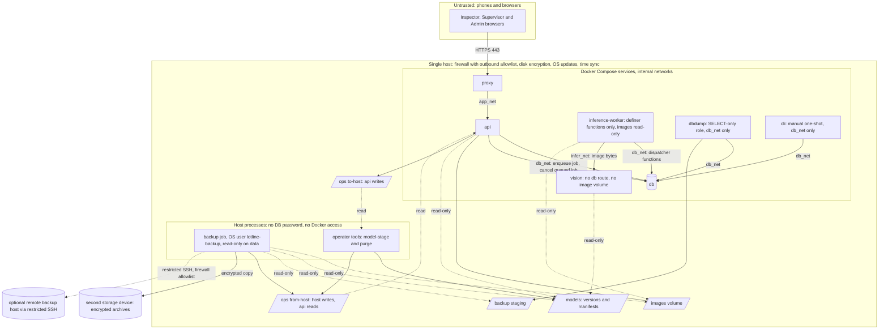

### 4.5 Where data lives and who can read it

| Data | Location | Who can read | Notes |
|---|---|---|---|
| Password hashes, session verifier hashes, login counters | `db` | `api` role | Never returned or logged. |
| Working images and originals | `images` | `api`; `inference-worker` (read-only); backup job (read-only) | Served to browsers only by authorized API routes. The worker reads one image per job and verifies its hash. |
| Model files, manifests | `models/` | `vision` (versions only), `api`, backup job (read-only) | Hashes also in the database. |
| Audit records, host events | `db` | `api`; Supervisor and Admin through the UI | In backups. |
| Backup archives | second device (and optional remote host) | operator | Encrypted; decryption key offline. |
| Secrets | secret files | only the granted service | Backup **private** key is not on the host. |

### 4.6 Key design decisions and why

| Decision | Why it is needed |
|---|---|
| Four networks; `vision` shares none with `db` or `api`; the worker is the only bridge | "No credentials" is not a network boundary (D-01 in Draft 0.1 audit A-03). The worker's database rights are limited to definer functions, so even the bridge cannot write arbitrary rows (LL-01, LL-09). |
| `inference-worker` sends image bytes to `vision`; the API has no route to `vision` | `vision` needs no volume of all photos, and a compromised API cannot reach the detector. |
| Host backup job with no Docker access and no database password | A backup job with Docker access is root-equivalent; a job with a database password could alter data. |
| Public-key encryption for backups | A stolen host cannot decrypt old backups. |
| API never hard-deletes evidence | A compromised API should not be able to destroy evidence through normal code paths. |
| Decision inserts only through a SECURITY DEFINER function | The database can re-check what it can see before any ACCEPT or REJECT row exists. |
| ESCALATE resolved by workflow, not override | An override must not bypass missing clause mapping or evidence. |
| Model activation by authenticated Admin in the web app | The host never needs database privileges. |
| Server-side sessions | Instant logout and revocation. |

---

## 5. Detailed security requirements

Basis = facts and assumptions behind a row. Test = test IDs from section 10.

### 5.1 Authentication and password handling

| ID | Requirement | Tier | Basis | Test |
|---|---|---|---|---|
| AUTH-01 | Hash passwords with Argon2id at or above an OWASP minimum row. Benchmark on the real host so one verification stays well under one second. Random salt per password; store the full encoded hash with parameters; re-hash at login when parameters rise. | E | F1, F2 | T-04 |
| AUTH-02 | **Input limits before any hashing.** Login and password-change bodies are at most 4 KB (proxy and app). A password must be valid UTF-8, at most **128 Unicode code points** and at most **256 UTF-8 bytes**; the byte limit is checked before normalization, then NFC normalization is applied, then both limits are checked again. At most 2 password verifications run at the same time (extra requests wait or fail generically). | E | F1, F2, F4, A19 | T-03 |
| AUTH-03 | Password policy (NIST): at least 15 code points; no composition rules; accept ASCII, space, and Unicode; NFC normalization; no periodic expiry; forced change if compromise is suspected; no hints or security questions; blocklist check (common and breached passwords, plus "lotline", the email, the display name) with the reason shown; allow paste and password managers. | E | F2, A2 | T-03 |
| AUTH-04 | Login returns the **same generic response, status, and similar timing** for unknown email, wrong password, disabled account, and an account in a delay window. Unknown email still runs a dummy hash. An account in a delay window is answered after a padded wait equal to the typical verification time (a sleep, not a hash). | E | F4 | T-02 |
| AUTH-05 | **Progressive delay.** The failure counter lives **on the `user` row** (`failed_consecutive`, `delay_until`, `last_failure_at`). No delay for failures 1–4; from failure 5, attempts are rejected without checking the password for 30 s, doubling per failure to a cap of 15 min. A success resets the counter; so does 24 h without any failure. At 100 consecutive failures password login for that account is disabled until an Admin resets it. The Admin is alerted at 10. **Unknown emails get no persistent per-email record.** | E | F3, F4, A9 (S) | T-05, T-06 |
| AUTH-06 | **Lockout denial-of-service controls.** No hard lock before 100 failures. Counters belong to the account, not the IP. The per-IP limit at the proxy (60 per minute) and an overall login limit (300 per minute) are coarse because phones may share one NAT address. An Admin can clear counters. Repeated failures on an Admin or Supervisor account raise a visible alert. | E | F3, F4, A18, A19 | T-06 |
| AUTH-07 | **First Admin and break-glass.** The `cli` one-shot container (started by the operator) creates the first Admin and can reset any password or create an Admin if all Admins are locked out. It writes an audit row with actor `host-operator` and the OS user name as informational text. No default accounts exist. | E | A6 | T-08 |
| AUTH-08 | **Temporary passwords.** Server-generated, random, at least 16 characters, shown once to the Admin, stored only hashed, `must_change` set, valid 24 h. Until changed, the session may call only change-password and logout. A reset revokes all sessions of that user. | E | F2 | T-07 |
| AUTH-09 | The last active Admin cannot be disabled or demoted. Nobody changes their own role. | E | R | T-08 |
| AUTH-10 | MFA (TOTP) for Admin and Supervisor. | O | F2, A2 | n/a |
| AUTH-11 | **Bounded authentication records.** No per-attempt table and no per-email table exist. Per-IP limiter state lives in the proxy's bounded memory zone. Failures are counted in `user` (existing accounts) and in the `security_counter` table: one row per minute and kind (for example `login_failure_unknown`, `login_failure_known`), kept 30 days (A26), cleaned daily. Per-attempt detail goes only to the rotated application log. | E | F4, A26 | T-09 |

### 5.2 Sessions and CSRF

| ID | Requirement | Tier | Basis | Test |
|---|---|---|---|---|
| SES-01 | Server-side sessions. The cookie carries a random **identifier** and a random **secret verifier** (CSPRNG; verifier at least 128 bits). The database stores the identifier and SHA-256 of the verifier; lookup by identifier, constant-time comparison; never accept the identifier alone. | E | F5 | T-01, T-12 |
| SES-02 | Cookie: generic name with the `__Host-` prefix; `Secure`; `HttpOnly`; `SameSite=Strict`; `Path=/`; no `Domain`; no `Max-Age`. | E | F5 | T-14 |
| SES-03 | Timeouts enforced on the server: idle 30 min, absolute 8 h (A10 (S)). Last-seen updated at most once a minute. Expired session returns 401. | E | F5, A10 | T-10 |
| SES-04 | New session ID at login, password change, and role change. IDs are accepted only from the cookie. Unknown IDs are treated as anonymous and logged. | E | F5 | T-12 |
| SES-05 | Logout deletes the server session. Password change, reset, disable, or role change revokes the user's other sessions at once. | E | F5 | T-11 |
| SES-06 | No tokens in `localStorage` or `sessionStorage`. Authenticated and sensitive responses carry `Cache-Control: no-store`. | E | F5 | T-14 |
| SES-07 | Log session creation, renewal, destruction, expiry, and invalid-ID attempts by internal session row ID, never the raw cookie. | E | F5 | T-62 |
| CSRF-01 | **Synchronizer token.** The server creates a per-session token. The React app reads it from a JSON response (not a cookie) and sends it in a custom header on every non-GET request, including photo uploads. Constant-time compare. | E | F6 | T-13 |
| CSRF-02 | Check `Origin` against a **configured** public origin. If `Origin` is missing or `null`, accept only with a valid token. Reject unsafe requests whose `Sec-Fetch-Site` is `cross-site`. | E | F6 | T-13 |
| CSRF-03 | Login endpoint: JSON content type, custom header, and Origin check (or a pre-session token). | E | F6 | T-13 |
| CSRF-04 | GET, HEAD, OPTIONS never change state. React code never builds request URLs or methods from URL parts. | E | F6 | T-13 |
| CSRF-05 | No raw HTML rendering of user text; restrictive Content Security Policy (XSS defeats CSRF defenses). | E | F6, U5, U7 | T-13 |

### 5.3 Authorization, object access, and master data

| ID | Requirement | Tier | Basis | Test |
|---|---|---|---|---|
| AZ-01 | **Deny by default.** Every route is registered with a required permission. A test lists all routes and fails if one has none. | E | R | T-15 |
| AZ-02 | One policy function `can(user, action, resource)` decides: role permission, ownership, lot state. It runs on **every** request, including reading images and reports. 403 when the object exists but is forbidden; 404 when it does not exist. | E | R | T-16, T-17 |
| AZ-03 | Resources are loaded through the policy layer. Nested IDs are checked along the chain (image → sample unit → lot). A mismatched chain returns 404. This stops IDOR between users inside the organization. | E | R | T-17 |
| AZ-04 | Identity fields (`reviewer_id`, `created_by`, `organization_id`) come from the session. Request models list allowed fields and reject unknown ones. Clients cannot send role, status, severity, counts, hashes, model version, or evidence values. | E | R, U13 | T-18 |
| AZ-05 | **Lot lock.** After a decision exists, lot data, plan, and sample units are locked. Only a Supervisor can change them, and that leads to a **new** decision. The old decision stays. | E | R | T-52 |
| AZ-06 | Optimistic concurrency: version numbers on lots, confirmed defects, and image review status. A stale write returns 409. | E | R | T-52 |
| AZ-07 | Separation of duties: Admin has no QC action. Nobody changes their own role. A second reviewer (ESC-02) must be a different person from the first reviewer. A Supervisor override on a lot where that Supervisor confirmed defects is flagged. | E | A4 | T-16, T-45, T-56 |
| AZ-08 | Single organization: `organization_id` on users and lots only; child rows reach it through the lot. | E | A1 | T-17 |
| AZ-09 | Composite organization keys, row-level security, and a two-organization test database. | O | A1 | n/a |
| AZ-10 | **Read scope (A5, S).** All roles can read all lots, decisions, and reports. Inspectors and Supervisors can view **all** images and review results, including other Inspectors' images; Admin cannot view images. Image routes use the same policy function and are logged on first view per session. Writing remains limited (own lots for Inspectors). | E | A5 (S) | T-20 |
| MD-01 | **Products and buyers (master data).** Created and edited by **Admin and Supervisor**. Inspectors read only. | E | A4, S10 | T-19 |
| MD-02 | **Buyer clause lists.** Clause rows are versioned and never updated (INSERT only). Only a **Supervisor** can add a clause version or map a defect type to a clause (ESC-01), always with a reason. Admin cannot. Confirmed defects reference the exact clause row used. Whether Version 1 includes a clause-list editing screen, or only Supervisor mapping plus a seed file, is S11. | E | S11 | T-19 |
| MD-03 | **Sampling plans.** Created per lot by a **Supervisor only**; versioned and immutable; validated by BR-05. Admin and Inspector cannot create or change plans. | E | S11 | T-19, T-46 |
| MD-04 | **Matrix versus database grants.** All API users share one database role, so PostgreSQL cannot tell Admin from Supervisor. The role matrix (section 6) is therefore enforced **in the API**. The database adds two things: grants that limit what the API as a whole can do (section 5.7), and triggers on `clause`, `plan`, `override`, and `model_activation` that check the acting `user_id` belongs to an active user with the required role. This protects against bugs, not against a fully compromised API. | E | F15 | T-19, T-21 |
| MD-05 | Every create or change of master data, clauses, and plans is audited with before/after values. | E | R | T-62 |

### 5.4 QC business-rule protection

Key data (names are illustrative):

- `confirmed_defect(id, sample_unit_id, image_id, defect_type, clause_id, severity, status, source, prediction_id NULL, reviewer_id NOT NULL, ...)`; `status` is `confirmed`, `needs_clause`, or `rejected`.
- `image(..., original_sha256, working_sha256, review_status, reviewed_by, reviewed_at, review_basis, integrity_status, state, second_review_state, ...)`. `review_status` is `pending_review`, `reviewed_defects`, `reviewed_clean`, or `excluded`; the image's **inference status is not a column**: it is derived from the latest `inference_job` by the view `v_image_inference_status` (`pending`, `ok`, `failed`, `not_inferred`); `state` is `active`, `withdrawn`, `purge_requested`, or `purged`; `second_review_state` is `none`, `required`, or `done`.
- `clause(id, buyer_id, defect_type, severity, version)`, unique on `(id, severity)`.
- `plan(id, lot_id, version, n, counting_mode, source_reference, entered_by)` (**one `n` per plan**) and `plan_class(plan_id, class, ac, re)` (three rows: critical, major, minor).
- `decision(id, lot_id, plan_id, outcome, reason_codes, counts_snapshot, evidence_snapshot, computed_by, computed_at, supersedes_id)`.
- `override`, `override_approval`, `second_review`, `clause_mapping`, `model_version`, `model_activation`, `prediction`.
- `inference_job(id, image_id, status, attempts, max_attempts, worker_id, model_version_id, lease_expires_at, next_attempt_at, error_code, created_at, finished_at)`; `model_selftest(id, model_version_id, worker_id, passed, detail, created_at)` (INSERT-only); `defect_class(code)` (INSERT-only reference list); `lot.critical_nonvisual_status` (`pending`, `done`, `not_required`, `failed`, with who, when and a mandatory note for `failed`); `clause_mapping` key `(buyer, defect_type, zone_code, size_band)` (BR-17). Full definitions: System Design 4.5 and 4.12.

**Decision precedence (canonical; resolves LL-02).** The first matching tier wins; every matching reason is recorded. The authoritative order is Research Prompt v3.1 section H, implemented in System Design 8.6 and stated as a business rule in PRD 9.4. Reason-code strings are the System Design strings.

| Tier | Condition | Outcome | Reason code | Resolved by (ordinary workflow, never an override) |
|---:|---|---|---|---|
| 0 | No plan | HOLD | `HOLD_PLAN_MISSING` | Supervisor enters a plan |
| 1 | Plan invalid: `n` absent or below 1, any class `Re != Ac + 1`, `counting_mode` unset, class limit missing | HOLD | `HOLD_PLAN_INVALID` | Supervisor enters a valid plan version |
| 2 | (a) `critical_nonvisual_status = failed`, independent of sample completeness; or (b) the sample is complete, reviewed and verified (no condition of tiers 7, 8, 10, 11, 12 is active) and any class count is at or above its `Re` | REJECT | (a) `REJECT_CRITICAL_NONVISUAL_FAILED`; (b) `REJECT_LIMIT_REACHED` | n/a (see OV-10 for (a)) |
| 3 | An open proposal whose predicted type routes to a critical clause (`provisional_critical`, re-derived at compute time; a routing hint, never a severity) | ESCALATE | `ESCALATE_CRITICAL_UNREVIEWED` | Reviewer answers the proposal, then recompute |
| 4 | A confirmed defect has no mapped buyer clause (`needs_clause`), including a reviewer-chosen "other" type | ESCALATE | `ESCALATE_UNMAPPED_CLAUSE` | Supervisor maps it (ESC-01), then recompute |
| 5 | The human reviewer rejected a `provisional_critical` proposal and the second review is pending | ESCALATE | `ESCALATE_CRITICAL_REJECTION_UNCONFIRMED` | Supervisor second review (ESC-02), then recompute |
| 6 | Reviewer flagged "possible critical, need a second opinion" | ESCALATE | `ESCALATE_SECOND_OPINION_REQUESTED` | Supervisor second review (ESC-02), then recompute |
| 7 | Fewer sample units than `min(n, lot size)` | HOLD | `HOLD_UNITS_MISSING` | Add units |
| 8 | A required view is not reviewed: missing image, no review of the current image, unanswered proposals, a **live** inference job on a view with no human review, inference failed or never ran with no manual review, retake requested | HOLD | `HOLD_VIEWS_PENDING` | Upload, review, or finish manually (BR-13) |
| 9 | `critical_nonvisual_status = pending` (blocks ACCEPT, not REJECT) | HOLD | `HOLD_CRITICAL_NONVISUAL_PENDING` | Supervisor records the check |
| 10 | A current view has active confirmed defects but a review state other than "confirmed defects", or a clean review with an active defect | HOLD | `HOLD_VIEW_STATE_INCONSISTENT` | Reviewer corrects the view |
| 11 | Image file missing, unreadable, or hash does not match | HOLD | `HOLD_EVIDENCE_INTEGRITY` | Restore the file or retake the photo |
| 12 | Technical error while verifying or computing and the database could still record the row | HOLD | `HOLD_COMPUTE_ERROR` | Retry. If the database or audit write is unavailable, no row is written and the API answers 503 (BR-08). |
| 13 | Otherwise: complete, every class count at or below `Ac`, critical non-visual `done` or `not_required` | ACCEPT | `ACCEPT_PLAN_MET` | n/a |

Because `Re = Ac + 1` (BR-05), a class count is either at or below `Ac` or at or above `Re`: there is no gap.

**Monotonicity re-check (requested with the LL-02 confirmation).** Research Prompt §H places REJECT before ESCALATE because "counts only grow, so an open question cannot reverse a rejection". Checked against the counting rules: this holds for `every_class`. Under `highest_class_only` it can fail: confirming a higher-severity defect on a unit moves that unit up a class and **lowers** a lower-class count, and a retraction also lowers counts. Example (plan with critical `Ac 1 / Re 2`, major `Ac 1 / Re 2`): two majors reject; an unmapped defect on one of them later maps to critical, so critical is 1 and major is 1, which no longer rejects. The approved order is kept. The failure direction is safe (a lot may be rejected and later recomputed after the question is resolved; it is never wrongly accepted), and a REJECT locks the lot, so reversal needs the audited reopen. Whether to evaluate ESCALATE first when an E2 or E3 condition touches a unit that contributes to the rejecting class under `highest_class_only` is **PENDING APPROVAL** (decision log DP-OQ-1). Test T-91 covers the corner case.

| ID | Rule protected | Requirement | Tier | Basis | Test |
|---|---|---|---|---|---|
| BR-01 | AI proposes, humans confirm. | Counts come **only** from `confirmed_defect` rows with `status = confirmed` and a non-null `reviewer_id`. No count query touches `prediction`. `prediction` has no severity, count, or "defective" column. | E | R | T-36 |
| BR-02 | Empty list is not clean. | An image stays `pending_review` until a person sets `reviewed_clean` or `reviewed_defects` through the review endpoint (reviewer and time stored). Inference cannot set review fields. | E | R | T-35 |
| BR-03 | One garment, once. | Count by garment, not defect or box. Each garment goes to its **highest confirmed severity** only. Implement once in the pure counting module and mirror it in SQL view `v_unit_class` (each unit in exactly one class). A property test compares both on random data. | E | R, U2 | T-42 |
| BR-04 | Severity from the buyer clause list only. | A confirmed row needs `clause_id`; composite foreign key `(clause_id, severity)` makes the database reject a different severity. Requests cannot carry severity. AI output has no severity field and AI confidence is not used for severity, counts, or outcomes (confidence may only order the review list). Unknown clause means `needs_clause`, no severity stored, ESCALATE. | E | R, U2 | T-37, T-43 |
| BR-05 | Valid plans only. | Plans hold **one `n` per plan** and `(Ac, Re)` for **exactly three classes** (critical, major, minor), plus a `counting_mode` (BR-15). **Version 1 requires `Re = Ac + 1` for every class** (single sampling: no count falls between Ac and Re). Also `n` integer ≥ 1, `Ac` integer ≥ 0, plausible upper bounds, and `source_reference` (the buyer order or licensed standard) recorded. Enforced at entry (API), by database `CHECK` constraints, and again by the decision guard. An invalid plan is never used: the lot gets HOLD `HOLD_PLAN_INVALID`. The default-plan assumption (section 1.1) is a label, not a stored fact. No ISO table is stored or published. | E | A29, A27, S14 | T-46, T-47, T-48 |
| BR-06 | Four outcomes. | `decision.outcome` is ACCEPT, REJECT, HOLD, or ESCALATE (CHECK). Reason codes are those in the table above. HOLD and ESCALATE are Lotline workflow states and are labelled so in reports. | E | R | T-49 |
| BR-07 | ACCEPT only on a complete, human-confirmed, verified sample; REJECT on the same basis or on a failed critical non-visual check. | Compute only through EV-03. ACCEPT and `REJECT_LIMIT_REACHED` preconditions: valid plan; at least the required units (A27); required images per unit (A16); every included image has a human review result and a reviewer; no image pending; no failed/pending/not-inferred image unless a person completed it manually; no retake requested; no `needs_clause`; no unresolved second review; every included file verified (EV-01). ACCEPT also needs the critical non-visual status `done` or `not_required` (BR-16). `REJECT_CRITICAL_NONVISUAL_FAILED` needs only a valid plan and the recorded `failed` status (EV-10). Any other miss gives HOLD or ESCALATE, never ACCEPT or REJECT. | E | R | T-49, T-51, T-90 |
| BR-08 | Failures are not zero defects. | Database error, inference failure, missing file, hash mismatch, audit failure, or backup problem ends in an error or HOLD. No code path maps a failure to a count of zero. | E | R | T-34, T-64 |
| BR-09 | Immutable decisions. | `decision` rows are never updated or deleted. A change creates a new row with `supersedes_id`. The snapshot stores counted unit IDs. | E | F15 | T-52 |
| BR-10 | Database re-check. | The database guard and its limits are specified in EV-04 to EV-06. | E | F20 | T-50, T-51 |
| BR-11 | Uncertainty and calibration. | Version 1 has **no calibration set**. The UI labels every model confidence value **"uncalibrated"** and never shows it as a probability. No uncertainty interval is used in Version 1. If an interval feature is added later, an interval that crosses the pass/fail boundary must give HOLD. Uncertainty flags (low score, unknown class) are review hints only and never become defect counts. | E | R | T-54 |
| BR-12 | Human image-quality workflow. | A reviewer can mark an image **unusable** (reason text) and request a retake: the image becomes `excluded` (kept, never counted), the unit gets `retake_requested`, and the lot is HOLD until a replacement image is uploaded and reviewed. There is **no automated blur or darkness detection in Version 1** (future work, Appendix C). A quality score can never change a count. | E | R | T-33 |
| BR-13 | Manual inspection stays possible and never deadlocks. | If inference is unavailable, reviewers add defects manually and finish images (`review_basis = manual`). A queued job on such an image is cancelled through `api_cancel_job`; a running job is fenced at write time (AI-16). A job that is still `queued` or `running` does **not** block a view that already has a human review result. Decisions are then possible once review is complete. | E | R | T-34, T-84 |
| BR-14 | Potential critical is a lookup, not an AI result. | "Potential critical" means: the detector's proposed defect **type** maps, in the buyer's clause list, to a critical clause. It is a routing hint computed from the clause table when the prediction is stored (`prediction.provisional_critical`, immutable, never a severity) and **re-derived from the current clause table at decision time**, so a later clause change cannot hide an escalation (DL-09). Detector confidence plays no part. A human rejecting such a proposal, or flagging "need a second opinion", triggers ESC-02. | E | R | T-37, T-45 |
| BR-15 | `counting_mode` is configuration. | The plan stores `counting_mode` = `highest_class_only` (a unit counts once, in its highest confirmed severity) or `every_class` (a unit counts once in each class where it has a confirmed defect). The mode is immutable with the plan version, printed on the report, part of the evidence snapshot, and has no default. The counting code and the SQL view `v_unit_class` implement both modes (resolves LL-07). | E | R | T-93 |
| BR-16 | Critical non-visual gate. | `lot.critical_nonvisual_status` is `pending`, `done`, `not_required` or `failed`. Only a **Supervisor** sets it (not Admin, A4); every change is audited; `failed` needs a note; a decided lot must be reopened to change it. `pending` blocks ACCEPT (`HOLD_CRITICAL_NONVISUAL_PENDING`), not REJECT. `failed` gives REJECT (`REJECT_CRITICAL_NONVISUAL_FAILED`) without waiting for the sample (resolves LL-05; Research Prompt R13). | E | R | T-90 |
| BR-17 | Severity needs zone and size band. | Severity is looked up from `clause_mapping` by `(buyer, defect_type, zone_code, size_band)`; the reviewer chooses the zone from the buyer's list; exact match first, then the same key with `size_band` empty; no row means no severity and ESCALATE (`ESCALATE_UNMAPPED_CLAUSE`). The mapping row is stored with the confirmed defect (resolves LL-08; Research Prompt R4). | E | R | T-94 |
| BR-18 | Reason-code strings are canonical. | The decision stores the System Design strings (for example `ACCEPT_PLAN_MET`, `REJECT_LIMIT_REACHED`, `HOLD_VIEWS_PENDING`). Earlier names (`CLASS_RE_REACHED`, `ALL_CLASSES_WITHIN_AC`, `PLAN_MISSING`, `UNREVIEWED`, `NOT_INFERRED`, and so on) are retired; the crosswalk is in System Design Appendix B. | E | R | T-49 |

### 5.5 Evidence verification and the database decision guard

**What PostgreSQL can and cannot see.** The `db` container mounts only its data volume. It cannot see image files, and the decision function has no file privileges. So the database can re-check **recorded facts** but not **file reality**.

| ID | Requirement | Tier | Basis | Test |
|---|---|---|---|---|
| EV-01 | **API verifies files first.** Before any decision, for every included image the API checks: the working file exists; its size matches; its SHA-256 equals the stored `sha256_working`; and the file decodes. Any failure produces a HOLD decision with reason `HOLD_EVIDENCE_INTEGRITY` (never ACCEPT or REJECT). | E | F7, R | T-49 |
| EV-02 | **Evidence snapshot.** The decision stores an immutable `evidence_snapshot` containing: lot ID and plan version; verification start and end times; for every included image its ID, unit ID, view, expected `sha256_working` (from the database), verified `sha256_working` (computed now), size, human review status, reviewer, review time, review basis, inference status, and model version (if any); per-unit completeness against the required views; counts per class with the counted unit IDs; and the clause versions used. | E | R | T-49, T-51 |
| EV-03 | **One controlled operation.** Only one server function, `compute_and_record_decision`, may create a decision. It: starts a transaction; locks the lot row with `SELECT ... FOR UPDATE` first (always the lot first, to avoid deadlocks, F21); loads plan, units, images, reviews, and defects; runs EV-01; evaluates the plan engine; calls the database function (EV-04); writes the audit row; commits. No other code path writes decisions (a code-search test enforces this). | E | F21 | T-50, T-52 |
| EV-04 | **Restricted decision insert.** `lotline_app` has **no INSERT** on `decision`. Only the `SECURITY DEFINER` function `record_decision(lot_id, proposed_outcome, proposed_reason_codes, evidence, actor_id)` can insert. It is owned by a `NOLOGIN` role `lotline_decision_writer`; `search_path` is set to a trusted schema with `pg_temp` last; `EXECUTE` is revoked from `PUBLIC` and granted only to `lotline_app`; the function and its privileges are created in one transaction (F20). The function **ignores any counts the caller sends** and recomputes them from tables. | E | F20, F15 | T-50 |
| EV-05 | **What the database re-checks** for every proposed ACCEPT or REJECT (a proposed HOLD or ESCALATE is always accepted, because it is fail-safe). See the table below. Failure raises an error; the API then records a HOLD decision `GUARD_REJECTED` or returns an error, never an ACCEPT or REJECT. | E | F20, U2 | T-51 |
| EV-06 | **Checks outside the database.** File existence, readability, hash correctness, decodability, the truth of the verified hashes, and disk corruption stay with the API and the filesystem. Documented limit: **a compromised or faulty API could forge the verified values.** The guard reduces the chance of a false ACCEPT; it does not prevent every case. Second lines: nightly reconciler (UP-11), report-time re-verification (EV-07), and the current-status view (EV-08). | E | R | T-50 |
| EV-07 | **Report re-verification.** When a report is produced, the API re-verifies the included image files and prints the result with its time. A failure makes the report say so and downgrades the lot status (EV-08). | E | R | T-53 |
| EV-08 | **Current status view.** `v_lot_status` shows the latest decision, except that any included image with `integrity_status` other than `ok` (set by EV-01, the reconciler, or restore mode) forces **HOLD `HOLD_EVIDENCE_INTEGRITY`**. UI, API responses, and reports must read lot status from this view and never from `decision.outcome` directly (a test checks). An old ACCEPT can therefore never survive lost or altered evidence. | E | R | T-53 |
| EV-09 | **Honesty rule.** The guard must never be described as preventing false ACCEPT decisions. It is one independent check among several. | E | R | n/a |
| EV-10 | **Guard paths by outcome.** ACCEPT and `REJECT_LIMIT_REACHED`: every check of EV-04 and EV-05. `REJECT_CRITICAL_NONVISUAL_FAILED`: the plan is valid and `lot.critical_nonvisual_status = failed` with a named Supervisor, time and note; completeness and hash checks are not required because a rejection never becomes an acceptance. HOLD and ESCALATE rows need no guard beyond the schema checks. | E | R | T-90 |

What the decision function re-checks:

| # | Check (in SQL, using only database content) | Fail result |
|---|---|---|
| 1 | Lot exists, is not archived; the plan version belongs to the lot; the plan has exactly 3 classes, each with `n ≥ 1`, `Ac ≥ 0`, `Re = Ac + 1` | error |
| 2 | Number of distinct sample units ≥ required units (A27) | error |
| 3 | The set of included image IDs in the evidence equals the set in the database (no image omitted or invented) | error |
| 4 | For each image: evidence `expected` hash equals the stored `sha256_working`, and `verified` equals `expected` (string equality) | error |
| 5 | Each included image has a review result, a non-null reviewer who is an active Inspector or Supervisor, and `review_basis` `manual` or the derived inference status (`v_image_inference_status`) is `ok` | error |
| 6 | Every sample unit meets its required-image rule (A16) | error |
| 7 | No unit has `retake_requested`; no `needs_clause`; no image with `second_review_state = required` | error |
| 8 | Per-class counts recomputed from `v_unit_class` equal the proposed snapshot | error |
| 9 | Outcome recomputed from those counts and the plan equals the proposed outcome | error |
| 10 | `verification_finished_at` is at most 300 s before `now()`, and no related image, review, or defect row changed after `verification_started_at` | error |
| 11 | `supersedes_id` equals the current latest decision of the lot (or null for the first) | error |
| 12 | The acting user is active with role Inspector or Supervisor | error |

### 5.6 ESCALATE resolution and overrides

**Ordinary decision processing and exceptional overrides are different things.** HOLD and ESCALATE are resolved by completing or correcting the underlying information and **recomputing**. An override is an exceptional human departure from a **complete, valid** ACCEPT or REJECT.

| ID | Requirement | Tier | Basis | Test |
|---|---|---|---|---|
| ESC-01 | **Unknown clause.** A `needs_clause` defect stays unresolved until a **Supervisor** maps it to a valid clause in the buyer's list. The mapping is a `clause_mapping` row (who, when, reason) and a controlled update of the defect to `confirmed` with the clause and the clause's severity. It cannot be done by an override, and a user cannot type a severity. If no suitable clause exists, the Supervisor must first add one (MD-02, S11); otherwise ESCALATE stays. | E | R, S11 | T-44 |
| ESC-02 | **Second review.** For `ESCALATE_SECOND_OPINION_REQUESTED`, a Supervisor who is **not** the original reviewer reviews the image. They either confirm the defect through the normal confirm path (clause lookup applies) or record `concur_reject` with a reason in `second_review`. That clears `second_review_state`. | E | R | T-45 |
| ESC-03 | **Recompute.** After ESC-01 or ESC-02, the lot must be recomputed through EV-03. This creates a **new decision** that supersedes the ESCALATE decision. The old decision stays. No override is involved. | E | R | T-44, T-45 |
| ESC-04 | Reports label HOLD and ESCALATE as **Lotline workflow states**, not ISO sampling outcomes. | E | R | T-58 |
| ESC-05 | **No AI severity.** The AI proposes type and location only. Candidate severity can come only from a mapped buyer clause (BR-14). A model disagreement triggers human review (ESC-02), never an automatic severity or count. | E | R | T-37, T-45 |
| OV-01 | Only a Supervisor can override. A reason of at least 20 characters is required. The override is a **separate row** linked to the decision. The decision row is never changed. | E | R | T-55 |
| OV-02 | The system recommendation stays in `decision`. The override stores `final_disposition` separately: `OVERRIDE_ACCEPT` (system said REJECT) or `OVERRIDE_REJECT` (system said ACCEPT). It also stores supervisor ID, time, reason, and before/after values. | E | R | T-55 |
| OV-03 | **Overridable only when** the decision is the current latest, its outcome is **ACCEPT or REJECT**, evidence verification passes again at override time (EV-01, result stored), and no `needs_clause` or unresolved second review exists. **HOLD and ESCALATE are never overridable**; missing evidence or a missing clause mapping cannot be bypassed. A database trigger checks what it can: outcome, latest decision, actor role, reason length, disposition consistent with outcome, no `needs_clause`, no unresolved second review. | E | R, S6 | T-57 |
| OV-04 | **High-risk override** = `OVERRIDE_ACCEPT`. It takes effect only after approval by a **different** Supervisor (`override_approval` row). A stricter `OVERRIDE_REJECT` needs a reason but no second approval. If only one active Supervisor exists, S5 applies (default: flagged HIGH RISK, Admin notified). | E | R, S5 | T-56 |
| OV-05 | Every override and approval is audited with before and after values. | E | F15 | T-62 |
| OV-06 | **Report wording.** Line 1: "System recommendation: <outcome> (single sampling; plan <n; Ac, Re per class>; counting mode <mode>; assumed default plan: normal inspection, General Inspection Level II, critical AQL 0 as Ac 0 / Re 1, major AQL 2.5, minor AQL 4.0)". Line 2, if overridden: "Final disposition: ACCEPTED BY SUPERVISOR OVERRIDE (or REJECTED ...) by <name> on <date>, approved by <name>, reason: <text>. This is not an ISO 2859-1 acceptance." An overridden outcome is never printed as plain ACCEPT or REJECT. The report also shows the evidence verification result (EV-07), model versions or "not inferred (manual)", and the label "uncalibrated". | E | R | T-58 |
| OV-07 | No UPDATE or DELETE grant for the app role on `decision`, `override`, `override_approval`. | E | F15 | T-55 |
| OV-08 | A later recompute creates a new decision and makes an older override ineffective; it is shown as "superseded". | E | R | T-56 |
| OV-09 | An override never hides lost evidence: `v_lot_status` still shows HOLD `HOLD_EVIDENCE_INTEGRITY` if evidence is later missing. | E | R | T-53 |
| OV-10 | **PROPOSED, PENDING APPROVAL.** A decision whose primary reason is `REJECT_CRITICAL_NONVISUAL_FAILED` is **not overridable**. The Supervisor re-records the check after a real re-check (status `done`) and recomputes. Rationale: an override to ACCEPT would contradict a recorded safety finding, and System Design 1.1 did not allow it. Not part of the approved Security 0.3 policy; the owner must confirm. | E | R | T-92 |

### 5.7 Database and data integrity

Roles: `lotline_owner` (owns all objects; runs migrations; **never used at run time**), `lotline_app` (run-time API; not owner, not superuser, no `CREATE`, no `TRUNCATE`, `REFERENCES`, or `TRIGGER`), `lotline_dispatcher` (the worker's **login** role: **no table, view or sequence privilege**; EXECUTE on the six `dispatcher_*` functions only), `lotline_backup` (SELECT only), and four `NOLOGIN` owners of SECURITY DEFINER functions, each with the narrowest column-level grants: `lotline_dispatch_writer` (dispatcher functions), `lotline_decision_writer` (decision function), `lotline_api_writer` (`api_cancel_job`), `lotline_model_writer` (model registration and activation). `PUBLIC` defaults are revoked in the same transaction that creates each object (F15), and `EXECUTE` is revoked from `PUBLIC` on every function. Full grants and function contracts: System Design 4.12.

Grants for `lotline_app` (the API enforces the Admin/Inspector/Supervisor split; MD-04):

| Object | Privileges for `lotline_app` |
|---|---|
| `user` | SELECT, INSERT, UPDATE (no DELETE) |
| `session`, `security_counter` | SELECT, INSERT, UPDATE, DELETE |
| `product`, `buyer` | SELECT, INSERT, UPDATE |
| `clause`, `clause_mapping`, `plan`, `plan_class`, `second_review`, `override`, `override_approval`, `host_event`, `audit_log` | SELECT, INSERT only |
| `model_version`, `model_activation`, `model_selftest` | SELECT only (inserts only through `app_register_model` and `app_activate_model`) |
| `prediction` | SELECT; UPDATE only on the review-state columns defined in System Design 4.5; **no INSERT** (the worker inserts through `dispatcher_record_predictions`) |
| `lot`, `sample_unit`, `confirmed_defect` | SELECT, INSERT, UPDATE (no DELETE) |
| `image` | SELECT, INSERT; UPDATE **only on columns** `review_status, reviewed_by, reviewed_at, review_basis, integrity_status, state, second_review_state`. Paths and hashes cannot be updated (F15). There is no `inference_status` column (derived view). |
| `decision` | **SELECT only** (inserts only through `record_decision`) |
| `inference_job` | SELECT; **INSERT of the column `image_id` only** (all other columns take defaults); **no UPDATE**. A queued job is cancelled only through `api_cancel_job`. |
| `model_selftest`, `defect_class` | SELECT only |
| views (`v_unit_class`, `v_lot_counts`, `v_lot_status`, `v_active_model`, `v_image_inference_status`, `v_protected_trigger_check`) | SELECT |
| functions | EXECUTE on `record_decision`, `api_cancel_job`, `app_register_model`, `app_activate_model` only |

`lotline_backup`: SELECT on all tables and sequences. `lotline_decision_writer`: INSERT on `decision`; UPDATE on `lot(status, updated_at)` only; SELECT on the tables the function reads. The grants of the other definer owners are in System Design 4.12.

| ID | Requirement | Tier | Basis | Test |
|---|---|---|---|---|
| DB-01 | Parameterized queries only (ORM or bound parameters). Dynamic sort and filter columns use an allowlist. Static analysis and a review checklist item. | E | R, U8 | T-21 |
| DB-02 | The roles above. The run-time roles own nothing, because owners keep rights that cannot be revoked and **can disable triggers** (F15, spike S-26). | E | F15 | T-21, T-62, T-82 |
| DB-03 | Grants exactly as in the table above. | E | F15 | T-19, T-21 |
| DB-04 | Constraints: `NOT NULL`; foreign keys with `ON DELETE RESTRICT`; `CHECK` for enums, `plan_class` (`n ≥ 1`, `ac ≥ 0`, `re = ac + 1`), class names, and `reviewer_id`; `UNIQUE (lot_code)`; `UNIQUE (plan_id, class)`; partial `UNIQUE (lot_id, original_sha256) WHERE state = 'active'`; composite foreign key `(clause_id, severity)`. No cascading deletes on evidence. | E | R, U2 | T-29, T-46 |
| DB-05 | One API write = one transaction, including its audit row. Errors return 503 and leave no partial state. Statement timeout and pool limit. | E | R | T-64 |
| DB-06 | Views `v_unit_class`, `v_lot_counts`, `v_lot_status`, `v_active_model`, the decision function, and the override and clause triggers are part of the migrations and have migration tests. | E | R | T-42, T-51 |
| DB-07 | Secrets from secret files (F13), distinct passwords per role. The API refuses to start with a missing or empty secret. | E | F13 | T-77 |
| DB-08 | `db` joins only `db_net` and publishes no port. Only `api`, `dbdump`, and `cli` join `db_net`. | E | F12 | T-75 |
| DB-09 | **File–record invariants.** INV-1: every committed `image` row (state other than `purged`) has a working file with matching size and hash. INV-2: a file without a row (orphan) is allowed and cleaned later. INV-3: image files are removed only by the host purge procedure (UP-16). | E | R | T-30, T-31 |
| DB-10 | Data minimization: only email, display name, role about a person; no hash or verifier in responses or logs; no EXIF GPS stored. | E | A7 | T-62 |
| DB-11 | Row-level security and composite organization keys. | O | A1 | n/a |
| DB-12 | The decision function follows F20 (see EV-04). | E | F20 | T-50 |
| DB-13 | The bootstrap superuser password is stored offline and never used by any service. | E | A6 | T-77 |
| DB-14 | PostgreSQL 18, with minor updates applied (18.7 was current on 12 November 2026 per the documentation banner). | E | A21 | T-78 |

Additional database requirements from the LL-01/LL-09 reconciliation:

| ID | Requirement | Tier | Basis | Test |
|---|---|---|---|---|
| DB-15 | **The worker has no table access.** `lotline_dispatcher` holds no privilege on any table, view or sequence. It claims, heartbeats, fails and records only through `dispatcher_claim_job`, `dispatcher_heartbeat`, `dispatcher_fail_job`, `dispatcher_record_predictions`, `dispatcher_claim_selftest`, `dispatcher_record_selftest`. `SELECT ... FOR UPDATE SKIP LOCKED` needs UPDATE privilege on the table (spike S-01, S-02), so the privilege sits with the function owner, not the login role. | E | F15 | T-80, spike S-03, S-35 |
| DB-16 | **Column-level grants only.** The dispatch writer may UPDATE only the job columns it changes and `lot(updated_at)` (used solely to take the row lock); it cannot change `lot.status`, `image_id` or `max_attempts`. | E | F15 | spike S-34 |
| DB-17 | **No forged jobs.** `lotline_app` may INSERT `inference_job(image_id)` only and has no UPDATE. The only API state change is `api_cancel_job`: `queued` to `canceled`, reason from an allowlist; running, succeeded and failed jobs are untouched. | E | R | T-81, spike S-28 to S-30 |
| DB-18 | **Fencing.** Every dispatcher write function checks job status, worker id, attempt number and an unexpired lease; a stale writer writes nothing and gets `fenced`. | E | R | T-80, spike S-08, S-13, S-31, S-32 |
| DB-19 | **Validation in the database.** `dispatcher_record_predictions` accepts at most 100 detections, each with a class in `defect_class`, a score 0 to 1 and a box of four finite numbers with positive size inside the image; anything else fails the job as `invalid_output` and stores nothing. Tests must include **missing keys** (a NULL type test once let a missing `box` pass; found by spike S-33). | E | R | T-40, spike S-33 |
| DB-20 | **Append-only is prevented for run-time roles and detected for owners.** Triggers block UPDATE, DELETE and TRUNCATE on `prediction`, `model_version`, `model_activation`, `model_selftest`, `defect_class` and `decision`. The table owner and a superuser can still disable or drop them. `v_protected_trigger_check` must report `OK` for every protected trigger; the Admin page and the nightly check read it and raise an alert for `DISABLED` or `MISSING`. | E | F15 | T-82, spike S-25 to S-27 |
| DB-21 | **EXECUTE matrix.** Every function in schema `ll` is callable only by its documented login role; a role with no grants can call none. | E | F15 | T-83, spike S-24, S-39 |
| DB-22 | **Model flow in the database.** `app_register_model` inserts `model_version`; `app_activate_model` appends `model_activation` only if the latest `model_selftest` for that version passed (and, for a rollback, the version was activated before); both are serialized by an advisory lock. | E | F15, S19 | T-85, spike S-38 |

### 5.8 Image upload and storage

**Definitions.** The **original** is the exact uploaded bytes. The **working copy** is a derived, canonical image: it is what the reviewer sees, what the model sees, what boxes refer to, what reports show, and what evidence hashes mean.

| ID | Requirement | Tier | Basis | Test |
|---|---|---|---|---|
| UP-01 | Before reading the body: authenticate, CSRF, role, ownership, lot unlocked, per-user rate limit (A19). | E | F7 | T-13, T-17 |
| UP-02 | **Formats.** JPEG and PNG only. HEIC, WebP, GIF, TIFF, BMP, SVG, PDF are rejected with a clear message. Capture guide: iPhone Settings → Camera → Formats → **Most Compatible** (F19). HEIC is deferred. | E | F7, F19, A8 (S) | T-27 |
| UP-03 | **Validation chain.** Stream to a temp file; check the file signature; open with Pillow under limits; verify; decode fully. The decoded type decides the stored type. A signature check alone is not enough (F7). | E | F7 | T-23 |
| UP-04 | **Limits.** 15 MB at the proxy and in the app while streaming. Set `Image.MAX_IMAGE_PIXELS` to 50 million **and** turn `DecompressionBombWarning` into an error (Pillow only warns between 1× and 2× the limit, F18); never `None`. Reject multi-frame files and files with an alpha channel. Filename at most 255 characters, no colon. Request timeout. | E | F7, F18, A8 (S) | T-24, T-25, T-26 |
| UP-05 | **Canonical working copy.** Decode the original; apply the EXIF orientation once; convert to **8-bit RGB sRGB** (use the embedded colour profile if present, else assume sRGB; verify with a Display P3 sample, U15); strip all metadata; save as a **lossless PNG**. Do **not** resize, sharpen, denoise, or adjust contrast or white balance. A 16-bit source is converted to 8 bit by Lotline, once, so display and model see identical pixels (the Ultralytics reader would otherwise keep only the high byte, F10). Because the working copy is lossless, its pixels equal the decoded original except for the orientation move and any colour-profile conversion, so defect-relevant detail (stitch structure, shade, stains) is preserved. Store `original_sha256` and `working_sha256`, dimensions, whether a profile was converted, and the source orientation tag. Keep the original in a separate private folder (A17 (S)); it is never used for display, inference, or reports. Never store GPS or device EXIF in the database. If lossless files are too large, S16 offers a high-quality JPEG alternative (a lossy second generation). | E | F7, F10, A17 (S), U15 | T-22 |
| UP-06 | Server-generated UUID file names. Paths built from configured base folders; the resolved path must stay inside the base folder; no symlinks; folders 0700, files 0600. | E | F7 | T-26 |
| UP-07 | Images live on a private volume mounted into `api` (rw), into `inference-worker` (**read-only**) and read by the host backup job (read-only ACL). Not into `proxy`, not into `vision`, not into `db`. | E | F7, F12 | T-28, T-38 |
| UP-08 | Images are served only by an authorized API route with fixed content type, `X-Content-Type-Options: nosniff`, and `Cache-Control: no-store`. No directory listing. No public URLs. | E | F7, F5 | T-28 |
| UP-09 | **Reliable write protocol: file first, row last** (table below). A crash can leave an orphan file, never a row without a file. | E | R, U12 | T-30 |
| UP-10 | **Duplicates.** A repeated `original_sha256` in the same lot (state `active`) is not stored again and not counted. The same hash in another lot is flagged for Supervisor review. A recompressed copy is **not** detected (documented limit). | E | R | T-29 |
| UP-11 | **Reconciler** (startup, nightly, and restore mode): delete old temp files; quarantine (move, not delete) orphan files older than 24 h; re-check size and hash of files; set `integrity_status = missing` or `mismatch` and the lot to HOLD through EV-08; alert. | E | R | T-31, T-32 |
| UP-12 | Disk-space guard: below a free-space threshold, uploads fail with a clear error and an alert is raised. | E | F7 | T-24 |
| UP-13 | Human unusable-image workflow (BR-12). | E | R | T-33 |
| UP-14 | Antivirus scan; decoding in a separate low-privilege process. | O | F7 | n/a |
| UP-15 | Capture guide: no faces, no badges. | E | A7 | n/a |
| UP-16 | **API never hard-deletes image evidence.** It may delete only its own temp files and files it just wrote after a failed commit; orphans are quarantined. Withdrawal is soft. Hard deletion is the host purge procedure (BAK-13). | E | R | T-71 |

Upload and recovery sequence (PostgreSQL cannot commit file operations atomically, so ordering and cleanup do the work):

| Step | Action | If the process dies here |
|---|---|---|
| W1 | Stream to `tmp/<uuid>.part` on the **same filesystem** as the final folder; count bytes; compute `original_sha256`. | Temp file only; reconciler deletes it. |
| W2 | Validate (UP-03, UP-04). Failure: delete temp, audit `upload_rejected`. | Same. |
| W3 | If the hash already exists in this lot: delete temp, audit duplicate, answer with `duplicate_of`. | Same. |
| W4 | Build the working copy (UP-05) in `tmp/<uuid>.work.part`; compute `working_sha256`. | Same. |
| W5 | `fsync` files; move original and working copy into their final private folders; `fsync` the folder (U12). | Final file(s) with no row (orphans); quarantined after 24 h. |
| W6 | One transaction: lock the lot row; confirm the lot is unlocked; insert the `image` row (paths, hashes, `integrity_status = ok`), the `inference_job(image_id)` row (status `queued`) and the audit row; commit. A constraint error rolls back and deletes the just-written files. | Rolled back: orphans only. Committed: complete. |
| W7 | The `inference-worker` claims the job and sends the working copy bytes to `vision` (5.9). Failure ends as `failed` or `not_inferred` through `dispatcher_fail_job`. | The image stays `pending` (derived) until the job ends; a pending image blocks ACCEPT and REJECT. |

A **row without a file** cannot come from a crash in this sequence. It can come only from later loss, corruption, or a mismatched restore. UP-11, EV-01, EV-08, and BAK-15 detect and block it.

**Note on HEIC.** Not in Version 1. iPhones capture HEIF by default; "Most Compatible" gives JPEG (F19). Ultralytics registers `pi-heif` on its own and may try to install it at run time (F10, U6). Adding HEIC adds a second decoder to the most exposed code path (U14). Revisit after measuring how many inspectors cannot change the setting (Q5).

### 5.9 AI inference and model management

| ID | Requirement | Tier | Basis | Test |
|---|---|---|---|---|
| AI-01 | **Network isolation.** `vision` joins only `infer_net` (internal), shared only with `inference-worker`. It shares no network with `db` or `api`. No internet path. Not "no credentials": no route. `inference-worker` is the only bridge (`db_net` plus `infer_net`) and opens no listening port. | E | F12 | T-38, T-75, T-86 |
| AI-02 | **Container hardening** for `vision` and `inference-worker`. Non-root; read-only root filesystem with a small temp area; drop all capabilities; `no-new-privileges`; not privileged; no Docker socket; memory, CPU, process limits. Only mount of `vision`: `models/versions` (read-only). Only mount of `inference-worker`: `images` (read-only). | E | F14, U4 | T-38, T-76 |
| AI-03 | **Interface.** `inference-worker` claims one job, reads the working image **by hash** from `images` (read-only) and verifies its SHA-256 against the database value, then sends the bytes of that one image, a request ID and `model_sha256` to `vision` over `infer_net` with a timeout, and calls `dispatcher_heartbeat` while it waits. `vision` re-validates the image and loads, on demand, the file `versions/<model_sha256>.pt` **after verifying its hash**. It accepts no path parameter. Endpoints: `/infer` and `/health` only. It returns detections and the `model_sha256` it used. The worker does not claim jobs while `/health` fails. | E | F7, F18 | T-38, T-39, T-89 |
| AI-04 | **Untrusted output.** `dispatcher_record_predictions` validates inside PostgreSQL before storing anything (DB-19): class in `defect_class`; box inside image bounds; score 0 to 1; at most 100 detections; returned `model_sha256` equals the job's model. Invalid output is not stored as a prediction; the job becomes `failed` with `invalid_output` and the derived image status is `failed`. | E | R | T-40 |
| AI-05 | **Model loading.** Treat every checkpoint as **code you trust**. Only files from the team's own pipeline; SHA-256 recorded in the database and in a version-controlled manifest outside the models folder; hash checked before load; `models` mounts read-only into `vision` only; no web upload of models. PyTorch 2.6 or newer is required (F9) but is **not** sufficient: `weights_only=True` narrows risk but does not stop denial of service or all memory bugs (F8). **RF-DETR (approved baseline):** the RF-DETR reference documentation (search excerpt only) says `trust_checkpoint` defaults to `False` and permits a pickle fallback when `True`, and that its `from_checkpoint` path calls the loader with trust; older RF-DETR code used `weights_only=False`. Which behaviour the **pinned** version has is **unverified** (U21); until T-88 passes, assume full pickle deserialization. Ultralytics (fallback only) loads `.pt` with `weights_only=False` by default (F10). Containment comes from AI-01 and AI-02. | E | F8, F9, F10, U21 | T-39, T-88 |
| AI-06 | **Dependency security.** All dependencies of every image (`api`, `vision`, `proxy`, frontend build) must be **maintained, patched, and pinned** to exact versions with hashes where supported (U8), recorded in `VERSIONS.md`. Vulnerability checks run for the **full** set (Python, JavaScript, base images), at build and weekly; High and Critical findings are fixed within 7 days or accepted in writing by the Supervisor. No packages install at run time (inference has no internet). Because uploads are limited to JPEG and PNG, the Ultralytics HEIC auto-install path should never trigger; a test confirms it (U6). Keep Ultralytics **out** of the `api` image so its patched image opener (F10) never touches the upload validator. | E | F9, F10, U6, U8, A21 | T-78 |
| AI-07 | **Limits and errors.** Timeout 30 s per `vision` call, worker concurrency 1 to 2, lease 120 s renewed by a 10 s heartbeat, `max_attempts` 3 with backoff (5 s, 10 s) through `dispatcher_fail_job`; the worker stops claiming while `vision` is unhealthy so an outage does not consume attempts. Job states: `queued`, `running`, `succeeded`, `failed`, `canceled`. The **image** status is derived (`v_image_inference_status`): `pending`, `ok`, `failed`, `not_inferred`. Only `ok` plus a human review result, or a completed manual review, can support ACCEPT or REJECT. | E | R | T-34, T-41, T-89 |
| AI-08 | **Model records are immutable; activation is append-only.** `model_version` rows (file hash, size, manifest hash, training run, data version, library versions, thresholds, who registered, when) are INSERT-only. `model_activation` rows (`action` = `activate` or `rollback`, version, hash, actor, `via`, reason, previous activation, time) are INSERT-only. The **active model** is the latest successful activation (`v_active_model`). | E | F15 | T-59 |
| AI-09 | **Registration, activation, rollback** (table below). The host never needs database privileges. Activation requires an authenticated **Admin** in the web application who re-enters their password (F4) **and** a passing `model_selftest` row written by `inference-worker` (M4), because the API has no route to `vision`. The audit row is written in the same transaction as the `model_activation` row. A failed activation (hash mismatch, missing file, failed self-test) writes no activation row and an `activation_failed` audit row. | E | F4, F15, S19 | T-59, T-60, T-61, T-85 |
| AI-10 | **Prediction auditability.** Each `prediction` stores image ID, `model_version_id`, `model_sha256`, input hash, inference settings, raw output, latency, time (the job-level items live on the `inference_job` record in System Design 4.5). The **detector-output columns are INSERT-only** (written by `dispatcher_record_predictions`; no run-time role can UPDATE them); only the review-state columns defined in System Design 4.5 can change, and each change is audited (ADR-023, DL-08). `confirmed_defect.source` and `prediction_id` show whether a human accepted a proposal or added the defect. | E | R | T-36 |
| AI-11 | Log inference failures and uncertainty flags without image bytes. | E | R | T-41 |
| AI-12 | Non-pickle model format for serving; signed manifests. | O | U9 | n/a |
| AI-13 | **AI cannot assign severity.** The prediction schema has no severity, class-weight, or count field; no rule reads AI confidence (BR-04). | E | R | T-37 |
| AI-14 | Every displayed model confidence is labelled "uncalibrated" (BR-11). | E | R | T-54 |
| AI-15 | **The job table is the source of truth.** No code path writes an image-level inference status. The API may INSERT `inference_job(image_id)` and call `api_cancel_job`; nothing else changes a job except the dispatcher functions. | E | R | T-81 |
| AI-16 | **Manual review and fencing (resolves LL-10).** Predictions are written only for a job that is `running` with an unexpired lease for the same worker and attempt, whose image is current, not excluded, **not yet human-reviewed**, in a lot that is not decided. Otherwise the job ends `canceled` (`lot_locked`, `superseded_image`, `manual_review`) and nothing is stored. A queued job on a manually finished image is cancelled through `api_cancel_job`, which also frees the one-active-job index so a retry can be queued. | E | R | T-80, T-84 |
| AI-17 | **Self-test without an API-to-Vision route.** `inference-worker` claims a model version with no self-test (`dispatcher_claim_selftest`), asks `vision` to load it by hash and run a bundled fixed image, and records the result with the echoed hash (`dispatcher_record_selftest`; a hash mismatch forces `passed = false`). | E | R | T-85 |
| AI-18 | **Library pin.** `rfdetr`, `torch` and their dependencies are pinned to exact versions recorded in `VERSIONS.md`; the loading behaviour of the pinned `rfdetr` version is tested (T-88) before any model is activated. | E | F9, U21 | T-88 |

Model registration, activation, and rollback:

| Step | Who and how | Records |
|---|---|---|
| M1 | Host operator runs `model-stage` with the file and its manifest: it computes SHA-256, checks the manifest, copies the file to `models/versions/<sha256>.pt` and the manifest to `models/manifests/`, mode read-only. No database access. | Event file in `ops/from-host/` |
| M2 | The API ingests the event (AUD-10). | Audit row, actor `host` |
| M3 | Admin registers the version in the web UI. The API reads manifest and file read-only, recomputes the hash, compares with manifest and event. | `model_version` row + audit row, one transaction |
| M4 | Admin requests activation (reason required, password re-entered). `inference-worker` claims the unverified version, has `vision` load `model_sha256` and run a bundled fixed test image, and records the result and echoed hash in `model_selftest`. `app_activate_model` refuses unless the latest self-test passed. | On success: `model_activation` row + audit row |
| M5 | From then on, every claimed job carries the active `model_sha256`; a mismatch in the reply fails the job (`model_mismatch`) and nothing is stored. | Predictions with version |
| M6 | Rollback = a new activation row (`action = rollback`) pointing to an earlier version, reason required. | Same |
| M7 | Old lots keep their predictions and versions. | n/a |

### 5.10 Audit logging and host-level events

**What each mechanism protects against (and what it does not).**

| Mechanism | Protects against | Does **not** protect against | Tier |
|---|---|---|---|
| Owner/run-time role split; run-time role has INSERT and SELECT only on `audit_log` (F15) | Edits and deletes through the application, including SQL injection | The table owner, a database superuser, or anyone with host access | **E** |
| Audit row in the same transaction as the change; failed audit write rolls the change back | Changes with no record | Someone who edits the database directly | **E** |
| Nightly consistency check (each confirmed defect, decision, override, activation, and image has an audit row) | A code path that skipped auditing | Rows deleted by a privileged user | **E** |
| Trigger blocking UPDATE, DELETE, TRUNCATE | Mistakes and a careless script | The table owner and superusers can still change or drop it (F15) | O |
| Hash chain | Detects some edits by privileged users **if** the latest chain head is kept somewhere they cannot change | Prevention; a superuser can recompute the whole chain; it needs serialized writes. **Not tamper-proof.** | O |
| Weekly audit export to the second storage | Total loss of the audit table | Falsified entries made before the export | O |

| ID | Requirement | Tier | Basis | Test |
|---|---|---|---|---|
| AUD-01 | Record: login success, lockout milestones, logout, expiry; password change and reset; user create/disable/role change; product, buyer, clause, clause mapping, plan changes; lot create/edit/archive; upload accepted/rejected/duplicate/withdrawn; purge request and result; inference run and failure; defect confirmed/edited/rejected/added; image review result and unusable/retake; second review; decision computed; override and approval; model registered/activated/rolled back/failed; audit export; authorization denied; host events (AUD-10); break-glass; restore start and end. | E | F4, F5 | T-62 |
| AUD-02 | Fields: row ID, server time, actor (`user`, `system`, `host`, or `host-operator`), action, entity type and ID, lot ID, before, after (changed fields only), reason, outcome, request ID, client IP (informational). | E | R | T-62 |
| AUD-03 | Same transaction as the change. If the audit insert fails, the change does not commit. Denied attempts are written separately after the rollback (best effort) and to the application log. | E | R | T-62 |
| AUD-04 | Run-time role INSERT and SELECT only. No API route edits or deletes audit rows. | E | F15 | T-62 |
| AUD-05 | No passwords, tokens, verifiers, or CSRF tokens in audit rows or logs. | E | F5 | T-62 |
| AUD-06 | Keep at least 12 months (A12 (S)). Supervisor and Admin can read; only Admin can export; the export is audited. | E | A12 | T-62 |
| AUD-07 | Nightly consistency check; alert on a gap. | E | R | T-62 |
| AUD-08 | Trigger blocking UPDATE, DELETE, TRUNCATE on `audit_log`. | O | F15 | n/a |
| AUD-09 | Hash chain with verification job and off-machine head, or the weekly export. Always described as tamper-evident, never tamper-proof. | O | R | O-04 |
| AUD-10 | **Host events.** Host tools (backup job, `model-stage`, `purge`) write **one JSON file per event** into `ops/from-host/` (event ID, type, time, OS user, details). The API reads new files every minute, validates them strictly (schema, at most 64 KB, known types, no path text used as a path), and in one transaction inserts a `host_event` row (unique event ID, so ingestion is repeatable) and an audit row (actor `host`). Invalid files move to `rejected/` with an alert. Files stay on the host and are in backups. If the API or database is down, files simply wait. The Admin page shows the count of pending and rejected events and the time of the last ingestion. A compromised host can forge or omit events (A6). | E | R, A6 | T-63 |
| AUD-11 | **Bounded login audit.** Audit rows for login failures are written only for existing accounts and only at failure counts 1, 5, 10, 25, 50, 100 and on lockout changes. Unknown-email failures are aggregated only (AUTH-11). | E | F4, A26 | T-09 |
| AUD-12 | The `cli` container (first Admin, break-glass, restore mode) writes its own audit rows directly (actor `host-operator`). | E | A6 | T-08 |
| AUD-13 | **Review process.** The Admin reviews weekly: failed or stale backups, lockout alerts, host events, model activations, break-glass events. A Supervisor reviews overrides and second reviews. Reviews are recorded as acknowledgements in the audit log. | E | R | T-63 |

### 5.11 Deployment and operations

| ID | Requirement | Tier | Basis | Test |
|---|---|---|---|---|
| DEP-01 | Compose with `edge`, `app_net`, `db_net`, `infer_net` and the memberships of section 4.2. Only `edge` is not internal. | E | F12 | T-75 |
| DEP-02 | Only `proxy` publishes ports (80 redirects to 443). A `ufw` rule alone is not enough (F11). Test from **another machine**. | E | F11 | T-74 |
| DEP-03 | HTTPS at the proxy. `Secure` cookies. Camera use needs a secure context (F17). Certificate method decided in S3. HSTS only after HTTPS is stable (U5). | E | F17, A3 | T-14 |
| DEP-04 | **Secrets.** Compose secret files granted per service (F13): three database passwords, TLS key (if file-based), first-Admin bootstrap value. Not in environment variables, Git, or images. Mode 0600. Rotation procedure written. The backup **private** key is not on the host; the backup **public** key is not secret. | E | F13 | T-77 |
| DEP-05 | **Containers.** Non-root where the image allows; drop all capabilities; `no-new-privileges`; read-only root filesystem with a small temp area; no privileged mode; no Docker socket (F14). Exact keys per U4. Applies to `proxy`, `api`, `inference-worker`, `vision`, `db` (where its image allows), `dbdump`, `cli`. | E | F14, U4 | T-76 |
| DEP-06 | Per-service memory, CPU, and process limits; log rotation; health checks (`proxy`, `api`, `inference-worker`, `vision` with loaded-model hash, `db`); restart policy. Syntax per U4. | E | F14, U4 | T-76 |
| DEP-07 | Response headers: restrictive CSP, `nosniff`, no framing, `Referrer-Policy`, `Permissions-Policy` with `camera=(self)` (F17). Details per U5. | E | F17, U5 | T-14 |
| DEP-08 | Production configuration: debug off; API docs pages off or Admin-only; generic error bodies with a request ID; no CORS. | E | R | T-14 |
| DEP-09 | Host: default-deny inbound firewall; SSH key-only and restricted; automatic security updates; NTP; full-disk encryption (A6, A13). | E | A6 | T-74 |
| DEP-10 | Dependency hygiene per AI-06, plus `VERSIONS.md` and a check that the documentation used for each pinned version matches it (A21). | E | AI-06, A21 | T-78 |
| DEP-11 | Alerts shown to Admin (no email, A13): inference down, disk low, backup failed or stale (BAK-12), reconciler findings, audit gap, login-failure spikes, pending or rejected host events. | E | A13 | T-34, T-73 |
| DEP-12 | Image scanning and SBOM review. | O | R | O-01 |
| DEP-13 | **Host folders** as in section 4.3, with the stated owners and modes. The backup OS user gets read-only ACLs on data folders (U17). | E | A6, U17 | T-66 |
| DEP-14 | **Outbound control.** Containers have no internet path (internal networks). On the host, a firewall rule limits outbound connections from the backup OS user to the single backup destination (U17). All other host outbound traffic follows normal host policy. | E | F12, U17 | T-65 |

### 5.12 Backup, purge, and recovery

**Consistency strategy, stated plainly.** A database dump and a file copy are **not** one atomic snapshot. Lotline's strategy has five parts: (1) take the dump first (time T0) and copy files after it (T1 later than T0); (2) image files are never modified in place and are never deleted while a backup run holds the lock, so every image row in the dump has its file in the later copy; (3) an inventory check after copying detects gaps early; (4) the restore-time reconciler is the authoritative check and marks anything missing as HOLD; (5) work done after T0 is lost, which is the RPO. **Limits:** rows added after T0 may have files in the copy (harmless orphans); the inventory is taken just after the dump, not in the same snapshot; and a purge or loss between the checks is only **detected**, not prevented, if the lock is bypassed.

| ID | Requirement | Tier | Basis | Test |
|---|---|---|---|---|
| BAK-01 | **Scope.** (1) PostgreSQL dump, including audit, host events, model versions and activations, purge records. (2) Database role creation scripts (versioned in Git; a per-database dump does not cover cluster-wide roles, U18). (3) Image folder: working copies and originals. (4) Models: `versions/` and `manifests/`. (5) `ops/from-host/` including the purge ledger. (6) Configuration without secrets: Compose file, proxy config, role scripts, `VERSIONS.md`. (7) TLS certificates. (8) Secrets: stored separately and offline, **not** in backups. | E | F16, U18 | T-68, T-72 |
| BAK-02 | **Consistency.** As described above: dump at T0, files at T1, inventory check, restore-time reconciliation, honest limits. Not described anywhere as an atomic snapshot. | E | F16 | T-69 |
| BAK-03 | **Targets (assumptions, S7):** RPO 4 h and RTO 8 h in working hours; a run every 4 h in working hours; retention per A11. Note that PostgreSQL's own documentation says `pg_dump` alone is generally not the right choice for regular production backups outside simple cases (F16); continuous archiving (U20) is deferred (BAK-08). | E | A11 (S), F16 | T-72 |
| BAK-04 | **Encryption and key separation.** Archives are encrypted **before** leaving the host with a **public key**; the host holds only the public key. The private key lives offline with two custodians (A25) and is never stored with backups or on the host. A tool choice (for example `age` or GPG) is made after checking its documentation (U11). | E | A25 (S), U11 | T-67 |
| BAK-05 | **Complete restore procedure** (table below). Tested before first use and monthly. | E | R | T-72 |
| BAK-06 | **Disk failure.** Database and images are on a different device from the backups. Replace the device, then follow BAK-05. | E | R | T-72 |
| BAK-07 | **No wrong ACCEPT after restore.** After a restore the system starts in maintenance mode (uploads, confirmations, decisions, overrides, model activation off). The reconciler runs. `v_lot_status` shows HOLD for any lot with missing or altered evidence. Decisions made after T0 are lost; Supervisors compare lots with the PDF reports already issued and recompute any lot whose decision is missing. | E | R | T-53, T-72 |
| BAK-08 | Point-in-time recovery to shrink RPO. | O | U20 | O-07 |
| BAK-09 | **Backup pipeline** (table below) and **transfer path.** Required: encrypted archive written to a **second storage device attached to the host**. Recommended (S18): also pushed to a second machine over SSH using a restricted, unprivileged account. All transfer is done by the **host** backup job. No container has outbound access. | E | A24 (S), U16, U17 | T-65 |
| BAK-10 | **Least privilege.** The host backup OS user: read-only on images, models, manifests, `ops/from-host`, config, and staging; write only to its work area, the second device, `ops/from-host` (events) and `ops/locks`; no Docker group; no sudo; no database password; no secrets other than the encryption public key and the destination SSH key. The `dbdump` container: `db_net` only; SELECT-only role; mounts only `backup/staging`; no image or model mounts; no internet. | E | F13, F14 | T-66 |
| BAK-11 | **Manifest** (table below), written inside the encrypted archive. Its SHA-256 goes into the event file and so into the audit log, making later replacement of a backup detectable. | E | R | T-68 |
| BAK-12 | **Failure detection and reporting.** (1) Every step failure writes a `backup_result` event with status `failed` and the reason. (2) A **dead-man check**: the API computes the age of the last successful `backup_result`; the Admin page shows a warning after 6 h and a critical alert after 12 h (A11 values), even if the job never ran. (3) The job times out (dump wait 30 min, whole run 4 h). (4) Free-space check on staging, work area, and the second device. (5) A stuck lock older than 6 h raises an alert and keeps purge blocked. (6) Monthly restore drills must be recorded as events or an alert appears. (7) The weekly Admin review (AUD-13) checks these. | E | A11, AUD-10 | T-73 |
| BAK-13 | **Withdrawal, purge, and backups** (table below). | E | A22 (S), A23 (S) | T-70, T-71 |
| BAK-14 | **Backup retention for withdrawn or purged images.** A purged image remains in older backups until they expire (up to the longest retention, about 6 months plus one cycle under A11). Encrypted archives are not edited to remove one image. If the project owner needs faster removal, shorten the retention (S7, S9). After any restore, the purge ledger is re-applied (BAK-15). Backups may expire only through the retention schedule; the newest successful backup and the newest verified restore-drill backup are never expired. | E | A11, A22 | T-71, T-72 |
| BAK-15 | **Reconciliation after restore.** For each restored `image` row (state not `purged`): file present and hashes match → `ok`; missing or different → `integrity_status` set, lot shown as HOLD (EV-08). Files with no row → quarantine, not auto-deleted. For each entry in the **union** of the database purge records and the restored `purge-ledger.jsonl`: delete any resurrected file and mark the row `purged`. All sessions revoked; login counters cleared. | E | R | T-72 |
| BAK-16 | **Restore drills.** Monthly, restore the newest backup into a scratch environment and run the checks in BAK-05 steps R3–R9; record a `restore_drill` event. | E | R | T-72 |

Backup pipeline (one run, orchestrated by the host job):

| Step | Action |
|---|---|
| B1 | Host timer starts the job as OS user `lotline-backup`. It takes the exclusive host lock `ops/locks/backup.lock` without waiting. If the lock is held (a purge is running) it records `backup_skipped_locked` and stops. |
| B2 | It writes `backup/staging/dump-request-<run>`. The `dbdump` container (polling that folder) runs `pg_dump` as `lotline_backup` and writes `db-<run>.dump`, its SHA-256, per-table row counts, and a `done` file with the dump start time **T0**. Right after the dump it writes `inventory-<run>.csv` (image ID, paths, hashes, state) with a plain SELECT. |
| B3 | **T1 (later than T0):** the job reads (read-only) the images folder, `models/versions` and `manifests`, `ops/from-host` (with the purge ledger), and the configuration files. |
| B4 | **Inventory check:** for each inventory row not `purged`, the copied file exists with matching size, and its SHA-256 matches `working_sha256` (full re-hash weekly, otherwise only for files not yet verified). Any gap marks the run `inconsistent`: event, alert, retry at the next cycle; the run is **not** reported as a good backup. |
| B5 | Build the manifest and its SHA-256. |
| B6 | Encrypt the archive with the public key. Streaming into the encryption step avoids an extra plaintext copy where possible. |
| B7 | Write the encrypted archive to the second storage device. If configured, push it to the remote host (restricted SSH account, host firewall allowlist). |
| B8 | Read back and verify the archive SHA-256 at each destination (remote check per U16). |
| B9 | Write the `backup_result` event (status, T0, T1, end time, manifest SHA-256, archive SHA-256, sizes, counts, destinations, errors). Delete plaintext from staging and the work area. |
| B10 | Release the lock. |

Backup manifest contents:

| Section | Fields |
|---|---|
| Run | run ID; application version or commit; Compose file SHA-256; PostgreSQL version; tool versions; T0, T1, end time |
| Database | dump file name, size, SHA-256; per-table row counts; counts of images, decisions, overrides, audit rows |
| Images | number and total bytes of working copies and originals; SHA-256 of the per-file hash list (`images.sha256`, included in the archive); inventory summary; purge ledger SHA-256 and entry count |
| Models | for each file in `versions/` and `manifests/`: name and SHA-256; count |
| Configuration | each file and SHA-256 |
| Verification | inventory-check result and counts; full-hash date |
| Output | archive SHA-256; encryption recipient fingerprint; destinations and read-back results; status |

Withdrawal, purge, and backups:

| Step | Action |
|---|---|
| PG-1 | **Withdraw (soft).** An Inspector (own lot, before a decision) or a Supervisor marks an image `withdrawn`. It leaves the sample; the file stays. |
| PG-2 | **Purge request.** A Supervisor requests a purge with a reason. The API accepts it only if: the 30-day hold-off has passed (A22 (S)); the image is **not** referenced by any decision evidence snapshot within the evidence-retention period (A23 (S)). It sets `state = purge_requested` and writes a request file into `ops/to-host/`. |
| PG-3 | **Operator action.** The operator runs `purge` interactively on the host. It lists the images, reasons, and requesters and needs an explicit confirmation. It takes the host lock; **if a backup holds the lock it refuses**, and a backup refuses to start while a purge holds it (B1). It treats the request files as untrusted input: strict schema, paths must stay inside the images folder, hashes must match. |
| PG-4 | It deletes the working and original files and appends entries to `ops/from-host/purge-ledger.jsonl`. |
| PG-5 | It writes a `purge_result` event and asks for an extra backup run so the new state is captured. |
| PG-6 | The API ingests the event: image `state = purged` (paths cleared, hashes kept), a purge record, an audit row. |
| PG-7 | Older backups still hold the image until they expire (BAK-14). After a restore, BAK-15 re-applies the ledger. |

Restore procedure:

| Step | Action |
|---|---|
| R1 | Declare the incident, stop services, record the reason in the host log. |
| R2 | Prepare a clean host (DEP-09). Install the Compose and application versions named in the manifest. Re-create secrets from the secure store (not from backups). |
| R3 | Select the newest backup with status `ok` (not `inconsistent`). Fetch it from the second device or remote host. Check the archive SHA-256 against the event record or a second copy. |
| R4 | Decrypt on the restore host with the private key, brought from offline storage by a custodian. |
| R5 | Verify the manifest and the hashes it lists (dump, hash list, models, configuration). |
| R6 | Start only `db`. Create roles from the versioned scripts. Restore the dump into an empty database. Compare table counts with the manifest (U18). |
| R7 | Restore images, models, manifests, `ops/from-host` (with the purge ledger), and configuration with correct owners and modes. |
| R8 | Start `api` in **restore maintenance mode** (Admin login only; uploads, confirmations, decisions, overrides, model activation disabled). |
| R9 | Run the reconciler in restore mode (BAK-15): file checks, purge-ledger union, orphan quarantine, sessions revoked, counters cleared. Lots with problems show HOLD through `v_lot_status`. |
| R10 | Supervisors compare lots decided after T0 with the reports already issued. Lots whose decisions are missing are recomputed after review. |
| R11 | The Admin ends maintenance mode (password re-entered, reason, audited). |
| R12 | The `cli` container writes a `restore_completed` audit row with the manifest SHA-256 and T0. |
| R13 | Run a fresh backup and confirm a successful event. |
| R14 | Post-incident review; update this document and the drills. |

---

## 6. Role-permission matrix

"Own" = lots the user created. **Confirm** marks rows that depend on an open decision in Appendix E.

| Action | Admin | Inspector | Supervisor | Confirm |
|---|---|---|---|---|
| Log in, log out, change own password | Yes | Yes | Yes | |
| Create/disable users, change roles, issue temporary passwords, clear login counters | Yes | No | No | |
| Create or edit **products and buyers** | Yes | No | Yes | S10 |
| Create buyer **clause** versions; map defect types to clauses | No | No | Yes | S11 |
| Enter a sampling **plan** for a lot | No | No | Yes | S11, S14 |
| Create a lot | No | Yes | Yes | |
| Edit lot metadata before a decision | No | Own | Yes | S4 |
| Change lot data or plan after a decision exists | No | No | Yes (leads to a new decision) | |
| View lots, details, decisions, reports | Yes | Yes | Yes | S4 |
| View garment images and review results | **No** | **Yes, all lots (including other Inspectors')** | Yes | S4 |
| Upload, retake, or withdraw an image (before decision) | No | Own | Yes | S4 |
| Request or repeat inference (enqueues a job) | No | Own | Yes | |
| Confirm, edit, reject, or add a defect; finish an image | No | Own | Yes | S4 |
| Mark an image unusable and request a retake | No | Own | Yes | |
| Cancel a queued inference job (manual review; `api_cancel_job`) | No | Own | Yes | |
| Set the critical non-visual status (BR-16) | No | No | Yes | RP R13 |
| Flag "possible critical, need second opinion" | No | Own | Yes | S17 |
| Second review (ESC-02) | No | No | Yes (not the first reviewer) | S17 |
| Compute a decision | No | Own | Yes | |
| Override a decision (ACCEPT or REJECT only) | No | No | Yes | S6 |
| Approve a high-risk override | No | No | Yes (a different Supervisor) | S5 |
| Request purge of a withdrawn image | No | No | Yes | S9 |
| Register, activate, or roll back a model version (web, password re-entered) | Yes | No | No | S19 |
| View audit log and host events | Yes | No | Yes | |
| Export audit log | Yes | No | No | |
| Stage a model file; run purge; run backup tools; restore (host) | Host operator | No | No | |
| Break-glass password reset or Admin creation (`cli`) | Host operator | No | No | |
| Edit or delete audit, decision, override, activation rows | No | No | No | |
| Delete a lot that has a decision | No | No | No | |

---

## 7. Security flow diagrams

Diagram 1 (overall architecture) is in section 4.4. Boxes mean the control is **planned**.

### 7.1 Authentication and authorization (diagram 2)

Login:

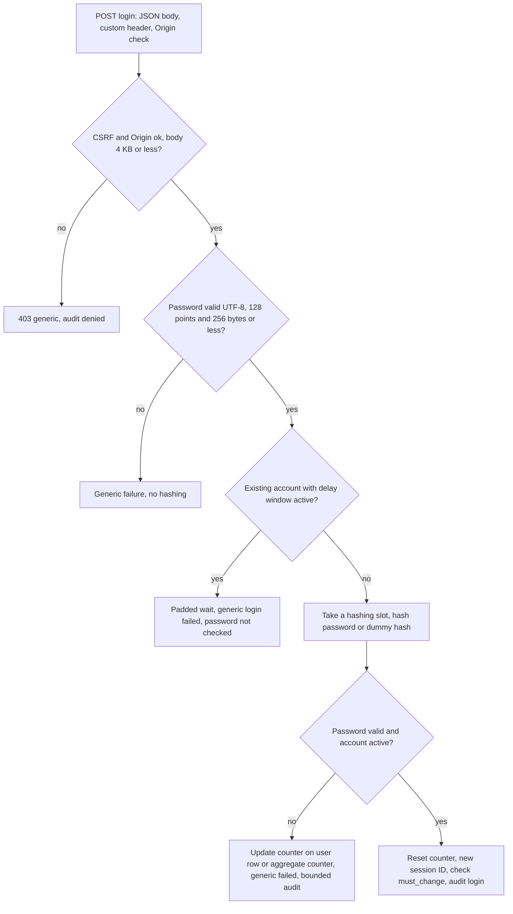

Every later request:

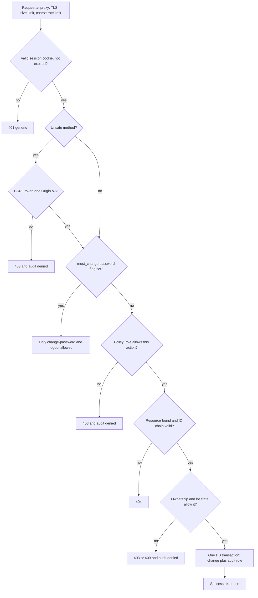

### 7.2 Image upload and validation (diagram 3)

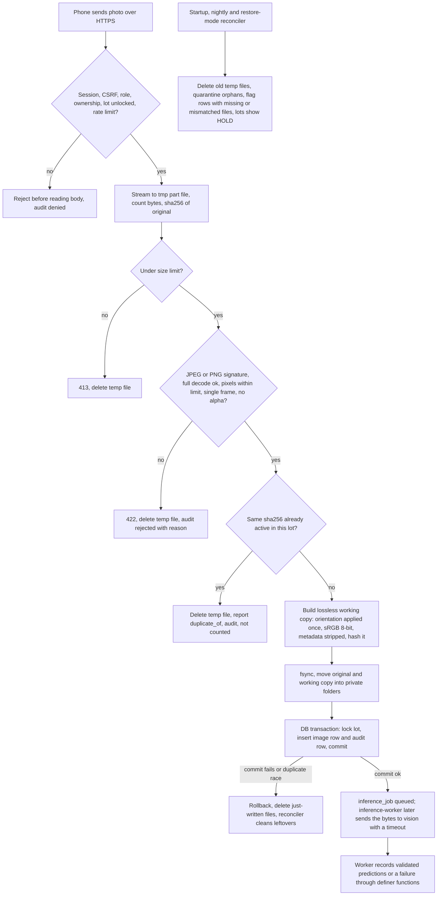

### 7.3 AI inference isolation (diagram 4)

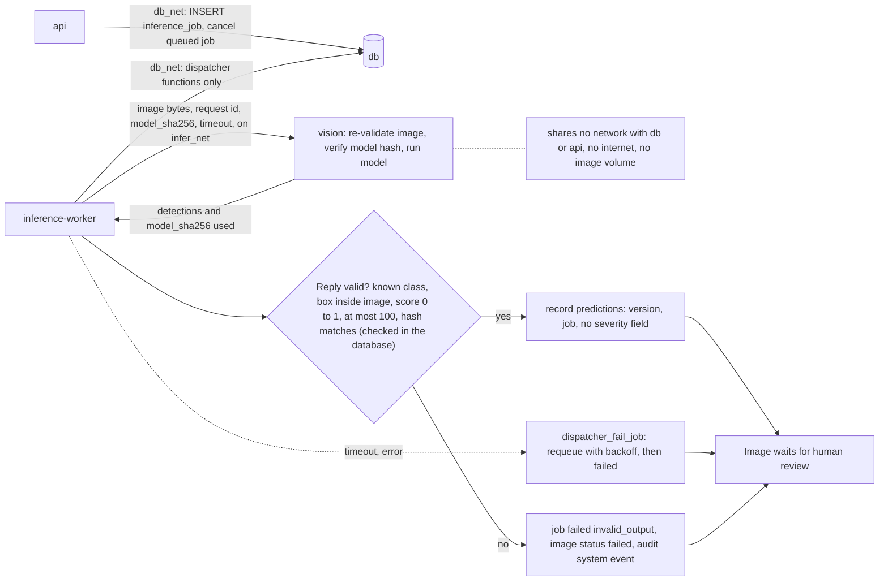

### 7.4 Human defect confirmation (diagram 5)

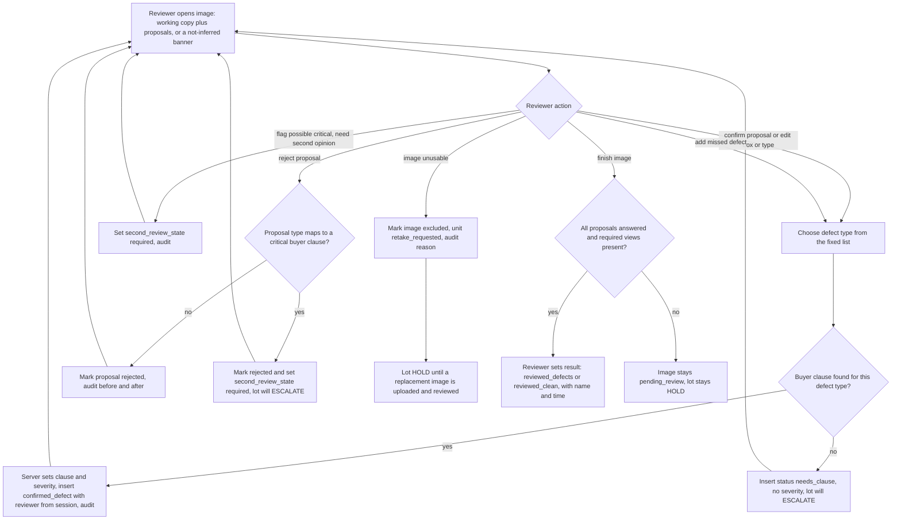

### 7.5 AQL decision protection (diagram 6)

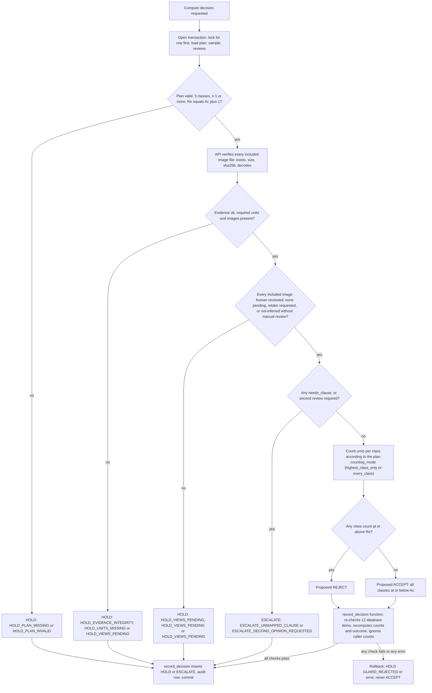

### 7.6 ESCALATE resolution, ordinary workflow (diagram 7a)

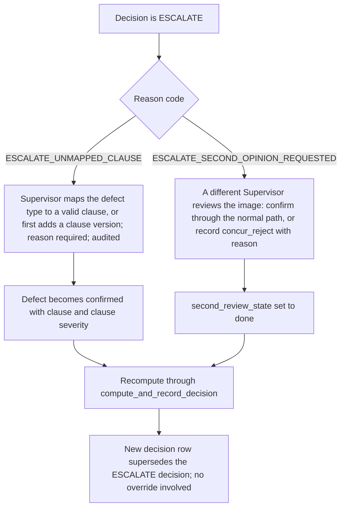

### 7.7 Supervisor override, exceptional path (diagram 7b)

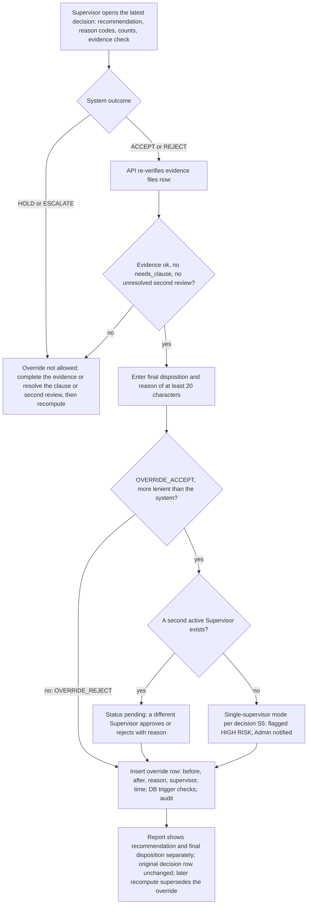

### 7.8 Backup, purge lock, and recovery (diagram 8)

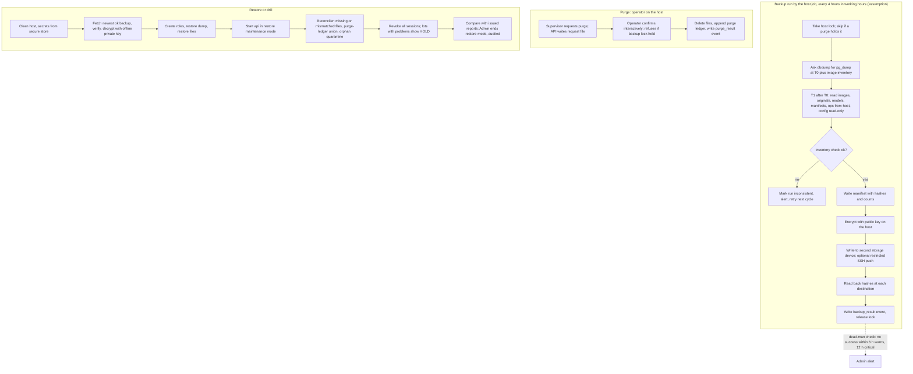

### 7.9 Model registration and activation (diagram 9)

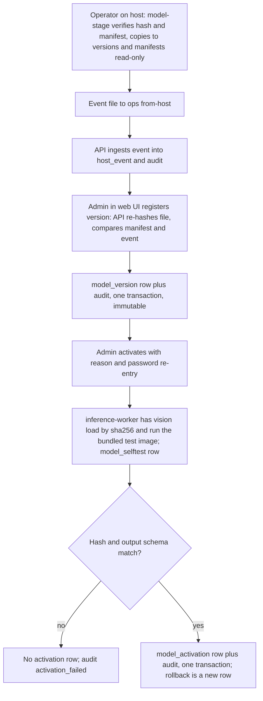

---

## 8. Threat model

| # | Threat | Impact | Main controls | Requirements |
|---|---|---|---|---|
| TM-01 | Password guessing or stolen password | Account takeover | Argon2id, 15-character rule, blocklist, progressive delay | AUTH-01 to AUTH-06 |
| TM-02 | Attacker locks out a Supervisor or Admin | No overrides or administration | Per-account delay, 100 cap, break-glass | AUTH-05 to AUTH-07 |
| TM-03 | Password or login flood; huge Unicode input | CPU and memory exhaustion | Body and byte limits, hashing concurrency limit, proxy limits | AUTH-02, AUTH-06 |
| TM-04 | Random-email flood fills the database | Storage exhaustion | No per-email rows, aggregate counters, 30-day cleanup | AUTH-11, AUD-11 |
| TM-05 | Account enumeration | Targeted attacks | Generic responses, padded timing | AUTH-04 |
| TM-06 | Session theft or fixation | Account takeover | HTTPS, `__Host-` cookie, short timeouts, renewal | SES-01 to SES-06 |
| TM-07 | CSRF including login CSRF | Forged confirm or override | Synchronizer token, Origin, Fetch Metadata | CSRF-01 to CSRF-04 |
| TM-08 | XSS | Session abuse; defeats CSRF defenses | No raw HTML, CSP | CSRF-05 |
| TM-09 | IDOR between users | Unauthorized change or leak | Central policy, nested-ID checks | AZ-01 to AZ-03, AZ-10 |
| TM-10 | Mass assignment | Escalation; forged counts or evidence | Allow-listed request models | AZ-04 |
| TM-11 | Unauthorized change of products, buyers, clauses, plans | Wrong severity or plan | Role checks, DB grants, role-checking triggers | MD-01 to MD-04 |
| TM-12 | AI proposal treated as a count or severity | False ACCEPT | Counts only from confirmed rows; no AI severity | BR-01, BR-04, AI-13 |
| TM-13 | Empty detection list read as clean | False ACCEPT | Human review result required | BR-02 |
| TM-14 | Garment counted twice | Wrong outcome | Counting view and property test | BR-03 |
| TM-15 | Invalid plan (gap between Ac and Re, missing class) | Undefined outcome | Plan validation at three layers | BR-05 |
| TM-16 | False ACCEPT from a bug or SQL injection | Bad lot passes | Evidence verification, restricted decision insert, database re-check, immutable decisions | EV-01 to EV-09 |
| TM-17 | Forged evidence values from a faulty API | Bad lot passes | Second lines: reconciler, report re-verification, status view | EV-06 to EV-08 |
| TM-18 | Override bypasses missing clause or evidence | Wrong decision | ESCALATE and HOLD not overridable; ordinary workflow only | OV-03, ESC-01 to ESC-03 |
| TM-19 | Override shown as an ISO acceptance | Dishonest report | Separate final disposition and fixed wording | OV-02, OV-06 |
| TM-20 | Single person releases a rejected lot | Bad lot released | Reason, second Supervisor, audit | OV-04 |
| TM-21 | Malicious or malformed image | Server compromise | Allowlist, full decode, limits, canonical copy | UP-02 to UP-06 |
| TM-22 | Decompression bomb | Memory exhaustion | Pixel limit with warning-as-error | UP-04 |
| TM-23 | Crash during upload | Row without image | File first, row last, reconciler | UP-09, UP-11 |
| TM-24 | Image lost or altered later | Missing evidence | Hash check at decision, nightly reconciler, status view | EV-01, UP-11, EV-08 |
| TM-25 | Evidence deleted while a backup needs it | Inconsistent backup | API never hard-deletes; host lock shared by purge and backup | UP-16, BAK-13 |
| TM-26 | Malicious model checkpoint (`.pt` or `.pth`) | Code execution in `vision` | Own-built, hash-pinned, read-only, no upload, contained container, pinned-version loading test | AI-05, AI-01, AI-02, AI-18 |
| TM-27 | Compromised `vision` container | Pivot to database or API; photo theft | No shared network with `db` or `api`, no image volume, no internet; its only reachable peer, `inference-worker`, opens no port | AI-01 to AI-03 |
| TM-28 | Unauthorized model activation | Altered detector behavior | Admin only, password re-entry, hash and smoke test, audit | AI-08, AI-09 |
| TM-29 | `vision` returns bad data | Corrupt records | Validation inside the database function that stores predictions | AI-04, DB-19 |
| TM-30 | Vulnerable dependency anywhere | Compromise | Pinned full set, weekly checks, 7-day fixes | AI-06, DEP-10 |
| TM-31 | Direct database exposure | Data leak or tampering | No published port, internal network | DB-08, DEP-02 |
| TM-32 | Runtime role abused after compromise | Audit or decision tampering | Non-owner role, INSERT-only tables, restricted decision insert | DB-02, DB-03, EV-04 |
| TM-33 | Audit skipped or edited | Lost accountability | Same transaction, consistency check; optional chain/export | AUD-03, AUD-07 |
| TM-34 | Forged or missing host events | Lost record of host actions | Event files kept on the host and in backups; weekly review (limit A6) | AUD-10, AUD-13 |
| TM-35 | Docker bypasses `ufw` | Exposed services | Only the proxy publishes ports; outside scan | DEP-02 |
| TM-36 | Secrets in env, Git, logs | Credential leak | Secret files, scanning | DB-07, DEP-04 |
| TM-37 | Backup theft or stolen host | Data leak | Public-key encryption; private key offline | BAK-04 |
| TM-38 | Backup job abused (it can read all data) | Data leak | No Docker access, no DB password, read-only, no container egress, firewall allowlist | BAK-10, DEP-14 |
| TM-39 | Backups fail silently | Data loss | Event and dead-man alerts, drills | BAK-12, BAK-16 |
| TM-40 | Inconsistent restore | Row without file; old ACCEPT survives | Order, inventory check, reconciler, status view, maintenance mode | BAK-02, BAK-15, EV-08 |
| TM-41 | Purged image resurrected from an old backup | Privacy harm | Purge ledger re-applied; retention limits | BAK-14, BAK-15 |
| TM-42 | Malicious request file from a compromised API to the host | Evidence destroyed | Interactive operator confirmation; strict validation; old backups remain | PG-3, BAK-14 |
| TM-43 | Cherry-picked sampling | Bad lot accepted | **Process control only** (section 11) | n/a |
| TM-44 | Faces or badges in photos | Privacy harm | Capture guide, withdrawal, purge procedure, metadata stripped | UP-05, UP-15, PG-1 to PG-7 |
| TM-45 | Detector evasion or missed defect | Bad lot accepted | Human review of every included image; uncalibrated labelling; no automatic counts | BR-02, BR-11 |
| TM-46 | Compromised `inference-worker` | Abuse of its database access | It can call only the six dispatcher functions: no table privilege, column-level grants for the function owner, fenced writes | DB-15, DB-16, DB-18, AI-16 |
| TM-47 | Compromised API forges or revives inference jobs | False "inference ok", skipped inference | INSERT of `image_id` only, no UPDATE, `api_cancel_job` allows queued to canceled only; image status is derived; human review is still required | DB-17, AI-15 |
| TM-48 | Table owner or superuser disables an append-only trigger | Silent change of predictions, decisions or model records | Run-time roles never own tables; `v_protected_trigger_check` plus Admin alert; backups; the residual limit stays visible | DB-02, DB-20 |

---

## 9. Failure handling

**Rule:** a technical failure never produces ACCEPT, REJECT, or "zero defects". It produces an error, HOLD, or ESCALATE.

| # | Situation | Behavior | Decision effect | User sees | Recovery |
|---|---|---|---|---|---|
| FH-01 | `vision` unavailable, slow, or unhealthy | The worker stops claiming; upload and manual review still work; jobs stay `queued` or fail after retries; images are `not_inferred` or `pending` | HOLD `HOLD_VIEWS_PENDING` until every sample image is manually reviewed | "Not inferred" banner | Retry or finish manual review |
| FH-02 | `vision` returns invalid output | Not stored; job `failed` (`invalid_output`) | HOLD `HOLD_VIEWS_PENDING` | "Detector result rejected" | Retry or manual review |
| FH-03 | Model hash mismatch or load failure | `vision` refuses that model; job fails or the self-test fails | HOLD (as FH-01) | Admin alert | Fix model file; activation refused |
| FH-04 | Database unavailable | 503; nothing partial; no file kept without a row | No decision | "Nothing was saved" | Restore database; repeat |
| FH-05 | Audit insert fails | Whole transaction rolls back | No change | Error with request ID | Fix permissions or table |
| FH-06 | Corrupted image | Validation fails; temp file deleted | Unit lacks a valid image: HOLD `HOLD_VIEWS_PENDING` | "Retake this photo" | Upload again |
| FH-07 | Reviewer judges an image unusable | Image `excluded` (kept); unit `retake_requested` | HOLD `HOLD_VIEWS_PENDING` | "Retake requested" | Upload and review a replacement |
| FH-08 | Duplicate image | Not stored again; not counted | Sample not advanced | "Duplicate of an earlier photo" | Photograph another garment |
| FH-09 | Unknown clause, or reviewer-chosen "other" type | No severity guessed; `needs_clause` | ESCALATE `ESCALATE_UNMAPPED_CLAUSE` | "A Supervisor must map this" | ESC-01, then recompute |
| FH-10 | Reviewer rejects a critical-mapped proposal, or flags a second opinion | `second_review_state = required` | ESCALATE `ESCALATE_SECOND_OPINION_REQUESTED` | "Second review required" | ESC-02, then recompute |
| FH-11 | Unauthorized request | 401, 403, or 404; nothing changes | None | Generic message | None |
| FH-12 | Disk full | Upload fails loudly | HOLD if evidence missing | "Storage problem" | Free space |
| FH-13 | Image file missing or hash mismatch (found by decision check or reconciler) | Image `integrity_status` set | HOLD `HOLD_EVIDENCE_INTEGRITY`; old decisions shown as HOLD (EV-08) | Admin alert and lot banner | Restore from backup or retake |
| FH-14 | Crash during upload | Temp or orphan file only | None | Retry upload | Reconciler cleans up |
| FH-15 | Plan invalid or missing | Plan rejected at entry or at decision | HOLD `HOLD_PLAN_INVALID` or `HOLD_PLAN_MISSING` | "Plan must be corrected" | Supervisor enters a valid plan |
| FH-16 | Decision guard rejects a proposed ACCEPT or REJECT | Rolled back | HOLD `GUARD_REJECTED` (or error) | "Decision blocked, contact Supervisor" | Investigate the mismatch |
| FH-17 | Backup failed, inconsistent, or stale | Event and alert; last good backup remains | None | Admin alert (6 h warning, 12 h critical) | Fix and rerun |
| FH-18 | Purge requested during a backup | Operator tool refuses (lock held) | None | Operator message | Retry after the backup |
| FH-19 | Model activation fails | No activation row; `activation_failed` audit | None | "Activation failed" | Fix file or choose another version |
| FH-20 | Host event ingestion fails or file is invalid | File moved to `rejected/`; alert | None | Admin page counter | Operator inspects |
| FH-21 | Restore completed | Sessions revoked; reconciler runs; maintenance mode | Lots with missing evidence HOLD | Re-login; maintenance banner | Steps R9 to R11 |
| FH-22 | Proxy or API down | Site unreachable | No changes possible | Connection error | Restart service |
| FH-23 | `inference-worker` down, or a dispatcher function fails | Jobs stay `queued`; a restarted worker reclaims `running` jobs after lease expiry (attempts counted, then `failed`); stale writers are fenced | HOLD (as FH-01); manual review is not blocked | Admin alert | Restart the worker or finish manually |

---

## 10. Security testing plan

All tests are **planned**. None has been run. They suit a Docker Compose test stack, `pytest` with an HTTP client, a PostgreSQL 18 test database, fixture images, `psql` as each database role, and (for network tests) a second machine.

### 10.1 Essential Version 1 tests

| Test ID | Objective | Test procedure | Expected result | Related requirement |
|---|---|---|---|---|
| T-01 | Normal login works | Log in with a valid account; inspect the cookie | Session created; cookie flags as in T-14 | SES-01, SES-02 |
| T-02 | Generic login failures | Try unknown email, wrong password, disabled account, an account in a delay window; compare status, body, timing | Same status and body; timing similar | AUTH-04 |
| T-03 | Password limits and policy | Try 14 and 15 characters; 128 and 129 code points; 64 and 65 four-byte characters (256 and 260 bytes); invalid UTF-8; a 5 KB body; a long string of combining marks; a string that grows when normalized; a common password; "lotline…"; the email | 14, 129, 65 four-byte, invalid UTF-8, oversized, normalization-growth, common and context-word passwords rejected with a reason, **before** hashing; others accepted | AUTH-02, AUTH-03 |
| T-04 | Hash storage | Read the stored value; search DB dump and logs for the plain password | Argon2id string with parameters at or above the OWASP minimum; no plaintext | AUTH-01 |
| T-05 | Progressive delay | Make 5, then 6, failures; try the correct password during the wait; wait; log in; repeat with an unknown email | Wait applies even with the correct password; works after; unknown email looks the same | AUTH-05 |
| T-06 | Lockout DoS resistance | From another IP, make many failures against a Supervisor; then the Supervisor logs in after the wait; push to 100 failures; Admin resets | Delay never exceeds 15 min before 100; real user recovers; at 100 an Admin reset restores access | AUTH-05, AUTH-06 |
| T-07 | Temporary password | Admin issues one; log in; call other routes; advance the test clock 24 h | Only change-password and logout work; expires; old sessions revoked | AUTH-08 |
| T-08 | Break-glass and last Admin | Run the `cli` reset; try to demote the last Admin | Reset works and writes an audit row with actor `host-operator`; demotion refused | AUTH-07, AUTH-09, AUD-12 |
| T-09 | Authentication-record growth | Send 100,000 login attempts with random unknown emails; check tables and audit | No per-email rows; `security_counter` has one row per minute and kind; audit rows bounded; cleanup removes rows older than 30 days | AUTH-11, AUD-11 |
| T-10 | Session timeouts | With short test timeouts, wait for idle and absolute expiry | 401 after each | SES-03 |
| T-11 | Session revocation | Log out and replay the cookie; change password, disable user, change role with a second session open | Old cookies stop working | SES-05 |
| T-12 | Fixation and ID handling | Set a cookie before login; log in; send an ID in a URL or header | New ID issued; planted and URL IDs ignored | SES-01, SES-04 |
| T-13 | CSRF | POST without token; wrong Origin; no Origin and no token; cross-site `Sec-Fetch-Site`; login CSRF; multipart upload from another site | All refused with 403 | CSRF-01 to CSRF-05, UP-01 |
| T-14 | Cookie, cache, and header checks | Inspect headers and cookie | `__Host-` prefix, `Secure`, `HttpOnly`, `SameSite=Strict`; `no-store`; CSP and other headers; no CORS; docs pages off | SES-02, SES-06, DEP-03, DEP-07, DEP-08 |
| T-15 | Deny by default | List routes; call each without login | Every route has a permission; all return 401 | AZ-01 |
| T-16 | Role matrix | Table-driven test: every role × every action in section 6 | Result equals the matrix | AZ-02, AZ-07 |
| T-17 | IDOR | Inspector B writes to Inspector A's lot; nested routes with mismatched IDs | 403 for forbidden writes; 404 for mismatched chains; nothing changes | AZ-02, AZ-03, AZ-08 |
| T-18 | Mass assignment | Send extra fields (`role`, `reviewer_id`, `severity`, counts, hashes, `evidence`) | Rejected or ignored | AZ-04 |
| T-19 | Master-data permissions | As each role try to create or edit products, buyers, clause versions, clause mappings, and plans; also test with `psql` as `lotline_app` | Matches section 6 and MD-01 to MD-03; clause and plan inserts by a non-Supervisor `user_id` refused by the trigger; clause and plan rows cannot be updated | MD-01 to MD-04, DB-03 |
| T-20 | Image visibility | Inspector B opens Inspector A's images; Admin requests an image; unauthenticated request | Inspector B allowed (A5); Admin 403; unauthenticated 401; view logged | AZ-10 |
| T-21 | SQL injection and DB limits | Injection strings in login, lot code, search, notes, sort, JSON; as `lotline_app` try `DROP`, `ALTER`, `TRUNCATE`, `DELETE`, `UPDATE image SET working_sha256`, `INSERT INTO decision` | No leaks or changes; every protected action refused | DB-01 to DB-03 |
| T-22 | Valid upload and working copy | Upload JPEG and PNG incl. an EXIF-rotated JPEG with GPS, a Display P3 JPEG, a 16-bit PNG, a PNG with alpha | UUID names; working copy is a lossless 8-bit sRGB PNG, upright, no metadata; pixels equal the orientation-corrected decoded original (sRGB input); P3 colours match a reference conversion within the agreed tolerance; alpha file rejected; boxes match the display | UP-05 |
| T-23 | Disguised and broken files | Script renamed `.jpg`; real PNG named `.jpg`; wrong `Content-Type`; empty, truncated, corrupted files | Decided by content; bad files rejected; no row or file left | UP-03 |
| T-24 | Size limits and disk guard | One byte over 15 MB through the proxy, direct to the API, and chunked; full test volume | Rejected; clear error; no partial row | UP-04, UP-12 |
| T-25 | Pixel limits | Small file declaring 60 and 120 megapixels | Rejected before full decode; memory bounded; warning treated as error | UP-04 |
| T-26 | Path and filename abuse | `../../x.jpg`, `a:b.jpg`, null byte, 300 characters | Generated path; nothing outside the base folder; name shown escaped | UP-04, UP-06 |
| T-27 | Unsupported formats | HEIC, WebP, GIF, SVG, PDF | Rejected with the "Most Compatible" hint | UP-02 |
| T-28 | Image access | Guess image URLs on the proxy; read an image without login | Proxy has no image files; 401 | UP-07, UP-08 |
| T-29 | Duplicates | Same file twice; 10 in parallel; same file in another lot; a recompressed copy; re-upload after withdrawal | One row; cross-lot flagged; recompressed copy **not** detected (documented); re-upload after withdrawal allowed | UP-10, DB-04 |
| T-30 | Crash consistency | Kill the API at W1, after W5, before and after W6 commit | No row without a file; leftovers cleaned; no double count | UP-09, DB-09 |
| T-31 | Missing file | Delete a working file by hand; run the reconciler; request a decision; request the lot status | Image marked missing; decision HOLD; status HOLD | UP-11, EV-01 |
| T-32 | Altered file | Change one byte of a stored image | Mismatch found; HOLD; alert | UP-11 |
| T-33 | Human unusable image and retake | Reviewer marks an image unusable; request a decision; upload and review a replacement | Image `excluded` and kept; HOLD `HOLD_VIEWS_PENDING`; HOLD ends only after the replacement is reviewed; no automatic blur or darkness check exists; no quality score affects counts | BR-12, UP-13 |
| T-34 | Inference down | Stop `vision`, then `inference-worker`; upload; request a decision; finish manual review; cancel the queued job in the UI | Upload works; jobs stay `queued` (no attempts consumed while `vision` is unhealthy); images `not_inferred` or `pending`; HOLD; manual completion allowed and not blocked by the queued job; never ACCEPT without human review | AI-07, AI-16, BR-08, BR-13, DEP-11 |
| T-35 | Empty detection list | Stub inference returns nothing for a defective garment | Image `pending_review`; HOLD; not clean | BR-02 |
| T-36 | Predictions cannot change counts | Alter scores or delete all predictions | Counts and decision unchanged | BR-01, AI-10 |
| T-37 | AI cannot assign severity | Stub inference returns extra fields (`severity`, `critical`, `count`) and a very high confidence for a critical-mapped type; schema inspection | Extra fields rejected; no severity stored on predictions; severity appears only after a human confirms and a clause is mapped; confidence changes nothing | BR-04, BR-14, ESC-05, AI-13 |
| T-38 | Inference isolation | In `vision`: resolve and connect to `db`, to `api`, to the internet; list mounts; write outside the temp area; check user and capabilities; connect to `inference-worker` ports. In `inference-worker`: list mounts and listening ports | `vision`: no route to `db`, `api` or the internet; only `models/versions` mounted read-only; no image volume; non-root; capabilities dropped. `inference-worker`: only `images` mounted read-only; no listening port | AI-01 to AI-03, UP-07 |
| T-39 | Model file control | Flip one byte in a model file; look for upload or path-loading routes; touch a file in `models` | Load refused on mismatch; no such routes; mount read-only | AI-03, AI-05 |
| T-40 | Bad inference output | Stub `vision` returns an out-of-range box, an unknown class, 10,000 detections, a wrong `model_sha256`, and detections **missing** `class`, `score` or `box` | Rejected inside the database; job `failed` (`invalid_output` or `model_mismatch`); nothing stored | AI-04, DB-19 |
| T-41 | Inference timeout | Make the stub hang | The worker's call times out within 30 s; job requeued with backoff, then `failed`; image `not_inferred`; event logged | AI-07, AI-11 |
| T-42 | One garment counted once | Garment with 1 major + 3 minor; garment with 2 majors; garment with minors only; compare engine, `v_unit_class`, and a hand count; random property test | 1 major and 0 minor; 1 major; 1 minor; engine equals SQL | BR-03, DB-06 |
| T-43 | Severity from clause only | Client severity; confirm with an unknown clause; SQL that sets a wrong severity; HOLD and ESCALATE both present | Client severity rejected; `needs_clause` gives ESCALATE; database foreign key refuses the wrong severity; HOLD wins over ESCALATE (A28) | BR-04, BR-14 |
| T-44 | Unknown clause cannot be bypassed | With an ESCALATE `ESCALATE_UNMAPPED_CLAUSE` lot, try to override as Supervisor and to set a severity directly; then map the clause and recompute | Override refused (OV-03); mapping creates a `clause_mapping` row and a confirmed defect with the clause severity; a **new** decision supersedes the old; the ESCALATE decision stays | ESC-01, ESC-03, OV-03 |
| T-45 | Second review | Reviewer rejects a critical-mapped proposal; reviewer flags a second opinion; the same user tries to second-review; a different Supervisor confirms or concurs; recompute | ESCALATE `ESCALATE_SECOND_OPINION_REQUESTED`; same-user review refused; after ESC-02 a recompute gives a new decision | ESC-02, ESC-03, ESC-05, AZ-07 |
| T-46 | Plan validation | Enter plans with `Re ≠ Ac + 1`, negative `Ac`, `n = 0`, non-integers, text, huge values, only two classes, a duplicate class, a fourth class; insert directly with `psql` | API rejects each; database `CHECK` or unique constraints refuse direct inserts; no invalid plan can reach a decision | BR-05, DB-04, MD-03 |
| T-47 | Boundary counts | For each class set count = `Ac`, `Ac + 1` (= `Re`), `0` with `Ac = 0`, and large counts; test each class alone and in combination (critical OK but major at `Re`) | `Ac` gives eligible for ACCEPT; `Re` gives REJECT; any class at `Re` gives REJECT; all classes at or below `Ac` gives ACCEPT; never an undefined result | BR-05, BR-06 |
| T-48 | Plan separation | Static scan of the plan module imports; update a plan row; scan the repository for ISO table content | No vision imports; update refused; no table | BR-05 |
| T-49 | Evidence verification before decision | Remove or change an included image file; leave a unit without a required image; request a decision each time | HOLD `HOLD_EVIDENCE_INTEGRITY` or `HOLD_VIEWS_PENDING`; the evidence snapshot lists the failing image and hashes; no ACCEPT or REJECT | EV-01, EV-02, BR-06, BR-07 |
| T-50 | Forged evidence and direct decision inserts | As `lotline_app` run `INSERT INTO decision`; call `record_decision` with forged counts, a fake `verified` hash, an omitted image, an invented image, and a wrong outcome; inspect function owner, `search_path`, and `EXECUTE` grants; grep the code for other decision writers | Direct insert refused (no privilege); forged counts ignored; set or hash mismatches raise errors; wrong outcome raises; function owned by the `NOLOGIN` role, `EXECUTE` only for `lotline_app`; only one code path calls it. **The test documents that a forged `verified` hash for an image that is truly altered cannot be detected by the database** (EV-06) | EV-03, EV-04, EV-06, DB-12 |
| T-51 | Database guard re-checks | Call `record_decision` with: a stale `verification_finished_at`; a review changed after verification started; counts that differ from `v_unit_class`; a `needs_clause` present; `second_review_state = required`; a wrong `supersedes_id`; an inactive actor | Each raises an error; the API records HOLD `GUARD_REJECTED`; no ACCEPT or REJECT | EV-05, BR-07, BR-10 |
| T-52 | Immutable decisions, versions, concurrency | Change a confirmation after a decision; recompute; two users confirm at once; two decision requests at once | New row supersedes; old row kept; stale write gets 409; decisions serialize on the lot lock without deadlock | BR-09, AZ-05, AZ-06, EV-03 |
| T-53 | Lot status after evidence loss; report check | Decide ACCEPT; then delete an included image; read lot status through the UI, API, and report | All show HOLD `HOLD_EVIDENCE_INTEGRITY`; the report shows the failed re-verification; reading `decision.outcome` directly for status is not found in code | EV-07, EV-08, OV-09, BAK-07 |
| T-54 | Uncalibrated label | Inspect every place confidence is shown; try an interval-based rule (none exists) | Every value labelled "uncalibrated"; no interval used; uncertainty flags never change counts | BR-11, AI-14 |
| T-55 | Override basics | Override without reason; as Inspector and Admin; as Supervisor; `UPDATE decision` | Reason required; only Supervisor succeeds; recommendation unchanged; no UPDATE grant | OV-01, OV-02, OV-07 |
| T-56 | High-risk override | REJECT→ACCEPT with and without a second Supervisor; self-approval; a later recompute | Pending until a different Supervisor approves; self-approval refused; single-Supervisor mode flags HIGH RISK; a later recompute marks the override superseded | OV-04, OV-08, AZ-07 |
| T-57 | HOLD and ESCALATE not overridable | Try to override a HOLD, an ESCALATE, a non-latest decision, and a decision with failing evidence | All refused by the API and by the database trigger where it can check | OV-03 |
| T-58 | Report wording | Reports for a system ACCEPT, a system REJECT, a HOLD, an ESCALATE, an overridden ACCEPT, an overridden REJECT | HOLD and ESCALATE labelled workflow states; overridden reports show both lines and "not an ISO 2859-1 acceptance"; "uncalibrated"; evidence result shown | OV-06, ESC-04 |
| T-59 | Model registration, activation, rollback | Stage a model; register; activate; roll back; read `model_version`, `model_activation`, audit | Version rows immutable; activation rows append-only with actor, time, hash, reason, via; audit row in the same transaction; `v_active_model` follows the latest success | AI-08, AI-09 |
| T-60 | Unauthorized activation | Try activation as Inspector, Supervisor, unauthenticated, with a wrong password re-entry, and by direct SQL as `lotline_backup` | All refused; the trigger refuses an activation row from a non-Admin `user_id` | AI-09, MD-04 |
| T-61 | Activation hash mismatch | Alter a staged file or its manifest; try to register and activate; stop `vision` during the self-test | Registration or activation refused; no activation row; `activation_failed` audit row; active model unchanged | AI-09, FH-19 |
| T-62 | Audit coverage and integrity | Perform every event in AUD-01; `UPDATE` and `DELETE` on `audit_log` as `lotline_app`; break the audit insert; search audit and logs for secrets; run the consistency check after deleting an audit row as owner | One row per event with before and after; protected; the change rolls back when audit fails; no secrets; the check reports the gap | AUD-01 to AUD-07, SES-07, MD-05, DB-10 |
| T-63 | Host event ingestion | Drop valid, duplicate, oversized, malformed, and path-traversal event files into `ops/from-host/`; stop the database and restart | Valid events create `host_event` and audit rows once; duplicates ignored; bad files moved to `rejected/` with an alert; files wait while the database is down | AUD-10, AUD-13 |
| T-64 | Database failure | Stop the database during an upload, a confirmation, and a decision request | 503; no partial row; no stray file; no decision | DB-05, BR-08 |
| T-65 | Backup transfer restrictions | From the `dbdump` container and the `api` container try to reach the internet and the backup destination; as the backup OS user try other hosts; run a backup with the destination unreachable and with a wrong host key | Containers have no outbound path; the backup user can reach only the allowlisted destination; failures produce a `failed` event and an alert; no archive is reported as good | BAK-09, DEP-14 |
| T-66 | Backup access restrictions | As the backup OS user try to write to images, models, `ops/to-host`, staging; read a secret file; join the Docker group or use `sudo`; connect to PostgreSQL; as `lotline_backup` try `INSERT`, `UPDATE`, `DELETE` | Writes and secrets refused; no Docker or `sudo`; no database password on the host; backup role is read-only | BAK-10, DEP-13 |
| T-67 | Backup encryption and key separation | Inspect the archive; search the host and backup folders for the private key; try to decrypt with a wrong key and with the right key on a separate machine | Archive unreadable without the key; the host holds only the public key; wrong key fails; right key works | BAK-04 |
| T-68 | Backup contents and manifest | After a run, list the archive and check every manifest section: dump hash, row counts, image counts and hash list, original uploads, model files and manifests, `ops/from-host` and purge ledger, configuration, restore scripts; compare the manifest SHA-256 with the audit event | All present; hashes match; the audit event holds the manifest hash | BAK-01, BAK-11 |
| T-69 | Backup consistency strategy | Take the dump, add an upload, then copy files; also delete an image between dump and copy (bypassing the lock) | Extra file is an orphan; the inventory check flags the deleted image; the run is `inconsistent` and not reported good | BAK-02 |
| T-70 | Purge during backup | Start a backup run; start `purge`; then start a backup while `purge` runs | Purge refuses while the backup lock is held; the backup skips with `backup_skipped_locked` while purge runs; no file deleted during a run | BAK-13, FH-18 |
| T-71 | Purge workflow and ledger | Withdraw an image; request purge before and after 30 days; request purge for an image in a decision's evidence; confirm purge; restore an older backup | Early or evidence-referenced requests refused; purge needs operator confirmation; ledger entry and `purge_result` event; API marks `purged`; after the older restore the ledger deletes the resurrected file | UP-16, BAK-13, BAK-14, BAK-15 |
| T-72 | Restore drill and reconciliation | Restore the newest backup onto a clean stack (R1–R13): remove one image and alter another in the backup; include a purged image in an older backup | Roles and counts match the manifest; maintenance mode on; missing and altered images flagged; affected lots HOLD even if they had ACCEPT; purge ledger re-applied; orphans quarantined; sessions revoked; restore events and audit rows written; a recorded drill | BAK-01, BAK-03 to BAK-07, BAK-15, BAK-16 |
| T-73 | Backup failure detection and reporting | Simulate: dump failure, full disk, transfer failure, timeout, stuck lock, no run for 6 h and 12 h, missed monthly drill | Each produces an event and an Admin alert at the stated thresholds; the dead-man alert appears even when the job never starts | BAK-12, DEP-11 |
| T-74 | Exposed ports | Port scan from another machine with `ufw` enabled | Only 80 and 443 (and SSH from allowed addresses) | DEP-02, DEP-09 |
| T-75 | Network membership | Inspect Compose config and runtime networks | Matches section 4.2; `vision` shares no network with `db` or `api`; `inference-worker` is the only container on both `db_net` and `infer_net`; no container has a non-internal network except `proxy` on `edge` | DEP-01, DB-08, AI-01 |
| T-76 | Container hardening | Inspect each container (including `dbdump` and `cli`) | Non-root where possible; capabilities dropped; `no-new-privileges`; read-only root filesystem; limits and health checks set | DEP-05, DEP-06, AI-02 |
| T-77 | Secrets handling | Search Git history, image layers, environment, and logs for secrets; start with an empty secret; look for the bootstrap superuser password on the host | None found; startup refused; superuser password not present | DB-07, DEP-04, DB-13 |
| T-78 | Dependency pinning and vulnerability checks | Check `VERSIONS.md` against lockfiles and installed versions for every image and the frontend; run Python, JavaScript, and base-image vulnerability checks; check PyTorch is a maintained, patched, pinned version; confirm the docs used match the pinned versions | All pinned; no unresolved High or Critical items without written acceptance; documentation matches versions | AI-06, DEP-10, DB-14 |
| T-79 | Worker has no table privilege | As `lotline_dispatcher`: SELECT, INSERT, UPDATE, DELETE on every table, view and sequence | All refused; only the six functions run | DB-15 |
| T-80 | Dispatcher function contract | Two concurrent claims; heartbeat; fail with retry and backoff; replay of a finished job; expired lease; stale worker; superseded image; decided lot; wrong model hash | Different jobs; stale writer fenced; nothing stored on cancel; attempts counted; exhausted attempts end `failed` | DB-15, DB-18, AI-16 |
| T-81 | API cannot forge or revive jobs | As `lotline_app`: INSERT a job with a status or attempts; UPDATE a job; call `api_cancel_job` on queued, running, succeeded and unknown ids and with a bad reason | Forged insert and UPDATE refused; only queued to canceled succeeds | DB-17, AI-15 |
| T-82 | Owner bypass limit and detection | As a run-time role: DISABLE or DROP a protected trigger. As `lotline_owner`: disable one and read `v_protected_trigger_check`; run the nightly check | Run-time roles refused; the owner can bypass (documented limit); the check reports DISABLED or MISSING and raises an Admin alert | DB-02, DB-20 |
| T-83 | EXECUTE matrix | List EXECUTE rights of every function for each role and for a role with no grants | Matches System Design 4.12; nothing for PUBLIC | DB-21 |
| T-84 | Manual review does not deadlock | Stop the worker; queue a job; reviewer finishes the image manually; compute a decision; start the worker | Queued job cancelled or ignored; the view counts as reviewed; a late prediction is fenced (`manual_review`); a retry can be queued | BR-13, AI-16 |
| T-85 | Model flow | Register a model; activate without self-test; self-test with a wrong echoed hash, then a correct one; activate; roll back to an earlier and to a never-activated version | Refusals and appended rows as specified; the API never contacts `vision` | AI-09, AI-17, DB-22 |
| T-86 | Vision network isolation | From `vision`: reach `api`, `db`, the internet, other containers. From `api`: reach `vision` | Only `inference-worker` is reachable from `vision`; `api` cannot reach `vision` | AI-01 |
| T-87 | Worker exposes no port | Port-scan `inference-worker` from `vision` | No open port | AI-01 |
| T-88 | Pinned RF-DETR loading behaviour | With the pinned `rfdetr` and `torch`: load a team checkpoint; test whether a pickle fallback is used; load a crafted malicious pickle in a `vision` test container | Result recorded in `VERSIONS.md`; a malicious checkpoint cannot reach the network, database or images | AI-05, AI-18, U21 |
| T-89 | Vision outage behaviour | Make `vision` `/health` fail; queue jobs; restore | The worker stops claiming; attempts are not consumed; jobs resume | AI-03, AI-07 |
| T-90 | Critical non-visual gate | Set pending, done, not_required, failed; decide before and after the sample is complete; Admin attempts to set; decided-lot attempt | pending blocks ACCEPT; failed gives `REJECT_CRITICAL_NONVISUAL_FAILED` even with an incomplete sample; Admin and decided lot refused; guard path EV-10 | BR-16, EV-10 |
| T-91 | Precedence | One case per tier and per adjacent pair of tiers, including the `highest_class_only` corner (two majors reject; an unmapped defect on one maps to critical; recompute) | Outcome and primary reason as in the table; all reasons recorded; the corner is documented | BR-07, BR-18, A28 |
| T-92 | Override policy | Admin override attempt; override of HOLD, of ESCALATE, and of a `REJECT_CRITICAL_NONVISUAL_FAILED` decision; high-risk override with one and two Supervisors | Refused except for ACCEPT and REJECT decisions; second Supervisor needed for `OVERRIDE_ACCEPT`; OV-10 as the owner decides | OV-01 to OV-04, OV-10 |
| T-93 | Counting mode | Same confirmed defects under both modes; a plan without a mode | Counts differ as specified; `HOLD_PLAN_INVALID` without a mode; mode on the report | BR-15 |
| T-94 | Zone and size-band mapping | Exact match, size-band fallback, no match, type "other" | Severity from the exact row, then the empty-band row; no row gives `ESCALATE_UNMAPPED_CLAUSE`; no guessing | BR-17 |
| T-95 | Spike rerun gate | Run the LL-01/LL-09 spike unchanged on PostgreSQL 18 before each release candidate | 39 of 39 pass | DB-15 to DB-22 |

### 10.2 Optional advanced tests

| Test ID | Objective | Test procedure | Expected result | Related requirement |
|---|---|---|---|---|
| O-01 | Container image scanning | Scan images with a vulnerability scanner | No unresolved High or Critical findings, or each explained | DEP-12 |
| O-02 | Continuous dependency scanning and SBOM | Add scanning to CI; produce a software bill of materials | Reports kept per release | DEP-10 |
| O-03 | Web scanner | Run a scanner against the **test** deployment only | No high findings, or documented | CSRF-05, DEP-07 |
| O-04 | Audit tamper detection (only if a hash chain is built) | Edit an old audit row as a superuser; run verification | Break detected; alert; report says integrity failed | AUD-09 |
| O-05 | Load behavior | Burst of uploads and logins | No crash; limits hold | AUTH-02, UP-01 |
| O-06 | Network penetration test | External tester | Findings documented | DEP-01, DEP-02 |
| O-07 | Point-in-time recovery drill | Recover to a chosen time | Meets RPO | BAK-08 |
| O-08 | Image parser fuzzing | Fuzz the upload validator | No crash, no hang | UP-03, UP-04 |
| O-09 | Inference flapping | Start and stop `vision` and `inference-worker` repeatedly | Jobs end `queued`, `failed` or `succeeded`; images `not_inferred` or `pending`; no false clean; no duplicate predictions | AI-07, AI-16 |
| O-10 | Second-organization isolation | Seed a second organization and repeat IDOR tests | No cross-organization access | AZ-09 |
| O-11 | Remote backup failure injection | Drop the network and corrupt the remote copy | Detected by read-back; alert | BAK-09, BAK-12 |

---

## 11. Residual risks and out-of-scope items

| Risk | Why it remains | What reduces it |
|---|---|---|
| **Cherry-picked sampling** | Software sees only what is photographed. | Process rules, Supervisor spot checks. A "selection method" record is deferred. |
| **Trusted model files** | A `.pt` file is code (F10). An attacker who places one gets code execution inside `vision`. | Own-built files, hash pinning, read-only mount, no network route to `db`, no image volume. Non-pickle serving deferred. |
| **Decision guard limits** | The database cannot see files; a faulty API could forge the verified hashes; the SQL counting view duplicates logic. | Reconciler, report-time re-verification, status view, property tests. Never described as preventing false ACCEPT. |
| **Compromised API can delete or alter files** | The API has write access to `images` for uploads. | Reconciler, nightly hash checks, backups (older copies remain), the host lock and ledger for deliberate purges. |
| **Host or database superuser** | Can bypass grants, edit data, forge host events. | Few people with host access; backups; optional hash chain (tamper-evident, **not** tamper-proof) or weekly audit export. |
| **Backup job can read all data** | It must read images and models. | No Docker access, no database password, read-only ACLs, public-key encryption, firewall allowlist. |
| **Old backups keep purged images** | Encrypted archives are not edited. | Retention schedule; ledger re-applied after restore; shorter retention if required (S7, S9). |
| **Backup consistency is not atomic** | Dump and file copy are separate. | Dump first, lock, inventory check, restore reconciliation, HOLD on gaps. |
| **Single Supervisor** | A high-risk override may lack a second approver. | Decision S5; flag; Admin notice. |
| **Reviewer fatigue** | A reviewer may click through. | Explicit per-image result; second review for critical-mapped rejections; Supervisor sampling. |
| **No MFA** | A guessed password is enough. | 15-character rule, delay, short sessions. TOTP deferred. |
| **Shared NAT address** | IP limits are weak. | Account-based counters; coarse IP limits. |
| **Recompressed or fake photos** | Hashes catch identical files only. | Cross-lot flag, Supervisor review. |
| **Restore loses recent work** | Anything after T0 is gone. | RPO assumption; issued PDF reports; recompute procedure. |
| **Untested design** | No penetration test. | Section 10 tests; external review before real factory use. |

**Out of scope for Version 1:** multi-organization hosting, SSO, SIEM, high availability, automated image-quality checking, certification, legal review of personal data and buyer confidentiality.

---

## 12. Open questions

Decisions for the project owner or Supervisor are in Appendix E (S1–S19). The technical questions below are separate.

| # | Question | Why it matters |
|---|---|---|
| Q1 | Which tool will encrypt and verify backups, and does its documentation support public-key encryption and read-back checks as assumed? | BAK-04 (U11). |
| Q2 | Can the host firewall limit outbound traffic by OS user as assumed? | DEP-14 (U17). |
| Q3 | Which exact Compose keys and syntax apply to the chosen Docker Compose version? | DEP-05, DEP-06 (U4). |
| Q4 | Does the documentation for the pinned PyTorch, Ultralytics, and Pillow versions match the pages read here? | A21, AI-06. |
| Q5 | How many inspectors cannot change iPhones to "Most Compatible"? | Whether HEIC is ever needed (UP-02). |
| Q6 | Which colour tolerance is acceptable for the Display P3 test? | T-22 (U15). |
| Q7 | Is point-in-time recovery needed to meet the RPO? | BAK-08 (U20). |
| Q8 | Is a non-pickle model serving path worth a later phase? | AI-12 (U9). |
| Q9 | Real photo sizes and volumes (to tune limits and lossless storage cost)? | A8, S16. |

---

## 13. Security implementation roadmap (Version 1)

| Phase | Work | Exit criteria |
|---|---|---|
| P0 | Project-owner and Supervisor decisions (Appendix E, **S1–S19**); freeze assumptions A1–A29 | S1–S19 answered or accepted |
| P1 | Compose skeleton: four networks, TLS, secret files, non-root containers, limits, health checks, host folders and permissions | T-74, T-75, T-76, T-77 pass |
| P2 | Database: four roles, grants, constraints, plan checks, views, decision function, triggers; PostgreSQL 18 | T-19, T-21, T-46, T-47, T-50, T-51 pass |
| P3 | Authentication, sessions, CSRF, bounded throttling, `cli` break-glass | T-01 to T-14 pass |
| P4 | Authorization policy, master-data rules, audit writer and consistency check | T-15 to T-20, T-62 pass |
| P5 | Upload pipeline, lossless working copy, reconciler, human unusable-image workflow | T-22 to T-33 pass |
| P6 | Inference isolation, response validation, model registration and activation | T-34 to T-41, T-59 to T-61 pass |
| P7 | Business rules, evidence verification, escalation workflow, overrides, report wording | T-42 to T-58 pass |
| P8 | Host events, backup pipeline, purge, restore drill, alerts | T-63 to T-73 pass |
| P9 | Dependency checks, review of the unverified list (section 3.3), optional tests, external review | T-78 passes; U-items resolved or accepted |

---

## 14. Verified references

**Read status.** *Full page* = I opened and read the page. *Excerpt* = I read only what a search returned from that page. *Secondary* = third-party text. **Applies to** = the software version the page describes, compared with the version this design specifies (A21).

| Ref | Source and section used | Applies to | Supports | URL | Read status |
|---|---|---|---|---|---|
| R1 | OWASP Password Storage Cheat Sheet: "Introduction", "Using Work Factors", "Argon2id", "PBKDF2 pre-hashing" | Current OWASP text; algorithm guidance, not a software version | F1; AUTH-01, AUTH-02 | https://cheatsheetseries.owasp.org/cheatsheets/Password_Storage_Cheat_Sheet.html | Full page |
| R2 | NIST SP 800-63B-4, section 3: 3.1.1.2 "Password Verifiers" and 3.2.2 "Rate Limiting (Throttling)" | SP 800-63B-4 (as published on pages.nist.gov) | F2, F3; AUTH-02 to AUTH-08 | https://pages.nist.gov/800-63-4/sp800-63b/authenticators/ | Full page |
| R3 | OWASP Authentication Cheat Sheet: password strength, error messages, protection against automated attacks (throttling, lockout), logging | Current OWASP text | F4; AUTH-04 to AUTH-06, AI-09 | https://cheatsheetseries.owasp.org/cheatsheets/Authentication_Cheat_Sheet.html | Full page |
| R4 | OWASP Session Management Cheat Sheet: session ID properties, server-side token storage, cookies, expiration, life cycle | Current OWASP text | F5; SES-01 to SES-07 | https://cheatsheetseries.owasp.org/cheatsheets/Session_Management_Cheat_Sheet.html | Full page |
| R5 | OWASP CSRF Prevention Cheat Sheet: token-based mitigation, Fetch Metadata, defense in depth, login CSRF | Current OWASP text | F6; CSRF-01 to CSRF-05 | https://cheatsheetseries.owasp.org/cheatsheets/Cross-Site_Request_Forgery_Prevention_Cheat_Sheet.html | Full page |
| R6 | OWASP File Upload Cheat Sheet: file upload protection (extension, content type, signature, filename, content, storage, limits) | Current OWASP text | F7; UP-01 to UP-08 | https://cheatsheetseries.owasp.org/cheatsheets/File_Upload_Cheat_Sheet.html | Full page |
| R7 | PyTorch documentation, Serialization semantics (`torch.load`, `weights_only`) | **PyTorch 2.15 docs** (the `stable` URL redirects here). The project's pinned PyTorch version must be checked separately (A21). | F8; AI-05 | https://docs.pytorch.org/docs/2.15/notes/serialization.html | Full page |
| R8 | NVD record CVE-2025-32434 | PyTorch 2.5.1 and earlier affected; 2.6.0 fixed | F9; AI-05, AI-06 | https://nvd.nist.gov/vuln/detail/cve-2025-32434 | Excerpt. Referenced vendor advisory (not opened): https://github.com/pytorch/pytorch/security/advisories/GHSA-53q9-r3pm-6pq6 |
| R9 | Ultralytics docs, Reference for `ultralytics/utils/patches.py`: `torch_load`, `image_open`, `imread` | Current Ultralytics documentation (main). The pinned Ultralytics version must be checked (A21). | F10; AI-05, AI-06, UP-05 | https://docs.ultralytics.com/reference/utils/patches | Full page |
| R10 | Docker docs, Packet filtering and firewalls: "Docker and ufw" | Current Docker Engine docs | F11; DEP-02 | https://docs.docker.com/engine/network/packet-filtering-firewalls/ | Full page |
| R11 | Docker Compose docs: networks reference (`internal`) and networking how-to | Current Compose docs | F12; DEP-01, AI-01 | https://docs.docker.com/reference/compose-file/networks/ and https://docs.docker.com/compose/how-tos/networking/ | Excerpt. Secondary note about services attached to both an internal and a normal network: https://www.hivenet.com/post/docker-compose-networking |
| R12 | Docker Compose docs: "Manage secrets securely in Docker Compose" | Current Compose docs | F13; DB-07, DEP-04 | https://docs.docker.com/compose/how-tos/use-secrets/ | Excerpt |
| R13 | OWASP Docker Security Cheat Sheet (rules on user, capabilities, no-new-privileges, read-only filesystem, resources) | Current OWASP text | F14; AI-02, DEP-05, DEP-06 | https://cheatsheetseries.owasp.org/cheatsheets/Docker_Security_Cheat_Sheet.html | Excerpt |
| R14 | PostgreSQL documentation, 5.8 Privileges | **PostgreSQL 18** (page titled "Documentation: 18", 18.7); matches the specified version | F15; DB-02, DB-03, AUD (table), AI-08 | https://www.postgresql.org/docs/18/ddl-priv.html | Full page |
| R15 | PostgreSQL `pg_dump` manual page | **18.4** man page via mirrors (not the official docs page for 18) | F16; BAK-01 to BAK-03 | https://man.archlinux.org/man/extra/postgresql-libs/pg_dump.1.en and https://manpages.opensuse.org/Tumbleweed/postgresql18/pg_dump.1pg18.en.html | Excerpt (mirrors) |
| R16 | MDN, MediaDevices: getUserMedia() | Current MDN | F17; DEP-03 | https://developer.mozilla.org/docs/Web/API/MediaDevices/getUserMedia | Excerpt |
| R17 | Pillow docs, Image module (source text of the reference): decompression-bomb handling and `MAX_IMAGE_PIXELS` | Pillow "stable" docs; the pinned Pillow version must be checked (A21) | F18; UP-04 | https://pillow.readthedocs.io/en/stable/_sources/reference/Image.rst.txt | Excerpt |
| R18 | Apple Support, Using HEIF or HEVC media on Apple devices | Current Apple page | F19; UP-02 | https://support.apple.com/en-us/HT207022 | Excerpt |
| R19 | PostgreSQL documentation, CREATE FUNCTION: "Writing SECURITY DEFINER Functions Safely" | **PostgreSQL 18** (result titled "Documentation: 18") | F20; EV-04, DB-12 | https://www.postgresql.org/docs/current/sql-createfunction.html | Excerpt |
| R20 | PostgreSQL documentation, 13.3 Explicit Locking (row-level locks, `FOR UPDATE`, deadlocks) | **PostgreSQL 18** | F21; EV-03, AZ-06 | https://postgresql.org/docs/18/explicit-locking.html | Excerpt |

**Not opened and not used as facts:** OWASP guides on XSS, HTTP headers, CSP, HSTS, Mass Assignment, IDOR, Logging, FastAPI, Multi-Tenant; the PostgreSQL chapters on constraints, triggers, row security, `pg_hba`, `pg_restore`, and Backup and Restore; the Docker Compose services reference, resource limits, health checks, logging drivers, and bind mounts; Pillow colour-management pages; documentation of backup and encryption tools; OpenSSH documentation. See section 3.3.

---

# Appendices

## A. Change log: Draft 0.2 to Draft 0.3

| Area | Change in Draft 0.3 | Reason |
|---|---|---|
| Structure | Added executive summary, issue table (1.3), grants table, decision-state table, restore and purge tables, nine diagrams plus architecture diagram, validation report. Requirement IDs kept where still valid. | Review request |
| Backup | New pipeline, host job, `dbdump` helper, `cli` container, host folders, manifest, restore steps, failure detection, retention rules (BAK-01 to BAK-16, DEP-13, DEP-14) | D-01, D-17, D-21 |
| Purge | API no longer hard-deletes; host purge with lock and ledger (UP-16, PG-1 to PG-7) | D-02 |
| Decision guard | Evidence verification, evidence snapshot, restricted insert, 12 database checks, honest limits, status view (EV-01 to EV-09) | D-03, D-25 |
| Plan | `Re = Ac + 1`; exactly three classes; validation at three layers (BR-05) | D-04 |
| Image quality | Automated blur/dark gating removed; human unusable and retake workflow (BR-12, FH-07); calibration and uncertainty rule (BR-11) | D-05, D-28 |
| ESCALATE and override | Ordinary resolution workflow (ESC-01 to ESC-05); overrides only for ACCEPT and REJECT (OV-03); AI severity wording fixed (BR-04, BR-14) | D-06, D-07, D-23 |
| Model management | Immutable versions, append-only activation, Admin web activation, host staging only (AI-03, AI-08, AI-09) | D-08, D-22 |
| Permissions | Master-data rules (MD-01 to MD-04), grants table, explicit image-view rule (AZ-10) | D-09, D-12 |
| Authentication | Counters on the user row; no per-email rows; byte limits; bounded audit (AUTH-02, AUTH-05, AUTH-11, AUD-11) | D-10, D-11 |
| Host events | File-based event pipeline and review (AUD-10 to AUD-13) | D-13 |
| Upload | Lossless sRGB working copy, original versus working definitions (UP-05) | D-14 |
| Dependencies | Full dependency set; PyTorch 2.6 not sufficient (AI-06, DEP-10) | D-15 |
| Audit | Mechanism comparison table; hash chain and trigger optional (section 5.10) | D-18 |
| References | PostgreSQL 18 pages; locking and `SECURITY DEFINER` verified; version column; unverified list renumbered | D-19, D-20, D-26 |
| Appendices | S-list renumbered S1–S19; roadmap points to S1–S19 | D-16 |
| Tests | 78 essential tests (was 54) and 11 optional, all planned; new tests T-09, T-19, T-20, T-33, T-37, T-44 to T-51, T-53, T-59 to T-61, T-63, T-65 to T-73, T-78 | Test review |

## B. Critical corrections

| # | Correction | Where |
|---|---|---|
| C-1 | The backup job needs read access, encryption, and a transfer path. It now runs on the host with read-only access, no Docker, no database password, a public key only, and no container internet. | BAK-09, BAK-10 |
| C-2 | "Append-only images" was inconsistent with purge. Evidence deletion is now a host procedure that shares a lock with backup. | UP-16, BAK-13 |
| C-3 | The database cannot verify files. The API verifies, the evidence is stored in detail, direct inserts are blocked, and the document lists the limits. | EV-01 to EV-09 |
| C-4 | `Re = Ac + 1` closes the gap between Ac and Re. | BR-05 |
| C-5 | ESCALATE can no longer be overridden. Missing clause mapping and missing evidence cannot be bypassed. | ESC-01 to ESC-03, OV-03 |
| C-6 | AI never assigns severity; "potential critical" is a clause lookup. | BR-04, BR-14, AI-13 |
| C-7 | Version 1 has no automated image-quality gate. | BR-12 |
| C-8 | Model activation no longer conflicts with INSERT-only records. | AI-08, AI-09 |
| C-9 | Login records can no longer grow without limit. | AUTH-11 |
| C-10 | An old ACCEPT can no longer survive lost evidence. | EV-08 |

## C. Deferred improvements (not in Version 1)

- Automated image-quality checking (blur, darkness) and any quality score.
- MFA (TOTP) for Admin and Supervisor.
- Hash chain for audit records, audit-blocking trigger, weekly signed audit export.
- Row-level security, composite organization keys, multi-organization tests.
- Non-pickle model serving (ONNX or similar) and signed model manifests (U9).
- HEIC support.
- Antivirus scanning and a separate sandboxed decoder.
- Point-in-time database recovery (continuous archiving).
- Perceptual-hash duplicate detection; sample "selection method" record.
- Image scanning and SBOM in CI; automated web scanning.
- Email notifications for alerts.
- Tightened and reduced inspection; double or multiple sampling.

## D. Implementation checklist

All items are **unchecked** because nothing is built.

**Platform**
- [ ] Compose with `edge`, `app_net`, `db_net`, `infer_net`; memberships exactly as section 4.2
- [ ] Only `proxy` publishes ports; scan from another machine
- [ ] Host folders and permissions as section 4.3
- [ ] TLS and certificate decision (S3)
- [ ] Secret files for database passwords; startup fails if missing
- [ ] Non-root, dropped capabilities, `no-new-privileges`, read-only root filesystem, limits, health checks for every service including `dbdump` and `cli` (check syntax, U4)
- [ ] Host firewall: default-deny inbound; outbound allowlist for the backup user (U17)

**Database (PostgreSQL 18)**
- [ ] Roles `lotline_owner`, `lotline_app`, `lotline_backup`, `lotline_decision_writer`; versioned role scripts
- [ ] Grants exactly as section 5.7, including column-level UPDATE on `image`
- [ ] Constraints, plan `CHECK` (`re = ac + 1`), views `v_unit_class`, `v_lot_counts`, `v_lot_status`, `v_active_model`
- [ ] `record_decision` function per EV-04 (owner, `search_path`, `EXECUTE` grants, created in one transaction)
- [ ] Triggers on `clause`, `plan`, `override`, `model_activation` (role of acting user)
- [ ] Composite foreign key `(clause_id, severity)`
- [ ] Bootstrap superuser password stored offline

**Authentication and sessions**
- [ ] Argon2id; 4 KB body, 128 code points, 256 bytes, NFC; concurrency limit 2; blocklist with context words
- [ ] Counters on `user` row; progressive delay; 100-failure disable; padded timing; `security_counter` table with 30-day cleanup
- [ ] `cli` break-glass with audit
- [ ] Identifier + verifier sessions, `__Host-` cookie, `SameSite=Strict`, 30 min / 8 h
- [ ] Synchronizer token in a custom header; configured origin; Fetch Metadata; login protection

**Authorization and QC rules**
- [ ] Route registry; `can()` policy; nested-ID checks; image-view rule (S4)
- [ ] Master-data rights per MD-01 to MD-04
- [ ] Counts only from confirmed rows; image review results by humans only
- [ ] HOLD/ESCALATE table implemented exactly; precedence A28
- [ ] Plan validation in API, database, and function
- [ ] `compute_and_record_decision` as the only decision path; code-search test
- [ ] ESC-01 clause mapping and ESC-02 second review; recompute path
- [ ] Overrides for ACCEPT and REJECT only; second approval; report wording
- [ ] "Uncalibrated" label everywhere confidence is shown

**Upload and images**
- [ ] JPEG and PNG only; limits; warning treated as error; alpha rejected
- [ ] Lossless sRGB working copy; originals separate; colour test with a Display P3 sample
- [ ] File-first write protocol W1–W7; reconciler (normal and restore mode)
- [ ] Human unusable-image and retake workflow
- [ ] API never hard-deletes image evidence

**Inference and models**
- [ ] `vision` on `infer_net` only; bytes in, JSON out; load by hash; models read-only
- [ ] Output validation; timeouts; circuit breaker; `not_inferred`
- [ ] `model-stage` host tool; registration and activation in the web UI with password re-entry; rollback; activation audit
- [ ] `VERSIONS.md`; full-dependency vulnerability checks; no runtime installs

**Audit, host events, backup, purge**
- [ ] Audit in the same transaction; nightly consistency check; bounded login audit
- [ ] Host event files and ingester; weekly Admin review
- [ ] `dbdump` helper; host backup job; manifest; public-key encryption; second device; optional restricted SSH push
- [ ] Backup lock shared with purge; purge tool with interactive confirmation and ledger
- [ ] Dead-man alert at 6 h and 12 h; monthly restore drill event
- [ ] Restore procedure R1–R14 rehearsed; restore maintenance mode

**Tests**
- [ ] T-01 to T-78 written and passing in CI (none run yet)
- [ ] Optional tests O-01 to O-11 scheduled
- [ ] Unverified list U2–U21 reviewed

## E. Supervisor and project-owner decisions needed

| # | Decision | Proposed default in this draft |
|---|---|---|
| S1 | Session timeouts (A10) | 30 min idle, 8 h absolute |
| S2 | Login delay parameters (A9) | Delay from the 5th failure, 15 min cap, disable at 100 |
| S3 | Where Lotline runs and the certificate method | Decide LAN certificate authority or public name |
| S4 | Image and lot visibility and write scope (A5) | All roles read all lots; Inspectors and Supervisors view all images; Admin no images; Inspectors write own lots |
| S5 | High-risk override when only one active Supervisor exists | Flag HIGH RISK and notify Admin |
| S6 | Overrides allowed only for ACCEPT and REJECT; HOLD and ESCALATE never overridable | Yes (decided in this draft; please confirm) |
| S7 | Backup targets, frequency, retention (A11) | RPO 4 h, RTO 8 h, run every 4 h, 14 daily / 8 weekly / 6 monthly |
| S8 | Audit retention (A12) | 12 months or longer if a buyer requires |
| S9 | Evidence retention and purge policy (A22, A23) | 30-day hold-off; Supervisor request plus operator confirmation; no purge of images referenced by a decision within 12 months |
| S10 | Who edits products and buyers | Admin and Supervisor |
| S11 | Who edits clause lists and plans, and whether Version 1 has a clause-list editing screen | Supervisor only; V1 default includes Supervisor mapping (ESC-01); full clause editing screen or seed file only is open |
| S12 | Required images per sample unit (A16) | At least one; Supervisor decides front and back |
| S13 | Upload limits and formats (A8) | JPEG and PNG, 15 MB, 50 megapixels |
| S14 | `Re = Ac + 1` for every class in Version 1 (A29) | Yes (single sampling only; decided in this draft; please confirm) |
| S15 | How sample size works (A27) | Resolved by Research Prompt D6: one `n` per plan; required units = smaller of lot size and `n`; counting follows `counting_mode` (BR-15) |
| S16 | Working-copy format and keeping originals (A17) | Lossless PNG working copy; keep originals; alternative: high-quality JPEG |
| S17 | ESCALATE when a human rejects a critical-mapped proposal or flags a second opinion; precedence HOLD over ESCALATE (A28) | Yes (this follows the brief's rule; confirm the review workload is acceptable) |
| S18 | Backup destinations (A24) | Second local device required; restricted SSH push to a second machine recommended |
| S19 | Who may register and activate models, and key custodians (A25) | Admin only; two custodians for the backup private key (one Admin, one Supervisor) |

---

# Draft 0.3 Validation Report

This report states what was done, what is still open, and what cannot be confirmed until the application exists. **No control has been implemented and no test has been run.**

## Fixed (problems corrected in this document)

1. **Backup architecture (A):** the backup design now has a defined path to the second device (host job; second storage device required; optional restricted SSH push), read-only access, public-key encryption with the private key offline, failure detection with a dead-man alert, a manifest, a complete restore procedure, and tests T-65 to T-73. Diagram 1, the service table, deployment requirements, threat model, and checklist were updated.
2. **Backup consistency and deletion (B):** the document no longer claims dump plus file copy is atomic; it states the real strategy and limits. The API never hard-deletes images; purge is a host procedure that shares a lock with backup and keeps a ledger; manifest contents are defined; restore reconciliation is defined; missing evidence shows HOLD through `v_lot_status`.
3. **Decision guard and evidence (C):** API file verification, a detailed evidence snapshot, one controlled decision operation, a restricted `SECURITY DEFINER` insert, 12 database re-checks, an explicit list of what stays outside PostgreSQL, and negative tests (T-49 to T-51).
4. **Plan validation (D):** `Re = Ac + 1` adopted for Version 1 and enforced at API, database, and decision function; missing classes and invalid values are rejected; boundary tests added (T-46, T-47).
5. **Image-quality scope (E):** automated blur/dark detection and `QUALITY_FAIL` removed from requirements, diagrams, failure table, threat model, roadmap, and checklist; a human unusable and retake workflow added.
6. **ESCALATE versus override (F):** unknown clauses and second reviews are resolved by ordinary workflow and recompute; overrides cover only ACCEPT and REJECT; reports separate recommendation and final disposition.
7. **AI severity wording (G):** the AI proposes type and location only; "potential critical" is a clause lookup; exact HOLD and ESCALATE cases are tabulated; tests added (T-37, T-45).
8. **Model activation (H):** immutable model versions plus an append-only activation table, written by an authenticated Admin in the web application; the host has no database privileges.
9. **Additional items 1–10:** permissions and grants aligned (MD-01 to MD-04, section 5.7); login-record growth bounded; password byte limits defined; Inspector image visibility stated; host events recorded and reviewed; working-copy handling specified; dependency security no longer relies on PyTorch 2.6; S-list mismatch fixed (S1–S19, roadmap updated); backup retention of purged images defined; audit mechanisms distinguished and not described as tamper-proof.
10. **References:** PostgreSQL pages now match the specified version (18); locking and `SECURITY DEFINER` claims verified; ten references read in full, the rest labelled as excerpts or secondary; unverified claims renumbered.
11. **Consistency:** requirement IDs, test IDs, diagrams, tables, and appendices were checked against each other; old statements about quality gating, ESCALATE overrides, an INSERT-only model table with Admin activation, and the append-only image rule were removed.

## Still unresolved (decision needed from the project owner or Supervisor)

- S1 to S19 in Appendix E, especially: S4 (image visibility), S5 (single-Supervisor high-risk overrides), S6 and S14 (decided here, need confirmation), S7 (backup targets), S9 (evidence retention and purge), S11 (clause-list editing in Version 1), S15 (class `n` differences), S16 (lossless PNG versus JPEG), S17 (second-review workload), S18 and S19 (backup destinations, key custodians, activation authority).
- Whether the project owner accepts that a database cannot prove file reality, so a faulty API could forge verified hashes (EV-06).
- Open technical questions Q1 to Q9 (section 12).

## Requires implementation verification (cannot be confirmed until built and tested)

- Every control and every test in this document (all planned).
- All U2 to U21 claims, notably: trigger, `CHECK`, composite-key, and view behavior; Compose key syntax; Ultralytics runtime package-install behavior; Pillow colour management and exact lossless output; backup and encryption tool features; OpenSSH restriction; host firewall rules by OS user; `flock` and ACL behavior; `pg_restore` and role handling on PostgreSQL 18; the Backup and Restore chapter; atomic rename and `fsync` on the chosen filesystem.
- That the `record_decision` function, grants, and triggers behave as specified on PostgreSQL 18.
- That the `vision` container truly has no route to `db` and no internet, and that the backup job truly cannot write to data folders.
- That the exact pinned versions of PyTorch, Ultralytics, Pillow, and all other dependencies match the documentation used here and have no unresolved vulnerabilities.
- That backup, purge, and restore procedures achieve the RPO and RTO targets and behave as described in a drill.

---

## Appendix F — Reconciliation record, 17 November 2026 (LL-01 to LL-10)

### F.1 Design-spike evidence

| Item | Value |
|---|---|
| What was run | `ll01_ll09_spike.sql` (revision 2) with `run_spike.py`: 39 checks on a **reduced schema** (integer keys, no multi-tenancy, no full decision guard). It is design evidence, **not repository test evidence**. |
| Engines | PostgreSQL 16.x (Ubuntu package) and **PostgreSQL 18.7** (conda-forge build), both 17 November 2026 |
| Result | **39 PASS, 0 FAIL** on both engines (`spike_results_pg16.txt`, `spike_results_pg18.txt`). Revision 1 of the spike (24 checks, PostgreSQL 16.15) also passed 24 of 24, and extra probes found the gaps P-01 to P-07 (`probe_results.txt`); revision 2 closes them. |
| Reading S-26 | The check passes because the **documented limit was reproduced**: the table owner can disable the trigger. It is a limitation, not a protection. |

| Requirement | Spike checks | Status |
|---|---|---|
| DB-15 worker has no table access; `SKIP LOCKED` privilege | S-01 to S-04, S-35 | PASS (spike) |
| DB-16 column-level grants | S-34 | PASS (spike) |
| DB-17 no forged or revived jobs | S-28 to S-30 | PASS (spike) |
| DB-18, AI-16 fencing, lease, retry, heartbeat, manual-review fence | S-05, S-08, S-12 to S-18, S-21, S-22, S-31, S-32, S-37 | PASS (spike) |
| DB-19, AI-04 output validation | S-33 | PASS (spike) |
| DB-20 append-only, owner bypass, detection | S-09 to S-11, S-19, S-25 to S-27 | PASS (spike) |
| DB-21 EXECUTE matrix | S-24, S-39 | PASS (spike) |
| DB-22, AI-17 model flow | S-19, S-20, S-38 | PASS (spike) |
| AI-15 derived image status | S-36 | PASS (spike) |
| Decision-function privilege pattern (reduced) | S-23 | PASS (spike); the full guard (EV-04, EV-05, EV-10) is **NOT TESTED** |

### F.2 Not tested (no evidence)

Network isolation of `vision` and the worker (T-86, T-87); container hardening (T-38); RF-DETR loading behaviour of the pinned version (T-88, U21); Vision outage handling in the worker process (T-89); the full decision guard and all precedence, override, counting-mode, zone mapping and critical non-visual tests (T-90 to T-94); every other test of section 10. Status of all of these: **NOT TESTED**.

### F.3 Pending and deferred

| Item | Status | Reason, impact, next action |
|---|---|---|
| OV-10 (failed critical non-visual check is not overridable) | PROPOSED, PENDING APPROVAL | Not part of the approved Security 0.3 policy. If rejected, remove OV-10 and the T-92 case. |
| DP-OQ-1 (evaluate ESCALATE first when it touches a unit that contributes to the rejecting class under `highest_class_only`) | PENDING APPROVAL | Approved order kept meanwhile (A28). Impact: a possible avoidable REJECT that an audited reopen corrects. |
| Re-check of every Security row against the new System Design table names (for example `v_lot_status` internals) | DEFERRED | Reason: no repository and no audit report for LL-11 to LL-22 in this session. Impact: some rows may still use Draft 0.3 vocabulary. Action: second pass once the original audit list is supplied. |
