# Lotline — UI/UX Design Specification

> Version 0.1 · 18 November 2026 · Companion to the Lotline PRD v0.1 and the UI/UX Flow Map.
> **Governing principle:** AI proposes defects. Humans confirm defects. The deterministic sampling engine makes the recommendation. The AI never independently approves a lot.

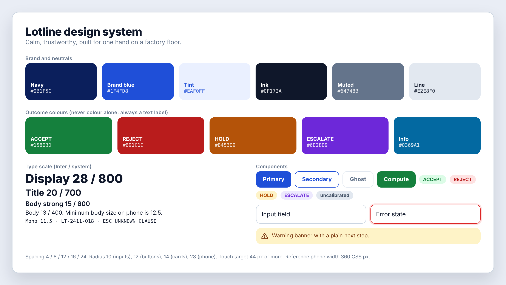

## 1. Design goals

| Goal | What it means on screen |
|---|---|
| **Trustworthy** | Calm navy and blue palette, plain words, no hype. Every model score says *uncalibrated*. |
| **One-hand, on the floor** | 360 px phone-first layout. Primary actions sit in a sticky bar at the thumb. Touch targets are 44 px or more. |
| **Human stays in charge** | No "Confirm all". Severity is set by the buyer clause, never by the user or the AI. An empty detection list reads "No proposals. This is not a pass." |
| **Never a false pass** | Failures end in an error, HOLD or ESCALATE, never ACCEPT. |
| **Role-clear** | Users only see actions their role can do. The server still enforces every permission. |

## 2. Design tokens

### Colour

| Token | Hex | Use |
|---|---|---|
| Navy | `#0B1F5C` | App bar, headings on dark |
| Brand blue | `#1F4FD8` | Primary buttons, links, active tab |
| Tint | `#EAF0FF` | Selected rail item, read-back card |
| Ink / Muted / Line | `#0F172A` / `#64748B` / `#E2E8F0` | Text, secondary text, borders |
| ACCEPT | `#15803D` on `#DCFCE7` | Passed lot |
| REJECT | `#B91C1C` on `#FEE2E2` | Failed lot, errors |
| HOLD | `#B45309` on `#FEF3C7` | Rule cannot be applied yet |
| ESCALATE | `#6D28D9` on `#EDE9FE` | A person must decide |
| Info | `#0369A1` on `#E0F2FE` | Notes, assumptions |

Outcome colour is never the only signal. Each outcome also carries its text label.

### Type, spacing, shape
- **Font:** Inter, falling back to the system UI font. Mono for lot codes and reason codes.
- **Scale:** Display 28/800 · Title 20/700 · Body strong 15/600 · Body 13/400 · Caption 11.5. Minimum body size on phone is 12.5.
- **Spacing:** 4, 8, 12, 16, 24. **Radius:** 10 inputs, 12 buttons, 14 cards, 28 phone frame.
- **Reference width:** 360 CSS px, no horizontal scroll of primary content. Admin Panel is designed at 1120 px.

## 3. Navigation model

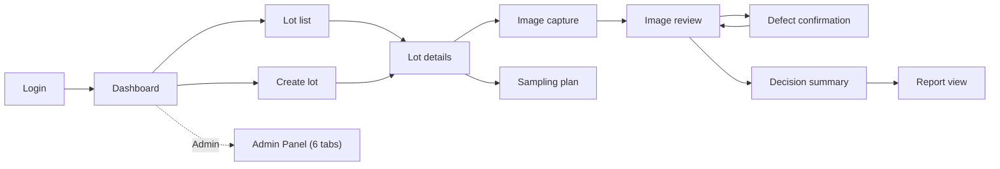

- **Phone bottom bar:** Home · Lots · New lot · Account (New lot hidden for Admin).
- **Admin Panel:** left rail with six tabs. The active tab is stored in the URL so a refresh keeps context.
- **Roles:** Admin lands on the Admin Panel. Inspector and Supervisor land on the Dashboard. Supervisor sees only the Audit tab, read-only, with no Export.

---

## 4. Screens

Screens 12 and 13 of the earlier map (User management, Audit log) now live inside the Admin Panel (screen 14), shown here as six tab views.

### 4.1 Login
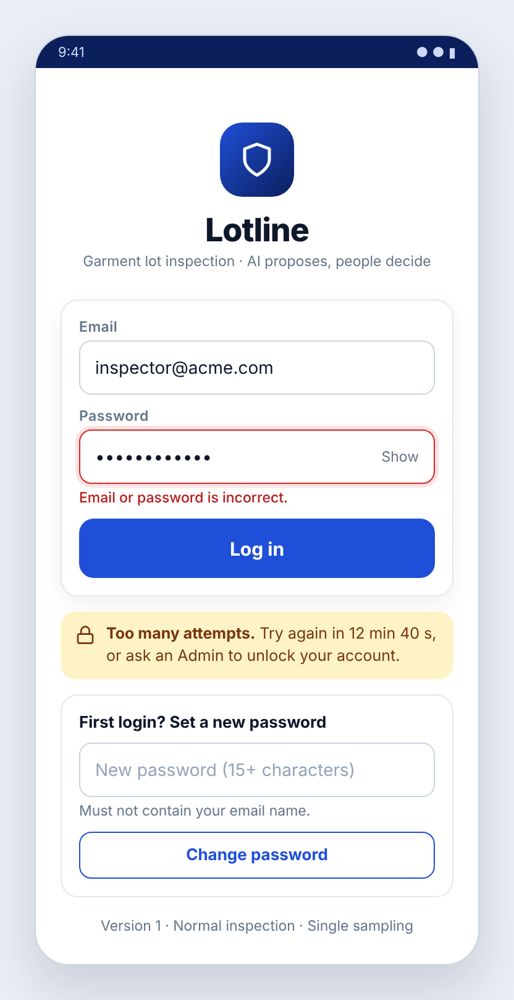

- Generic error for unknown email, wrong password or disabled account, with identical wording.
- Lock message shows remaining time after 5 failures in 15 minutes.
- First-login users set a new password (15+ characters, no email name) before continuing.
- **Next:** Dashboard on success.

### 4.2 Dashboard
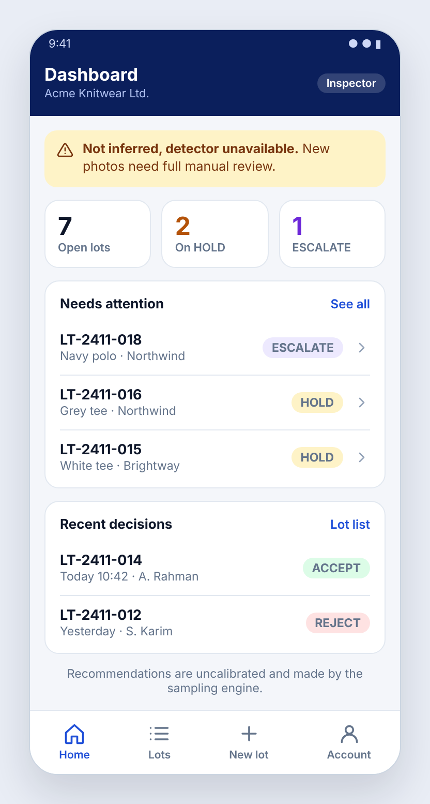

- Counts of open, HOLD and ESCALATE lots, then a "Needs attention" list and recent decisions.
- Detector-down banner reads "Not inferred, detector unavailable." Admin also sees alerts for low disk, backup failure, audit-chain mismatch and login-failure spikes.
- Empty state: "No lots yet" with a Create lot button.

### 4.3 Lot list
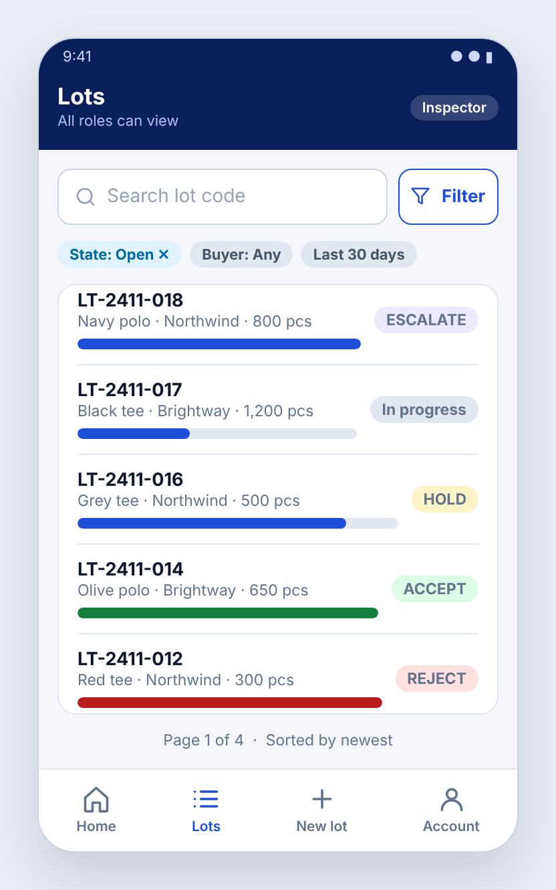

- Search, filter chips (state, buyer, outcome, date), sort and pagination.
- Each row shows the sample progress bar and an outcome chip.
- Invalid filter or sort values return a 422 with plain guidance. Empty state: "No lots match."

### 4.4 Create lot
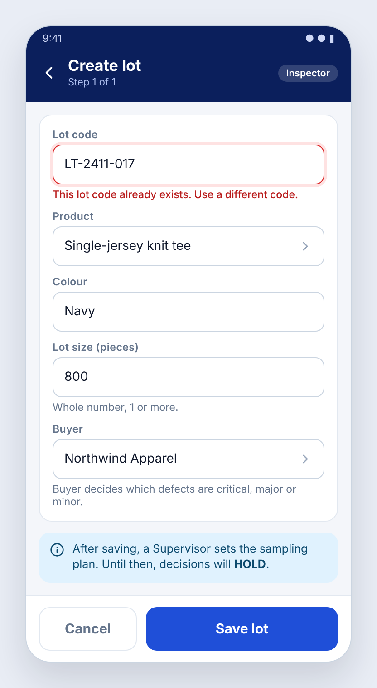

- Fields: lot code, product, colour, lot size (whole number, 1 or more), buyer.
- Inline errors for a duplicate code. If no product or buyer exists, ask an Admin or Supervisor.
- A note explains that decisions HOLD until a Supervisor sets the sampling plan.

### 4.5 Lot details (control center)
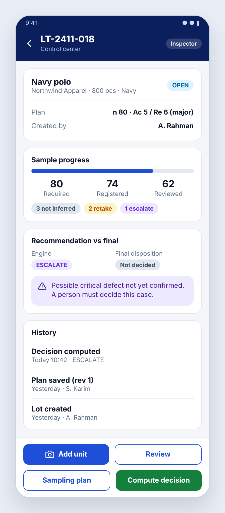

- Header, plan summary, sample progress (required, registered, reviewed) and status chips (not inferred, retake, escalate).
- Engine recommendation and final disposition are always shown side by side.
- Sticky actions: Add unit, Review, Sampling plan, Compute decision. A 409 prompts a reload on stale data.

### 4.6 Sampling plan configuration
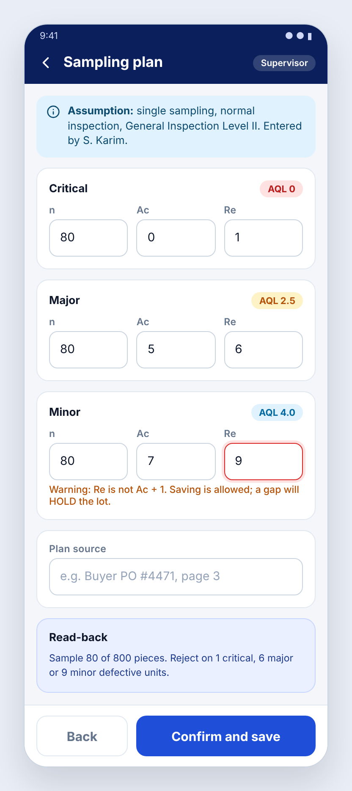

- Per-class `n`, `Ac`, `Re` with the assumption label always visible.
- Warnings, not blocks: `Re` is not `Ac + 1`, `n` differs across classes, `n` is at least the lot size (whole lot).
- A read-back summary must be confirmed. Locked after a decision. Inspectors see it read-only.

### 4.7 Image capture and upload
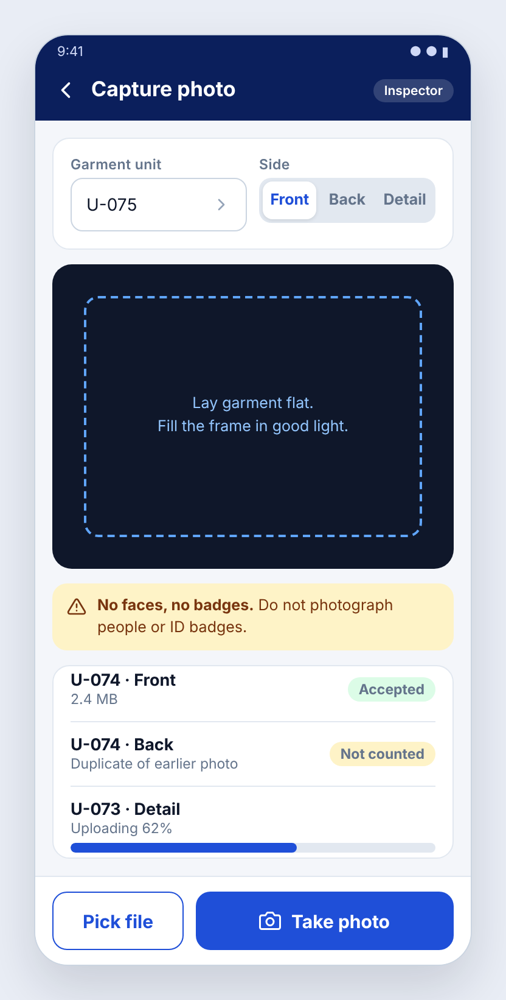

- Unit picker, side picker (front, back, detail), camera or file picker.
- A permanent "No faces, no badges" banner.
- Per-file result chips: accepted, duplicate (not counted), rejected with reason. Rate-limit and disk-full messages are plain words.

### 4.8 Image review
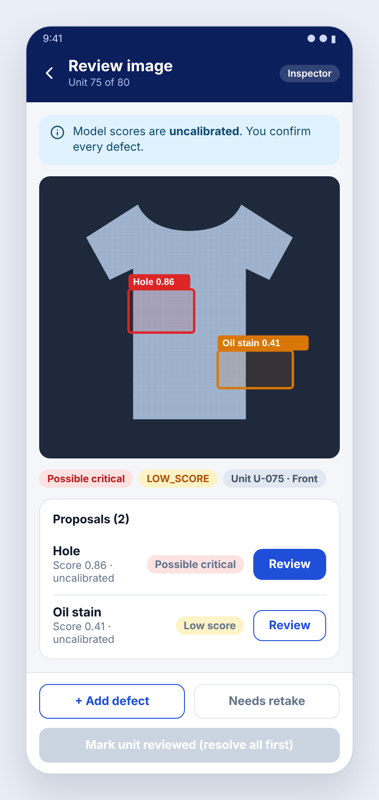

- Photo with box overlay, touch zoom, proposal list with **uncalibrated** scores and flags (BLUR, DARK, LOW_SCORE, UNKNOWN, possible critical).
- "Mark unit reviewed" stays disabled, with the reason, until every proposal is resolved.
- One proposal at a time. No bulk confirm.

### 4.9 Defect confirmation
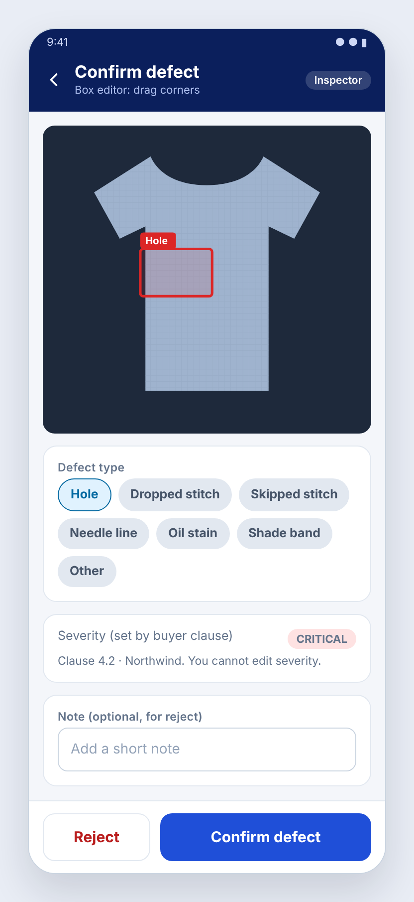

- Fixed type list: hole, dropped stitch, skipped stitch, needle line, oil stain, shade band, other.
- Severity is shown, set from the buyer clause, and is not editable. No clause means "A person must decide" (ESCALATE).
- Reject accepts an optional note. Rejecting a critical-mapped proposal escalates the lot.

### 4.10 Decision summary
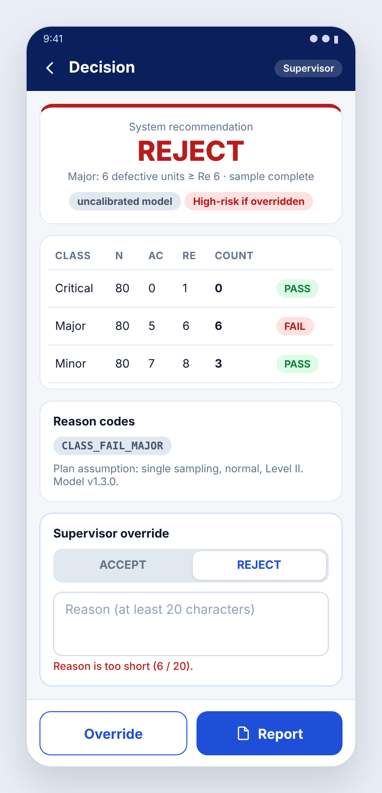

- Large outcome, per-class table (`n`, `Ac`, `Re`, count, PASS/FAIL/GAP), reason codes, plan assumption, model version and the **uncalibrated** label.
- Supervisor override: choose outcome and give a reason of at least 20 characters. High-risk overrides get a badge.
- Precedence: ESCALATE over HOLD over ACCEPT/REJECT.

### 4.11 Report view
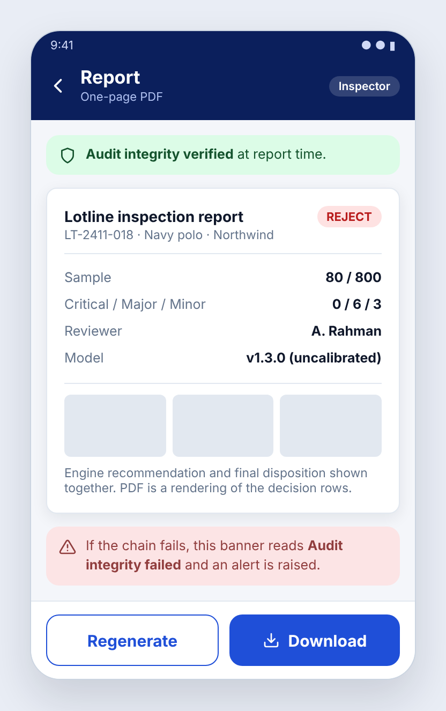

- One-page PDF preview with download. Integrity banner turns red with "Audit integrity failed" if the chain check fails.
- Inspector generates for own lots, Supervisor for any. Admin can view and download only.

### 4.12 Admin Panel · Users
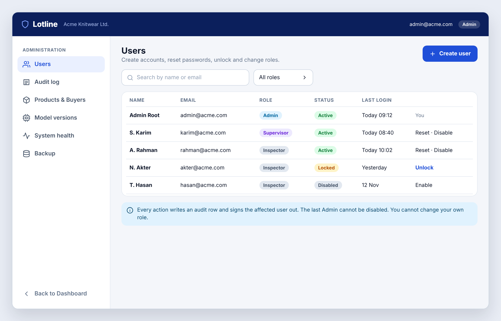

- Create, reset password, unlock, disable or enable, change role. Last Admin is protected and own-role change is blocked.
- Each action writes an audit row and signs the affected user out.

### 4.13 Admin Panel · Audit log
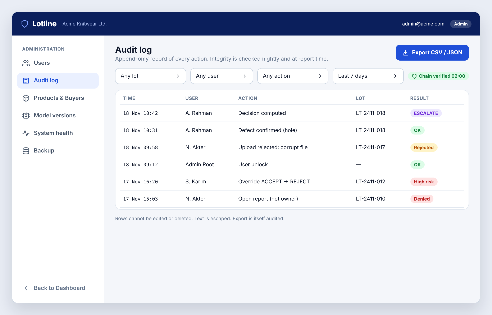

- Filter by lot, user, action and date. Integrity status is shown at the top. Denied attempts are visible.
- Export (Admin only) is itself audited. Supervisor sees this tab read-only without Export.

### 4.14 Admin Panel · Products & Buyers
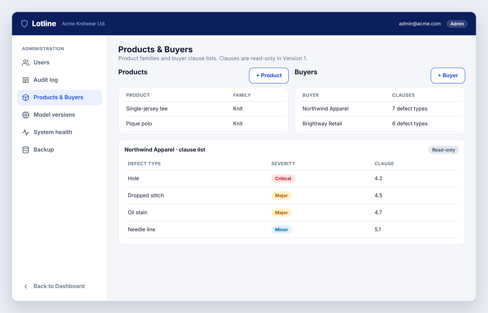

- Product and buyer records. Each buyer carries a clause list that drives severity. Clause list is read-only in Version 1.

### 4.15 Admin Panel · Model versions
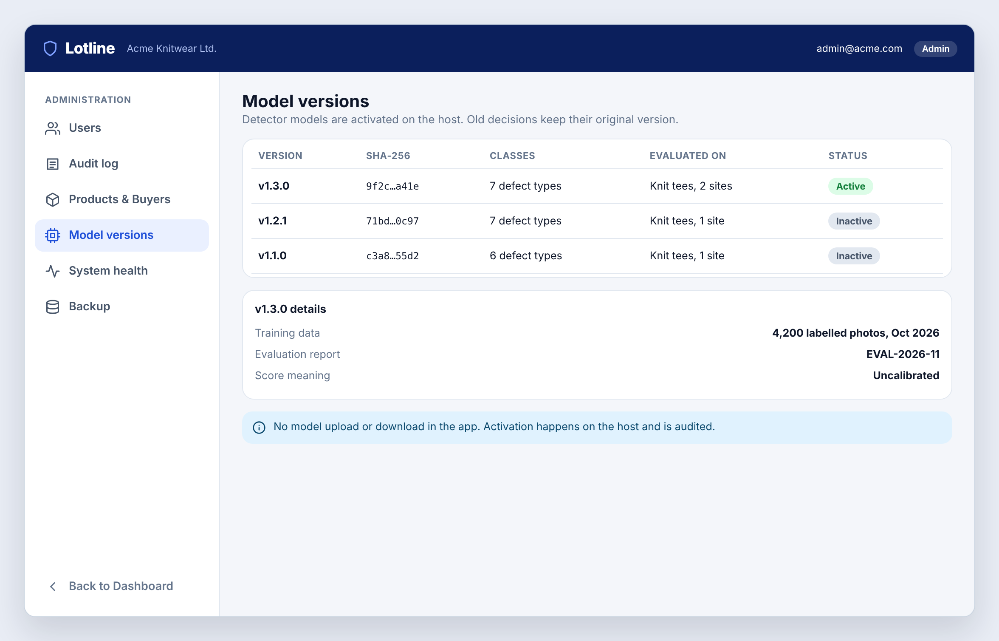

- Version, SHA-256, classes, evaluation domain and status. Activation happens on the host and is audited.
- Old decisions keep their original model version. No upload or download in the app.

### 4.16 Admin Panel · System health
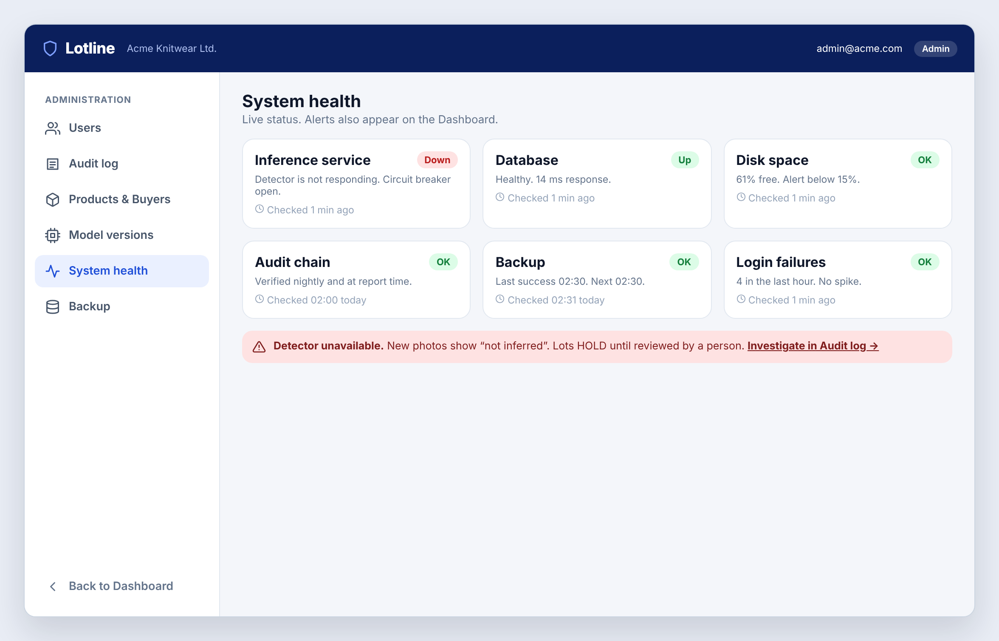

- Cards for inference, database, disk, audit chain, backup and login failures, each with a one-line status and last-checked time.
- Alerts link to the Audit tab and also appear on the Dashboard.

### 4.17 Admin Panel · Backup
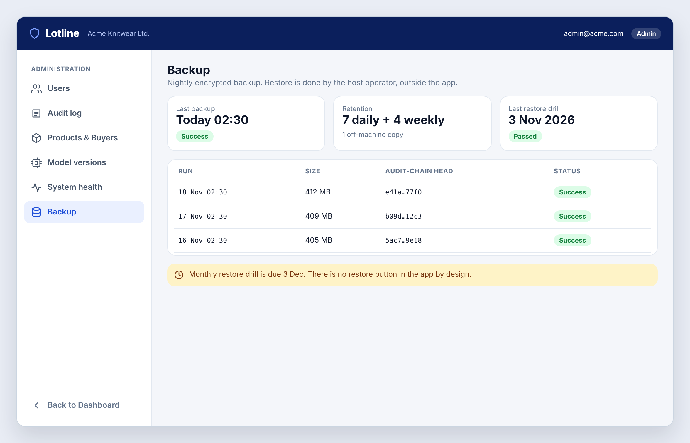

- Last run, retention (7 daily + 4 weekly, one off-machine copy), manifest with audit-chain head and last restore drill.
- There is no restore button in the app. Restore is a host-operator action.

---

## 5. Components

| Component | Rules |
|---|---|
| **Outcome chip** | ACCEPT green, REJECT red, HOLD amber, ESCALATE purple. Always text plus colour. |
| **Banner** | Warn, info, error, ok. Plain words plus one next step. No stack traces. Show request ID on errors. |
| **Sticky action bar** | Max two rows. Primary action on the right, destructive actions never primary. |
| **Input** | 44 px high, label above, help or error text below. |
| **Progress bar** | Blue for in progress, green for accepted, red for rejected. |
| **Table** | Phone: card rows. Desktop: sortable header, 10 px cell padding. |

## 6. States every screen must cover

| State | Treatment |
|---|---|
| Loading | Skeleton blocks, spinner on submit |
| Empty | Friendly sentence plus the next action |
| Error | Plain words, next step, request ID |
| Blocked action | Disabled button with the reason shown beside it |
| Stale data | 409 "Reload" prompt |
| Detector down | "Not inferred" banner, lots HOLD, never a clean pass |

## 7. Mandatory labels

1. **Plan shown:** "single sampling, normal inspection, General Inspection Level II; critical AQL 0 → Ac 0 / Re 1; major 2.5; minor 4.0. Entered by *user*."
2. **Model score shown:** the word **uncalibrated**. Never "calibrated", "conformal" or "ISO-compliant AI".
3. **Empty detection list:** "No proposals. This is not a pass."
4. **Failure shown:** plain words, next step, request ID.

## 8. Never do

- Never express an AQL as a percentage allowance.
- Never show "no defects" for an empty detection list.
- Never let a client set severity, reviewer, organization, counts or model version.
- Never offer an early REJECT before the sample is complete.
- Never bulk-confirm defects. Never edit or delete audit rows.
- Never reproduce an ISO 2859-1 / Z1.4 table.

## 9. Accessibility and responsive rules

- Contrast of 4.5:1 or better for text. Outcome never relies on colour alone.
- No hover-only controls. Focus rings on every control. Labels linked to inputs.
- Touch zoom and box placement on the review screen. All stored text is HTML-escaped.
- Breakpoints: **360** phone (reference), **768** tablet (two-column lot details), **1120** desktop (Admin Panel rail layout).

## 10. Build order and handoff

1. Lock reference phone width and supported browsers (OQ-14).
2. Build in the Inspector happy-path order: Login → Dashboard → Create lot → Lot details → Image capture → Image review → Defect confirmation → Decision summary → Report view.
3. Layer on Supervisor screens (Sampling plan, override panel) and the Admin Panel tabs.
4. Use section 3 as the navigation spec, the Flow Map's W-01 to W-16 as the interaction spec and its section 6.3 as the error-state spec.
5. Confirm open questions that touch UI: OQ-08 (image deletion vs withdrawal), OQ-11 (can an override choose HOLD), OQ-14 (language, browsers, accessibility level), OQ-17 (minimum images per unit).

> The images are design mockups of the specification. Sample data (lot codes, names) is illustrative only.